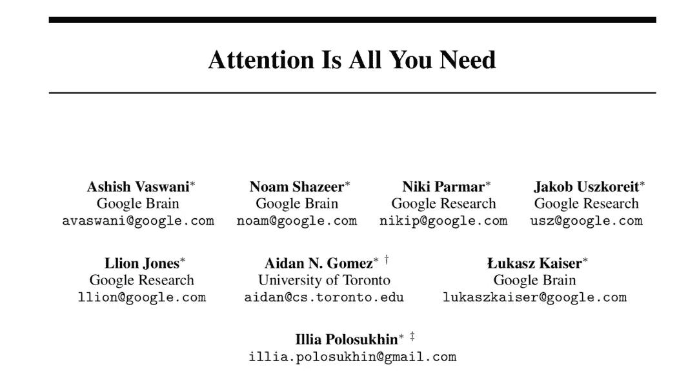
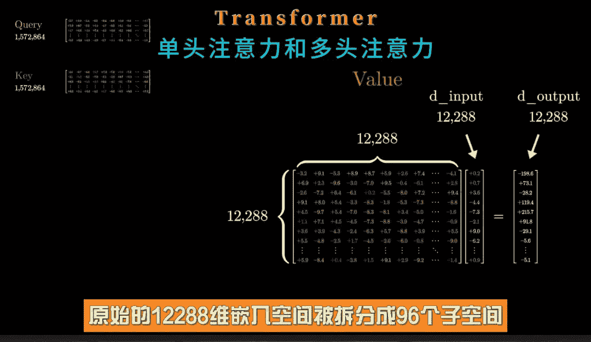
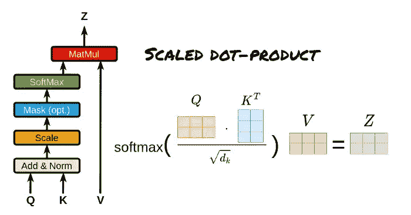
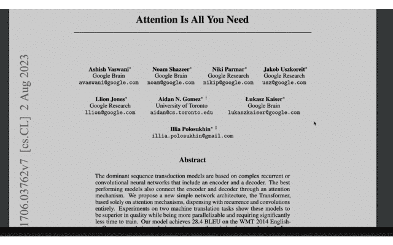
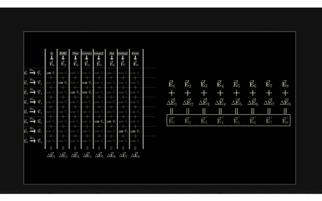

# Transformer动画讲解 - 单头注意力和多头注意力

> 来源：[https://geekbang.feishu.cn/docx/UIybdbuBhov1FFxlmOecmsKInLe](https://geekbang.feishu.cn/docx/UIybdbuBhov1FFxlmOecmsKInLe)

> 👨🏻 作者：AllenTang

> 📃 作者介绍：分享人工智能，让所有人玩转AI

> 🛖 公众号：架构师带你玩转AI

> ⏰ 收录时间：2024-05-23 11:28:42

> 🔗 原文链接：h[ttps://mp.weixin.q](https://mp.weixin.qq.com/s/6j9SdJYCn6mVpic3suqakA)q.com/s/6j9SdJYC...

关注作者公众号，获取更多AI知识

**动画地址：查看原文，可看动画**

**T**ransformer的起源： Google Brain 翻译团队通过论文《Attention is all you need》 提出了一种全新的简单网络架构— — Transformer，它完全基于注意力机制，摒弃了循环和卷积操作。

**注意力机制是全部所需**

**正**如论文标题所言“注意力机制是全部所需”，强调了注意力机制是Transformer架构的核心要素，就如同人的心脏一样，充当着发动机的作用。

**那么单头注意力和多头注意力到底是什么？它们两者有哪些**联系和区别？让我们一起跟着动画来解读吧。

**单头注意力和多头注意力 **

神经网络算法 - 一文搞懂Transformer

Transformer动画讲解 - 注意力机制

**单头注意力： **通过生成查询、键和值向量，计算并归一化注意力分数，最终对值向量进行加权求和，从而得到输入序列中每个位置的加权表示。

**单头注意力**

**单头注意力机制的工作流程如下：**

1.  生成查询、键和值 ： 接收一个由嵌入向量组成的输入序列。 使用三个不同的线性变换（或称为全连接层）将输入序列分别映射为查询（Q）、键（K）和值（V）向量。

1.  计算注意力分数 ： 计算查询向量与所有键向量之间的点积，得到注意力分数矩阵。 这些分数反映了查询与序列中每个位置的相关性。

1.  缩放注意力分数 ： 为防止点积结果过大导致softmax进入饱和区，可以将注意力分数除以一个缩放因子（通常是键向量维度的平方根）。

1.  归一化注意力分数 ： 应用softmax函数对注意力分数矩阵进行归一化，得到注意力权重矩阵。 归一化后的权重矩阵每行之和为1，表示序列中每个位置的注意力权重。

1.  加权求和 ： 使用归一化后的注意力权重对值向量进行加权求和。 加权求和的结果是自注意力机制的输出，它包含了根据注意力权重对输入序列中所有位置信息的加权整合。

**单头注意力工作流程**

Transformer动画讲解 - 注意力计算Q、K、V

### **多头注意力： ****通过**将输入的查询、键和值矩阵分割成多个头，并在每个头中独立计算注意力，再将这些头的输出拼接并线性变换，从而实现在不同表示子空间中同时捕获和整合多种交互信息，提升模型的表达能力。

**多头注意力机制工作流程如下：**

1.  初始化参数 ：首先，初始化查询（Q）、键（K）、值（V）矩阵的权重以及多头注意力中的头数（h）。这些权重将用于后续的线性变换。

1.  线性变换 ：对输入的查询、键和值矩阵进行线性变换，生成各自的变换矩阵。这些变换是通过将输入矩阵与相应的权重矩阵相乘来实现的。

1.  分割 ：将线性变换后的查询、键和值矩阵沿着深度（通常是最后一个维度）分割成多个头（h个）。每个头都会得到自己独立的查询、键和值矩阵。

1.  多头并行计算 ：在每个头中独立地执行 注意力得分来计算加权求和 。

1.  拼接 ：将所有头的输出矩阵沿着深度维度拼接在一起，形成一个大的输出矩阵。

1.  最终线性变换 ：对拼接后的输出矩阵进行线性变换，得到多头注意力的最终输出。这个线性变换通常包括一个可学习的权重矩阵和一个偏置项。

1.  残差连接与层归一化 ：多头注意力模块通常会与残差连接和层归一化一起使用，以提高模型的训练稳定性和性能。

**多头注意力工作流程 **

大模型开发 - 一文搞懂Transformer工作原理

### **两者的联系和区别： **两者在基本原理和目的上是相似的，但在注意力头的数量、信息捕捉与表达能力、计算复杂度与训练难度以及输出结果等方面存在显著的差异。

### 这些差异使得多头注意力在处理复杂任务时通常具有更好的性能。

### **两者的联系：**

1.  基本原理 ：两者都基于注意力机制，通过计算查询（Query）、键（Key）和值（Value）之间的相似度来确定输入的加权表示。

1.  目的 ：都是为了让模型能够关注到输入序列中重要的信息，从而提高模型的性能。

### 两者的区别：

1.  注意力头的数量 ：

+   单头注意力 ：只有一个注意力头，即只计算一次查询、键和值之间的相似度。

+   多头注意力 ：拥有多个独立的注意力头，每个头都会独立地计算查询、键和值之间的相似度。 这允许模型同时关注输入序列的不同部分。

1.  信息捕捉与表达能力 ：

+   单头注意力 ：只能关注一个方面，信息捕捉能力有限。

+   多头注意力 ：通过多个头的并行处理，能够捕捉到更多样化的**特征，提高了模型的表达能力和泛化性能。 这**种机制使得多头注意力能够关注到句子更多层面的信息，例如罕见词、多义词、反义词等。

1.  计算复杂度与训练难度 ：

+   单头注意力 ：计算复杂度相对较低，训练也较为简单。

+   多头注意力 ：虽然增加了计算复杂度，但通常可以通过并行计算来优化。同时，它也需要更多的训练数据和计算资源来优化模型。 然而，这些额外的投入通常能够带来模型性能的显著提升。

1.  输出结果 ：

+   单头注意力 ：直接输出一个加权表示。

+   多头注意力 ：每个头都会输出一个加权表示，然后将这些表示拼接在一起，并经过一个额外的线性变换，得到最终的输出。

**单头注意力和多头注意力**

[**神经网络算法 - 一文搞懂Self-Attention和**](http://mp.weixin.qq.com/s?__biz=MzkzMTEzMzI5Ng==&mid=2247485973&idx=1&sn=79be10a2fccf09e5fac2cb5cc6be5810&chksm=c26ee80af519611c0eaf666a17a9ab161ba9071d3cd16647e28a3ef5c5db955b94caddee08c9&scene=21#wechat_redirect)Multi-Head Attention

###

** **

****注释****

**Transformer动画素材来源于 3Blue1**Brown，想了解更多查看参考资料网址。

**3B**lue1Brown 是一个由 Grant Sanderson 创建的YouTube 频道。这个频道从独特的视觉角度解说高等数学，内容包括线性代数、微积分、人工神经网络、黎曼猜想、傅里叶变换以及四元数等。

**Grant Sanderson **毕业于斯坦福大学，并获得了数学学士学位。

**参考资料**

+   https://www.3blue1brown.com/

+   https://www.3blue1brown.com/lessons/attention

+   《Attention Is All You Need》