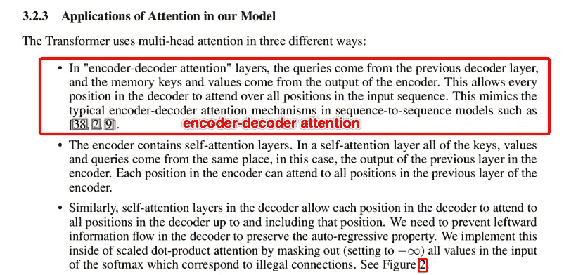
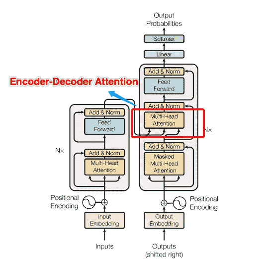
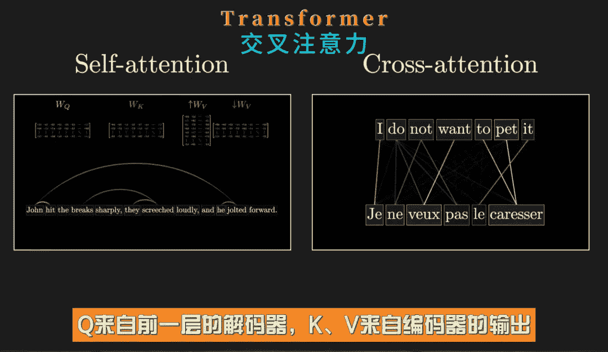
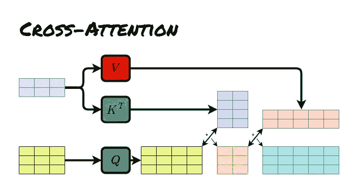
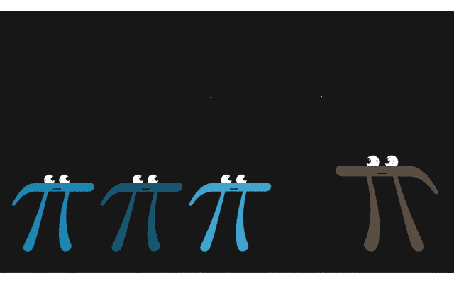

# Transformer动画讲解 - Cross Attention

> 来源：[https://geekbang.feishu.cn/docx/RCYCdCasQoCK2bxuLKrcWRjynIe](https://geekbang.feishu.cn/docx/RCYCdCasQoCK2bxuLKrcWRjynIe)

> 👨🏻 作者：AllenTang

> 📃 作者介绍：分享人工智能，让所有人玩转AI

> 🛖 👸号：架构师带你玩转AI

> ⏰ 收录时间：2024-05-23 11:28:42

> 🔗 原文链接：h[ttps://mp.weixin.q](https://mp.weixin.qq.com/s/YipnF9zCBRzL4-bLkLOb7Q)q.com/s/YipnF9zC...

关注作者👸号，获取更多AI知识

**动画地址：查看原文，可看动画**

**编码器-解码器注意力 ： ****在“**编码器-解码器注意力”层中，查询来自前一层解码器，而记忆键和值则来自编码器的输出。这使得解码器中的每个位置都能关注输入序列中的所有位置。这模仿了序列到序列模型中典型的编码器-解码器注意力机制。

**（1）论文中对于编码器-解码器注意力的描述，让我们初步了解Encoder-D**ecoder Attention的Q来自前一层的解码器，K、V来自编码器的输出。

**编码器-解码器注意力**

Transformer动画讲解 - 注意力机制

Transformer动画讲解 - 注意力计算Q、K、V

**（**2）当我们想深入了解，回到Transformer的架构图时，估计又懵逼了，怎么又变成Muti-Head Attention？

**Transformer架构图**

[**神经网络算法 - 一文搞懂Self-Attention和**](http://mp.weixin.qq.com/s?__biz=MzkzMTEzMzI5Ng==&mid=2247485973&idx=1&sn=79be10a2fccf09e5fac2cb5cc6be5810&chksm=c26ee80af519611c0eaf666a17a9ab161ba9071d3cd16647e28a3ef5c5db955b94caddee08c9&scene=21#wechat_redirect)Multi-Head Attention

Transformer动画讲解 - 单头注意力和多头注意力

**（3**）新手的疑问：架构图中明明是Multi-Head Attention，论文中的描述又变为Encoder-Decoder Attention，怎么又冒出一个新名词Cross Attention？

编码器-解码器的Cross Attention

神经网络算法 - 一文搞懂Transformer中的三种注意力机制

**C**ross Attention： 交叉注意力的 输入来自两个不同的序列， 一个序列用作查询（Q），另一个序列提供键（K）和值（V），实现跨序列的交互。

**Cross Attention**

**Se**lf Attention vs Cross Attention： Self Attention更适用于处理单个序列，而Cross Attention则更适用于处理多个序列之间的交互。

+   **输入来源： **

1.  Se**lf Attent****ion：** 其 输入来自同一序列 ，即查询（Q）、键（K）和值（V）都来自 编码器 。这种机制关注于序列内部元素之间的关联。

1.  Cross Attent**ion： 其**输入来自不同的序列。** 解码器序列** 作为查询（Q），而 编码器序列 作为键（K）和值（V）。这种机制关注于不同序列之间的元素关联。

+   **应用场景：**

1.  **Self Attention： 在自**然语言处理任务中尤为常见，如语言建模、文本分类等。由于 它关注的是序列内部元素之间的关联，因此特别适用于处理单个序列，如句子或段落。

1.  Cross Attention： 在自然语言处理、计算机视觉等领域都有应用，如机器翻译、图像描述生成等。 它允许模型关注不同序列之间的元素关联，从而能够处理多个序列之间的交互。

+   **作用机制：**

1.  Self** **Attention： 通过对 序列中的每个元素（如词或图像patch）生成一个表示，并使用这个表示作为查询去关注序列中的其他元素，从而计算出一个新的表示。 这个过程有助于捕捉序列内部的依赖关系。

1.  Cr**oss Attention： 在 **两个序列之间建立关联，一个序列的元素作为查询去关注另一个序列中的所有元素 。这种机制允许模型在翻译或生成任务中关注源序列和目标序列之间的对应关系。

Self Attention vs Cross Attention

**Cro**ss Attention应用机器翻译： 在机器翻译等序列到序列（Seq2Seq）的任务中，交叉注意力机制允许解码器在生成输出的每一步中，都能关注到输入序列中与当前步最相关的信息，从而生成更准确的输出。这种机制大大提高了Seq2Seq模型的性能，特别是在处理长序列和复杂依赖关系时。

1.  准备输入数据 ：

1.  通常有两个不同的输入序列，我们称之为源序列（Source Sequence）和目标序列（Target Sequence）。在机器翻译任务中，源序列可以是原文，而目标序列可以是译文的部分或全部。

1.  生成查询（Query）、键（Key）和值（Value） ：

1.  对于交叉注意力，查询（Q）通常来自目标序列的某个元素或元素的表示。

1.  键（K）和值（V）则来自源序列的元素或元素的表示。

1.  这些表示通常是通过嵌入层（Embedding Layer）或者经过某种形式的编码器（Encoder）得到的。

1.  计算注意力得分 ：

1.  对于每一个目标序列中的查询（Q），计算它与源序列中所有键（K）的相似度或相关性得分。这通常通过点积、加性注意力或缩放点积等方式实现。

1.  归一化注意力得分 ：

1.  使用Softmax函数将得分转换成概率分布，这样每个源序列中的键（K）都会有一个与之对应的权重。

1.  计算加权和 ：

1.  使用上一步得到的权重对源序列中的值（V）进行加权求和，得到一个加权表示（也称为上下文向量）。

1.  输出上下文向量 ：

1.  这个加权表示（上下文向量）捕捉了源序列中与目标序列查询最相关的信息，并将其作为交叉注意力的输出。

1.  使用上下文向量 ：

1.  这个上下文向量随后可以被用于目标序列的下一个处理步骤，例如在解码器（Decoder）中用于生成下一个词或预测下一个状态。

Cross Attention应用机器翻译

** **

****注释****

**Transformer动画素材来源于 3Blue1**Brown，想了解更多查看参考资料网址。

**3B**lue1Brown 是一个由 Grant Sanderson 创建的YouTube 频道。这个频道从独特的视觉角度解说高等数学，内容包括线性代数、微积分、人工神经网络、黎曼猜想、傅里叶变换以及四元数等。

**Grant Sanderson **毕业于斯坦福大学，并获得了数学学士学位。

**参考资料**

+   https://www.3blue1brown.com/

+   https://www.3blue1brown.com/lessons/attention

+   《Attention Is All You Need》