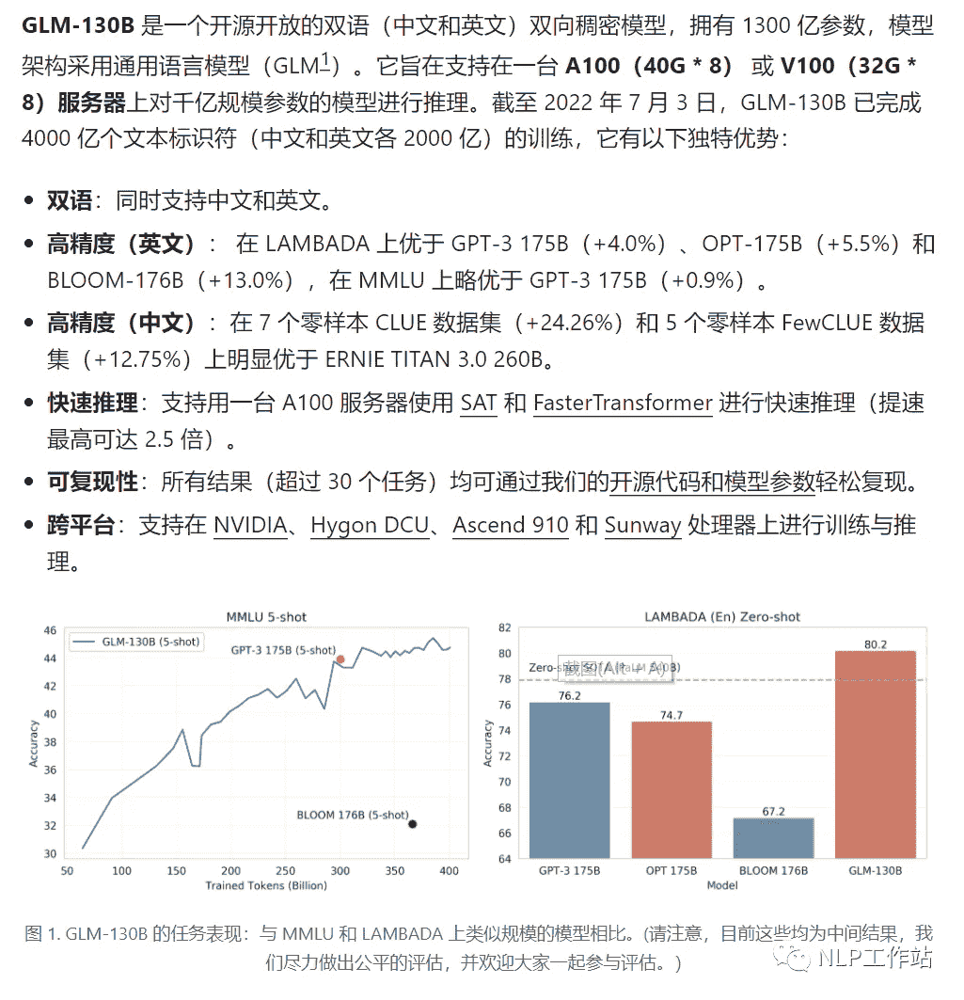
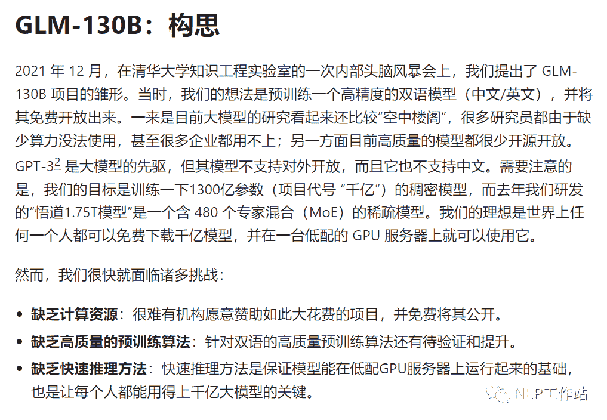
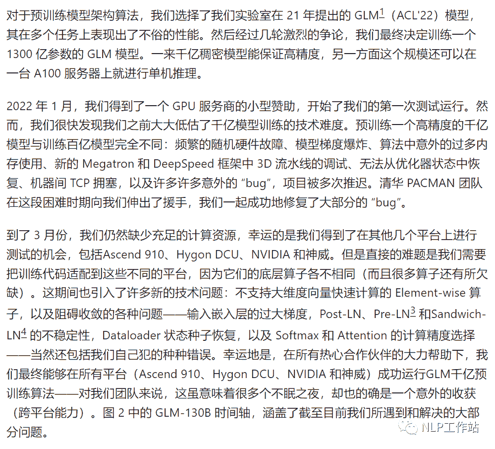
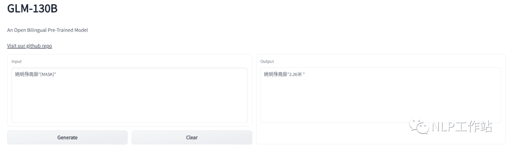
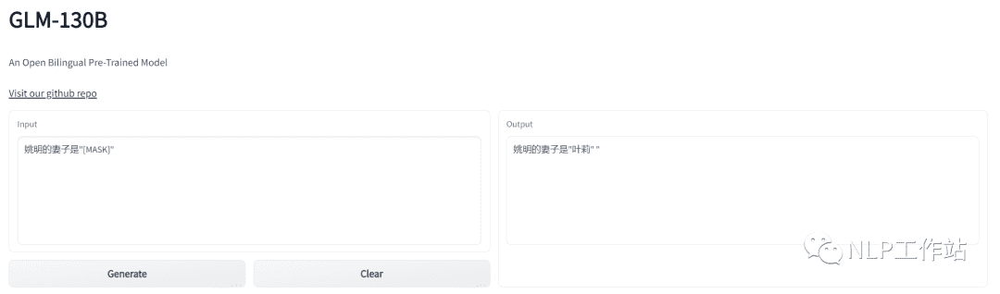
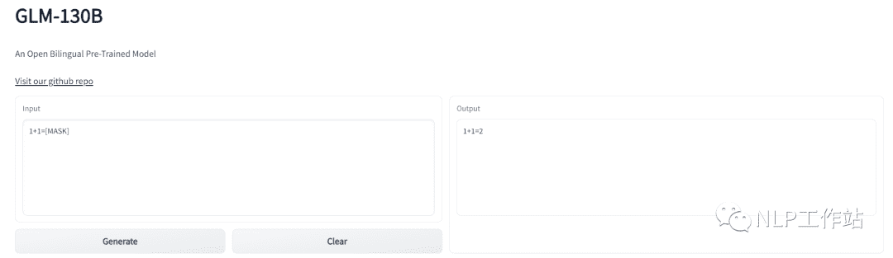
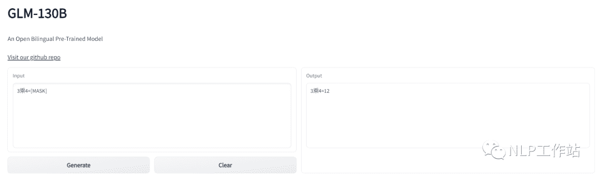
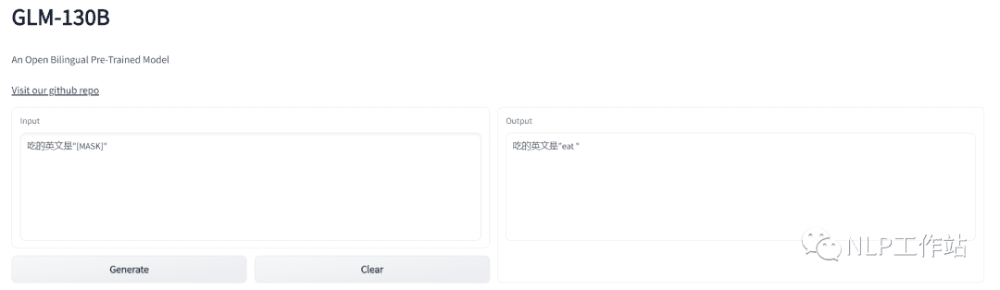
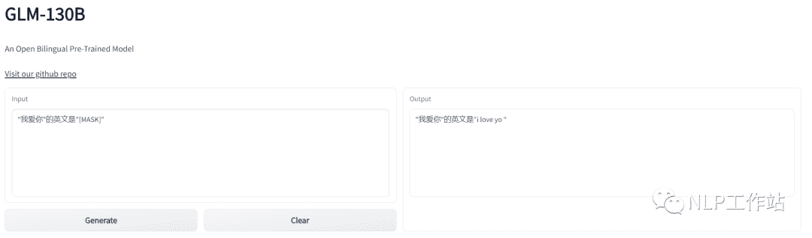

# 清华开源了1300亿开源的双语预训练模型-GLM-130B

> 来源：[https://geekbang.feishu.cn/docx/AyfxdUyuRoQu95xdNUkchDiwnKc](https://geekbang.feishu.cn/docx/AyfxdUyuRoQu95xdNUkchDiwnKc)

> 👨🏻 作者：刘聪NLP

> 📃 作者介绍：AIGC前沿知识分享&落地经验总结

> 🛖 知乎主页：https://www.zhihu.com/people/LiuCongNLP

> ⏰ 收录时间：2024-05-23 11:28:42

> 🔗 原文链接：h[ttps://mp.weixin.q](https://mp.weixin.qq.com/s/Qu0rzA2OatLjuEp9zAYegA)q.com/s/Qu0rzA2O...


关注作者👸号，获取更多AI知识

## ** 写在前面**

大家好，我是刘聪NLP。

今天刷Github的时候，发现了清华的GLM-130B，共有1300亿个参数，包含中文和英文两种语言，并且在中文零样本任务上效果优于ERNIE-TITAN-3.0。自己简单测试了一波，发现还是有点东西的。

大家可以根据Demo链接自行测试。

```
github：https://github.com/THUDM/GLM-130B
demo：https://huggingface.co/spaces/hanyullai/GLM-130B
```

## ** 介绍**

网站自己有介绍，我直接图片贴过来了。







## ** 测试**

自己测试了问题，感觉还是有些东西的。当然也很多没测出来，下面粘了一些比较好的例子。q:姚明身高是"[MASK]"



q:姚明的妻子是"[MASK]"



q:1+1=[MASK]



q:3乘4=[MASK]



q:吃的英文是"[MASK]"



q:"我爱你"的英文是"[MASK]"



## ** 总结**

大模型虽好，但推理至少需要一台V100服务器（32G * 8），普通玩家真的玩不起，小公司可能举全公司之力，都拿不出一台这样的服务器。

往期推荐：

+   [**中文NER数据集整理**](https://mp.weixin.qq.com/s?__biz=Mzg5MTU1NTE1OQ==&mid=2247485888&idx=1&sn=1bf97e1c9e59e66e7359aa388ab3eeeb&scene=21#wechat_redirect)

+   [**ACL2022|NoisyTune：**](https://mp.weixin.qq.com/s?__biz=Mzg5MTU1NTE1OQ==&mid=2247485803&idx=1&sn=5acb654c6fa67a5f041d60461037eda3&scene=21#wechat_redirect)微调前加入少量噪音可能会有意想不到的效果

+   ACL2022论文分类汇总-Prompt、句子表征、检索排序&摘要

+   总结|Prompt在NER场景的应用

+   NAACL2022-Prompt相关论文&对Prompt的看法

+   PolyLoss：一种将分类损失函数加入泰勒展开式的损失函数

+   PERT：一种基于乱序语言模型的预训练模型

+   DiffCSE：结合句子间差异的无监督句子嵌入对比学习方法

+   PairSCL：句子对级别的有监督对比学习方法

+   OpenAI：基于对比学习的预训练文本&代码表征技术

+   SNCSE：一种基于软负例的无监督句向量对比学习方法

+   [**SimCSE论文精读**](https://mp.weixin.qq.com/s?__biz=Mzg5MTU1NTE1OQ==&mid=2247485339&idx=1&sn=eb7610691295d933fded48f9e06fc8d7&scene=21#wechat_redirect)