# Llama2技术细节&开源影响

> 来源：[https://geekbang.feishu.cn/docx/H2ApdbYyDoIzYCxx2FrcpCGZn1f](https://geekbang.feishu.cn/docx/H2ApdbYyDoIzYCxx2FrcpCGZn1f)

> 👨🏻 作者：刘聪NLP

> 📃 作者介绍：AIGC前沿知识分享&落地经验总结

> 🛖 知乎主页：https://www.zhihu.com/people/LiuCongNLP

> ⏰ 收录时间：2024-05-23 11:28:42

> 🔗 原文链接：h[ttps://mp.weixin.q](https://mp.weixin.qq.com/s/rHJkJw9TFGaAR8bWDM5wmg)q.com/s/rHJkJw9T...

关注作者公众号，获取更多AI知识

## ** 写在前面**

大家好，我是刘聪NLP。

昨天MetaAI开源了Llama2模型，我只想说一句：“ 「MetaAI改名叫OpenAI吧！」 ”

Llama2不仅开源了预训练模型，而且还开源了利用对话数据SFT后的Llama2-Chat模型，并对Llama2-Chat模型的微调进行了详细的介绍。

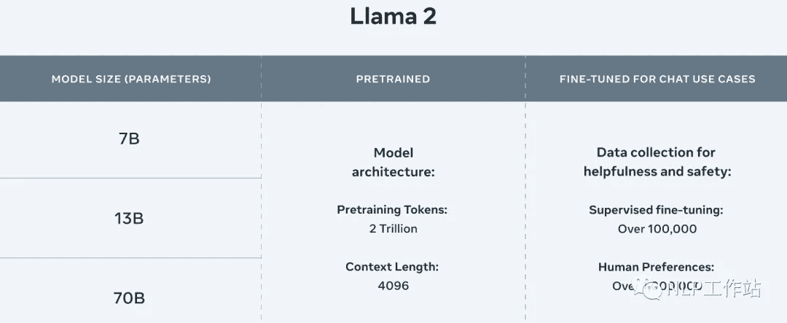

开源模型目前有7B、13B、70B三种尺寸，预训练阶段使用了2万亿Token，SFT阶段使用了超过10w数据，人类偏好数据超过100w。

非常自信的MetaAI。啥也不说，上来先show一副评估对比图，我就问OpenAI你服不服，skr。

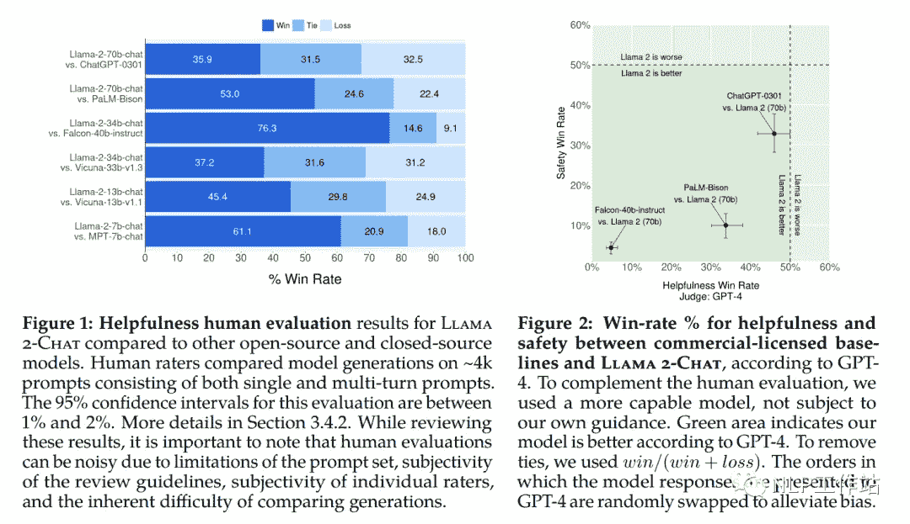

等等党不用着急，虽然中文占比只有0.13%，但后续会有一大推中文扩充词表预训练&领域数据微调的模型被国人放出。

这不Github一搜，已经有很多人占坑了，这是“有卡者的胜利”。

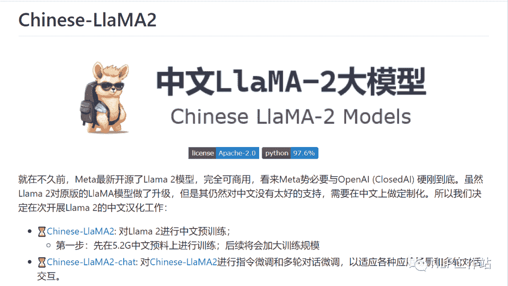

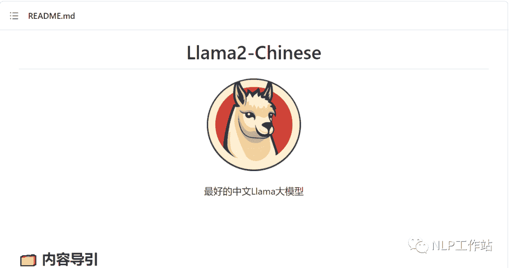

下面简要记录Llama2的技术细节。

## ** 预训练阶段**

模型结构为Transformer结构，与Llama相同的是采用RMSNorm归一化、SwiGLU激活函数、RoPE位置嵌入、词表的构建与大小，与Llama不同的是增加GQA（分组查询注意力），扩增了模型输入最大长度，语料库增加了40%。

训练超参数如下：AdamW优化器的β1、β2和eps分别为0.9、0.95和10e-5，采用cosin学习率，预热2000步后进行学习率衰减，最终降至峰值的10%，权重衰减系数为0.1，梯度裁剪值为1.0。

但请注意：7b和13b模型并没有增加GQA！！！

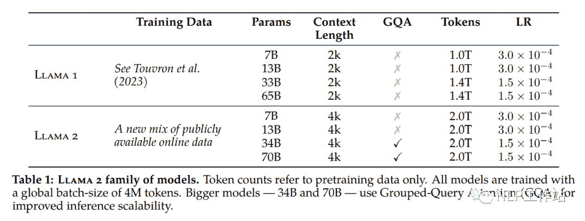

预训练阶段的损失如下图所示，可以看出，模型其实还没有完全收敛。

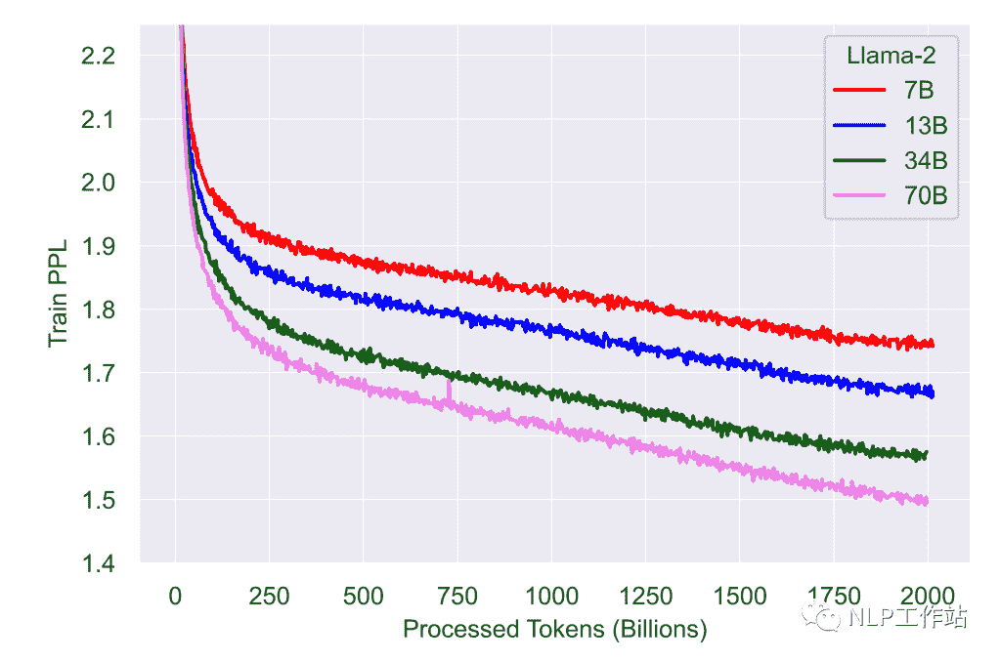

预训练模型效果一句话总结： **「开源第一，闭源一个没打过。」**

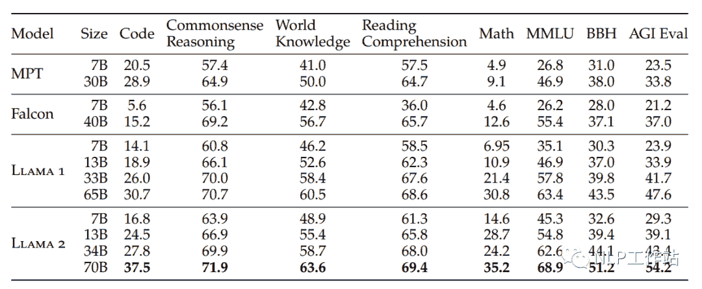

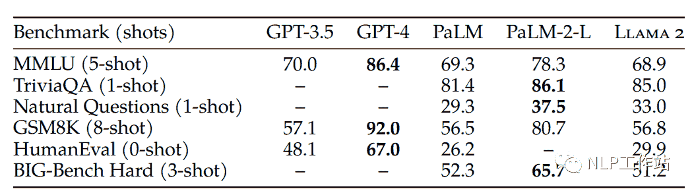

## ** 微调阶段**

上面预训练模型没打过你OpenAI没关系，你先等我全流程走完。

### ** SFT **

「Data Quality Is All You Need。」 MetaAI进行实验时发现，少量高质量数据集训练模型的效果，要好于大量低质量数据集的训练效果。因此以后SFT时候，不要一味地追求量，质更重要。

微调时初始学习率为2e−5，并采用余弦学习率下降，权重衰减为0.1，训练批次大小为64，最大长度为4096。为了提高模型训练效率，将多组数据进行拼接，尽量填满4096，每条数据直接用停止符隔开，计算loss时仅计算每条样本target内容的loss。

### ** RM **

对于人类偏好数据的收集，重点关注模型回复的有用性和安全性，通过选择对比两个模型结果获取；不过除了选择一个更好的结果之外，还需要对选择的答案标记偏好程度，例如：明显更好，更好，稍微更好、可以忽略地更好或者不确定。在安全性上，对两个结果会标记都符合安全性、只有一个复合安全性、都不符合安全性，以此收集安全性数据。

在模型迭代过程中，奖励模型所需的偏好数据，需要迭代收集，具体如下。

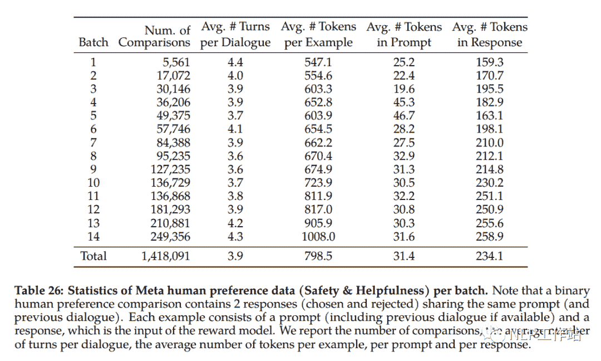

奖励模型是对提示生成的回复生成一个标量分值，评价模型生成质量，但发现有用性和安全性很难在同一个奖励模型表现都很好，因此，独立训练了两个奖励模型，一个针对有用性（helpfulness）进行了优化，另一个针对安全性（safety）进行了优化。

奖励模型的初始化来自于pretrained chat model检查点，将下一个Token预测分类器替换成标量奖励值回归器。训练时，采用带有边际约束的二元排序损失，如下：

边际约束开源提高奖励模型的准确性。并且为了奖励模型可以用有更好的泛化，防止出现奖励黑客现象（例如Llama2-Chat利用了奖励模型的弱点，在表现不佳的情况下夸大奖励分数），在奖励模型训练过程中，还加入了部分开源人类偏好数据。

训练参数设置：70B模型的最大学习率为5e−6，其余模型的最大学习率为1e−5，采用余弦学习率下降，最低到最大学习率的10%，并采用总步数的3%进行预热（最少5步），训练批次大小为1024。

不同奖励模型在不同数据上的效果如下表所示。

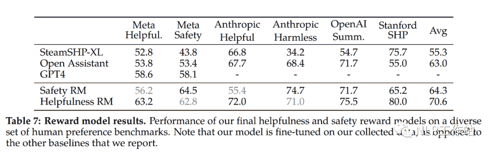

发现奖励模型对明显更好的数据效果更突出，对可以忽略地更好或者不确定的数据表现较差。

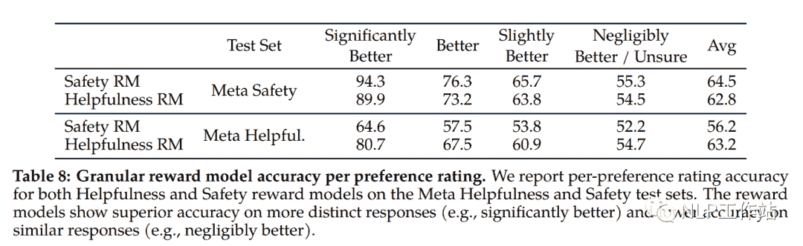

并且研究了奖励模型在数据和模型大小方面的缩放趋势，在数据逐步增大的同时，效果也在逐步提高。

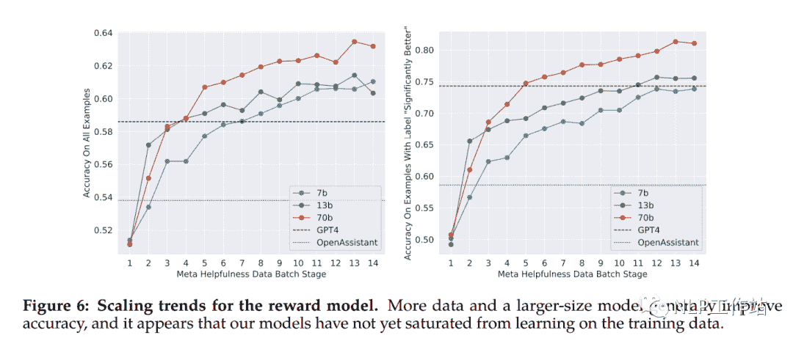

###  Iterative Fine-Tuning

随着收到更多批次的人类偏好数据，能够训练更好的奖励模型并收集更多提示。因此，训练了五个连续版本的RLHF模型（RLHF-v1到RLHF-v5）。

主要训练策略包括：

+   最近策略优化（PPO）:标准强化学习算法

+   拒绝采样微调：模型输出时采样K个结果，选择奖励值最高的一个，在强化学习阶段进行梯度更新。

在RLHF-v4之前，只使用拒绝采样微调，之后将两者顺序结合起来。但主要只有70B模型进行了拒绝采样微调，而其他小模型的微调数据来自于大模型拒绝采样数据，相当于用大模型蒸馏小模型。

在模型进行强化学习的奖励值由有用性奖励值和安全性奖励值组合产生，具体计算如下：

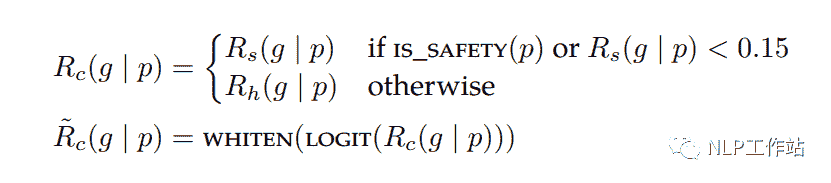

训练参数设置：对于所有模型，采样AdamW优化器，其中β1、β2和eps分别为0.9、0.95和1e−5，权重衰减为0.1，梯度裁剪为1.0，学习率为恒定为1e−6。PPO训练时大批次为512，小批次为64，PPO裁剪阈值为0.2。对于7B和13B模型，设置KL惩罚系数为0.01，对于34B和70B模型，设置KL惩罚系数为0.005。所有模型进行200到400次迭代训练。

## ** 多轮对话一致性**

最初的RLHF模型在几轮对话后忘记最初的指令，下图(左)所示。为了解决这些限制，提出Ghost Attention方法（Gatt，其实是一个训练trick）来增强模型对指令的遵从。

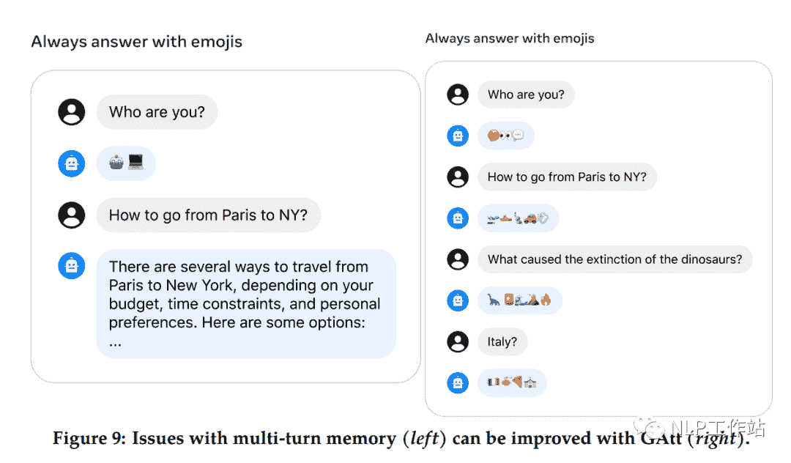

假设多轮对话数据为 [u1,a1,...,un,an]，定义一条指令（inst），使得整个对话过程中都遵守该指令，然后将该指令综合连接到对话的所有用户消息，构造为 [inst+u1,a1,...,inst+un,an]。为了避免语句不匹配的问题，在训练过程中，保留第一轮的提示，并将中间轮数的损失置为0。

## ** 总结**

Llama2模型7b，13b，34b，70b都有，完全够用，最期待的34b会暂缓放出。

国内开源底座模型还是在6b、7b、13b等层次，33-34b才是刚需呀。

随着开源可商用的模型越来越多，大模型社区会越来越繁华，是中小厂的福音。开源都是真英雄。

我愿从此跟随MetaAI走Open开源AI路线。

往期推荐：

+   [**大模型时代-行业落地再思考**](https://mp.weixin.qq.com/s?__biz=Mzg5MTU1NTE1OQ==&mid=2247486493&idx=1&sn=d58830d103a21e141a20d308f2ad3a83&scene=21#wechat_redirect)

+   [**大模型幻觉问题调研**](https://mp.weixin.qq.com/s?__biz=Mzg5MTU1NTE1OQ==&mid=2247486489&idx=1&sn=a74f92ab19a3d7f82cf2cd527c5c8df4&scene=21#wechat_redirect)

+   垂直领域大模型的一些思考及开源模型汇总

+   如何评估大模型-LLMs的好坏？

+   阿里「通义千问」大模型-内测分享

+   CORGI-PM：首个中文性别偏见探索和缓解数据集

+   AAAI2023 | 基于统一语义匹配的通用信息抽取框架-USM

+   [**IJCAI2022 | DictBert：采用对**](https://mp.weixin.qq.com/s?__biz=Mzg5MTU1NTE1OQ==&mid=2247486029&idx=1&sn=59cd696629d406cf45637482a7b134df&scene=21#wechat_redirect)比学习的字典描述知识增强的预训练语言模型

+   [**ACL2022|NoisyTune：**](https://mp.weixin.qq.com/s?__biz=Mzg5MTU1NTE1OQ==&mid=2247485803&idx=1&sn=5acb654c6fa67a5f041d60461037eda3&scene=21#wechat_redirect)微调前加入少量噪音可能会有意想不到的效果

+   ACL2022论文分类汇总-Prompt、句子表征、检索排序&摘要

+   总结|Prompt在NER场景的应用

+   NAACL2022-Prompt相关论文&对Prompt的看法

+   PolyLoss：一种将分类损失函数加入泰勒展开式的损失函数

+   PERT：一种基于乱序语言模型的预训练模型