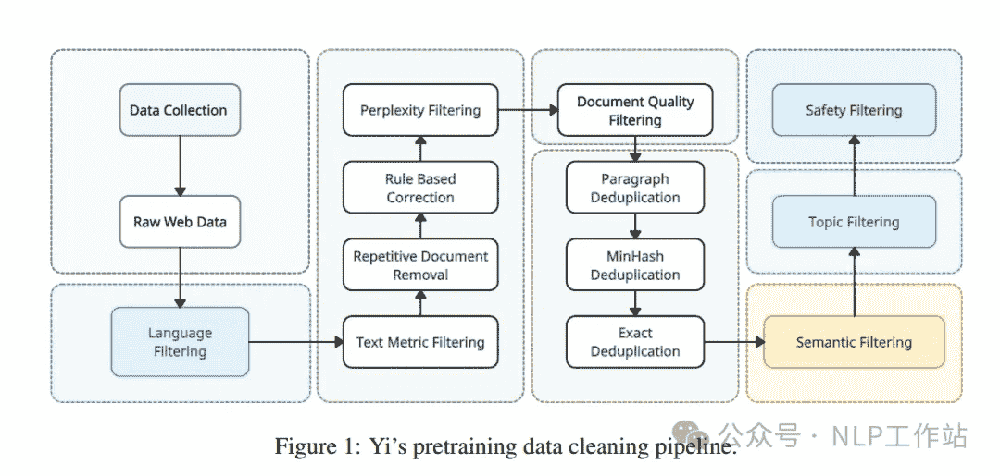
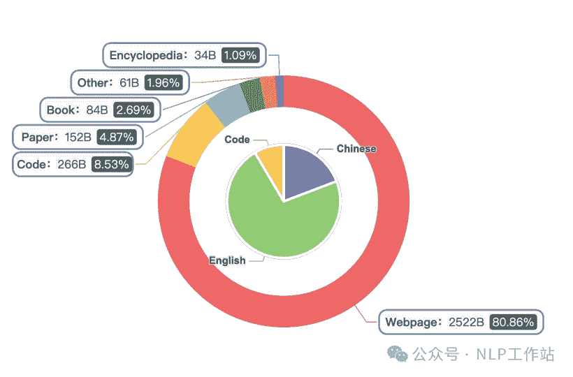
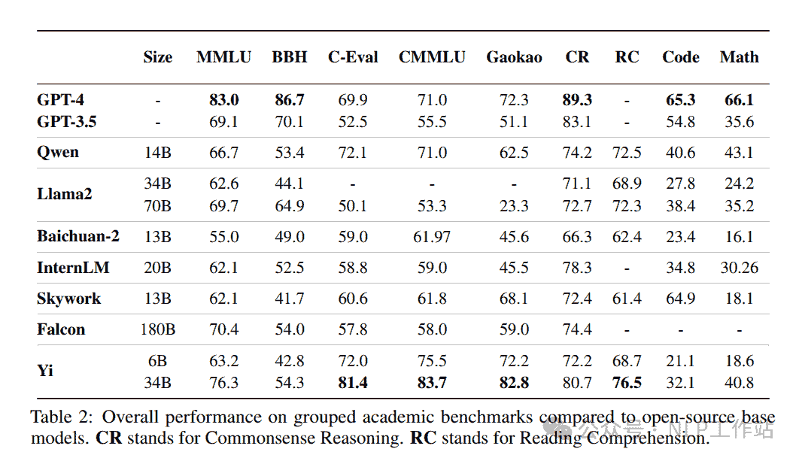
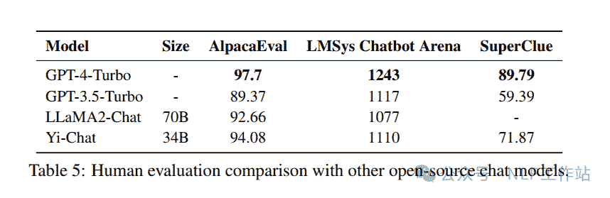
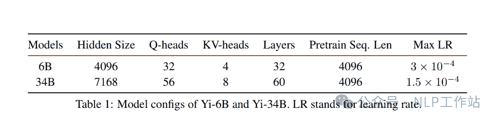
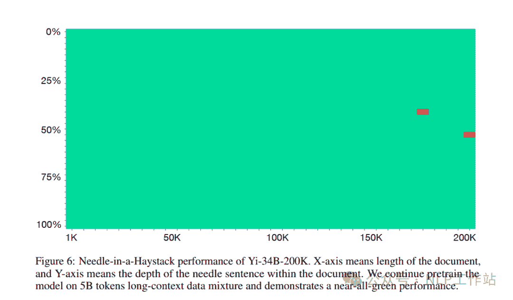
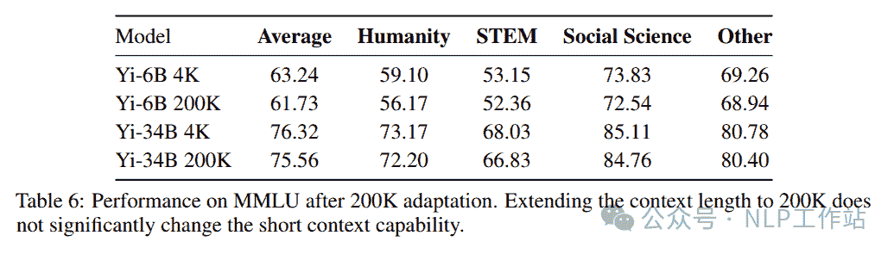
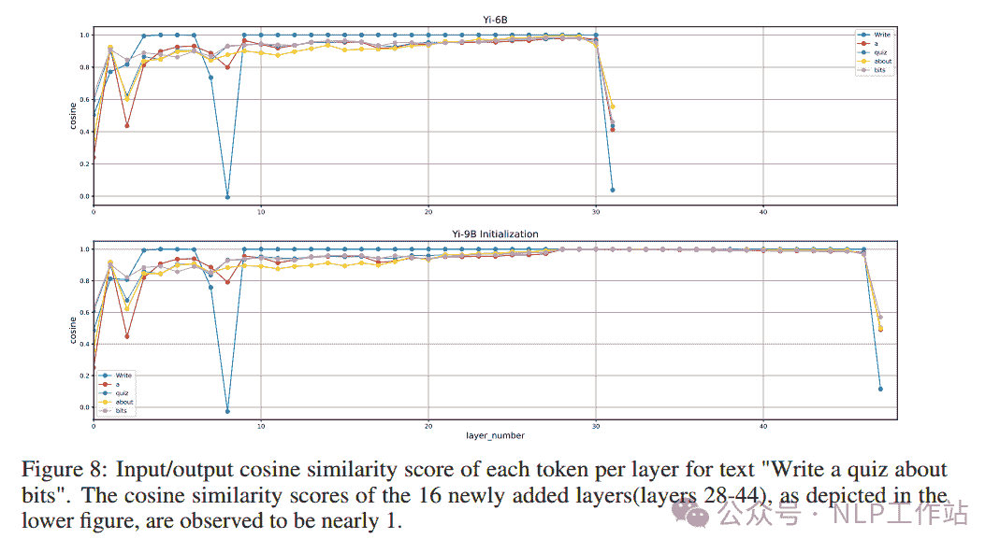
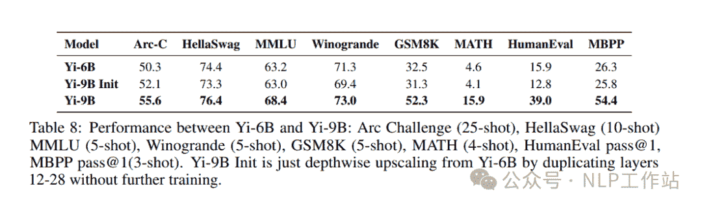

# Yi技术报告细节分享

> 来源：[https://geekbang.feishu.cn/docx/YBdtdZOaGoPvVnxft7bcNqHAnXd](https://geekbang.feishu.cn/docx/YBdtdZOaGoPvVnxft7bcNqHAnXd)

> 👨🏻 作者：刘聪NLP

> 📃 作者介绍：AIGC前沿知识分享&落地经验总结

> 🛖 知乎主页：https://www.zhihu.com/people/LiuCongNLP

> ⏰ 收录时间：2024-05-23 11:28:42

> 🔗 原文链接： h[ttps://mp.weixin.q](https://mp.weixin.qq.com/s/YDwL3dV-Fq5zcEyrL__NGw)q.com/s/YDwL3dV-...


关注作者👸号，获取更多AI知识

## **写在前面 **

大家好，我是刘聪NLP。

[**Yi模型很早就**](https://mp.weixin.qq.com/s?__biz=Mzg5MTU1NTE1OQ==&mid=2247486512&idx=1&sn=73d2b6dd73051e85bf6b9f630919f3d9&scene=21#wechat_redirect)发布[**了，但技术报告昨天才**](https://mp.weixin.qq.com/s?__biz=Mzg5MTU1NTE1OQ==&mid=2247486892&idx=1&sn=d5ce452857d4c0facad23ce5d11c7a5b&scene=21#wechat_redirect)出来[**。之前分享**](https://mp.weixin.qq.com/s?__biz=Mzg5MTU1NTE1OQ==&mid=2247486965&idx=1&sn=20afd82c50d8d1752c4645db3fec2ab9&scene=21#wechat_redirect)过 Llama2 、 Baichuan2 、 Qwen ，今天来给大家进行细节分享。

Yi模型在开篇就强调了模型设计思路是围绕模型规模、数据规模和数据质量。因此，下面分享内容主要为预训练、微调、长文本能力以及模型深度扩展。

```
Paper: https://arxiv.org/abs/2403.04652
```

##  **预训练阶段数据构造 **

Yi模型在预训练阶段的数据处理流程主要如下图所示，主要是对爬取的网络文本进行数据过滤和去重。



数据清洗流程

过滤方法：

+   启发式过滤：该方法主要去除质量较低的文本内容。过滤规则包含：（1）根据特殊URL、域名、黑名单词表以及乱码文本进行过滤；（2）根据文本长度、特殊字符比例、短、连续或不完整的行比例；（3）根据重复词语、N-Gram片段、段落的占比；（4）识别和匿名话个人可识别信息，例如：邮箱、电话等。

+   学习式过滤：通过困惑度、 质量、 安全和文档连贯性4种评分器来对文本进行过滤，其中，困惑度评分器利用KenLM库，按照CCNet的方法评估大量网络文本，丢弃困惑度分数明显高于平均水平的文本；质量评分器是经过维基百科数据训练的分类模型，当文本内容更偏向于维基这样高质量页面时，认为文本质量较高；安全评分器是识别并删除包含有毒内容的网络文档，如暴力、色情等；文档连贯性评分器识别文本的整体连贯性，删除句子或段落不连贯的文本。

+   聚类过滤：采用无监督语义聚类对文本进行分组，然后对聚类数据标注质量标签，为后续数据混合策略提供参考。

去重方法：文本过滤之后进行去重流程，涉及基于文档级别的MinHash去重和子文档精确匹配去重，有效识别和消除文档内部和跨文档中的重复内容。同时利用主题模型对数据赋予特定的主题，在最后数据采样过程种对信息密度较低的主题内容进行下采样（主要是广告文本）

最终预训练数据组成如下图所示，总计3.1T Token。



数据组成

##  **微调阶段数据构造 **

在微调过程中仅采用了10K数据进行模型微调，认为数据质量要胜过数量。相比于与采用数十万开源指令数据微调模型，采用较小、手动标注数据集的效果更优。

数据在构造过程中，采用WizardLM中的方法获取难度较高提示的数据集，采用LIMA中回复风格（总-分-总）对生成回复内容格式化，采用“Step-Back”模式对维链数据格式化。同时为了减少幻觉和重复，检查并确保回复中的知识不包含在模型中，消除可能导致模型死记硬背的回复，并重写回复保证微调多轮时数据不重复。

为了确保模型能力的覆盖范围，微调数据中涉及多种任务，例如：问答、创意写作、对话、推理、数学、编码、双语能力等。为了增加模型的精细控制能力，设计了一套系统指令，通过多样性的采样算法，平衡各种系统指令上的数据分布，增强的跨任务鲁棒性。

为了探索不同任务数据比例，对模型最终能力的影响，通过网格搜索方法，确定最终数据混合比例。

最后微调数据采用ChatML格式，让模型可以更好地区分输入中各类型信息，例如：系统指令、用户输入和模型回复。





##  **分词器、模型结构及微调参数 **

Tokenizer采用sentencepece中BPE方法对预训练数据训练得来，为平衡计算效率和词理解能力将词表设置为64000，将数字拆分为单个数字，将罕见字符用unicode编码。

模型采用Transformer-Decoder结构，采用llama的代码实现，修改如下：

+   注意力机制：Yi-6B和34B版本均采用Grouped-Query Attention(GQA)，Llama2中仅70B版本采用GQA。

+   激活函数：Yi采用SwiGLU作为后注意力层的激活函数。

+   位置编码：Yi模型采用旋转位置编码（RoPE），为例支持200k上下文窗口，调整了基础频率（RoPE ABF）。



模型结构

模型微[**调阶段，仅计算回**](https://mp.weixin.qq.com/s?__biz=Mzg5MTU1NTE1OQ==&mid=2247487123&idx=1&sn=b337c8a718c7998e507004ff189483ca&scene=21#wechat_redirect)复内容的损失，不考虑系统指令和用户指令。采用AdamW优化器，其中β1、β2和ϵ分别为0.9、0.999和1e−8。训练数据最大长度为4096，批量大小为64，训练300步，学习率恒定为1e−5，权重衰减为0.1，梯度裁剪最大阈值为1.0，并采用 NEFTune 方式训练，Yi-34B-Chat和Yi-6B-Chat噪声尺度分别为45和5。

##  **扩展模型上下文长度 **

对于长上下文的解决方法采用继续预训练和微调两种方法。基础模型其实本身已经存在利用200K输入上下文中任何位置信息的前来，继续预训练可以“解锁”这种能力，通过微调可以进一步调整生成内容的风格以更好地遵循人类指令和偏好。

+   预训练阶段：采用序列并行和分布式注意力的方式蛮力对模型全部注意力进行训练。数据来源：（1）原始预训练数据；（2）长上下文数据，主要来自数据；（3）多文档文档合成数据。共计对5B Token的数据进行训练，批次大小为4M Token。



大海捞针实验

+   微调阶段：将短SFT数据与长上下文问答问答数据混合使用。文档问答数据由模型辅助构建，即随机将多个文档拼成一个长文档，从中抽取一个或多个段落，要求模型基于抽取段落内容构建问答对。Trick，要求给答案之前模型需要背诵或改写原始段落，这种数据格式鼓励模型进行检索，从而阻止依赖自身知识回答产生的幻觉。



##  **扩展模型深度 **

参考SOLAR 10.7B模型对Yi-6B模型进行深度扩展，将原来的32层扩展到48层，构建Yi-9B模型。在具体层的选择时，通过评估每一层输入和输出直接的余弦相似度得出，如下图所示，余弦相似度越接近于1，则表明复制这些层不会显著改变原始模型输出的logits，因此选择复制原始模型中间12-28的16个层。



采用两阶段训练，第一阶段使用了0.4T数据（包含文本和代码），数据配比与Yi-6B模型一样；第二阶段使用了0.4T数据（包含文本、代码和数学），重点增加了代码与数学数据的比例，以提高代码性能。

在微调过程中，设定了一个固定的学习率 3e-5，并采取逐步增加 batch size 的策略，即从 batch size 4M token 开始，每当模型 loss 停止下降时就增加 batch size，使 loss 继续下降，让模型学习更加充分，收敛性能更好。



##  **写在最后 **

本次给大家带来Yi的技术报告内容，Yi模型也开源比较久了，开源不易，且用且珍惜。

Yi-6B模型的扩展深度到Yi-9B模型研究也比较有意思，尤其是通过余弦相似度来选择模型扩展层的方法。

往期推荐：

+   如何提高LLMs的文本表征(Text Embedding)能力?

+   DEITA-大模型指令微调的数据高效筛选方法

+   大模型微调技巧 | 高质量指令数据筛选方法-MoDS

+   辟谣！微软撤回声称ChatGPT为20B参数的论文，并给出解释。

+   [**如何看待微软论文声称 ChatGPT **](https://mp.weixin.qq.com/s?__biz=Mzg5MTU1NTE1OQ==&mid=2247487327&idx=1&sn=593923b9ca8fd01a58e769b52d002884&scene=21#wechat_redirect)是 20B (200亿) 参数量的模型？

+   大模型微调技巧-在Embeeding上加入噪音提高指令微调效果

+   如何从数据集中自动识别高质量的指令数据

+   BaiChuan2技术报告细节分享&个人想法

+   大模型LLM微调经验总结&项目更新

+   [**打造LLM界的Web UI**](https://mp.weixin.qq.com/s?__biz=Mzg5MTU1NTE1OQ==&mid=2247486578&idx=1&sn=8fc505e81e2a479bfaf9b5b15d120808&scene=21#wechat_redirect)

+   是我们在训练大模型，还是大模型在训练我们？

+   [**Llama2技术细节&开源影响**](https://mp.weixin.qq.com/s?__biz=Mzg5MTU1NTE1OQ==&mid=2247486512&idx=1&sn=73d2b6dd73051e85bf6b9f630919f3d9&scene=21#wechat_redirect)

+   [**大模型时代-行业落地再思考**](https://mp.weixin.qq.com/s?__biz=Mzg5MTU1NTE1OQ==&mid=2247486493&idx=1&sn=d58830d103a21e141a20d308f2ad3a83&scene=21#wechat_redirect)

+   垂直领域大模型的一些思考及开源模型汇总

+   如何评估大模型-LLMs的好坏？

+   总结|Prompt在NER场景的应用