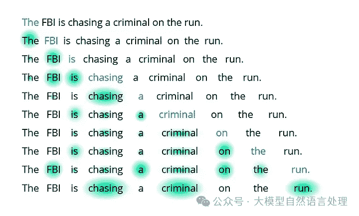
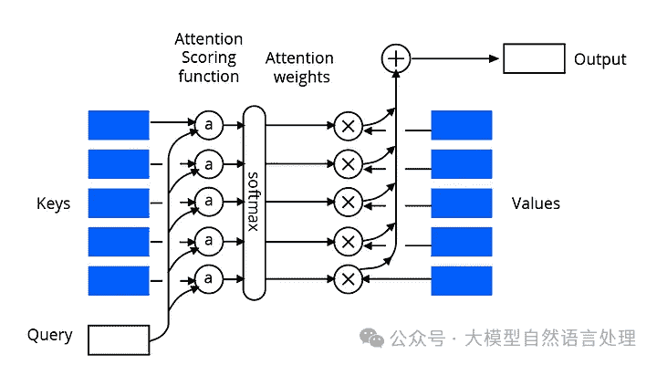
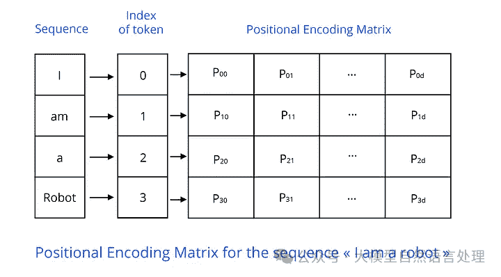
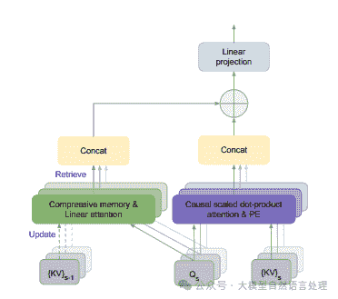
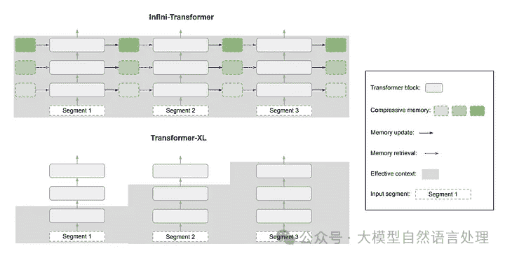
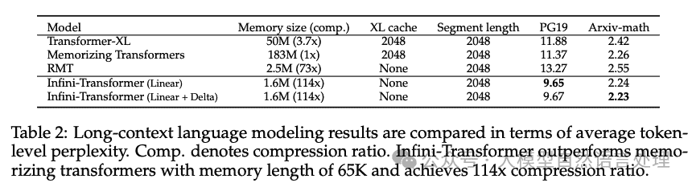
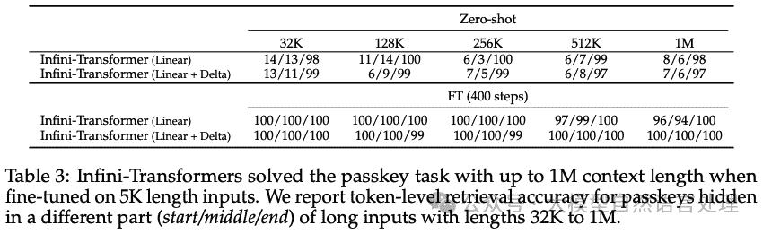
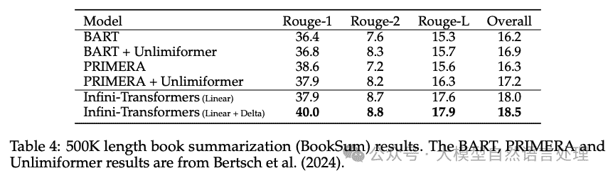

# 【LLM & 长文本】Infini-attention：高效无限上下文 Transformer

> 来源：[https://geekbang.feishu.cn/docx/JNEFdr2gFocFiqx9q8icwG6bnJe](https://geekbang.feishu.cn/docx/JNEFdr2gFocFiqx9q8icwG6bnJe)

> 👨🏻 作者：余俊晖

> 📃 作者介绍：一名NLP炼丹师，NLP算法竞赛TOP选手

> 🛖 👸号：大模型自然语言处理

> ⏰ 收录时间：2024-05-28 17:09:42

> 🔗 原文链接：h[ttps://mp.weixin.q](https://mp.weixin.qq.com/s?__biz=Mzg4NjI0NDg0Ng==&mid=2247484821&idx=1&sn=eb25b6ff5f280a620d8c8ea7a1315822&chksm=cf9dd114f8ea58028ff4a0ece652acd0f8fc1bd8e70dd0b2269653503400fcc0dfc9c07296a4&token=1812627684&lang=zh_CN#rd)q.com/s?__biz=Mz...

关注作者👸号，获取更多AI知识

##  **一、前言 **

大型语言模型（LLM）的架构在很大程度上受到了Transformer类型模型中注意力机制的影响。这些机制通过允许模型关注输入序列的相关部分，彻底改变了模型理解和生成文本的方式。然而，随着模型变得更加复杂，并被赋予处理越来越长的序列的任务，它们遇到了诸如注意力窗口和二次复杂度等挑战。为了应对这些挑战，出现了新的解决方案-谷歌的无限注意力（Infini-attention），在克服限制的同时保持效率。目标是通过这篇文章来介绍注意力机制的复杂性，探讨它们面临的问题，并突出无限注意力提出的解决方案。

##  **二、Attention **

在像Transformer和基于Transformer的大型语言模型（LLMs）架构，注意力机制在实现文本的上下文理解和生成中起着关键作用。这些机制的核心是能够集中注意力在输入数据的特定部分，通过注意力机制赋予不同元素不同程度的重要性。自注意力（Self-attention）通过一系列复杂的计算，促进了对序列内上下文关系的理解和生成。

例如，句子：“The cat sat on the mat.”在这个序列中，自注意力使模型能够识别单词之间的关系。通过根据相关性分配注意力权重，模型理解到“cat”和“mat”关系密切，因为它们有高的注意力权重，表明它们作为动作“sat”的主语和宾语的角色。

这个过程通过几个步骤展开：

+   序列：基于输入的单词，可以将每个单词标记化为大小为d的向量，并将每个向量组合成一个包含N个标记的序列S。

+   键（Key）、查询（Query）和值（Value）向量 ：每个序列与三个向量相关联：键（K）、查询（Q）和值（V）。键向量用作比较，查询向量代表当前单词，值向量包含所有其他单词的信息。

+   点积计算：通过当前单词的查询向量与所有其他单词的键向量之间的点积操作，评估每个序列的注意力分数。计算由注意力方程表示：

为了防止梯度变得过大，通过将点积除以键向量维度的  平方根来缩小其规模。然后，缩放后的点积通过softmax函数传递，将分数归一化为概率分布。这确保了注意力权重之和为1，便于在序列之间进行相对重要性的比较。最后，我们得到了一个注意力矩阵，其中每一行代表与序列中N个输入标记的每个先前标记相关联的注意力分数。

最终，从softmax操作获得并存储在我们注意力矩阵中的注意力权重被用来计算所有单词的值向量（Value vectors）的加权和，根据它们的重要性分数整合来自其他单词的信息，如下方图像所示。然后，基于新的输入标记序列计算局部注意力。

通过这些复杂的计算，自注意力机制使模型能够专注于输入序列的相关部分，增强了它们对文本数据中上下文关系的理解。这种机制已经改变了机器理解和生成类似人类文本的方式，然而，注意力机制也产生了多个问题，例如注意力窗口和二次复杂性。

##  三、Attention windows

Transformer虽然强大，但它们依赖于位置编码，在处理长序列时引入了限制。以下是具体原因：

+   **位置编码 **：标准的变换器在处理长序列时遇到困难，因为它们依赖位置编码来理解单词的顺序。这些编码就像是根据每个单词的位置分配的独特ID。例如，第一个单词获得一个独特的“第一个单词”编码，第二个单词获得一个“第二个单词”编码，依此类推。

+   **有限的上下文窗口 **：问题在于这些编码通常是为固定窗口大小学习的，比如说512个位置。如果一个序列超过512个单词，模型就会遇到在训练期间没有见过的位置。它没有为这些未见过的位置提供特定的编码，因此，它在理解距离较远的单词之间的关系时就会遇到困难。

+   **无法外推 **：想象一下，模型在第1000个位置遇到了单词“book”（书）。由于它没有为第1000个位置学习编码，它不能仅凭它们的位置来确定“book”与周围单词的关系。

本质上，位置编码创建了一个注意力窗口。模型可以有效地关注窗口内的单词并理解它们之间的关系，但它很难把握窗口外单词如何相互作用。当处理非常长的文档、对话或代码时，这种限制成为一个主要问题，因为理解长距离依赖性至关重要。

##  **四、二次复杂性 **

第二个问题是评估注意力矩阵，这涉及到从序列中的每个标记学习到每个其他标记的映射，导致二次成本。这种成本产生是因为每个输入元素都需要与每个其他元素交互，导致计算复杂度为O(n²)，其中n是序列的长度。这种二次成本是一个巨大的挑战，尤其是随着序列长度的增长，并且最近一直是研究的焦点。例如，对于一个具有512批量大小和2048上下文长度的500B模型，注意力键值（KV）状态有3TB的内存占用。

为了应对这种二次复杂度带来的挑战，特别是随着标记长度的增长，扩展模型大小的策**略变得**至关**重要。然**而，**扩展引入了推理成**本的权衡，这些成本通过各种指标来衡量，如 延迟 、 吞吐量 和 模型FLOPS 利用率。

###  **4.1 延迟 **

在模型推理的背景下，延迟指的是完成推理任务所需的总时间。它由两个主要部分组成：

+   预填充延迟：这个组成部分包括在推理过程开始时处理输入标记所需的时间。预填充延迟至关重要，因为它为后续解码步骤设置了初始条件。

+   解码延迟：解码延迟指的是基于处理过的输入标记自回归生成输出标记所需的时间。它涉及顺序预测每个标记，这可能是一个计算密集型的任务，尤其是对于长序列。

###  **4.2吞吐量 **

吞吐量是一个度量指标，用于量化在推理期间处理或生成标记的速率。它提供了对模型推理效率的见解，通常以每秒标记数来衡量。更高的吞吐量表明更快的模型推理，这对于实时应用程序或大规模部署是理想的。

###  **4.3 模型FLOPS **

浮点运算每秒（FLOPS）利用率衡量在推理期间硬件使用的效率。它比较观察到的吞吐量（实际每秒处理或生成的标记数）与如果硬件在没有内存或通信开销的情况下以峰值FLOPS运行可能实现的理论最大吞吐量。在讨论模型FLOPS利用率时，必须考虑诸如在推理期间执行的操作的计算强度等因素，包括矩阵乘法（matmuls）和注意力机制计算。这些操作消耗计算资源并有助于整体推理时间。

总之，虽然扩展基于Transformer的大型语言模型（LLMs）可以提高性能，但它带来了计算和内存负担。此外，这些模型在处理长序列方面存在限制，因为位置编码的固有限制。这限制了它们捕捉长距离依赖的能力，阻碍了它们在需要理解广泛上下文信息的任务中的有效性。

##  **五、无限注意力 **

无限注意力（Infini-attention）：将压缩记忆整合到Transformer的标准注意力机制中。这些概念的基础是两篇论文：

+   **Transformer-XL **：超越固定长度上下文的注意力语言模型：介绍了对标准Transformer架构的扩展。这个扩展，称为Transformer-XL，允许模型有效地捕获序列中的长距离依赖。与标准Transformer不同，Transformer-XL不受固定长度上下文窗口的限制。它通过使用递归机制来实现这一点。这个机制本质上是通过前一段的模型记忆来构建的，使其能够维持更广泛的上下文大小来处理当前段。

+   Transformers are rnns ：提出了一种新颖的线性注意力机制，与Transformer中使用的标准点积注意力相比，具有显著的计算优势。标准注意力机制具有二次时间和空间复杂度。相比之下，所提出的线性注意力机制以线性时间和空间运行，使其更加高效。

Infini-Transformer将长序列分割成较小的段（S），每个段有固定数量的标记（N）。模型一次处理这些段。

1.  记忆状态：隐藏状态携带有关先前处理段的信息。当模型在序列中移动时，此状态会更新。你可以将其视为一个记忆，捕捉模型到目前为止学到的内容。

1.  局部注意力：在每个段内，模型执行“局部注意力”。这种注意力机制只考虑当前段内的标记（而不是整个序列）。

1.  组合信息：重要的是，局部注意力机制还结合了隐藏状态。这个基于前一段更新的隐藏状态，注入了当前段之外更广泛上下文的信息。

总之，这种方法避免了对整个序列进行全面注意力的O(n²)复杂度。通过结合局部注意力和信息丰富的隐藏状态，模型仍然可以在单独处理段的同时捕获序列中的长距离依赖。

Infini-Transformer具有整个上下文历史，而Transformer-XL由于仅缓存上一段的KV状态，因此丢弃了旧的上下文。

##  **六、压缩记忆 **

1.  局部注意力：类似于标准Transformer，每个包含N个输入标记的段都会经历自注意力。

1.  记忆检索与更新：这一步包含了关键创新。这里的目标是将计算成本高昂的softmax函数及其转换分解成类似递归函数的形式。挑战在于softmax的性质——它是一个二次函数**，通常不容易分解。在标准Transfor**me**r中，这迫使模型存储所有键-查询值以进**行最终的softmax计算，导致效率低下。解决方案借鉴了“ Transformers are rnns ”论文中的想法。 提出近似softmax方程，使其线性化并允许递归计算，类似于RNNs的运作方式 。 这种方法使模型能够在整个序列中迭代更新并传递存储在隐藏状态中的总体注意力记忆。

+   记忆检索：

+   其中，  是从记忆  中检索到的内容，  是查询  的非线性激活函数，  是上一次的状态记忆矩阵  是归一化项，  是键的数量。

+   记忆更新：

+   其中，  是更新后的记忆矩阵，  和  是新的键和值，  是转置操作。

1.  增量规则（Delta Rule）：增量规则试图通过首先从记忆中检索现有值条目，然后从新值中减去它们，再应用关联绑定作为更新来改进记忆更新过程。目的是如果新键值绑定已经存在于记忆中，则保持关联矩阵（存储键值绑定）不变。

1.  这个公式与记忆更新类似，但使用了按元素的乘法  来计算差异。

1.  长期上下文注入：最后，使用门控函数将检索到的隐藏空间记忆中的记忆内容与新序列的局部注意力输出结合起来。这平衡了长期上下文和当前段信息在最终注意力输出中的影响。

1.  其中，  是最终的注意力输出，  是从记忆检索到的内容，  是点积注意力的输出，  是学习的门控标量。这些公式共同构成了压缩记忆机制的核心，使得 Infini-attention 能够在保持固定内存参数的同时处理无限长的上下文。通过这种方式，模型能够在处理长序列时保持效率和有效性。

##  **六、实验 **

+   长上下文语言建模

为了衡量无限注意力（Infini-Attention）的有效性，作者进行了各种涉及长上下文任务的实验。在这里，我们将关注一个具体的实验（有关全面评估，请参考论文）。他们将无限注意力与其他为长上下文和内存效率设计的模型进行了比较，例如Transformer-XL和循环记忆Transformer（RMT）。

结论：Infini Transformer在这些长上下文建模任务中的表现超过了Transformer-XL和记忆Transformer。重要的是，无限Transformer在保持与记忆Transformer模型相比114倍更小的内存占用的同时，实现了这一性能。此外，将训练序列长度从32,000个标记增加到100,000个标记，可以进一步改善无限Transformer模型的困惑度得分。这表明无限Transformer能够有效处理甚至更长的序列，同时保持效率。

+   继续预训练后检索

+   文本摘要

##  **总结 **

大型语言模型（LLMs）通过在Transformer架构中引入注意力机制而发生了革命性的变化。这些机制通过使模型能够专注于输入序列的关键部分，从根本上改变了模型理解和生成文本的方式。然而，随着模型变得更加复杂并处理越来越长的序列，出现了诸如注意力窗口和二次复杂度等挑战。为了应对这些问题，无限注意力（Infini-Attention）通过将压缩记忆模块整合到标准Transformer注意力机制中，无限注意力克服了这些限制，同时保持了效率。

##  **参考文献 **

+   Leave No Context Behind: Efficient Infinite Context Transformers with Infini-attention，https://arxiv.org/pdf/2404.07143