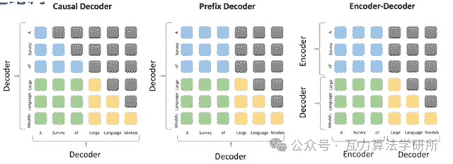
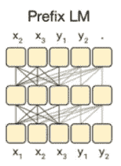
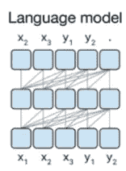
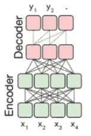
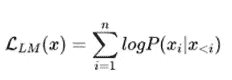
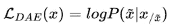

# 大模型面经——从prefix-decoder、casual-decoder、encoder-decoder角度深入聊聊大模型

> 来源：[https://geekbang.feishu.cn/docx/Y4UAddvqEoHFiPxo8Iqc1vcOneb](https://geekbang.feishu.cn/docx/Y4UAddvqEoHFiPxo8Iqc1vcOneb)

> 👨🏻 作者：喜欢卷卷的瓦力

> 📃 作者介绍：985海归硕士、计算机专业，前AI大厂研究院高级算法研究员，前国企研究院算法专家，现外企top10上市集团人工智能研究员，算法研究与开发经历6年，深度参与头部大模型产品研发上线，在大模型/语音识别/视觉等领域有丰富的项目经验

> ⏰ 收录时间：2024-05-23 11:28:42

> 🔗 原文链接：h[ttps://mp.weixin.q](https://mp.weixin.qq.com/s/F8KMOIUCviGlhfPlude7FQ)q.com/s/F8KMOIUC...

关注作者👸号，获取更多AI知识

本篇从目前开源的主流模型体系架构出发，对大模型做比较基础的介绍。

本篇主要以范围较宽的面试题形式，深入介绍大模型基础，大家可以参考着本篇内容进行查漏补缺。

下面是一个快捷目录。

1. 介绍一下大模型

2. 大模型的主流体系架构

3. 大模型的训练目标

4. 为什么大部分是decoder-only

5. 为什么有涌现能力

6. 大模型的优缺点

# **一、介绍大模型**

大模型：一般指1亿以上参数的模型，但是这个标准一直在升级，目前万亿参数以上的模型也有了。

大语言模型（Large Language Model，LLM）是针对语言的大模型。

大模型后面跟的6B、13B等，这些一般指参数的个数，B是Billion/十亿的意思。

# **二、主流架构体系**

大模型主要架构分为三种：：prefix Decoder 系、causal Decoder 系、Encoder-Decoder。

1.  prefix Decoder 系

+   注意力机制方式： 输入双向注意力，输出单向注意力

+   特点： prefix部分的token互相能看到 ，属于causal Decoder 和 Encoder-Decoder 折中

+   代表模型：ChatGLM、ChatGLM2、U-PaLM

+   缺点：训练效率低

2. causal Decoder 系

+   注意力机制方式： **从左到右的单向注意力**

+   特点：自回归语言模型，预训练和下游应用是完全一致的，严格遵守只有后面的token才能看到前面的 token的规则

+   适用任务：文本生成任务效果好

+   优点：训练效率高，zero-shot 能力更强，具有涌现能力

+   代表模型：LLaMA-7B、LLaMa 衍生物

3. Encoder-Decoder

+   注意力机制方式： **输入双向注意力，输出单向注意力**

+   特点：在输入上采用双向注意力，对问题的编码理解更充分

+   适用任务：在偏理解的 NLP 任务上效果好

+   缺点：在长文本生成任务上效果差，训练效率低

+   代表模型：T5、Flan-T5、BART

# **三、训练目标**

这里提供两种常见的目标，一种是最通用的语言模型目标，一种是去噪自编码器。

**1. 语言模型**

根据已有词预测下一个词 ，训练目标为最大似然函数，公式如下

训练效率：Prefix Decoder < Causal Decoder

Causal Decoder 结构会在 所有 token 上计算损失，而 Prefix Decoder 只会在 输出上 计算损失。

**2. 去噪自编码器**

随机替换掉一些文本段，训练语言模型去恢复被打乱的文本段。目标函数为:

去噪自编码器的实现难度更高。采用去噪自编码器作为训练目标的任务有GLM-130B、T5。

# 四、为何现在的大模型大部分是Decoder only结构？

[这里简答一下，想要更细致的答案大家可以去看 为什么](http://mp.weixin.qq.com/s?__biz=Mzg4MTkwMTQ4NA==&mid=2247483987&idx=1&sn=31146ff566ff09a128b91c9e85dcbe72&chksm=cf5fa890f82821862df9526829ef45105ce46e2855e277a0fbe7f929a4bfdf406e03b85c5462&scene=21#wechat_redirect)现在的LLM都是Decoder-only架构？从理论、训练效率与工程实现等多维度分析

因为 decoder-only结构模型在没有任何微调数据的情况下，zero-shot的表现能力最好 ；而encoder decoder则需要在一定量的标注数据上做multitask-finetuning才能够激发最佳性能。

目前的Large LM的训练范式还是在大规模语料上做自监督学习，很显然zero-shot性能更好的 decoder-only架构才能更好的利用这些无标注的数据。

大模型使用decoder-only架构除了训练效率和工程实现上的优势外，在理论上因为 Encoder的双向注意力会存在低秩的问题，这可能会削弱模型的表达能力。 就生成任务而言，引入双向注意力并无实质的好处。

而Encoder-decoder模型架构之所以能够在某些场景下表现更好，大概是因为它多了一倍参数。所 以在同等参数量、同等推理成本下，Decoder-only架构就是最优的选择了。

# **五、为什么有涌现能力**

1.  **任务的评价指标不够平滑；**

1.

2. 宏观上看到了涌现现象，但是子任务效果其实是平滑增长的。

复杂任务 vs 子任务，这个其实好理解，比如我们假设某个任务 T 有 5 个子任务 Sub-T 构成，每个 sub-T 随着模型增长，指标从 40% 提升到 60%，但是最终任务的指标只从 1.1% 提升到了 7%。

# **六、大模型的优缺点**

这个问题比较发散，技术性没那么强，大家顺便看看就可以了。

1.  优点

1）可以利用大量的无标注数据来训练一个通用的模型，然后再用少量的有标注数据来微调模型，以适应特定的任务。这种预训练和微调的方法可以减少数据标注的成本和时间，提高模型的泛化能力；

2）可以利用生成式人工智能技术来产生新颖和有价值的内容，例如图像、文本、音乐等。这种生成能 力可以帮助用户在创意、娱乐、教育等领域获得更好的体验和效果；

3）可以利用涌现能力（Emergent Capabilities）来完成一些之前无法完成或者很难完成的任务，例如 数学应用题、常识推理、符号操作等。这种涌现能力可以反映模型的智能水平和推理能力。

2. 缺点

1）需要消耗大量的计算资源和存储资源来训练和运行，这会增加经济和环境的负担。据估计，训练一 个GPT-3模型需要消耗约30万美元，并产生约284吨二氧化碳排放；

2） 需要面对数据质量和安全性的问题，例如数据偏见、数据泄露、数据滥用等。这些问题可能会导致 模型产生不准确或不道德的输出，并影响用户或社会的利益；

3）需要考虑可解释性、可靠性、可持续性等方面的挑战，例如如何理解和控制模型的行为、如何保证 模型的正确性和稳定性、如何平衡模型的效益和风险等。这些挑战需要多方面的研究和合作，以确 保大模型能够健康地发展。