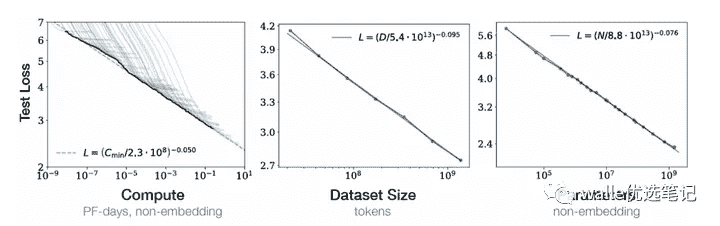
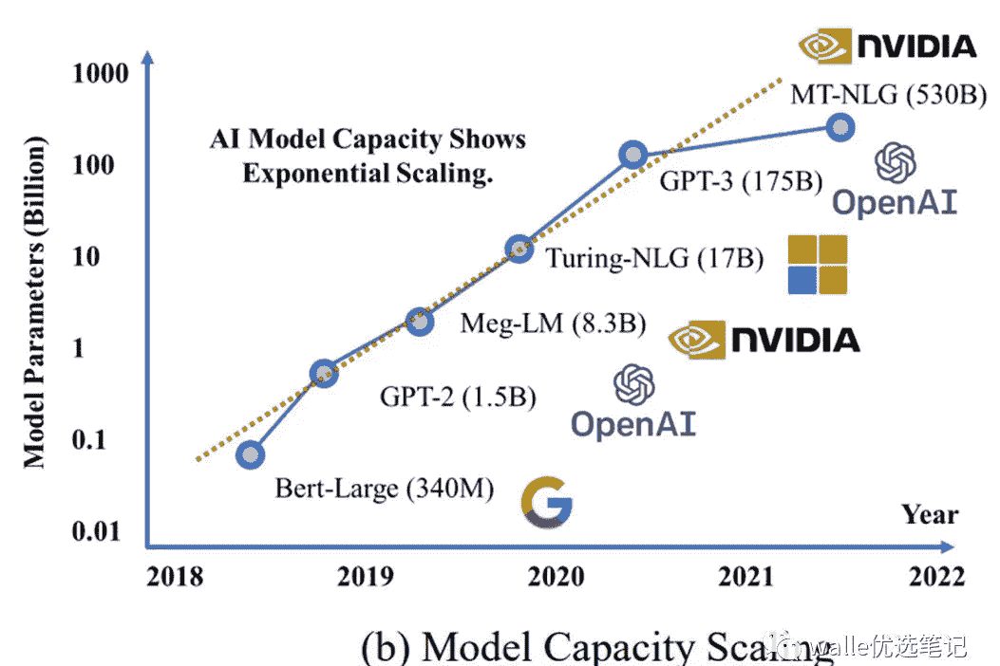

# 现在LLM 的大小为什么都设计成6/7B、13B和130B几个档次？解析大模型中的Scaling Law

> 来源：[https://geekbang.feishu.cn/docx/OqV7dQ9jkoVBUvx1Pm9cu7Y6nBd](https://geekbang.feishu.cn/docx/OqV7dQ9jkoVBUvx1Pm9cu7Y6nBd)

> 👨🏻 作者：喜欢卷卷的瓦力

> 📃 作者介绍：985海归硕士、计算机专业，前AI大厂研究院高级算法研究员，前国企研究院算法专家，现外企top10上市集团人工智能研究员，算法研究与开发经历6年，深度参与头部大模型产品研发上线，在大模型/语音识别/视觉等领域有丰富的项目经验

> ⏰ 收录时间：2024-05-23 11:28:42

> 🔗 原文链接：h[ttps://mp.weixin.q](https://mp.weixin.qq.com/s/-JwiRvYAo61RG6iHHhwmVg)q.com/s/-JwiRvYA...

关注作者👸号，获取更多AI知识

# **问题背景**

除了文章题目，你在实践中也许会遇到以下问题：

1.  1、计划训练一个10B的模型，想知道至少需要多大的数据？

1.  2、收集到了1T的数据，想知道能训练一个多大的模型？

1.  3、老板准备1个月后开发布会，给的资源是100张A100，应该用多少数据训多大的模型效果最好？

1.  4、老板对现在10B的模型不满意，想知道扩大到100B模型的效果能提升到多少？

这就是scaling law要回答的问题。

# **内容**

**一、总结**

scaling law ：语言模型性能主要和尺寸（scale）有关，和模型形状(宽度、深度)基本无关。scale主要说的是三个因素：参数量N（不包括embedding），数据集大小D，训练计算量C。大模型比小模型样本效率高，所以计算效率最高的方式是训练大模型早点停止，而不是训练小模型到收敛。

浮点运算量（FLOPs）C、 模型参数 N 以及训练的token数 D 之间存在关系：

C ≈ 6ND

N ∝ C^0.73

最优batch size B ∝ C ^ 0.24

最优训练步数 S ∝ C ^ 0.03

**二、key points**

1、 模型性能主要和模型尺寸（scale）有关，和模型形状基本无关。 scale主要说的是三个因素：参数量N（不包括embedding），数据集大小D，训练计算量C。性能基本和模型的宽度、深度没什么关系。

**2、平滑幂律 **。性能和N、D、C中的每一个都有幂律关系（另外两个不受限制的情况下），趋势跨越了6个数量级。

下图的意思是N、D、C中每一个增加，模型loss都会平滑下降。为了获得最优模型性能，三个因素需要同时增加。幂律关系的前提是增加其中一个因素的时候，不受另外两个因素的限制。

**3、过拟合的通用性。 **N和D同时增加时模型性能会增加。但N和D有一个固定住时，另外一个增加，模型性能的增益会消失。模型大小增加时8倍时，数据至少要增加5倍。

**4、训练通用性。 **训练的曲线遵循可预测的幂律关系，和模型大小无关。通过训练曲线早期部分，我们可以预测出训练后期的loss变化过程。

**5、迁移测试性能 **。如果在一个和训练文本分布不同的测试集上评估模型，结果和训练集基本一致，只是多了个恒定的损失。

**6、样本有效性。 **大模型比小模型更高效，达到同样的性能只需要更少的优化步骤和数据。

**7、收敛效率低下 **。如果固定住训练预算C，但模型大小N和数据D没有限制，我们能够获得最优的性能的方式是训练一个很大的模型，不等到收敛就停止训练。

**8、最优batch size **。训练这些模型的理想批量大小大致仅是损失的幂，并且可以通过测量梯度噪声标度来确定

参考资料：

[2001.08361] Scaling Laws for Neural Language Models (arxiv.org)