# 万字长文：LLM - 大语言模型发展简史

> 来源：`https://geekbang.feishu.cn/docx/AX3Tdd1G4oYp9FxYCnqc1VPmnDd`

> 🤵作者： lencx

> 📃 作者介绍：AI 初学者，喜欢分享，热爱开源（GitHub Stars 60k+）。

> ⏰ 收录时间：2024-06-05 15:56:01 (UTC+8)

> 🔗 原文链接： `https://mp.weixin.qq.com/s/nbO0kyZ5O-oqwLYXIA6b2w`

> Large Language Model（LLM）是一种基于深度学习的自然语言处理模型，它能够学习到自然语言的语法和语义，从而可以生成人类可读的文本。LLM 通常基于神经网络模型，使用大规模的语料库进行训练，比如使用互联网上的海量文本数据。这些模型通常拥有数十亿到数万亿个参数，能够处理各种自然语言处理任务，如自然语言生成、文本分类、文本摘要、机器翻译、语音识别等。

“large language model” — Image Creator [1] powered by DALL·E

2020 年 OpenAI 发布 `GPT-3` [2] ，大型语言模型（LLM）自此在流行度上一直保持稳定的增长。

直到 2022 年 11 月份，随着 `ChatGPT` 发布 [3] ，LLM 和生成式人工智能的整个领域的兴趣飙升。这些原因可能是 LLM 领域持续向前迈进的重大进展所致。

从谷歌 `LaMDA` 聊天机器人的惊人新闻（`Blake Lemoine Says Google's LaMDA AI Faces 'Bigotry'` [4] ），首个高性能的开源 LLM `BLOOM` [5] 发布，再到后来 OpenAI 接连发布 `ChatGPT Plus` [6] 、 `ChatGPT` 和 `Whisper API` [7] 、 `ChatGPT` 插件 [8] 和 `GPT-4` [9] 等等，不断将 AI 推向高潮。

> `BLOOM` [10] ：是一种自回归的大型语言模型 (LLM)，使用工业级计算资源在大量文本数据上训练，能够在 46 种语言和 13 种编程语言中输出几乎无法与人类写作的文本相区分的连贯文本。`BLOOM` 还可以通过将其作为文本生成任务来执行它没有明确训练过的文本任务。

AI 应用也在爆炸式增长中，每天睁开眼睛都会出现一大堆新产品，许多网友表示学不动了。例如：微软发布了 《AI 全家桶：Microsoft 365 Copilot》 ，New Bing，GitHub Copilot X [11] ，Google Bard [12] 、Adobe Firefly [13] ...（此处省略许多） 等一系列 AI 产品。

下面就来盘点一下近期 LLM 开源生态发生的一系列事件（注意：以下这些整理仅限个人了解，并非全部）。

## GPT 生态

### DeepSpeed

`DeepSpeed` [14] 是一个深度学习优化库，它使分布式训练和推理变得简单、高效和有效。一键式 RLHF 训练，让你的类 `ChatGPT` 千亿大模型提速省钱 15 倍。说人话就是：[类 ChatGPT 千亿大模型提速省钱 15 倍。说人话就是](http://mp.weixin.qq.com/s?__biz=MzIzNjE2NTI3NQ==&mid=2247485972&idx=1&sn=18afcbc4e79c67283b84eaec5dfc89a6&chksm=e8dd4be0dfaac2f60832cce0721f68606c3685286cb8b0172df81bed43917ac21b1036d58ca7&scene=21#wechat_redirect)：自己本地可以训练部署类 `ChatGPT` 模型，既高效又省钱。（了解更多 《`DeepSpeed Chat`：一键搞定不同规模 `ChatGPT` 类模型训练！》）

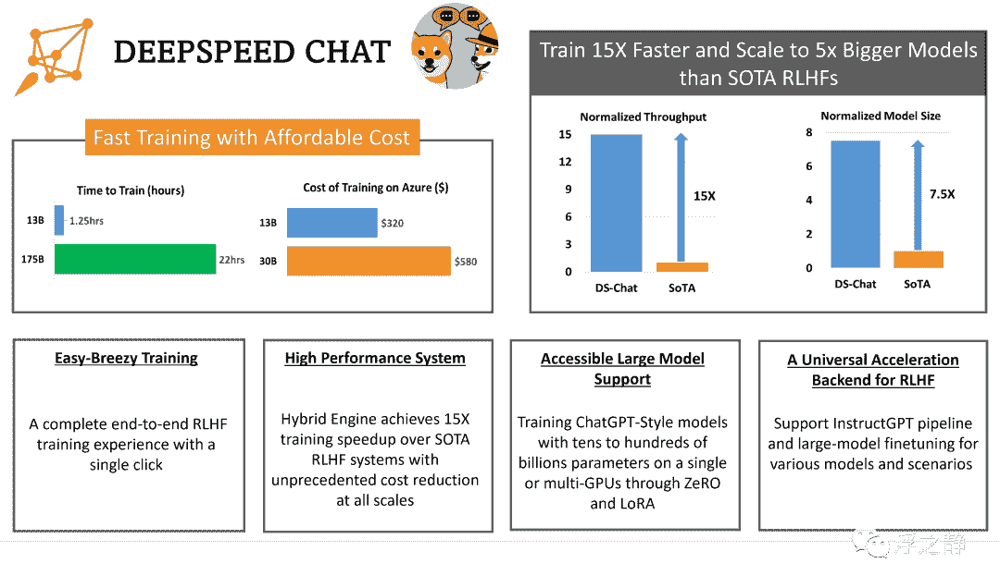

### MiniGPT-4

> 论文：

+ `MiniGPT-4: Enhancing Vision-Language Understanding with Advanced Large Language Models` [15]

+ `Plug-and-Play VQA: Zero-shot VQA by Conjoining Large Pretrained Models with Zero Training` [16]

+ `Flamingo: a Visual Language Model for Few-Shot Learning` [17]

> GitHub：`Vision-CAIR/MiniGPT-4` [18]

> 模型：`Vision-CAIR/MiniGPT-4` [19]

> 数据集：`Vision-CAIR/cc_sbu_align` [20]

> 在线体验：`Minigpt-4` [21]

`MiniGPT-4` 是由一个包含预训练 `ViT` 和 `Q-Former` [22] 的视觉编码器，一个线性投影层和一个先进的 Vicuna 大型语言模型组成的。`MiniGPT-4` 只需要训练线性层，以将视觉特征与 Vicuna 对齐。（了解更多 《多模态 `MiniGPT-4` 开源了！》）

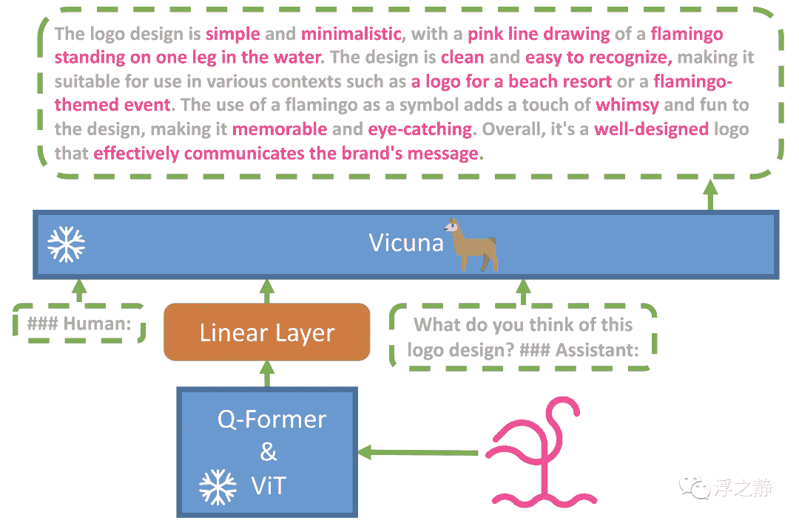

### minGPT

`minGPT` [23] 是 `GPT` [24] 的 `PyTorch` 重实现，包括训练和推理。`minGPT` 试图做到小型、清晰、易于解释和教育性，因为当前大多数可用的 `GPT` 模型实现都有点冗长。`GPT` 并不是一个复杂的模型，这个实现只有大约 300 行代码（见 `mingpt/model.py` [25] ）。它的主要功能是将一系列索引输入到 `Transformer` [26] 中，并输出下一个索引在序列中的概率分布。大部分复杂性只是为了有效率地进行批处理（跨示例和序列长度）。

### nanoGPT

`nanoGPT` [27] 是一个训练/微调中型 `GPTs` 的最简单、最快速的存储库。它是 `minGPT` 的重写。`minGPT` 被广泛引用于各种场合（笔记本、博客、课程、书籍等），这使得作者不太愿意对代码进行更大的变化。`nanoGPT` 将 `minGPT` 从单纯的教育重点转向一些具有实际应用性的方向（可以重现中型工业基准、接受一些权衡以获得运行时效率等）。

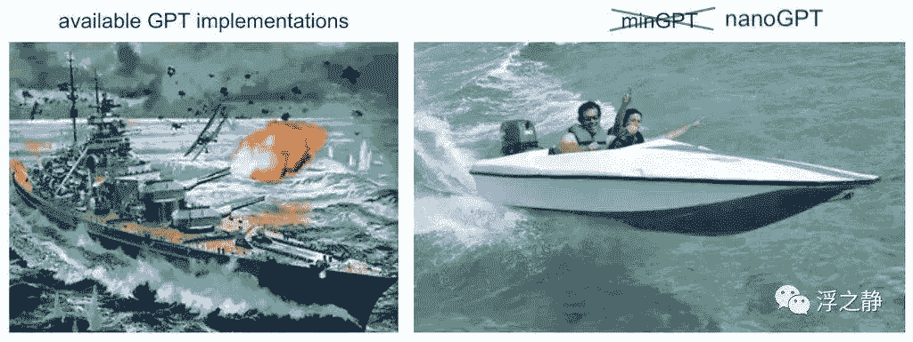

### GPT4Free

> 注意：此项目仅供学习研究，大概率涉及 OpenAI 侵权，请谨慎使用。

`GPT4Free` [28] 致力于帮助你释放 `ChatGPT` 的全部潜力！是否已经厌倦了遇到需要 `OpenAI API` 密钥的令人难以置信的项目，但最终因为没有密钥而感到失望？那么你可以试试此项目！项目提供了第三方 `GPT-4/3.5` API 的反向工程版本，这些版本来自各个网站，让你可以在没有任何障碍（项目提供的可使用模块，其设计就像 `OpenAI` 官方包一样）的情况下开始你的项目。

### AutoGPT

`Auto-GPT` [29] 是一个实验性的开源应用程序，展示了 `GPT-4` 语言模型的能力。由 `GPT-4` 驱动，将大语言模型（LLM）的"思考"链接在一起，以自主地实现你设定的任何目标。作为 `GPT-4` 完全自主运行的最早的例子之一，`Auto-GPT` 推动了人工智能所能实现的界限。

简单来说：当你告诉 `AutoGPT` 最终目标是什么，它将自行生成并完成每一步任务所需的提示，直到返回最终的结果（在这期间它会调用网络和 `GPT-4`）。但 `AutoGPT` 之所以流行，是因为人们对它能做什么以及它对未来可能意味着什么着迷。`AutoGPT` 通过自己的推理达到目标的能力与人类的思考行为，处理信息的方式极其相似。

关闭

**观看更多**

更多

退出全屏

切换到横屏模式

[🎦 点击观看视频](https://mpvideo.qpic.cn/0bc3vaadeaaay4adhbr3kzsfbkgdgkuaamqa.f10002.mp4?dis_k=bfba1188a1344e7ecb246824dc3ac22a&dis_t=1717573988&play_scene=10120&auth_info=DrvDzqhee0wUlZWj11xaR2o0GDs2SWgYBHkkFAcQOyUzRTlHCFYmI3ZnFEAxf019YA==&auth_key=fd0c28e6b5d4dc7b1643272b3535d79f&vid=wxv_2885619426191081474&format_id=10002&support_redirect=0&mmversion=false)

> 无法获取音频链接

视频详情

### AgentGPT

`AgentGPT` [30] 允许你配置和部署自主 AI 代理。为自己的定制 AI 命名，并让它开始实现任何想象的目标。它将通过思考要做的任务、执行它们并从结果中学习来尝试达到目标 。与 `AutoGPT` 类似，但它是网页版。

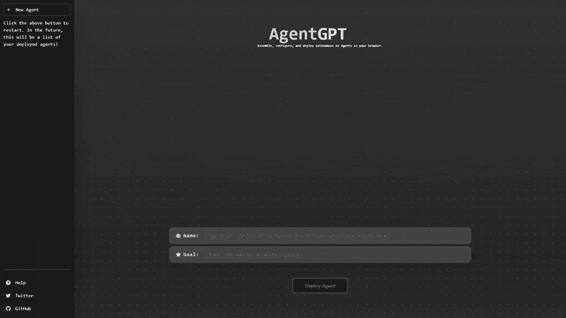

### AudioGPT

> 论文：`AudioGPT: Understanding and Generating Speech, Music, Sound, and Talking Head` [31] GitHub：`AIGC-Audio/AudioGPT` [32] 体验地址：`AudioGPT Demo` [33]

`AudioGPT` 理解和生成语音、音乐、声音和语音头像。

### DocsGPT

`DocsGPT` [34] 是一种先进的开源解决方案，简化了在项目文档中查找信息的流程。它集成了强大的 `GPT` 模型，使开发人员可以轻松地提出问题，并获得准确的答案。告别耗时的手动搜索，让 `DocsGPT` 帮助你快速找到所需的信息。

### 逆向工程

+ `acheong08/ChatGPT` [35] 是 `OpenAI ChatGPT API` 的逆向工程，可扩展为聊天机器人等。

+ `acheong08/EdgeGPT` [36] 是微软 `Bing Chat AI API` 的逆向工程。

## LLaMA 生态

`LLaMA` 基础模型在 2023 年 2 月发布。到目前已经有几个新的经过微调的 `LLaMA` 模型发布。

虽然时间不长，但已经发生了很多事情。本节（在 `A brief history of LLaMA models` [37] 基础上，对内容进行补充）主要涵盖一些模型的发展，并简要涉及一些工具：

+ `LLaMA` 基础模型

+ `Alpaca` 模型

+ `Vicuna` 模型

+ `Koala` 模型

+ `GPT4-x-Alpaca` 模型

+ `WizardLM` 模型

+ `OpenAssistant` 模型

用于在本地运行 `LLaMA` 模型的软件，主要有以下这些：

| Model | Size | Training data |

| --- | --- | --- |

| LLaMA (base model) | 7B, 13B, 33B, 65B | Various |

| Alpaca | 7B, 13B | 52k GPT-3 instructions |

| Vicuna | 7B, 13B | 70k ChatGPT conversations |

| Koala-distill | 7B, 13B | 117k cleaned ChatGPT conversations |

| GPT4-x-Alpaca | 13B | 20k GPT4 instructions |

| WizardML | 7B | 70k instructions synthesized with ChatGPT/GPT-3 |

| OpenAssistant LLaMA | 13B, 30B | 600k human interactions (OpenAssistant Conversations) |

### LLaMA 基础模型

> 论文：`LLaMA: Open and Efficient Foundation Language Models` [38]

> Blog：`Introducing LLaMA: A foundational, 65-billion-parameter large language model` [39]

> GitHub：`facebookresearch/LLaMA` [40]

> 发布日期：2023 年 2 月

`LLaMA`（Large Language Model Meta AI）是由 Meta（Facebook）发布的一种语言模型。它是 Meta 对 `OpenAI` 的 `GPT` 模型的回应。与 `GPT` 一样，`LLaMA` 旨在成为适合进一步微调的通用基础模型。`LLaMA` 模型具有以下变体：

+ 7B 个参数

+ 13B 个参数

+ 33B 个参数

+ 65B 个参数

注意：参数越多，模型越强大，但运行时也需要更多的资源。

#### 可访问性

与 `GPT` 不同，`LLaMA` 是一种开源模型。你可以下载、学习并在本地运行它们。要尝试它们，需填写 Google 表单申请 [41] 。

然而，这些模型在 2023 年 3 月泄露到 `Torrent` 上，距离它们发布不到一个月（了解更多 `Facebook LLAMA is being openly distributed via torrents` [42] ）。

> `Torrent`：是一种点对点（Peer-to-Peer，P2P）文件共享协议，用于在多个计算机之间共享大型文件，例如电影、音乐、软件等。与传统的文件下载方式不同，`Torrent` 使用一种分布式的下载方法，将文件划分成许多小块，然后由不同的用户在网络上共享这些块。这使得下载速度更快，同时也可以减轻单个服务器的负担。为了使用 `Torrent` 协议，用户需要安装一个 `Torrent` 客户端程序，例如 `qBittorrent` [43] 、 `uTorrent` [44] 等。然后，用户可以通过 `Torrent` 网站或种子（`.torrent`）文件来获取所需的文件，然后使用 `Torrent` 客户端来下载它们。

#### 目标

`LLaMA` 的目标是构建适合给定推理预算（例如，在 `NVIDIA 3090` [45] 上使用少于 10GB `VRAM`）的最佳性能模型。

> `NVIDIA 3090`：GeForce RTX™ 3090 Ti 和 3090 由 Ampere（`NVIDIA` 的第二代 RTX 架构）提供支持。它们具有专用的第二代 RT 核心和第三代 Tensor 核心、流式多处理器以及惊人的 24 GB G6X 内存，为玩家和创作者提供高质量的性能。

> `VRAM`（Video random-access memory）：是一种计算机内存类型，用于存储图像、视频等视觉内容的数据，通常是在显卡中使用。它是一种专门为图形处理而设计的高速 RAM，可以快速地读取和写入大量的图形数据。显卡的性能和可用内存大小直接影响着计算机的图形处理能力和性能。在机器学习中，`VRAM` 的大小也是一个重要的考虑因素，因为大型模型需要大量的内存来进行训练和推理。

#### 模型架构

`LLaMA` 是一种 `Transformer` 模型，类似于 `GPT`，具有以下修改：

+ 规范化每个变压器子层的输入，以提高训练稳定性

+ 使用 `SwiGLU` 代替 `ReLU` 以提高性能

+ 使用旋转嵌入而不是绝对位置以提高性能

下表总结了模型参数（作为参考：`GPT-3` 有 175B 个参数，`LLaMA` 模型则很小）：

| | Parameters | Layers | Attention heads | Embedding dimension |

| --- | --- | --- | --- | --- |

| 7B | 6.7B | 32 | 32 | 4,096 |

| 13B | 13B | 40 | 40 | 5,120 |

| 33B | 33B | 60 | 52 | 6,656 |

| 65B | 65B | 80 | 64 | 8,192 |

> `Transformer` 模型：

> 是一种基于注意力机制（`attention mechanism`）的神经网络模型，用于自然语言处理和其他序列数据任务。`Transformer` 模型最早由 Google 在 2017 年提出（`Transformer: A Novel Neural Network Architecture for Language Understanding` [46] ），被应用于机器翻译任务，并在各种自然语言处理任务中取得了优秀的表现。

## LLaMA 模型

> 与传统的循环神经网络（recurrent neural network，RNN）模型不同，Transformer 模型使用了全新的架构，即自注意力机制。自注意力机制可以使模型对输入序列的不同位置进行加权，从而更好地捕捉输入序列之间的依赖关系，使模型在处理长序列时更加高效和准确。Transformer 模型通常由编码器和解码器两部分组成，可以用于各种序列到序列的任务，如机器翻译、文本摘要、对话生成等。

### 训练

LLaMA 的预训练数据包括：

+ 英语 CommonCrawl [47]（占 67%）：移除非英语文本和重复内容，仅包括用作维基百科参考的页面

+ C4 [48]（占 15%）：一个经过清理的 CommonCrawl 版本，应用了同样的过滤器

+ Github（占 4.5%）：Google BigQuery 上可用的公共 GitHub 数据集

+ Wikipedia（占 4.5%）：涵盖 20 种语言的 2022 年 6 月至 8 月期间的维基百科数据

+ Gutenberg 和 Books3（占 4.5%）：书籍数据集

+ ArXiv（占 45%）：科学数据

+ StackExchange（占 2%）：涵盖科学和工程主题的高质量问答

分词器使用了基于字节对编码的 `SentencePiece` [49]（无监督文本标记器，用于基于神经网络的文本生成），该训练数据包含 1.4T 个标记。

> Google BigQuery [50]：是一项全托管的云数据仓库服务，可让用户分析和查询大型数据集。它由 Google 云平台提供，可以存储和查询 PB 级别的数据，而无需用户管理任何基础架构。用户可以使用标准 SQL 查询语言，通过 Web UI、命令行界面、API 等多种方式访问 BigQuery 服务，并支持将数据导入到 BigQuery 中，以进行进一步的分析和处理。

### 表现

通过常识推理、阅读理解和代码生成等任务对模型进行评估。性能总结：

+ 模型越大越好：在大多数任务中，更大的模型表现更好

+ 提示中的示例越多越好：在自然问题任务中，给 LLaMA 7B 模型 5 个示例几乎与不给 65B 模型示例一样好

+ 小型高性能模型：LLaMA 13B 的性能类似于 GPT-3，尽管参数只有后者的 1/10（13B 对比 175B）

+ LLaMA 在量化推理方面表现不佳：特别是小型的 7B 和 13B 模型

+ LLaMA 不像 ChatGPT 那样针对指令跟随进行调整。但是，65B 模型可以跟随基本指令。我们将等待 Alpaca（不久）

### 模型大小比较

使用更大的 LLaMA 模型可以获得多少收益？下表总结了不同类别任务的性能。它们是根据研究论文中提供的分数计算，假设是线性比例。LLaMA 模型的性能（标准化为 65B 为 100%）：

| | Average | Common sense reasoning | Natural Questions | Reading comprehension | TriviaQA | Quantitative reasoning | Code generation | Multitask language understanding |

| --- | --- | --- | --- | --- | --- | --- | --- | --- |

| 7B | Average 65% | Common sense reasoning 92% | Natural Questions 65% | Reading comprehension 90% | TriviaQA 76% | Quantitative reasoning 27% | Code generation 53% | Multitask language understanding 56% |

| 13B | Average 76% | Common sense reasoning 95% | Natural Questions 80% | Reading comprehension 91% | TriviaQA 86% | Quantitative reasoning 39% | Code generation 69% | Multitask language understanding 74% |

| 33B | Average 91% | Common sense reasoning 99% | Natural Questions 95% | Reading comprehension 94% | TriviaQA 96% | Quantitative reasoning 72% | Code generation 89% | Multitask language understanding 91% |

| 65B | Average 100% | Common sense reasoning 100% | Natural Questions 100% | Reading comprehension 100% | TriviaQA 100% | Quantitative reasoning 100% | Code generation 100% | Multitask language understanding 100% |

使用更大的模型值得吗？当从 7B 模型切换到 65B 模型时，你可以期望获得大约 50％ 的通用性能提升。但这也取决于你使用模型的目的。对于常识推理和阅读理解任务，你只会看到小幅的提升。对于代码生成和技术阅读任务，你将看到很大的提升。

### 小结

如果你使用足够的数据对小模型进行训练，它们可以表现良好。这为在 PC 上运行“本地 ChatGPT” 的可能性打开了大门。但是，LLaMA 基础模型没有被训练来遵循指令。这将留待以后的开发。

总之，LLaMA 旨在成为进一步微调的基础模型。它的优点包括：

+ 小型

+ 开源

+ 表现良好（得益于广泛的训练）

## Alpaca 模型

> 论文：

+ LLaMA: Open and Efficient Foundation Language Models [51]

+ Self-Instruct: Aligning Language Model with Self Generated Instructions [52]

> Blog： Alpaca: A Strong, Replicable Instruction-Following Model [53]

> GitHub: tatsu-lab/stanford_alpaca [54]

Alpaca 是一个经过微调的 LLaMA 模型，这意味着模型结构相同，但权重略有不同。它旨在解决 LLaMA 模型缺乏遵循指令能力的问题。它的行为类似于 ChatGPT，可以跟随对话和指令。7B 和 13B 的 Alpaca 模型现已可用。

### 训练

这个模型是被训练用来像 ChatGPT 一样遵循指示的。首先使用 OpenAI 的 GPT-3 生成训练数据，然后使用 Self-Instruct 流程将其转换为 52k 遵循指示的对话数据。因此，Alpaca 可以对 ChatGPT 等对话进行微调。

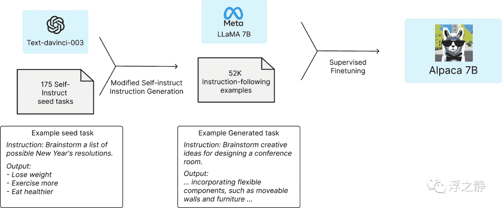

### 表现

作者中的部分人对它进行了一项盲评，评估 Alpaca 7B 和 GPT-3 （具体来说是经过指令训练的 `text-davinci-003` 模型）的指令跟随能力。评估结果表明两者响应的排名大致相等。这是一个令人惊讶的结果，因为 Alpaca 只有 GPT-3 的 1/26 大小。

当然，这只是性能的一个狭窄方面。这并不意味着 Alpaca 在其他领域（如代码生成和科学知识等）的表现与 GPT-3 相同，这些领域在研究中并未进行测试。

### 小结

Alpaca 是微调 LLaMA 模型的不错的一个开始。它在性能方面将被类似的微调方法 Vicuna 超越。

## Vicuna 模型

> Blog： Vicuna: An Open-Source Chatbot Impressing GPT-4 with 90%* ChatGPT Quality [55]

> GitHub： lm-sys/FastChat [56]

> 在线体验： Chat with Open Large Language Models [57]

Vicuna 是通过微调 LLaMA 模型对从 `ShareGPT.com` [58] 收集的用户共享对话进行训练。它有两种大小可供选择：7B 和 13B。

### 训练

该模型是由加州大学伯克利分校、卡内基梅隆大学、斯坦福大学、加州大学圣地亚哥分校和 MBZUAI 的学术团队进行微调训练的。

它使用 `ShareGPT.com` 上用户分享的 70,000 个 ChatGPT 对话进行训练的。训练 7B 模型的成本仅为 140 美元，训练 13B 模型的成本为 300 美元。

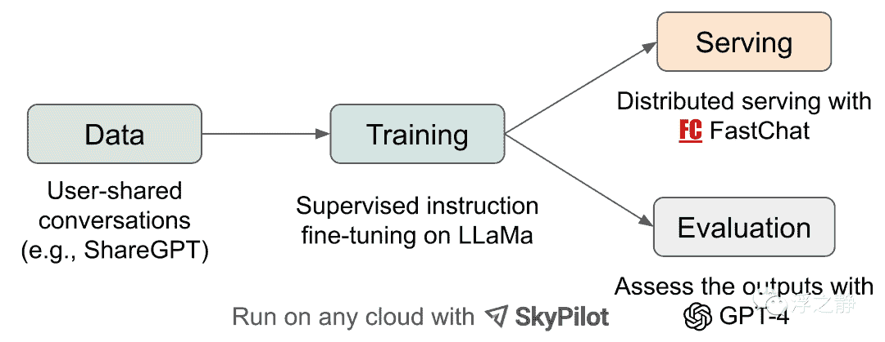

### 表现

根据 Blog 显示输出质量约为 ChatGPT（GPT-4） 的 90％，使其成为可以在本地运行的最佳语言模型。

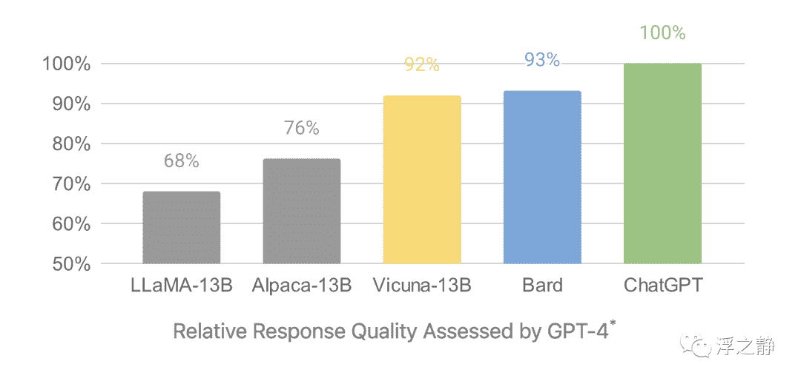

作者使用了一种有趣的方法来评估模型的表现：使用 GPT-4 作为评判标准。他们让 GPT-4 提出一些具有挑战性的问题，并让 Vicuna 和其他最佳语言模型来回答。然后，他们要求 GPT-4 从不同的方面（例如：有用性和准确性）评估答案的质量。

以下是比较 LLaMA、Alpaca、 Bard [59] 和 ChatGPT 的结果。在 GPT-4 的眼中，Vicuna 几乎与 ChatGPT 一样出色，比 LLaMA 和 Alpaca 优异许多。

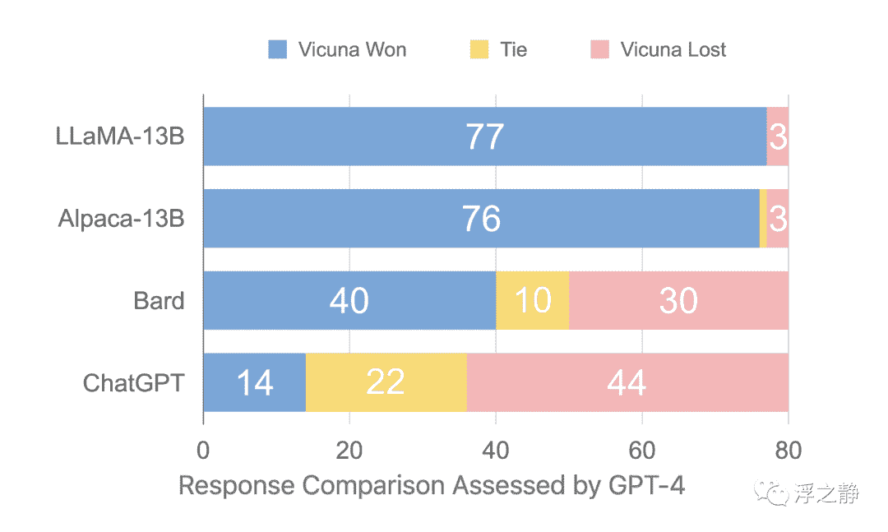

### 小结

当前 Vicuna 模型是你可以在本地运行的最佳 LLaMA 模型之一。但如果未来几周情况发生变化，你也不必感到惊讶。

## Koala 模型

> Blog： Koala: A Dialogue Model for Academic Research [60]

> GitHub： young-geng/EasyLM [61]

> 发布日期：2023 年 4 月

Koala 是一个 LLaMA 7B 和 13B 模型，由加州大学伯克利分校的一个学术团队使用公开可用的对话数据进行微调。

### 训练

为了构建 Koala，团队通过从 Web 和公共数据集中收集对话数据来筛选 Koala 的训练集。其中一部分数据包括用户在线发布的与大型语言模型（如 `ChatGPT`）的对话。Koala 不是通过尽可能多地爬取 Web 数据来最大化数量，而是专注于收集小而高质量的数据集。

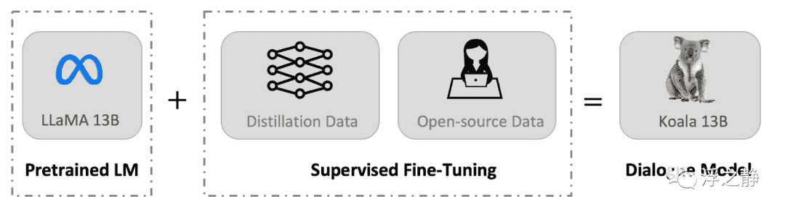

训练数据包括来自多个数据集的过滤数据：

+ ChatGPT 蒸馏数据

+ `ShareGPT`：使用公共 API 收集了用户在 `ShareGPT` 上共享的大约 60K 对话。为了保持数据质量，在用户查询级别进行了重复数据删除，并删除了所有非英语对话，留下大约 30K 个示例。

+ Human ChatGPT Comparison Corpus (HC3)：使用来自 HC3 英语数据集 [62] 的人类和 `ChatGPT` 响应，其中包含约 60K 人类答案和 27K `ChatGPT` 答案，用于约 24K 问题，从而产生总数约 87K 的问答示例。

+ 开源数据

+ Open Instruction Generalist (OIG)：使用由 LAION 策划的 Open Instruction Generalist [63] 数据集的手动选择的子集。具体是 grade-school-math-instructions、poetry-to-songs 和 plot-screenplay-books-dialogue 数据集。这总共约有 30k 个例子。

+ Stanford Alpaca：使用 Alpaca 训练数据集，该数据集包含大约 52K 个例子，是由 OpenAI 的 `text-davinci-003` 按照自我指导过程生成的。值得注意的是，HC3、OIG 和 Alpaca 数据集是单轮问答，而 `ShareGPT` 数据集是对话会话。

+ Anthropic HH：Anthropic HH 数据集 [64] 包含对模型输出有害和有帮助性的人类评分。该数据集包含约 160K 个人工评定的示例，其中每个示例由两个聊天机器人的响应组成，其中一个响应由人类优先选择。该数据集为 Koala 模型提供了能力和额外的安全保护。

+ OpenAI WebGPT：OpenAI WebGPT 数据集 [65] 包括总共约 20K 个比较，每个例子包括一个问题、一对模型答案和元数据。这些答案由人类评分，并得到一个优先得分。

+ OpenAI Summarization：OpenAI 摘要数据集 [66] 包含约 93K 个示例，每个示例都包含人类对模型生成的摘要的反馈。人类评估人员从两个选项中选择了更好的摘要。

训练了两个模型：

+ `Koala-Distll`：只使用 ChatGPT 蒸馏数据

+ `Koala-All`：使用所有数据（包括 ChatGPT 蒸馏和开源数据）

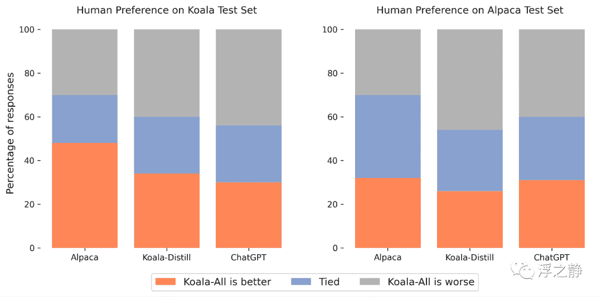

### 小结

数据质量比数量更重要。使用仅 ChatGPT 数据进行微调的 `Koala-Distll` 的性能优于使用其他数据进行训练的 `Koala-All`。在未来，寻找或生成高质量的数据来微调 LLaMA 模型是重要的。

## GPT4-x-Alpaca 模型

> HuggingFace： chavinlo/gpt4-x-alpaca [67]

> 发布日期：2023 年 4 月

GPT4-x-Alpaca 是一个 LLaMA 13B 模型，使用 GPT4 对话集合 `GPTeacher` [68] 进行了微调。关于它的训练和表现的信息不多。以下是一些社区为评估该模型所做的努力：

+ AI Showdown: GPT-4-x-Alpaca vs. Vicuna, GPT-4 as the judge (test in comments) [69]

+ New model: gpt4-x-alpaca-13b-native-4bit-128g !! [70]

## WizardLM 模型

> 论文： WizardLM: Empowering Large Language Models to Follow Complex Instructions [71]

> GitHub： nlpxucan/WizardLM [72]

> 发布日期：2023 年 4 月

WizardLM 是一个经过微调的 7B LLaMA 模型。它通过大量具有不同难度的指令跟随对话进行微调。这个模型的新颖之处在于使用了 LLM 来自动生成训练数据。

### 训练

WizardLM 模型使用一种名为 `Evol-Instruct` [73]（是一种使用 LLM 代人类自主批生成各种难度等级和技术范围的开放指令，以提高 LLM 能力的新方法）的新方法，通过 70k 个计算机生成的指令进行训练，该方法生成具有不同难度级别的指令。

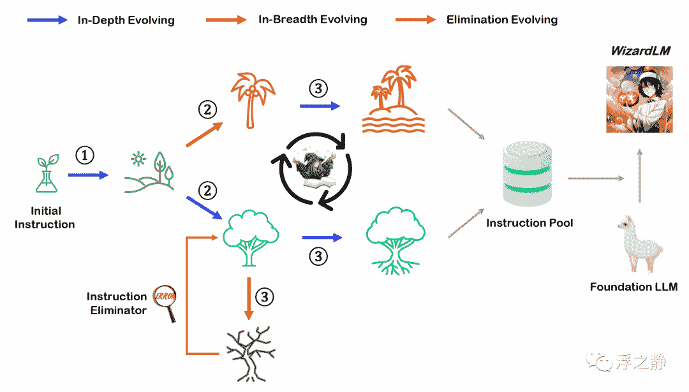

`Evol-Instruct` 使用以下五个操作来扩展提示：

+ 添加约束

+ 深化

+ 具体化

+ 增加推理步骤

+ 复杂输入

这些操作按顺序应用于初始指令以使其更加复杂，回复由 LLM 生成。

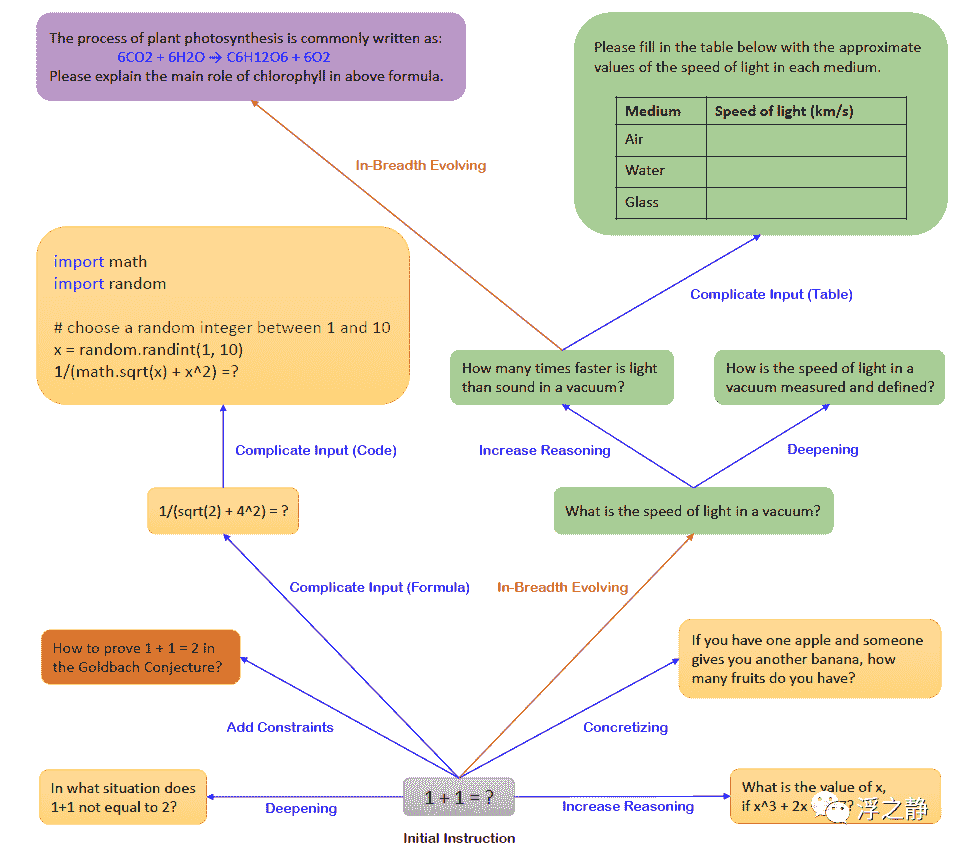

### 表现

为了评估 Wizard，作者在 Wizard 和基线之间进行了盲配对比较（具体来说就是：招募 10 个受过良好教育的人在五个方面对 WizardLM 和其他模型的响应进行评估：相关性，知识水平，推理，计算和准确性进行了 1-5 的排名）。WizardLM 取得了明显优于 Alpaca 和 Vicuna-7b 的结果。

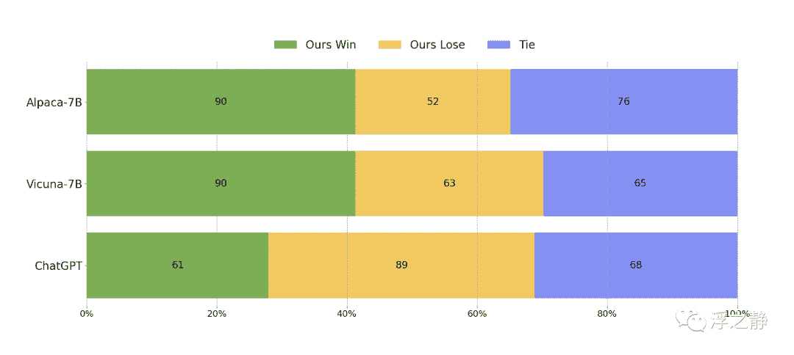

在测试集的高难度部分（难度等级 >= 8）中，甚至表现出优于 ChatGPT 的表现，胜率比 ChatGPT 高 7.9％（42.9％ 对 35.0％）。这表明 Wizard 的方法可以显著提高大型语言模型处理复杂指令的能力。

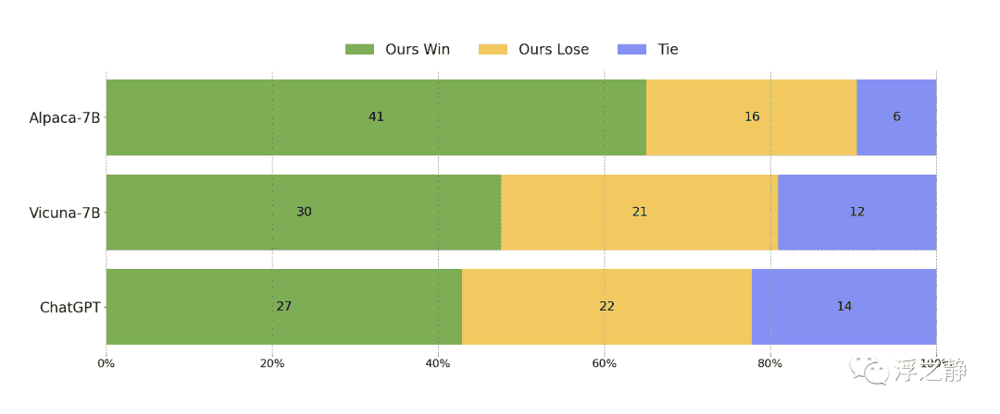

## OpenAssistant 模型

> 官网： Open Assistant [74]

> 论文： OpenAssistant Conversations -- Democratizing Large Language Model Alignment [75]

> GitHub： LAION-AI/Open-Assistant [76]

> 模型： OpenAssistant LLaMa 30B SFT 6 [77]

> 视频： OpenAssistant RELEASED! The world's best open-source Chat AI! [78]

> 在线体验： Large Language Model Chat API [79]

> 发布日期：2023 年 4 月

OpenAssistant 是一个开源项目，旨在开发免费提供给所有人使用的 AI 聊天机器人。训练数据集 OpenAssistant Conversations 包含了超过 60 万个涉及各种主题的交互，用于训练各种模型。目前发布了经过指令调整的 LLaMA 13B 和 30B 模型，以及其他使用相同数据集训练的模型。（了解更多 《Open Assistant：开源聊天助手》 ）

## Lit-LLaMA

# 大型语言模型

`Lightning-AI/lit-llama` [80] ：基于 `nanoGPT`（用于训练/微调中型 GPT 的最简单、最快的存储库） 实现的 `LLaMA` 语言模型。支持 `flash attention`、`Int8` 和 `GPTQ` `4bit` 量化、`LoRA` 和 `LLaMA-Adapter` 微调、预训练。项目采用 Apache 2.0 开源许可证 [81] 。

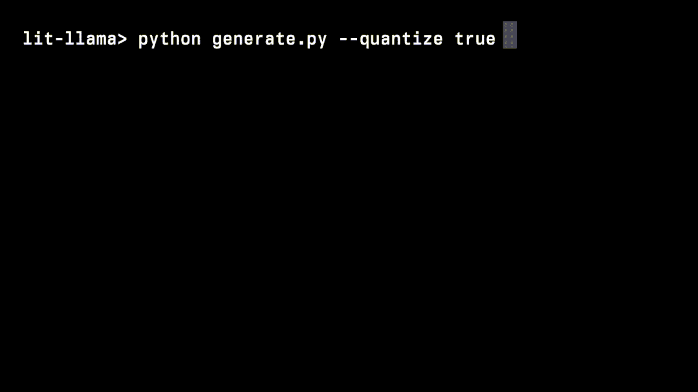

> `Lit-LLaMA` 认为人工智能应该完全开源并成为集体知识的一部分。但原始的 `LLaMA` 代码采用 GPL 许可证 [82] ，这意味着使用它的任何项目也必须在 GPL 下发布。这“污染”了其他代码，阻止了与生态系统的集成。`Lit-LLaMA` 永久性地解决了这个问题。

## `Dolly`

> Blog： Hello Dolly: Democratizing the magic of ChatGPT with open models [83]

> GitHub： `databrickslabs/dolly` [84]

> 模型：

+   `EleutherAI/gpt-j-6b` [85]

+   `databricks/dolly-v2-12b` [86] ：`Dolly2.0` 是第一个开源的指令跟随型大型语言模型，通过在经过授权用于研究和商业用途的人工生成指令数据集上进行微调。

`Dolly` 是一款基于 `EleutherAI` [87] 开源 6 亿参数模型修改而来的 LLM（Language Model），能够表现出类似于 ChatGPT 的指令跟随能力，并且能够在生成文本、头脑风暴和开放式问答等方面表现出与 ChatGPT 相似的 定性能力 。其工作原理是在 `Alpaca` 的数据支持下，对 `EleutherAI` 的开源模型 `pythia-12b` [88] 进行微调，以实现头脑风暴和文本生成等指令跟随能力。了解更多 Hello Dolly: Democratizing the magic of ChatGPT with open models [89] 。

## `RedPajama`

> Blog： RedPajama, a project to create leading open-source models, starts by reproducing LLaMA training dataset of over 1.2 trillion tokens [90]

> 数据集： `togethercomputer/RedPajama-Data` [91]

`RedPajama` 旨在创建一组领先的、完全开源模型的项目。`GPT-4` 等基础模型推动了 AI 的快速改进。然而，最强大的模型是封闭的商业模型或仅部分开放。目前该项目第一步已完成：复制超过 1.2 万亿个标记的 `LLaMA` 训练数据集。（了解更多 《RedPajama 开源：1.2 万亿数据集的可商用语言模型！》 ）

## `ChatLLaMa`

> 注意：此库不包含 `LLaMA` 的权重；要访问权重，需要申请 Meta 的表格。

`ChatLLaMa` [92] 可以让你使用自己的数据和尽可能少的计算量有效地利用 LLM 的微调功能。其目的是通过抽象计算优化和收集大量数据所需的工作，让开发人员高枕无忧。

## `StableLM`

> Blog： Stability AI Launches the First of its StableLM Suite of Language Models [93]

> GitHub： `stability-AI/stableLM` [94]

> 模型： `StableVicuna-13B` [95]

> 体验地址： `StableLM-Tuned-Alpha-7b` Chat [96]

2022 年，[Stability AI 推出了 Stable Diffusion](http://mp.weixin.qq.com/s?__biz=MzIzNjE2NTI3NQ==&mid=2247486123&idx=1&sn=41acac97713efcbdfe672a51bdf2315d&chksm=e8dd4b5fdfaac249a5c2a509ed09602960152ca55601eee24411b256c39b6dd2760c96f55703&scene=21#wechat_redirect)，这是一种革命性的图像模型，代表了专有 AI 的透明、开放和可扩展的替代方案。随着 `StableLM` 模型套件的推出，Stability AI 正在继续使基础 AI 技术对所有人可用。`StableLM` 模型可以生成文本和代码，并为一系列下游应用提供支持。它们展示了小而高效的模型如何在适当的训练下提供高性能。（了解更多 《 StableLM 开源: Stability AI 发布可商用语言模型！》 ）

## `LangChain`

> 官网： `LangChain` [97]

> GitHub： `wchase17/langchain` [98]

大型语言模型 (LLM) 正在成为一种变革性技术，`LangChain` 使开发人员能够构建他们以前无法构建的应用程序。然而，单独使用这些 LLM 往往不足以创建一个真正强大的应用程序——当你可以将它们与其他计算或知识来源相结合时，真正的力量就来了。

# 本机运行

## 运行 `LLaMA`

在软件工程方面的发展同样令人瞩目。目前，在个人电脑上运行 `LLaMA` 模型有两种方式：

+   文本终端

+   `llama.cpp` [99] ：主要目标是在 MacBook 上使用 4 位整数量化运行 `LLaMA` 模型

+   图形界面

+   `nat/openplayground` [100] ：LLM 游乐场，支持来自 OpenAI、Anthropic、Cohere、Forefront、HuggingFace、Aleph Alpha 和 `llama.cpp` 的任何模型。

+   `oobabooga/text-generation-webui` [101] ：用于运行 `LLaMA`、`llama.cpp`、`GPT-J`、`Pythia`、`OPT` 和 `GALACTICA` 等大型语言模型的 gradio web UI。

+   `nsarrazin/serge` [102] ：基于 `llama.cpp` 的聊天界面，用于运行 `Alpaca` 模型。完全自托管，不需要 API 密钥。适合 4GB RAM 并在 CPU 上运行。

### `llama.cpp`

`llama.cpp` 是用 C++ 编写的，其目标是在 Macbook 上运行 `LLaMA` 模型。它针对 Apple Silicon M1/M2 [103] 进行了优化。

支持 4 位整数量化，以减少 `LLaMA` 模型所需的资源。量化模型可以减少存储和 RAM 使用量，但会略微降低质量。一个 7B 模型最初需要 13GB 的磁盘空间和 RAM 才能加载。经过 4 位量化后，只需要约 4GB。

然而，它只支持在文本终端中使用。你也可以使用 `nat/openplayground` 或 `oobabooga/text-generation-webui` 作为 `llama.cpp` 的 GUI。

> `4-bit integer quantization`：

> 是一种将神经网络参数从浮点数转换为整数的技术，旨在减少模型存储和内存占用的大小，以便在移动设备等资源受限的环境中使用。

> 在传统的神经网络中，每个参数都是一个浮点数，通常需要 4 个字节存储。但是，在 `4-bit` 整数量化中，每个参数被近似为一个整数，只需要 1 个字节存储。虽然这样会牺牲一些模型精度，但由于整数计算通常比浮点数计算快，因此它可以加速神经网络的计算速度。

> `4-bit` 整数量化通常是在训练后应用的，使用一些技术来最小化精度损失，例如权重裁剪和量化感知训练。

### `nat/openplayground`

+   使用来自 OpenAI、Anthropic、Cohere、Forefront、HuggingFace、Aleph Alpha 和 `llama.cpp` 的任何模型

+   完整的 playground UI，包括历史记录、参数调整、键盘快捷键和 `logprops`

+   使用相同的提示并排比较模型，单独调整模型参数，然后使用不同的参数重试

+   自动检测 HuggingFace 缓存中的本地模型，并允许你安装新模型

+   在手机上运行

+   ...

### `oobabooga/text-generation-webui`

+   用于在模型之间切换的下拉菜单

+   类似于 OpenAI 游乐场的笔记本模式

+   对话和角色扮演的聊天模式

+   指令模式兼容 `Alpaca`、`Vicuna`、`Open Assistant`、`Dolly`、`Koala` 和 `ChatGLM` 格式

+   显示优化：HTML，Markdown，LaTeX 等

+   ...

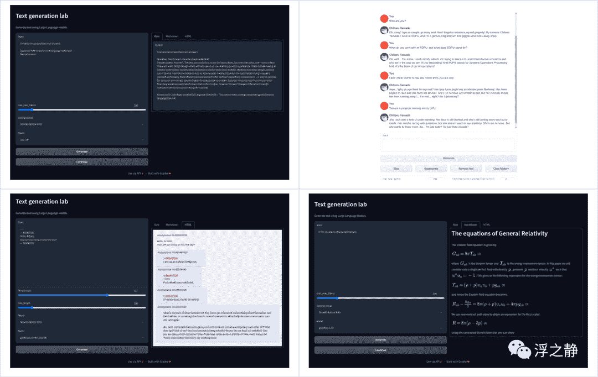

### `nsarrazin/serge`

你的自助式私人助理。没有远程 API，没有数据收集，没有广告。

## `WebLLM`

`WebLLM` [104] 将大型语言模型和聊天引入网络浏览器。一切都在浏览器内运行，无需服务器支持，并使用 `WebGPU` 加速。这开辟了许多有趣的机会，可以为每个人构建 AI 助手，并在享受 GPU 加速的同时实现隐私。

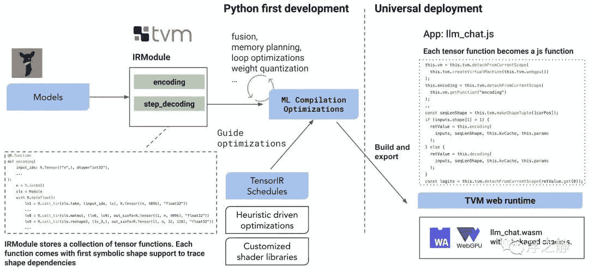

## `Web Stable Diffusion`

`Web Stable Diffusion` [105] 为网络浏览器带来 `Stable Diffusion` 模型。一切都在浏览器内运行，无需服务器支持。据项目作者称，这是世界上第一个完全在浏览器上运行的 `Stable Diffusion`。

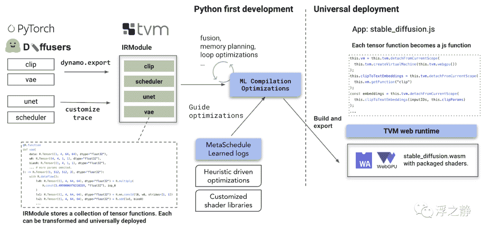

# 图像生态

## `Stable Diffusion`

> 论文： High-Resolution Image Synthesis with Latent Diffusion Models [106]

> GitHub： Latent Diffusion Models [107]

> 可视化界面： `AUTOMATIC1111/stable-diffusion-webui` [108]

`Stable Diffusion` [109] （稳定扩散）是一个潜在的文本到图像扩散模型。 Stability AI [110] 和 Runway [111] 的合作，`Stable Diffusion` 得以实现。得益于 Stability AI 的慷慨计算机捐赠和 LAION [112] 的支持，`Stable Diffusion` 在 LAION-5B [113] 数据库的一个子集上训练了一个 512x512 图像的潜在扩散模型。类似于 Google 的 `Imagen` [114] ，该模型使用一个冻结的 `CLIP` `ViT-L/14` 文本编码器来对模型进行文本提示的调节。该模型具有 860M `UNet` 和 123M 文本编码器，相对较轻，可以在至少拥有 10GB VRAM 的 GPU 上运行。（了解更多 《 Stable Diffusion 入门 》 ）

## `Segment Anything`

> 论文： Segment Anything [115]

> Blog： Introducing Segment Anything: Working toward the first foundation model for image segmentation [116]

> GitHub： `facebookresearch/segment-anything` [117]

> 官网： Segment Anything (Research by Meta AI) [118]

> 数据集： Segment Anything Dataset [119]

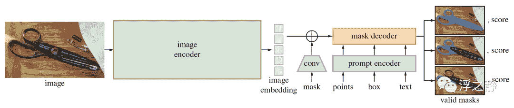

“`Segment Anything Model`”（`SAM`）可以从点或框等输入提示生成高质量的对象蒙版，可用于为图像中的所有对象生成蒙版。它已经在包含 1.1 亿个蒙版的 1100 万个图像数据集上进行了训练，并在各种分割任务上具有强大的零样本性能。

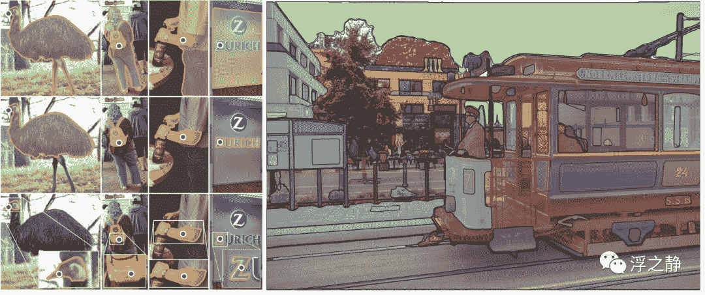

## References

[1]

Image Creator: https://www.bing.com/images/create

[2]

GPT-3: https://github.com/openai/gpt-3

[3]

ChatGPT 发布: https://openai.com/blog/chatgpt

[4]

Blake Lemoine Says Google's LaMDA AI Faces 'Bigotry': https://www.wired.com/story/blake-lemoine-google-lamda-ai-bigotry

[5]

LLM BLOOM: https://bigscience.huggingface.co/blog/bloom

[6]

ChatGPT Plus: https://openai.com/blog/chatgpt-plus

[7]

ChatGPT 和 Whisper API: https://openai.com/blog/introducing-chatgpt-and-whisper-apis

[8]

ChatGPT 插件: https://openai.com/blog/chatgpt-plugins

[9]

GPT-4: https://openai.com/product/gpt-4

[10]

BLOOM: https://huggingface.co/bigscience/bloom

[11]

GitHub Copilot X: https://github.com/features/preview/copilot-x

[12]

Google Bard: https://bard.google.com

[13]

Adobe Firefly: https://firefly.adobe.com

[14]

DeepSpeed: https://github.com/microsoft/DeepSpeed

[15]

MiniGPT-4: Enhancing Vision-Language Understanding with Advanced Large Language Models: https://arxiv.org/abs/2304.10592

[16]

Plug-and-Play VQA: Zero-shot VQA by Conjoining Large Pretrained Models with Zero Training: https://arxiv.org/abs/2210.08773

[17]

Flamingo: a Visual Language Model for Few-Shot Learning: https://arxiv.org/abs/2204.14198

[18]

Vision-CAIR/MiniGPT-4: https://github.com/Vision-CAIR/MiniGPT-4

[19]

Vision-CAIR/MiniGPT-4: https://huggingface.co/Vision-CAIR/MiniGPT-4

[20]

Vision-CAIR/cc_sbu_align: https://huggingface.co/datasets/Vision-CAIR/cc_sbu_align

[21]

Minigpt-4: https://minigpt-4.github.io

[22]

Q-Former: https://github.com/ViTAE-Transformer/QFormer

[23]

minGPT: https://github.com/karpathy/minGPT

[24]

GPT: https://github.com/openai/gpt-2

# 参考文献

[25] `mingpt/model.py`: https://github.com/karpathy/minGPT/blob/master/mingpt/model.py

[26] Transformer: https://arxiv.org/abs/1706.03762

[27] nanoGPT: https://github.com/karpathy/nanoGPT

[28] GPT4Free: https://github.com/xtekky/gpt4free

[29] Auto-GPT: https://github.com/Significant-Gravitas/Auto-GPT

[30] AgentGPT: https://github.com/reworkd/AgentGPT

[31] AudioGPT: Understanding and Generating Speech, Music, Sound, and Talking Head: https://arxiv.org/abs/2304.12995

[32] AIGC-Audio/AudioGPT: https://github.com/AIGC-Audio/AudioGPT

[33] AudioGPT Demo: https://huggingface.co/spaces/AIGC-Audio/AudioGPT

[34] DocsGPT: https://github.com/arc53/DocsGPT

[35] acheong08/ChatGPT: https://github.com/acheong08/ChatGPT

[36] acheong08/EdgeGPT: https://github.com/acheong08/EdgeGPT

[37] A brief history of LLaMA models: https://agi-sphere.com/llama-models

[38] LLaMA: Open and Efficient Foundation Language Models: https://arxiv.org/abs/2302.13971

[39] Introducing LLaMA: A foundational, 65-billion-parameter large language model: https://ai.facebook.com/blog/large-language-model-llama-meta-ai

[40] facebookresearch/LLaMA: https://github.com/facebookresearch/llama

[41] Google 表单申请: https://docs.google.com/forms/d/e/1FAIpQLSfqNECQnMkycAp2jP4Z9TFX0cGR4uf7b_fBxjY_OjhJILlKGA/viewform

[42] Facebook LLAMA is being openly distributed via torrents: https://news.ycombinator.com/item?id=35007978

[43] qBittorrent: https://www.qbittorrent.org

[44] uTorrent: https://www.utorrent.com

[45] NVIDIA 3090: https://www.nvidia.com/en-us/geforce/graphics-cards/30-series/rtx-3090-3090ti

[46] Transformer: A Novel Neural Network Architecture for Language Understanding: https://ai.googleblog.com/2017/08/transformer-novel-neural-network.html

[47] CommonCrawl: https://commoncrawl.org

[48] C4: https://huggingface.co/datasets/c4

[49] SentencePiece: https://github.com/google/sentencepiece

[50] Google BigQuery: https://cloud.google.com/bigquery

[51] LLaMA: Open and Efficient Foundation Language Models: https://arxiv.org/abs/2302.13971v1

[52] Self-Instruct: Aligning Language Model with Self Generated Instructions: https://arxiv.org/abs/2212.10560

[53] Alpaca: A Strong, Replicable Instruction-Following Model: https://crfm.stanford.edu/2023/03/13/alpaca.html

[54] tatsu-lab/stanford_alpaca: https://github.com/tatsu-lab/stanford_alpaca

[55] Vicuna: An Open-Source Chatbot Impressing GPT-4 with 90% ChatGPT Quality: https://vicuna.lmsys.org

[56] lm-sys/FastChat: https://github.com/lm-sys/FastChat

[57] Chat with Open Large Language Models: https://chat.lmsys.org

[58] ShareGPT.com: https://sharegpt.com

[59] Bard: https://blog.google/technology/ai/bard-google-ai-search-updates

[60] Koala: A Dialogue Model for Academic Research: https://bair.berkeley.edu/blog/2023/04/03/koala

[61] young-geng/EasyLM: https://github.com/young-geng/EasyLM

[62] HC3 英语数据集: (https://arxiv.org/abs/2301.07597)

[63] Open Instruction Generalist: https://laion.ai/blog/oig-dataset

[64] Anthropic HH 数据集: https://huggingface.co/datasets/Anthropic/hh-rlhf

[65] OpenAI WebGPT 数据集: https://huggingface.co/datasets/openai/webgpt_comparisons

[66] OpenAI 摘要数据集: https://huggingface.co/datasets/openai/summarize_from_feedback

[67] chavinlo/gpt4-x-alpaca: https://huggingface.co/chavinlo/gpt4-x-alpaca

[68] GPTeacher: https://github.com/teknium1/GPTeacher

[69] AI Showdown: GPT-4-x-Alpaca vs. Vicuna, GPT-4 as the judge (test in comments): https://www.reddit.com/r/LocalLLaMA/comments/12lksqo/ai_showdown_gpt4xalpaca_vs_vicuna_gpt4_as_the

[70] New model: gpt4-x-alpaca-13b-native-4bit-128g !!: https://github.com/oobabooga/text-generation-webui/discussions/727

[71] WizardLM: Empowering Large Language Models to Follow Complex Instructions: https://arxiv.org/abs/2304.12244

[72] nlpxucan/WizardLM: https://github.com/nlpxucan/WizardLM

[73] Evol-Instruct: https://github.com/nlpxucan/evol-instruct

[74] Open Assistant: https://open-assistant.io

[75] OpenAssistant Conversations -- Democratizing Large Language Model Alignment: https://arxiv.org/abs/2304.07327

[76] LAION-AI/Open-Assistant: https://github.com/LAION-AI/Open-Assistant

[77] OpenAssistant LLaMa 30B SFT 6: https://huggingface.co/OpenAssistant/oasst-sft-6-llama-30b-xor

[78] OpenAssistant RELEASED! The world's best open-source Chat AI!: https://youtu.be/ddG2fM9i4Kk

[79] Large Language Model Chat API: https://huggingface.co/spaces/olivierdehaene/chat-llm-streaming

[80] Lightning-AI/lit-llama: https://github.com/Lightning-AI/lit-llama

[81] Apache 2.0 开源许可证: https://www.apache.org/licenses/LICENSE-2.0

[82] GPL 许可证: https://www.gnu.org/licenses/gpl-3.0.html

[83] Hello Dolly: Democratizing the magic of ChatGPT with open models: https://www.databricks.com/blog/2023/03/24/hello-dolly-democratizing-magic-chatgpt-open-models.html

[84] databrickslabs/dolly: https://github.com/databrickslabs/dolly

[85] EleutherAI/gpt-j-6b: https://huggingface.co/EleutherAI/gpt-j-6b

[86] databricks/dolly-v2-12b: https://huggingface.co/databricks/dolly-v2-12b

[87] EleutherAI: https://www.eleuther.ai

[88] pythia-12b: https://huggingface.co/EleutherAI/pythia-12b

[89] Hello Dolly: Democratizing the magic of ChatGPT with open models: https://www.databricks.com/blog/2023/03/24/hello-dolly-democratizing-magic-chatgpt-open-models.html

[90] RedPajama, a project to create leading open-source models, starts by reproducing LLaMA training dataset of over 1.2 trillion tokens: https://www.together.xyz/blog/redpajama

[91] togethercomputer/RedPajama-Data: https://github.com/togethercomputer/RedPajama-Data

[92] ChatLLaMa: https://github.com/nebuly-ai/nebuly/tree/main/optimization/chatllama

[93] Stability AI Launches the First of its StableLM Suite of Language Models: https://stability.ai/blog/stability-ai-launches-the-first-of-its-stablelm-suite-of-language-models

[94] stability-AI/stableLM: https://github.com/stability-AI/stableLM

[95] StableVicuna-13B: https://huggingface.co/lmsys/vicuna-13b-delta-v1.1

[96] StableLM-Tuned-Alpha-7b Chat: https://huggingface.co/spaces/stabilityai/stablelm-tuned-alpha-chat

[97] Langchain: https://blog.langchain.dev

[98] wchase17/langchain: https://github.com/hwchase17/langchain

[99] llama.cpp: https://github.com/ggerganov/llama.cpp

[100] nat/openplayground: https://github.com/nat/openplayground

[101] oobabooga/text-generation-webui: https://github.com/oobabooga/text-generation-webui

[102] nsarrazin/serge: https://github.com/nsarrazin/serge

[103] Apple Silicon M1/M2: https://www.apple.com/newsroom/2022/06/apple-unveils-m2-with-breakthrough-performance-and-capabilities

[104] WebLLM: https://github.com/mlc-ai/web-llm

[105] Web Stable Diffusion: https://github.com/mlc-ai/web-stable-diffusion

[106] High-Resolution Image Synthesis with Latent Diffusion Models: https://arxiv.org/abs/2112.10752

[107] Latent Diffusion Models: https://github.com/CompVis/latent-diffusion

[108] AUTOMATIC1111/stable-diffusion-webui: https://github.com/AUTOMATIC1111/stable-diffusion-webui

[109] Stable Diffusion: https://github.com/CompVis/stable-diffusion

[110] Stability AI: https://stability.ai

[111] Runway: https://runwayml.com

[112] LAION: https://laion.ai

[113] LAION-5B: https://laion.ai/blog/laion-5b

[114] Imagen: https://arxiv.org/abs/2205.11487

[115] Segment Anything: https://arxiv.org/abs/2304.02643

[116] Introducing Segment Anything: Working toward the first foundation model for image segmentation: https://ai.facebook.com/blog/segment-anything-foundation-model-image-segmentation

[117] facebookresearch/segment-anything: https://github.com/facebookresearch/segment-anything

[118] Segment Anything (Research by Meta AI): https://segment-anything.com

[119] Segment Anything Dataset: https://segment-anything.com/dataset/index.html
