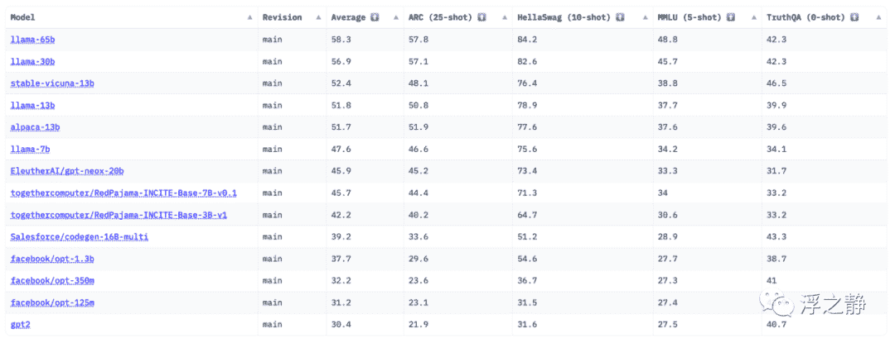
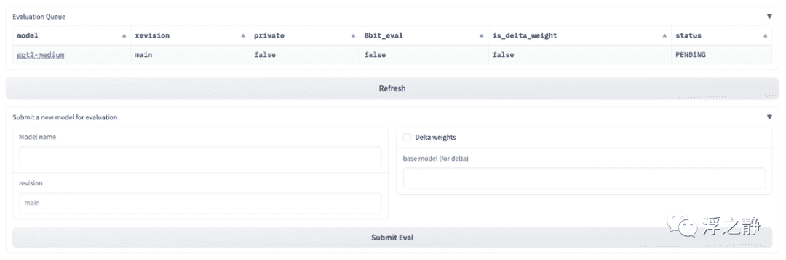

# 🤗 开放式 LLM 排行榜

> 来源：[https://geekbang.feishu.cn/docx/NGFId973XosMjGxONbIcX2PCnyg](https://geekbang.feishu.cn/docx/NGFId973XosMjGxONbIcX2PCnyg)

> 🤵作者： lencx

> 📃 作者介绍：AI 初学者，喜欢分享，热爱开源（GitHub Stars 60k+）。

> ⏰ 收录时间：2024-06-05 16:02:19 (UTC+8)

> 🔗 原文链接：h[ttps://mp.weixin.q](https://mp.weixin.qq.com/s/jJktlIexli43PUvdnfmFtg)q.com/s/jJktlIex...

开放式 LLM 排行榜 [1] 旨在跟踪、排名和评估发布的大型语言模 型（LLMs）和聊天机器人。该排行榜有助于筛选出开源社区中真正取得进展的模型，以及确定当前的技术 水平。评估模型时，使用 Eleuther AI 语言模型评估工具包（ Eleuther AI Language Model Evaluation Harness [2] ）中的四个关键基准。这个评估工具包是一个统一的框架，用于在许多不同的评估任务上测试生成式语言模型。排行榜的一个重要优势是，只要是 Transformers 模 型并在 Hub 上具有权重，社区中的任何人都可以将模型提交进行自动化评估。此外，该排行榜还支持评估具有增量权重的模型，例如 LLaMa 等非商业许可模型。通过这个排行榜，任何人都可以了解到最新的 LLMs 和聊天机器人，并且可以根据排行榜上的信息选择适合自己的模型。

评估是针对以下四个流行基准进行的：

+   AI2 推理挑战（25-shot） ：一组小学科学问题（论文： Think you have Solved Question Answering? Try ARC, the AI2 Reasoning Challenge [3] ）。

+   HellaSwag（10-shot） ：一个测试通识推理的基准，对人类来说很容易（约 95%），但对当前技术水平最高的模型来说具有挑战性（论文： HellaSwag: Can a Machine Really Finish Your Sentence? [4] ）。

+   MMLU（5-shot） ：一个用于衡量文本模型多任务准确性的测试。测试涵盖了 57 个任务，包括初等数学、美国历史、计算机科学、法律等（论文： Measuring Massive Multitask Language Understanding [5] ）。

+   Truthful QA MC（0-shot） ：一个基准，用于衡量语言模型在回答问题时是否真实可信（论文： TruthfulQA: Measuring How Models Mimic Human Falsehoods [6] ）。

之所以选择这些基准，是因为它们在零样本和少样本设置下涵盖了广泛领域的各种推理和通识知识测试。

> **📌 **

> 在 AI 领域中，“shot” 通常指的是训练模型时的样本数量。

> 例如：“25-shot” 是指训练模型时使用了仅有 25 个示例的小样本集合。这种训练方式称为 “few-shot learning”，即在非常有限的数据集上进行训练。在这种情况下，模型需要从这些非常有限的样本中学习，并在测试时表现良好。25-shot 在这里是指每个问题或任务只提供 25 个样本来训练模型。

> “0-shot”（零样本学习：Zero-shot learning，ZSL） 通常是指模型在没有进行任何领域或任务特定训练的情况下，能够直接对一个新任务或新领域的数据进行推理或生成输出。这意味着，模型在没有任何领域或任务特定的样本或训练数据的情况下，能够进行推理或生成输出。0-shot 是一种广义的元学习（meta-learning）方法，能够让模型在没有看到特定任务或领域的样本时，具备进行推理或生成输出的能力。在自然语言处理领域中，0-shot 通常用于衡量模型在处理新的自然语言处理任务或领域时的泛化能力。

🤗 Open LLM Leaderboard 的评估队列，这些模型将在 🤗 集群上自动评估

除了以上图片中包含的模型外，你也可以提交新模型来进行评估。

### References

[1]

开放式 LLM 排行榜: https://huggingface.co/spaces/HuggingFaceH4/open_llm_leaderboard

[2]

Eleuther AI Language Model Evaluation Harness: https://github.com/EleutherAI/lm-evaluation-harness

[3]

Think you have Solved Question Answering? Try ARC, the AI2 Reasoning Challenge: https://arxiv.org/abs/1803.05457

[4]

HellaSwag: Can a Machine Really Finish Your Sentence?: https://arxiv.org/abs/1905.07830

[5]

Measuring Massive Multitask Language Understanding: https://arxiv.org/abs/2009.03300

[6]

TruthfulQA: Measuring How Models Mimic Human Falsehoods: https://arxiv.org/abs/2109.07958