# 如何提高LLMs的文本表征(Text Embedding)能力?

> 来源：[https://geekbang.feishu.cn/docx/DTNnd2Uz5oLsAJxzBTNcum4XnOd](https://geekbang.feishu.cn/docx/DTNnd2Uz5oLsAJxzBTNcum4XnOd)

> 👨🏻 作者：刘聪NLP

> 📃 作者介绍：AIGC前沿知识分享&落地经验总结

> 🛖 知乎主页：https://www.zhihu.com/people/LiuCongNLP

> ⏰ 收录时间：2024-05-23 11:28:42

> 🔗 原文链接：h[ttps://mp.weixin.q](https://mp.weixin.qq.com/s/ZIXjMWKIkgWsFZJGJGgfFQ)q.com/s/ZIXjMWKI...


关注作者公众号，获取更多AI知识

## **写在前面**

大家好，我是刘聪NLP。

目前，大模型落地的可靠方案还是以RAG（retrieval-augmented-generation，检索增强生成）为主，那么检索在大模型落地中就起着重要的作用。而稠密检索可以从语义层面找到与用户Query相关的文档片段，文本表征（Text Embedding）模型也就成为除大模型外的研究内容。

但也许有一些人存在疑惑，为了不用大模型作为文本表征模型呢？前两天就在知乎上刷到了这个问题，今天就来回答一下。


并且分享一篇前几天刚刚刷了MTEB-英文榜单的论文，《Improving Text Embeddings with Large Language Models》，即提高大模型的文本表征。

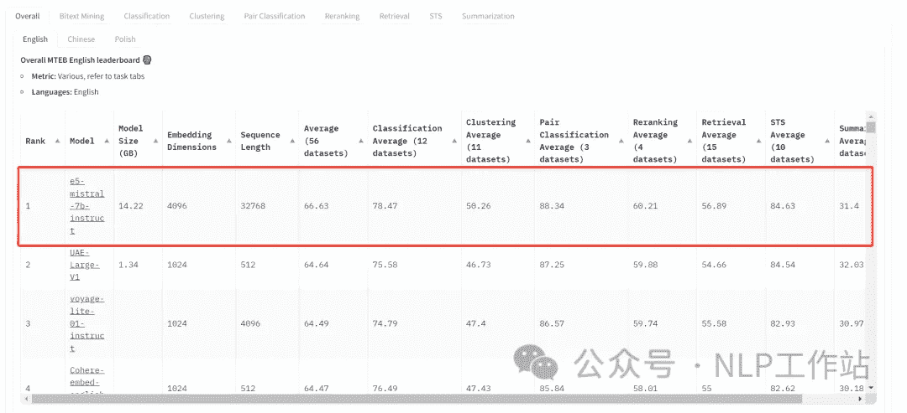

```
HF: https://huggingface.co/intfloat/e5-mistral-7b-instruct
Paper: https://arxiv.org/abs/2401.00368
```

##  为什么主流方法不用直接用大模型进行文本向量表征？

+   效果不理想。现在大模型的训练都是基于文本续写形式来训练的，损失函数主要预测下一个Token是否准确，而不是判断整个句子表征的好坏。因此直接用当前的大模型来对文本进行表征，效果并不理想。但如果将大模型以文本表征为目的的训练，也就用point-wise、pair-wise、list-wise等方法训练大模型，相信大模型文本向量表征一定更好。

之前也分享过一篇OpenAI以GPT3为底座训练的向量表征模型的论文- 《基于对比学习的预训练文本&代码表征技术》 ，欢迎大家阅读。这也可能是现在openai向量接口为什么好的原因吧，内部可能就是用了更大参数的模型。

+   部署成本变高。越大的模型，部署的成本就越高，如果利用大模型进行向量表征，那么部署成本就是翻倍的。BGE等主流向量表征模型，一般都是110M-300M参数量，相较于现在的大模型来说都是极小模型，部署和推理成本都在可接受范围之内的。

+   向量表征模型对负例个数和难度都有一定的要求，当训练资源一定的情况下，模型太大，负例个数就会相对减少，可能负例减少带来的副作用比参数变大带来的好处要大。

知乎：https://www.zhihu.com/question/637789621/answer/3351187000

## ** 提高大模型的文本向量表征**

对于《Improving Text Embeddings with Large Language Models》一文总结就是以下几点：

+   构造高质量训练数据

+   文本向量表征时写好提示词

+   选对底座大模型

### ** 数据构造 **

数据构造方法一般根据已有文档生成查询Query、伪标签或者根据查询Query生成伪文档等，而本文直接挖掘大模型内部存储的知识内容，在不依赖已有文档或查询Query的情况下，生成文档片段和查询Query，因此可以生成更多样化的数据，如下图所示。

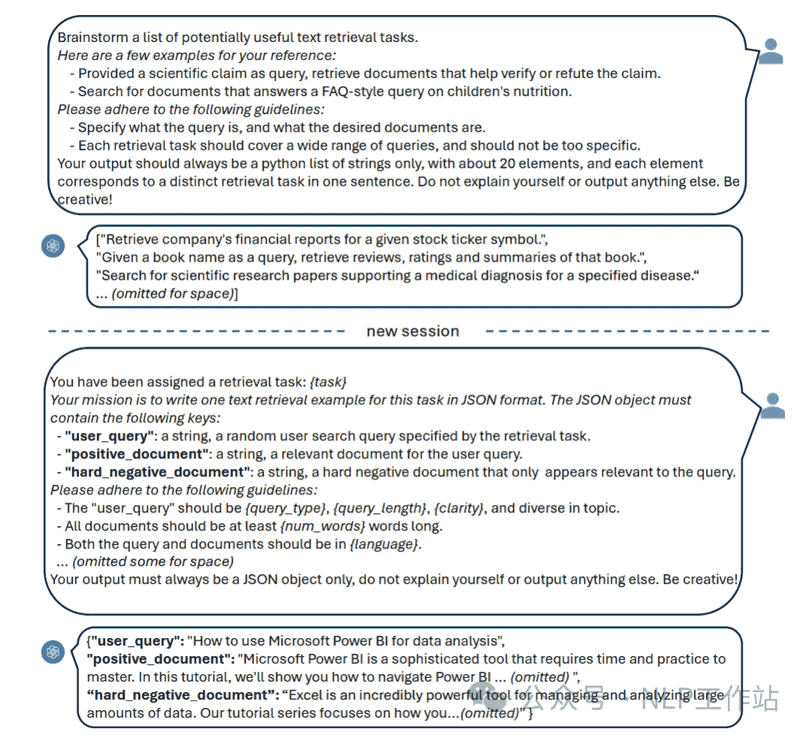

利用GPT-4构造数据样例

数据构造两步走：

+   通过GPT4模型进行头脑风暴，生成固定个数的检索任务列表

+   通过GPT4模型根据上一步生成的任务定义、Query类型、Query长度、Query清晰度、文档片段长度、语言等生成具体示例。

并且在数据构造时，根据向量表征任务不同，划分为非对称任务和对称任务：

+   非对称任务：主要是查询Query和文档片段在语义上相关，但不是彼此之间不能释义（也就是相关但不等同）。并且根据查询Query和文档片段的长度，进一步分为短长匹配、长短匹配、短短匹配和长长匹配。

+   对称任务：主要是询Query和文档片段在语义相似，但表面表达不同，包括单语语义文本相似度（STS）和双语文本检索。

通过150个指令构造了500k个样本，涉及92种语言，其中25%数据由GPT-35-Turbo构造，75%数据由GPT-4构造，详细分布如下图所示。

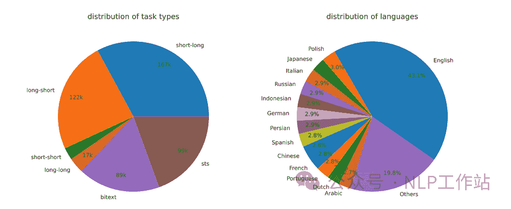

构造数据的任务类型和语言统计

### ** 模型训练 **

模型在训练过程中，将数据末尾添加一个[EOS]标记，文本经过大模型后，将[EOS]标记对应的向量作为整个文本的句子向量。并采用InfoNCE作为损失函数，负例采用Batch内负例和一个难负例。

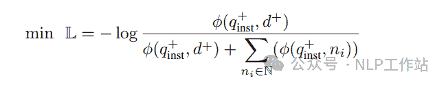

其中，  表示经过提示词改造的查询Query，  表示与查询Query相关的文档片段，  表示与查询Query无关的文档片段。  表示查询  和文档片段  之间的匹配值，采用缩放的余弦相似度表示，缩放值  为超参数，默认为0.02。


模型在训练时，查询Query需要进行提示词改造，文档片段不做提示改造；并且不同数据集下，查询Query拼接的提示词内容不同，详细如下表所示。

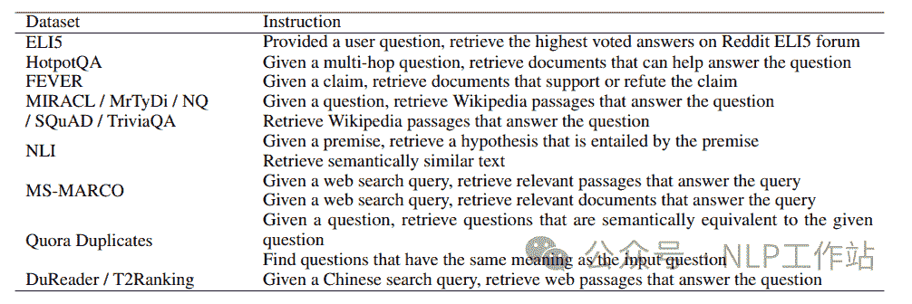

当然，在模型预测时，不同评测榜单中的各个数据的提示词也略有不同，如下表所示。

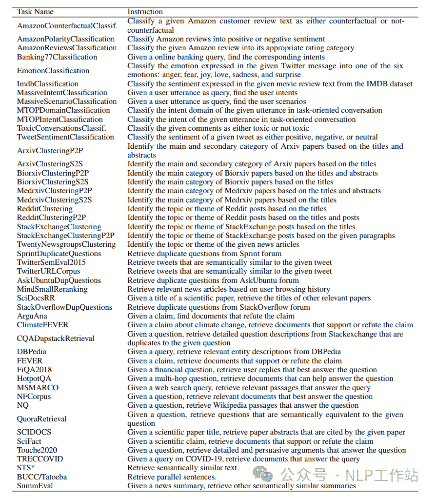

模型训练过程中，采用DeepSpeed ZeRO-3 + Lora方式微调，基模采用mistral-7b模型，rank为16，训练参数共计42M，最大长度为512，批次为2048，学习率为1e-4，在32个V100上训练了18小时。

### ** 结果分析 **

模型在训练过程中，数据不仅涉及利用GPT4生成的数据，还包括：ELI5 、HotpotQA、FEVER、MIRACL、MSMARCO、NQ、NLI、SQuAD、TriviaQA、Quora Duplicate Questions、MrTyDi、DuReader和T2Ranking等多个数据集，共180万训练样本。

通过下表可以看到，在全量数据微调下，可以达到Sota的效果，即便是仅采用生成数据进行微调，效果也比较理想，说明生成数据很重要。

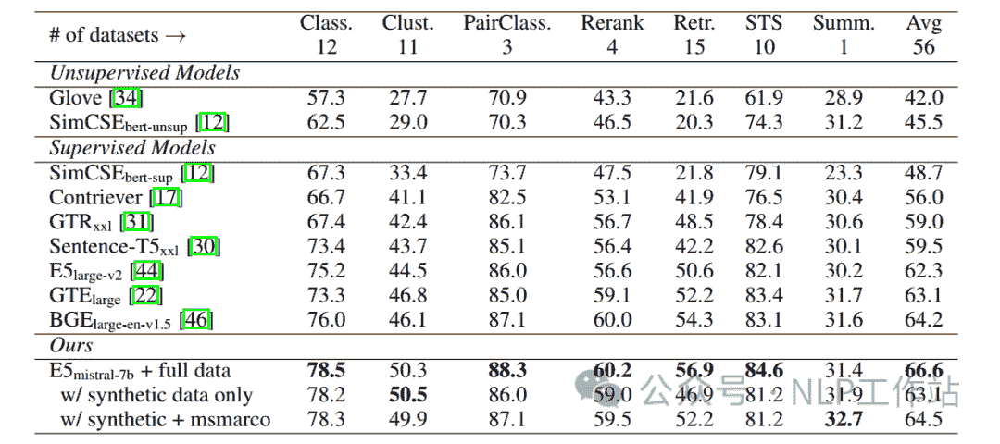

进行一些列的消融实验后，可以看出，基座模型的选择比较重要，选择Llama2-7B要比Mistral-7B低1.6%，说明底座模型越好，预训练数据效果越好，对文本向量表征模型效果越好。并且与上表进行对比，仅用msmarco数据效果为62.7%，用msmarco+构造数据效果为64.5%，进一步说明构造数据的重要性。

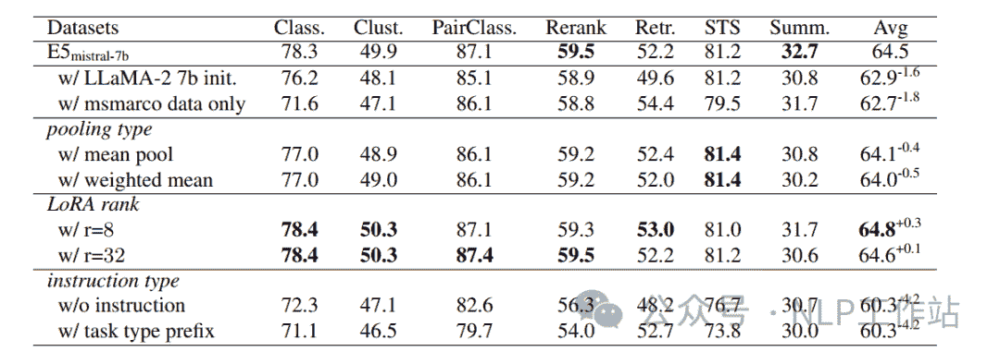

对于文本向量的选择，当选择平均池化和带权重平均时，都存在下过的下降，说明利用文本最后一个Token标记作为文本向量表征的效果较好。Lora的rank值选择不同时，效果也存在些许波动。并且发现，不在查询Query前加入提示词会有4.2%的下降，说明提示词很重要。

同时，对多语言表征进行了结果比较，发现模型在高资源语言下的效果比较理想，在少资源语言下的效果不理想，应该与底座模型Mistral-7B的预训练数据有关。

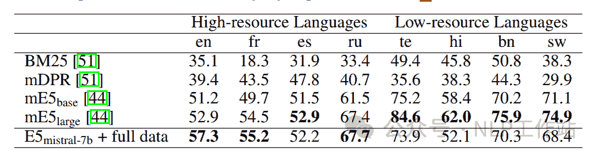

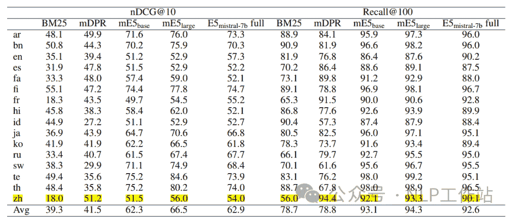

并且做了一个个性化密钥的检索试验，说明基于大模型的向量表征，虽然训练采用512作为最大长度，但可以将文本表征外推到4k。

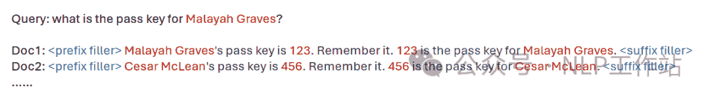

个性化密钥检索示意图

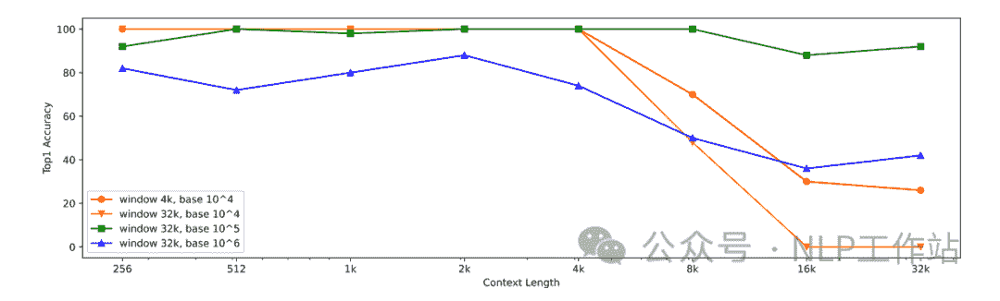

## ** 写在最后**

E5-Misral-7B模型，即使在榜单上比BGE-large高了2个点，但在工业上并不是很实用。参数增加太多了，部署&推理成本也变高。那么是不是可以利用1-2B的大模型来进行向量表征呢？

[**模型虽然大了，但又没大很多！**](https://mp.weixin.qq.com/s?__biz=Mzg5MTU1NTE1OQ==&mid=2247487877&idx=1&sn=c91de52b9b79809a19ad746211083747&scene=21#wechat_redirect)但底座模型效果是关键，可以参考 1-2B参数规模大模型汇总 一文，找到适合你的1-2B参数规模的大模型。

往期推荐：

+   DEITA-大模型指令微调的数据高效筛选方法

+   大模型微调技巧 | 高质量指令数据筛选方法-MoDS

+   辟谣！微软撤回声称ChatGPT为20B参数的论文，并给出解释。

+   [**如何看待微软论文声称 ChatGPT **](https://mp.weixin.qq.com/s?__biz=Mzg5MTU1NTE1OQ==&mid=2247487327&idx=1&sn=593923b9ca8fd01a58e769b52d002884&scene=21#wechat_redirect)是 20B (200亿) 参数量的模型？

+   大模型微调技巧-在Embeeding上加入噪音提高指令微调效果

+   如何从数据集中自动识别高质量的指令数据

+   BaiChuan2技术报告细节分享&个人想法

+   大模型LLM微调经验总结&项目更新

+   [**打造LLM界的Web UI**](https://mp.weixin.qq.com/s?__biz=Mzg5MTU1NTE1OQ==&mid=2247486578&idx=1&sn=8fc505e81e2a479bfaf9b5b15d120808&scene=21#wechat_redirect)

+   是我们在训练大模型，还是大模型在训练我们？

+   [**Llama2技术细节&开源影响**](https://mp.weixin.qq.com/s?__biz=Mzg5MTU1NTE1OQ==&mid=2247486512&idx=1&sn=73d2b6dd73051e85bf6b9f630919f3d9&scene=21#wechat_redirect)

+   [**大模型时代-行业落地再思考**](https://mp.weixin.qq.com/s?__biz=Mzg5MTU1NTE1OQ==&mid=2247486493&idx=1&sn=d58830d103a21e141a20d308f2ad3a83&scene=21#wechat_redirect)

+   垂直领域大模型的一些思考及开源模型汇总

+   如何评估大模型-LLMs的好坏？

+   总结|Prompt在NER场景的应用