# 大语言模型LLM为什么要用旋转位置编码（RoPE）—— 被LLaMA认可的长文本外推性（附代码）

> 来源：[https://geekbang.feishu.cn/docx/Iwr4dj4XRokQ3Tx5Scqcf8Xsnsb](https://geekbang.feishu.cn/docx/Iwr4dj4XRokQ3Tx5Scqcf8Xsnsb)

> 👨🏻 作者：喜欢卷卷的瓦力

> 📃 作者介绍：985海归硕士、计算机专业，前AI大厂研究院高级算法研究员，前国企研究院算法专家，现外企top10上市集团人工智能研究员，算法研究与开发经历6年，深度参与头部大模型产品研发上线，在大模型/语音识别/视觉等领域有丰富的项目经验

> ⏰ 收录时间：2024-05-23 11:28:42

> 🔗 原文链接：h[ttps://mp.weixin.q](https://mp.weixin.qq.com/s/aDWnTDl44🐧YCcicw5G5zQ)q.com/s/aDWnTDl4...

关注作者👸号，获取更多AI知识

作者：瑶光

本文科普了旋转位置编码的设计思路、被LLaMA等大模型选择的原因，并附上了代码。是位置编码系列第二篇。

位置编码的相关概念可以回顾 [大模型LLM为什么要用旋转位置编码](http://mp.weixin.qq.com/s?__biz=Mzg4MTkwMTQ4NA==&mid=2247484149&idx=1&sn=a568fa9e7012eabe6e35941ca5351b28&chksm=cf5fa836f82821209919af2bf09e02aada42192022543e1fe398098adde637742362eb681c05&scene=21#wechat_redirect)（RoPE）-- 解析位置编码的前世今生

**三、旋转位置编码**

**1、 什么是旋转位置编码 **

1.1 设计过程

根据上一篇文章我们知道，绝对位置编码好实现、计算速度快，但相对位置编码更符合语言的分布特性，也具有较强的灵活性。成年人就是既要也要。有没有一种方法把两种编码糅杂在一起呢？

**设计出发点 **：通过绝对位置编码的方式实现相对位置编码。

具体点，就是希望通过设计一种操作f应用在attention机制的k和q上，应用之后的k和q带有了绝对位置信息。由于attention的核心计算是内积操作，所以希望内积完的结果能带有相对位置信息。用公式写就是希望下面的式子成立：

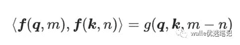

中间的求解过程公式比较多，具体可以看苏神的专栏：https://zhuanlan.zhihu.com/p/359502624

这里我们只放最终结论，最后求得的f为

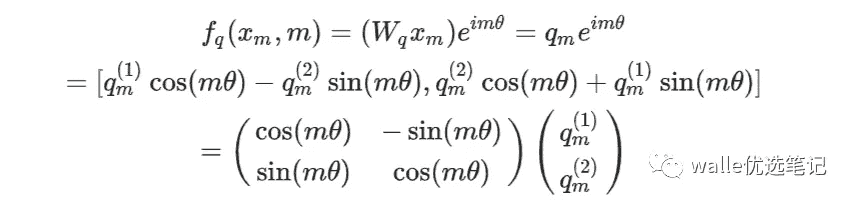

其中

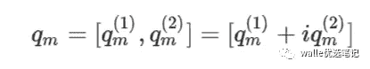

也即 query 向量乘以了一个旋转矩阵，这就是为什么叫做旋转式位置编码的原因。同理可以把q换成k。

最后我们看到

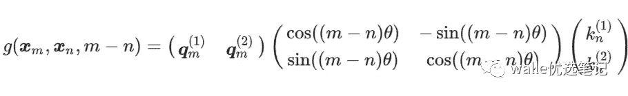

上式的具体推导过程：https://zhuanlan.zhihu.com/p/642884818

我在评论区看到一个很简洁的推导：

假设Ra表示角度为a的旋转矩阵，那么R具有如下性质：

1. Ra^T = R(-a)

2. Ra Rb = R(a+b)

回到旋转位置编码，我们可以去证明 <RaX, RbY> = <X, R(b-a)Y> ，证明如下：

<RaX, RbY>

= (RaX)^T RbY

= X^T Ra^T RbY

= X^T R(b-a) Y

= <X, R(b-a)Y>

现在我们得到了一个编码，它既糅合了绝对位置信息，又能在attention矩阵上表征相对位置信息。

1.2 远程衰减

RoPE形式上和Sinusoidal位置编码有点相似，只不过Sinusoidal位置编码是加性的，而RoPE可以视为乘性的。在θ i 的选 择上，苏神同样沿用了Sinusoidal位置编码的方案，即

θ i = 10000^{-2i/d}

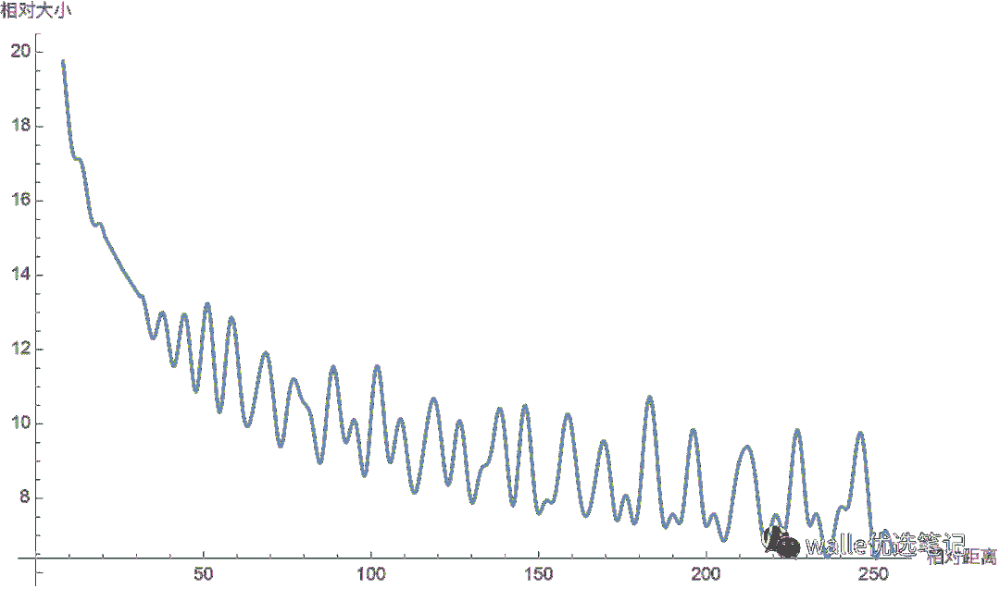

从图中可以看到随着相对距离的变大，内积结果有衰减趋势的出现。也就是离得越远的词汇起的作用越小。

1.3 线性场景

对于RoPE来说，它是用绝对位置编码的方式来实现相对位置编码，不需要操作Attention矩阵，因此有了应用到线性Attention的可能性。为了避免最后算attention时内积为负数或是分母为0，又由于上述变换f乘在q和k上的矩阵是正交的，不改变向量的模长，所以最后attention为

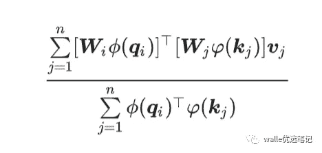

2、 大模型LLaMA、GLM 等使用RoPE的目的

具有较好的外推性。可以直接处理任意长的问题。

啥是外推性？

外推性是指大模型在训练时和预测时的输入长度不一致，导致模型的泛化能力下降的问题。例如，如果一个模型在训练时只使用了512个 token 的文本，那么在预测时如果输入超过512个 token，模型可能无法正确处理。这就限制了大模型在处理长文本或多轮对话等任务时的效果。

**3、 代码实现**

3.1 节省算力

由于内积满足线性叠加性，因此任意偶数维的RoPE，我们都可以表示为二维情形的拼接

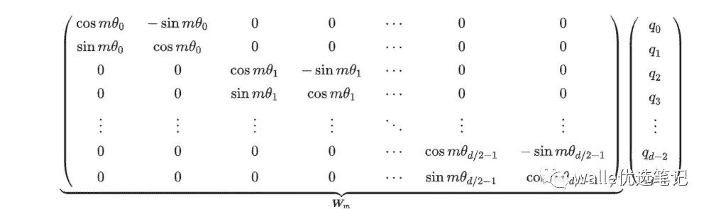

但由于上述矩阵太稀疏，所以推荐实现方式如下：

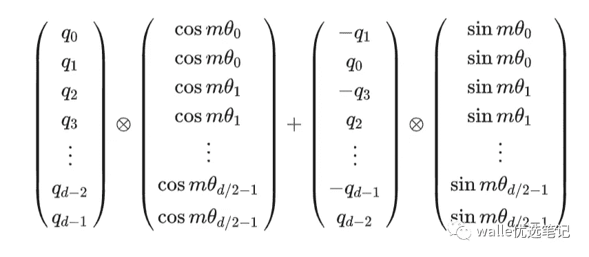

3.2 伪码如下

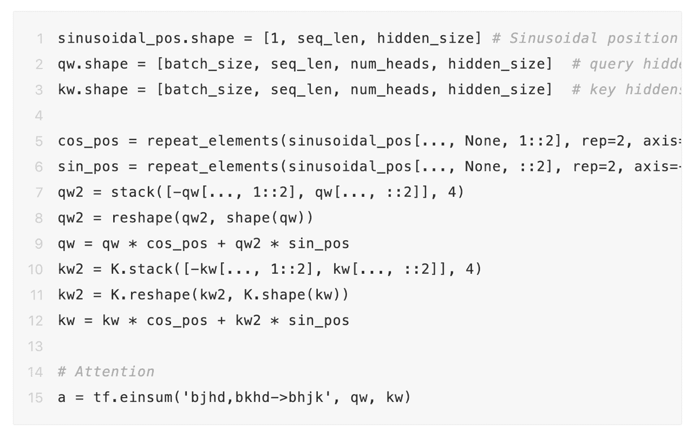

3.3 LLaMA 官方实现代码

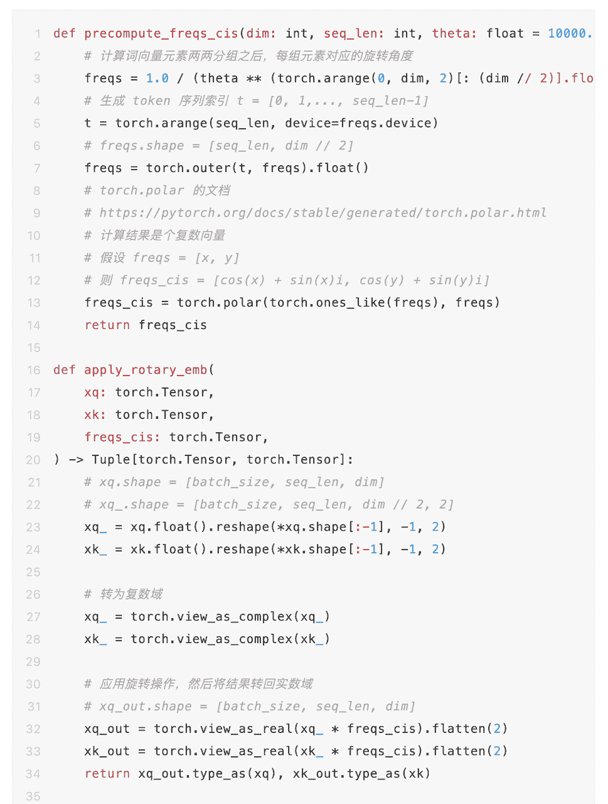

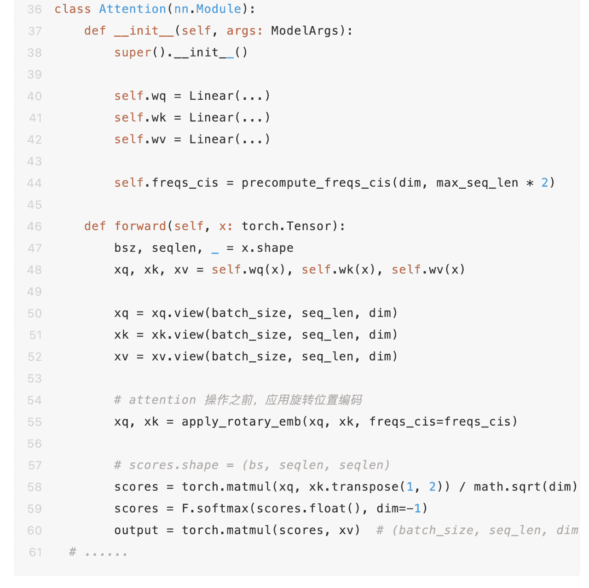

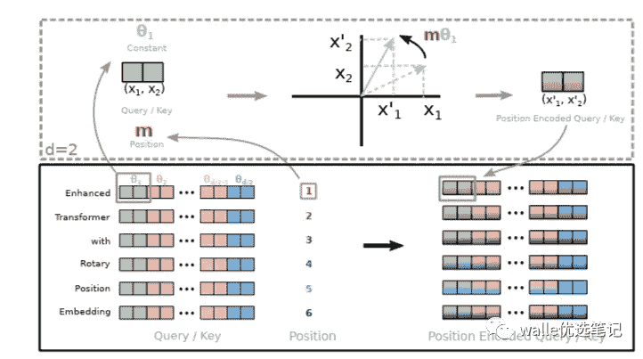

Implementation of Rotary Position Embedding(RoPE)

参考资料：

https://spaces.ac.cn/archives/8130

https://www.zhihu.com/question/606813543/answer/3145466206

https://github.com/ZhuiyiTechnology/roformer

https://zhuanlan.zhihu.com/p/642884818

https://zhuanlan.zhihu.com/p/359502624