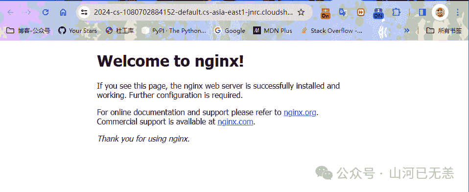
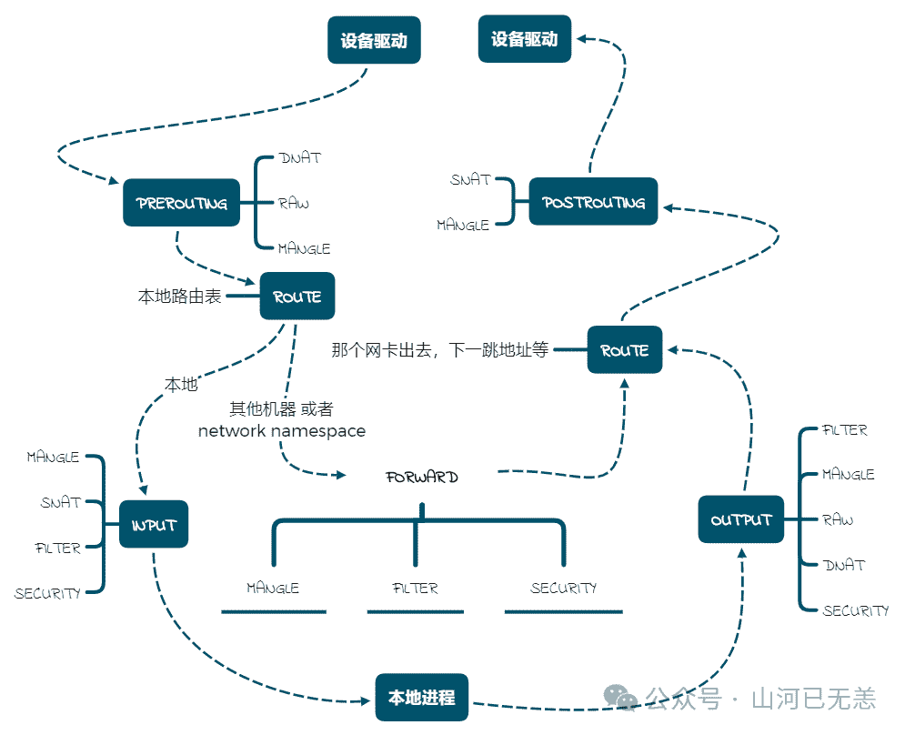

# Docker 容器如何访问外部网络以及端口映射原理？

> 来源：[https://geekbang.feishu.cn/docx/OLNEdvcIVojmlvxd8MZcpDRXnE6](https://geekbang.feishu.cn/docx/OLNEdvcIVojmlvxd8MZcpDRXnE6)
>
> 👨🏻 作者：山河已无恙
>
> 📃 作者介绍：SRE，云原生相关技术干货分享，RHCA/RHCE/RHCAS、CKA 认证，CSDN/51CTO博客专家，InfoQ写作平台/Alibaba Cloud社区签约作者、Huawei Cloud社区云享专家、Tencent Cloud社区内容共创官
>
> ⏰ 收录时间：2024-05-23 11:28:42
>
> 🔗 原文链接：https://mp.weixin.qq.com/s/FITU6TImpKPTTrHQ9kX9zw


关注作者，获取更多相关知识

## 写在前面

+ 整理 `Docker` 容器如何访问外部网络及端口映射原理做简单分享
+ 理解不足的小伙伴帮忙指正

不必太纠结于当下，也不必太忧虑未来，当你经历过一些事情的时候，眼前的风景已经和从前不一样了。——村上春树

---

正常情况下，在 `Docker` 中启动一个容器，这个容器可以自动访问外部网络，今天就来看看 `docker` 中的容器是如何访问外部网络的？

默认情况下，当什么配置都不做，`docker` 会为每个创建的容器使用 `bridge` 网络类型，同时 `docker` 默认使用 `bridge` 网络驱动。

可以通过下面的命令来验证

```
liruilonger@cloudshell:~$ docker network inspect bridge --format='{{.Driver}}'
bridge
liruilonger@cloudshell:~$ docker network inspect bridge
[
    {
        "Name": "bridge",
        "Id": "cd77486c39955f3d2369fe32e1f5b9b65d81c1a07bb677b085cec72b8fb52440",
        "Created": "2024-03-26T13:03:43.742084591Z",
        "Scope": "local",
        "Driver": "bridge",
        "EnableIPv6": false,
        "IPAM": {
            "Driver": "default",
            "Options": null,
            "Config": [
                {
                    "Subnet": "172.17.0.0/16",
                    "Gateway": "172.17.0.1"
                }
            ]
        },
        "Internal": false,
        "Attachable": false,
        "Ingress": false,
        "ConfigFrom": {
            "Network": ""
        },
        "ConfigOnly": false,
        "Containers": {},
        "Options": {
            "com.docker.network.bridge.default_bridge": "true",
            "com.docker.network.bridge.enable_icc": "true",
            "com.docker.network.bridge.enable_ip_masquerade": "true",
            "com.docker.network.bridge.host_binding_ipv4": "0.0.0.0",
            "com.docker.network.bridge.name": "docker0",
            "com.docker.network.driver.mtu": "1460"
        },
        "Labels": {}
    }
]
liruilonger@cloudshell:~$ docker info | grep -i network
  Network: bridge host ipvlan macvlan null overlay
```

## 启动容器与端口映射

现在我们启动一个 `nginx` 容器

```
liruilonger@cloudshell:~$ docker run -d -p 2024:80 --name mynginxs nginx
704b4427a24d56e6a2cc999fcf95125c73e665cb90029b191febc405f90a789a
liruilonger@cloudshell:~$
```

映射端口访问正常



同时在容器内部访问外部网站正常

```
liruilonger@cloudshell:~$ docker ps
CONTAINER ID   IMAGE     COMMAND                  CREATED         STATUS         PORTS                  NAMES
704b4427a24d   nginx     "/docker-entrypoint.…"   2 minutes ago   Up 2 minutes   0.0.0.0:2024->80/tcp   mynginxs
liruilonger@cloudshell:~$ docker exec -it 704b4427a24d bash
root@704b4427a24d:/# curl baidu.com
<html>
<meta http-equiv="refresh" content="0;url=http://www.baidu.com/">
</html>
root@704b4427a24d:/#
```

## 容器访问外部网络原理

现在我们来看看容器访问 `baidu.com` 是如何发生的？在此之前，我需要看一下当前容器的网络配置

```
liruilonger@cloudshell:~$ docker inspect 704b4427a24d
```

之所以能够实现访问外网，下面的配置必不可少

```
        "NetworkSettings": {
            "Bridge": "",
            "SandboxID": "29735aa89eefbbbc03beb8f120aab0d0898de7b46959cf560739748458a1f8ca",
            "SandboxKey": "/var/run/docker/netns/29735aa89eef",
            "Ports": {
                "80/tcp": [
                    {
                        "HostIp": "0.0.0.0",
                        "HostPort": "2024"
                    }
                ]
            },
            "HairpinMode": false,
            "LinkLocalIPv6Address": "",
            "LinkLocalIPv6PrefixLen": 0,
            "SecondaryIPAddresses": null,
            "SecondaryIPv6Addresses": null,
            "EndpointID": "c8e13b9e448504121192937ac4e4619c3dbdcc58fd26b89a601f3bba61dd9f21",
            "Gateway": "172.17.0.1",
            "GlobalIPv6Address": "",
            "GlobalIPv6PrefixLen": 0,
            "IPAddress": "172.17.0.2",
            "IPPrefixLen": 16,
            "IPv6Gateway": "",
            "MacAddress": "02:42:ac:11:00:02",
            "Networks": {
                "bridge": {
                    "IPAMConfig": null,
                    "Links": null,
                    "Aliases": null,
                    "MacAddress": "02:42:ac:11:00:02",
                    "NetworkID": "cd77486c39955f3d2369fe32e1f5b9b65d81c1a07bb677b085cec72b8fb52440",
                    "EndpointID": "c8e13b9e448504121192937ac4e4619c3dbdcc58fd26b89a601f3bba61dd9f21",
                    "Gateway": "172.17.0.1",
                    "IPAddress": "172.17.0.2",
                    "IPPrefixLen": 16,
                    "IPv6Gateway": "",
                    "GlobalIPv6Address": "",
                    "GlobalIPv6PrefixLen": 0,
                    "DriverOpts": null,
                    "DNSNames": null
                }
            }
        }
```

通过上面的配置信息，可以找到有用的信息

IP 地址为：`IPAddress`："172.17.0.2"，网关为：`Gateway`："172.17.0.1"

简单梳理一下流程：

1. 首先在容器内发起对 `baidu.com` 的访问请求
2. 请求首先被容器中网络命名空间（`/var/run/docker/netns/29735aa89eef`）对应的网络栈接收
3. 容器内的网络栈将检查目标地址是否在容器网络的子网范围内。由于 `baidu.com` 不在容器网络内，网络栈确定需要将请求发送到容器外部网络
4. 所以容器要找网关 `172.17.0.1` 把请求发出去。这里的网关地址实际上是在安装 `docker` 时默认创建的桥接虚拟设备 `docker0`

通过下面的命令我们可以看到

```
liruilonger@cloudshell:~$ ifconfig docker0
docker0: flags=4163<UP,BROADCAST,RUNNING,MULTICAST>  mtu 1460
        inet 172.17.0.1  netmask 255.255.0.0  broadcast 172.17.255.255
        ether 02:42:87:21:0a:8b  txqueuelen 0  (Ethernet)
        RX packets 23  bytes 2710 (2.6 KiB)
        RX errors 0  dropped 0  overruns 0  frame 0
        TX packets 23  bytes 4437 (4.3 KiB)
        TX errors 0  dropped 0 overruns 0  carrier 0  collisions 0

liruilonger@cloudshell:~$
```

实际上在创建容器之后，`docker` 会默认帮我们做一些事

+ 会创建一个容器对应的 Linux 网络命名空间
+ 创建一对 `veth pair`，将其中一个端口连接到根命名空间中的网桥 `docker0` 上，另一个端口放置在容器命名空间中。
+ 在容器命名空间中配置 IP 地址（`172.17.0.2`），并将该设备激活。
+ 在根命名空间中启用 IP 转发功能（通过设置 `net.ipv4.ip_forward=1`），同时在容器命名空间配置默认网关（`172.17.0.1`）。
+ 配置 NAT 规则 `SNAT`，将容器网络命名空间中的流量转发的源 IP 地址转化为根命名空间中的 IP 地址。

可以通过 `sudo iptables -t nat -nL` 命令查到 `POSTROUTING` 链中配置的 `SNAT` 规则

```
Chain POSTROUTING (policy ACCEPT)
target     prot opt source               destination
MASQUERADE  all  --  172.17.0.0/16        0.0.0.0/0
```

它将源地址为 `172.17.0.0/16`（`Docker` 桥接网络的子网）的所有数据包的源地址修改为主机的 IP 地址，并将目标地址设置为 `0.0.0.0/0`，表示任何目标地址。这个规则允许位于 `Docker` 桥接网络中的容器访问外部网络和互联网资源。

+ 目标命名空间中的流量将通过默认网关走网桥 IP 地址转发到根命名空间中，并通过根命名空间中的网络设备连接到互联网。

1. 所以在到达网关地址对应的 Linux 网桥设备 `docker0` 之后，因为默认开启了 IPv4 转发，即可以简单理解为把宿主机当交换机，`docker0` 的流量会直接转发到外部网络

```
liruilonger@cloudshell:~$ ip route
default via 10.88.0.1 dev eth0
10.88.0.0/16 dev eth0 proto kernel scope link src 10.88.0.4
172.17.0.0/16 dev docker0 proto kernel scope link src 172.17.0.1
liruilonger@cloudshell:~$
```

2. `Docker` 宿主机的网络栈接收到请求后，宿主机的网络配置设置了 `SNAT`，它将转换容器内部的源 IP 地址为宿主机的 IP 地址，宿主机上的网络栈将根据自己的路由表和网络配置，将请求转发到外部网络，同时以便响应返回时能正确到达容器

3. 之后的请求就是宿主机和公网的通信，这里不多描述

## 总结

所以一般情况下，容器访问外部网络，需要两个因素：

+ `ip_forward`（开启 IPv4 转发）


# SNAT/MASQUERADE（配置 SNAT/MASQUERADE）

所以如果发现容器内访问不了外部网络，则需要确认系统的 `ip_forward` 是否已打开。或者检查 `docker daemon` 启动的时候 `--ip-forward` 参数是不是被设置成 `false` 了，如果是的话，则需要设置 `--ip-forward=true` 重新启动 Docker，Docker 会打开主机的 `ip forward`。

即从容器网段出来访问外部网络的包，都要做一次 `MASQUERADE` ，即出去的包都用主机的 IP 地址替换源地址。

下面为当前容器宿主机所有链上的 `nat` 表的防火墙规则

```
liruilonger@cloudshell:~$ sudo iptables -t nat -nL
Chain PREROUTING (policy ACCEPT)
target     prot opt source               destination
DNAT       tcp  --  0.0.0.0/0            169.254.169.254      tcp dpt:80 to:127.0.0.1:900
DOCKER     all  --  0.0.0.0/0            0.0.0.0/0            ADDRTYPE match dst-type LOCAL

Chain INPUT (policy ACCEPT)
target     prot opt source               destination

Chain OUTPUT (policy ACCEPT)
target     prot opt source               destination
DNAT       tcp  --  0.0.0.0/0            169.254.169.254      tcp dpt:80 to:127.0.0.1:900
DNAT       tcp  --  0.0.0.0/0            169.254.169.254      tcp dpt:8080 to:169.254.169.254:80
DOCKER     all  --  0.0.0.0/0           !127.0.0.0/8          ADDRTYPE match dst-type LOCAL

Chain POSTROUTING (policy ACCEPT)
target     prot opt source               destination
MASQUERADE  all  --  172.17.0.0/16        0.0.0.0/0
MASQUERADE  tcp  --  172.17.0.2           172.17.0.2           tcp dpt:80

Chain DOCKER (2 references)
target     prot opt source               destination
RETURN     all  --  0.0.0.0/0            0.0.0.0/0
DNAT       tcp  --  0.0.0.0/0            0.0.0.0/0            tcp dpt:2024 to:172.17.0.2:80
liruilonger@cloudshell:~$
```

这里我们顺便看一下，容器端口映射的原理，实际上主要在 `DOCKER` 这条自定义链上配置了 `DNAT`

```
Chain DOCKER (2 references)
target     prot opt source               destination
RETURN     all  --  0.0.0.0/0            0.0.0.0/0
DNAT       tcp  --  0.0.0.0/0            0.0.0.0/0            tcp dpt:2024 to:172.17.0.2:80
liruilonger@cloudshell:~$
```

第二个规则是针对源地址为 0.0.0.0/0 ，目标地址为 0.0.0.0/0 ， 目标端口为2024的TCP数据包。这个规则将数据包的目标地址修改为172.17.0.2:80，即将数据包重定向到172.17.0.2的端口80。

这里实际上进行了端口映射的操作,也就是 `DNAT` 发生的地方，它有两处引用

分别是 `PREROUTING` 链和 `OUTPUT` 链，意味着从外面发到本机和本地进程访问本机（由 `iptables` 匹配规则 `ADDRTYPE match dst-type LOCAL` 指定）的 2024 端口的包目的地址都会被修改成 172.17.0.2:80。

关于 `docker` 的端口映射，除了使用 `docker ps` 命令给出容器的端口映射关系，还可以使用 `docker port` 命令查看容器的端口在主机上的映射

这里简单分享一些 `DNAT` 和 `SNAT` 的知识

## SNAT/DNAT 认知

### DNAT

`DNAT` 根据指定条件 修改数据包的目标IP地址和目标端口 。`DNAT` 的原理和我们上文讨论的端口转发原理差不多，差别是端口转发不修改IP地址。使用 `iptables` 做目的地址转换的一个典型例子如下:

```
iptables -t nat -A PREROUTING -d 1.2.3.4  -p tcp -dport 80 -j DNAT  --to-destination 10.20.30.40:8080 
```

+   `-j DNAT` 表示目的地址转换

+   `-d 1.2.3.4 -p tcp --dport 80` 表示匹配的包,条件是访问目的地址和端口为1.2.3.4:80的TCP包

+   `--to-destination` 表示将该包的目的地址和端口修改成 10.20.30.40:8080。

同样，`DNAT` 不修改协议。如果要匹配网卡，可以用 `-i eth0` 指定收到包的网卡(`i` 是 input 的缩写)。需要注意的是，`DNAT` 只发生在 `nat` 表的 `PREROUTING` 链和 `OUTPUT` ，这也是我们要指定收到包的网卡而不是发出包的网卡的原因

当涉及转发的目的IP地址是外机时，需要确保启用 `ip_forward` 功能，即把 Linux :

```
echo 1 &gt; /proc/sys/net/ipv4/ip_forward
```

### SNAT/网络地址欺骗

神秘的网络地址欺骗其实是 `SNAT` 的一种。`SNAT` 根据指定条件修改数据包的源IP地址，即 `DNAT` 的逆操作。与 `DNAT` 的限制类似，`SNAT` 策略只能发生在 `nat` 表的 `POSTROUTING` 链 和 `INPUT` 链。

```
ipttables -t nat -A POSTROUTING -s 192.168.26.12 -o eth0 -j SNAT -to-source 10.127.16.1 
```

+   `-j SNAT` 表示源地址转换

+   `-s 192.168.1.12` 表示匹配的包源地址是 192.168.1.12，

+   `--to-source` 表示将该包的源地址修改成 10.172.16.1。与 `DNAT` 类似

+   `-o eth0` (`o` 是 output 的缩写) 匹配发包的网卡

至于网络地址伪装，与 `SNAT` 类似,其实就是一种特殊的源地址转换，报文从哪个网卡出就用该网卡上的 IP 地址替换该报文的源地址，具体用哪个 IP 地址由内核决定。下面这条规则的意思是：源地址是 10.8.0.0/16 的报文都做一次 Masq 。

```
iptable -t nat -A POSTROUTING -s 10.8.0.0/16 -j MASQUERADE
```



## 博文部分内容参考

© 文中涉及参考链接内容版权归原作者所有，如有侵权请告知 :)

© 2018-2024 liruilonger@gmail.com, All rights reserved. 保持署名-非商用-相同方式共享(CC BY-NC-SA 4.0)
