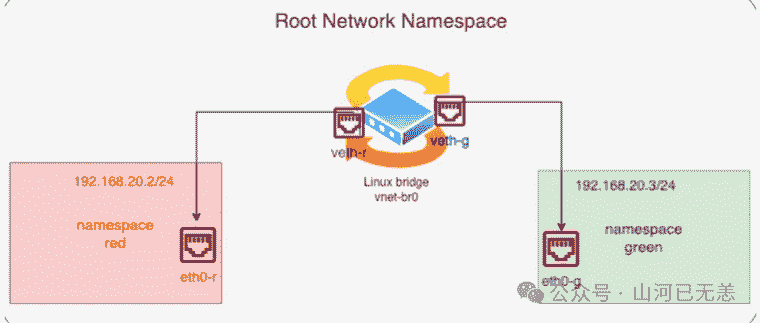

# 从Linux network namespace 认识 Docker 网络模型

> 来源：[https://geekbang.feishu.cn/docx/LLktdFOGHoQe4QxoguYcq2DBntd](https://geekbang.feishu.cn/docx/LLktdFOGHoQe4QxoguYcq2DBntd)

> 👨🏻 作者：山河已无恙

> 📃 作者介绍：SRE，云原生相关技术干货分享，RHCA/RHCE/RHCAS、CKA 认证，CSDN/51CTO博客专家，InfoQ写作平台/Alibaba Cloud社区签约作者、Huawei Cloud社区云享专家、Tencent Cloud社区内容共创官

> ⏰ 收录时间：2024-05-27 11:19:00 (UTC+8)

> 🔗 原文链接： h[ttps://mp.weixin.q](https://mp.weixin.qq.com/s?__biz=MzkyNjIxNTYwMw==&mid=2247497240&idx=1&sn=717929eb1f5a7e75fac02d329017a299&chksm=c2380ac4f54f83d2f713cf94c29cbee71402296766645abdb3994280c9bb41812472a57d6148#rd)q.com/s?__biz=Mz...


关注作者，获取更多相关知识

##

##  **写在前面 **

---

+   很早的一篇博文，后来忙所以没有整理完，整理 k8s 网络相关的知识，顺便整理

+   博文内容涉及 docker 网络模型梳理，以及桥接模式原理剖析，包括一些生产用例

+   理解不足小伙伴帮忙指正

**对每**个人而言，真正的职责只有一个：找到自我。然后在心中坚守其一生，全心全意，永不停息。所有其它的路都是不完整的，是人的逃避方式，是对大众理想的懦弱回归，是随波逐流，是对内心的恐惧 ——赫尔曼·黑塞《德米安》

---

##  **Docker 网络模式简述 **

Docker 在默认情况下，分别会建立一个 bridge 、一个 host 和一个 none 的网络

网络模式简介

|  |  |
| --- | --- |
| Host | 容器将不会虚拟出自己的网卡,配置自己的 IP 等,而是使用宿主机的 IP 和端口，即和根网络命名空间共用一个网络栈 |
| Bridge | 此模式会为每一个容器分配、设置 IP 等,并将容器连接到一个 docker0 虚拟网桥,通过 docker0网桥以及iptables nat表配置与宿主机通信 ，每个容器都是一个独立的网络栈 |
| None | 该模式关闭了容器的网络功能 |
| Container | 创建的容器不会创建自己的网卡,配置自己的 IP, 而是和一个指定的容器共享 ，即和存在的容器公用一个网络栈即命名空间 |

Docker 内置这四个网络，运行容器时，你可以使用该 –network 标志来指定容器应连接到哪些网络,除非你使用该 docker run --network= 选项指定，否则 Docker 守护程序默认将容器连接到 Bridge 网络。

同时如果我们创建自定义网络，默认情况下，不指定类型创建的网络类型也是桥接（Bridge）网络

```
docker network create oa-net
8858411315a892cd61bbe8b31411595dd8b013792fd05ab68806f3ca5572c3a7
```

上面的命令创建了一个名字为 oa-net 的桥接网络

除了运行于单个主机之上的桥接网络,也可以创建一个 overlay 网络, overlay 网络允许跨多台宿主机进行通信。 实际上如果你有跨主机的需求，完全可以使用 k8s 而不是使用 docker。

通过上面的描述我们也可以看到，容器网络本质上是 Linux 网络命名空间特性的利用，简单总结:

+   共享根网络命名空间(网络栈)的就是 Host 模式

+   和某个容器共享网络命名空间的就是 Container 模式，也就是 Host 模式的特殊情况

+   每个容器单独一个网络命名空间的就是 Bridge 模式

+   不使用网络命名空间就是 None 模式。

所以先需要明白什么是 Linux 网络命名空间，是什么

##  network namespace 是什么？

可以通过 ip-netns 帮助文档简单了解

```
┌──[liruilong@liruilongs.github.io]-[~]
└─$man ip-netns | cat
```

网络命名空间 在逻辑上是 网络堆栈 的另一个副本，具有 自己的路由、防火墙规则和网络设备 。

默认情况下， 进程 从其 父进程 继承其 网络名称空间 。 最初， 所有进程共享来自 init 进程的相同默认网络命名空间 。即 Linux 进程 处在和主机相同的 namespace ，即初始的根 namespace 里，默认享有全局系统资源。

按照约定，命名网络命名空间是位于 /var/run/netns/NAME 的可以打开的对象。 打开 /var/run/netns/NAME 产生的文件描述符引用指定的网络名称空间。 保持文件描述符打开可以使网络命名空间保持活动状态。 文件描述符可以与 setns(2) 系统调用一起使用来更改与任务关联的网络命名空间。

对于了解网络命名空间的应用程序，惯例是首先在 /etc/netns/NAME/ 中查找全局网络配置文件，然后在 /etc/ 中查找。 例如，如果您想要不同的用于隔离 VPN 的网络命名空间的 /etc/resolv.conf 版本，您可以将其命名为 /etc/netns/myvpn/resolv.conf 。

ip netns exec 通过 创建安装命名空间 并绑定安装所有每个网络命名空间，自动处理此配置、 网络命名空间 不感知应用程序的文件约定将文件配置到 /etc 中的传统位置。

network namespace 可以说是整个 Linux 网络虚拟化技术的基石,其作用就是 隔离内核资源

Linux 内核自 2.4.19 版本接纳第一个 namespace： Mount namespace(用于隔离文件系统挂载点) 起，到 3.8 版本的 user namespace(用于隔离用户权限) ，总共实现了 6 种不同类型的 namespace (Mount namespace、UTS namespace(主机名)、IPC namespace(进程通信mq)、PID namespace、network namespace和user namespace) 。

默认情况下 network namespace 在 Linux 内核 2.6 版本引入，作用是隔离 Linux 系统的设备，以及 IP 地址、端口、路由表、防火墙规则等 网络资源 。因此，每个网络 namespace 里都有自己的网络设备(如 IP 地址、路由表、端口范围、/proc/net 目录等)。

##  初识 network namespace

network namespace 可以通过系统调用来创建, 当前 network namespace 的增删改查功能已经集成到 Linux 的 ip 工具的 netns 子命令中。

帮助文档中的 Demo

```
   ip netns add vpn
          创建名为vpn的网络名称空间

   ip netns exec vpn ip link set lo up
          在vpn网络名称空间中激活回环接口。
```

创建一个名为 ns_lrl 的 network namespace

```
┌──[root@liruilongs.github.io]-[~]
└─$ip netns list
┌──[root@liruilongs.github.io]-[~]
└─$ip netns add ns_lrl
┌──[root@liruilongs.github.io]-[~]
└─$ip netns list
ns_lrl
```

创建了一个 network namespace 时，系统会在 /var/run/netns 路径下面生成一个挂载点

```
┌──[root@vms105.liruilongs.github.io]-[~]
└─$ls /var/run/netns/ns_lrl
/var/run/netns/ns_lrl
┌──[root@vms105.liruilongs.github.io]-[~]
└─$
```

挂载点的作用一方面是方便对 namespace 的管理，另一方面是使 namespace 即使没有进程运行也能继续存在。

命令空间通过下面的方式激活回环接口后

```
┌──[root@liruilongs.github.io]-[~]
└─$ip netns  exec ns_lrl ip link set lo up
```

可以看到像默认 Linux namespace 一样的本地回环地址

```
┌──[root@liruilongs.github.io]-[~]
└─$ip netns exec ns_lrl ip a
1: lo: &lt;LOOPBACK,UP,LOWER_UP&gt; mtu 65536 qdisc noqueue state UNKNOWN group default qlen 1000
    link/loopback 00:00:00:00:00:00 brd 00:00:00:00:00:00
    inet 127.0.0.1/8 scope host lo
       valid_lft forever preferred_lft forever
    inet6 ::1/128 scope host
       valid_lft forever preferred_lft forever
```

做简单的 ping 测试

```
┌──[root@vms105.liruilongs.github.io]-[~]
└─$ip netns exec ns_lrl  ping 127.0.0.1 -c 3
PING 127.0.0.1 (127.0.0.1) 56(84) bytes of data.
64 bytes from 127.0.0.1: icmp_seq=1 ttl=64 time=0.044 ms
64 bytes from 127.0.0.1: icmp_seq=2 ttl=64 time=0.033 ms
64 bytes from 127.0.0.1: icmp_seq=3 ttl=64 time=0.031 ms

--- 127.0.0.1 ping statistics ---
3 packets transmitted, 3 received, 0% packet loss, time 2024ms
rtt min/avg/max/mdev = 0.031/0.036/0.044/0.005 ms
┌──[root@vms105.liruilongs.github.io]-[~]
└─$
```

##  配置 network namespace 之间通信

###  虚拟以太网对(veth pair)

我们来看一个 Demo，两个网络命名空间如何通信,在这之前，先看一点理论，

veth pair 是 Virtual Ethernet(虚拟以太网)接口在 Linux 中的一种实现方式。 veth 接口具有以下特点:

veth 是一对接口,分别位于两个不同的 network namespace 中。这一对接口通过 内核实现软链接 ,可将不同 namespace 中的数据连接起来。数据可以直接在这一对接口间进行传输,实现了 namespace 间的数据通信。

创建一个网络命名空间

```
┌──[liruilong@liruilongs.github.io]-[~]
└─$ip netns add net1
mkdir /var/run/netns failed: Permission denied
```

需要 root 才行，切一下 root,这里需要说明

+   非 root 进程被分配到 network namespace 后只能访问和配置已经存在于该 network namespace 的设备

+   root 进程可以在 network namespace 里创建新的网络设备

+   network namespace 里的 root 进程还能把本 network namespace 的虚拟网络设备分配到其他 network namespac

```
┌──[liruilong@liruilongs.github.io]-[~]
└─$sudo -i
[sudo] password for liruilong:
```

创建两个 网络命名空间

```
┌──[root@liruilongs.github.io]-[~]
└─$ip netns add net1
┌──[root@liruilongs.github.io]-[~]
└─$ip netns add net2
┌──[root@liruilongs.github.io]-[~]
└─$ip netns list
net2
net1
```

仅有一个本地回环设备是没法与外界通信的。如果我们想与外界(比如主机上的网卡)进行通信，就需要在 namespace 里再 创建一对虚拟的以太网卡 ，即所谓的 veth pair 。顾名思义， veth pair 总是成对出现且相互连接，它就像 Linux 的双向管道 (pipe) ，报文从 veth pair 一端进去就会由另一端收到.

```
┌──[root@liruilongs.github.io]-[~]
└─$ip link add veth1 netns net1 type veth peer name veth2 netns net2
┌──[root@liruilongs.github.io]-[~]
└─$ip link
1: lo: &lt;LOOPBACK,UP,LOWER_UP&gt; mtu 65536 qdisc noqueue state UNKNOWN mode DEFAULT group default qlen 1000
    link/loopback 00:00:00:00:00:00 brd 00:00:00:00:00:00
2: ens160: &lt;BROADCAST,MULTICAST,UP,LOWER_UP&gt; mtu 1500 qdisc mq state UP mode DEFAULT group default qlen 1000
    link/ether 00:0c:29:93:51:67 brd ff:ff:ff:ff:ff:ff
    altname enp3s0
```

+   ip link add : 创建一对接口

+   veth1 : 设置本地端接口名

+   netns net1 : 将 veth1 移动到名为 net1 的命名空间

+   type veth: 指定接口类型为 veth 虚拟接口, veth是virtual ethernet 的缩写,即 虚拟以太网 接口。

+   peer name veth2 : 设置远端接口名

+   netns net2 : 将 veth2 移动到名为 net2 的命名空间

上面的操作创建了 veth1 和 veth2 这么一对虚拟以太网卡。在默认情况下，它们都在主机的根 network namespce 中，将其中一块虚拟网卡 veth1 通过 netns net1 命令移动到 net1 network namespace ,另一块网卡通过 netns net2 命令移动到 命令移动到 net2 network namespace`

执行这个命令后,会在两个不同的命名空间 net1和net2 内各自创建一根接口:

+   在 net1 命名空间内创建接口 veth1

+   在 net2 命名空间内创建接口 veth2

这两根接口通过 peer 自动连接成一对,形成跨命名空间的虚拟链路 。

在每个命名空间执行 ip link 命令，可以看到详细的信息

```
┌──[root@liruilongs.github.io]-[~]
└─$ip netns exec net1 ip link
1: lo: &lt;LOOPBACK&gt; mtu 65536 qdisc noop state DOWN mode DEFAULT group default qlen 1000
    link/loopback 00:00:00:00:00:00 brd 00:00:00:00:00:00
2: veth1@if2: &lt;BROADCAST,MULTICAST&gt; mtu 1500 qdisc noop state DOWN mode DEFAULT group default qlen 1000
    link/ether b2:ae:39:9e:50:4b brd ff:ff:ff:ff:ff:ff link-netns net2
```

net1 命名空间虚拟网卡 veth1 ,与名称为 net2 的命名空间相关联

```
┌──[root@liruilongs.github.io]-[~]
└─$ip netns exec net2 ip link
1: lo: &lt;LOOPBACK&gt; mtu 65536 qdisc noop state DOWN mode DEFAULT group default qlen 1000
    link/loopback 00:00:00:00:00:00 brd 00:00:00:00:00:00
2: veth2@if2: &lt;BROADCAST,MULTICAST&gt; mtu 1500 qdisc noop state DOWN mode DEFAULT group default qlen 1000
    link/ether 7a:1b:8e:91:41:79 brd ff:ff:ff:ff:ff:ff link-netns net1
```

net2 命名空间虚拟网卡 veth2 ,与名称为 net1 的命名空间相关联

通过 ip netns exec net1 bash 这个命令进入指定命名空间的 shell 环境，在当前 shell 中执行的命名对当前命名空间生效

```
┌──[root@liruilongs.github.io]-[~]
└─$ip netns exec net1 bash
```

分配 IP 地址以及配置掩码，指定对应的虚拟网卡, 这里分配 IP 192.168.20.1/24

```
┌──[root@liruilongs.github.io]-[~]
└─$ip address add 192.168.20.1/24 dev veth1
```

激活本地回环网卡

```
┌──[root@liruilongs.github.io]-[~]
└─$ip link set dev lo up
```

激活虚拟网卡

```
┌──[root@liruilongs.github.io]-[~]
└─$ip link set dev veth1 up
```

因为另一端 veth1 还没有打开，所以链接状态仍然显示为关闭 state DOWN

```
┌──[root@liruilongs.github.io]-[~]
└─$ip link
1: lo: &lt;LOOPBACK,UP,LOWER_UP&gt; mtu 65536 qdisc noqueue state UNKNOWN mode DEFAULT group default qlen 1000
    link/loopback 00:00:00:00:00:00 brd 00:00:00:00:00:00
2: veth1@if2: &lt;NO-CARRIER,BROADCAST,MULTICAST,UP&gt; mtu 1500 qdisc noqueue state DOWN mode DEFAULT group default qlen 1000
    link/ether b2:ae:39:9e:50:4b brd ff:ff:ff:ff:ff:ff link-netns net2
```

查看路由信息，可以发现，命令空间路由相互独立,但是由于接口当前 down,这条路由实际不可用

```
┌──[root@liruilongs.github.io]-[~]
└─$ip route
192.168.20.0/24 dev veth1 proto kernel scope link src 192.168.20.1 linkdown
```

查看命名空间 IP 信息

```
┌──[root@liruilongs.github.io]-[~]
└─$ip a
1: lo: &lt;LOOPBACK,UP,LOWER_UP&gt; mtu 65536 qdisc noqueue state UNKNOWN group default qlen 1000
    link/loopback 00:00:00:00:00:00 brd 00:00:00:00:00:00
    inet 127.0.0.1/8 scope host lo
       valid_lft forever preferred_lft forever
    inet6 ::1/128 scope host
       valid_lft forever preferred_lft forever
2: veth1@if2: &lt;NO-CARRIER,BROADCAST,MULTICAST,UP&gt; mtu 1500 qdisc noqueue state DOWN group default qlen 1000
    link/ether b2:ae:39:9e:50:4b brd ff:ff:ff:ff:ff:ff link-netns net2
    inet 192.168.20.1/24 scope global veth1
       valid_lft forever preferred_lft forever
┌──[root@liruilongs.github.io]-[~]
└─$exit
exit
```

退出第一个命名空间的 shell 环境，我们进入第二个命名空间的 shell 环境,做相同的配置 这里分配 IP 192.168.20.2/24

```
┌──[root@liruilongs.github.io]-[~]
└─$ ip netns exec net2 bash
┌──[root@liruilongs.github.io]-[~]
└─$ip address add 192.168.20.2/24 dev veth2
┌──[root@liruilongs.github.io]-[~]
└─$ip link set dev veth2 up
┌──[root@liruilongs.github.io]-[~]
└─$ip link set dev lo up
```

这个时候，我们在看链接，状态，会发现，veth2 虚拟网卡状态为 UP 状态 state UP

```
┌──[root@liruilongs.github.io]-[~]
└─$ ip link
1: lo: &lt;LOOPBACK,UP,LOWER_UP&gt; mtu 65536 qdisc noqueue state UNKNOWN mode DEFAULT group default qlen 1000
    link/loopback 00:00:00:00:00:00 brd 00:00:00:00:00:00
2: veth2@if2: &lt;BROADCAST,MULTICAST,UP,LOWER_UP&gt; mtu 1500 qdisc noqueue state UP mode DEFAULT group default qlen 1000
    link/ether 7a:1b:8e:91:41:79 brd ff:ff:ff:ff:ff:ff link-netns net1
```

查看分配 IP 的虚拟网卡也为 UP 状态

```
┌──[root@liruilongs.github.io]-[~]
└─$ip a
1: lo: &lt;LOOPBACK,UP,LOWER_UP&gt; mtu 65536 qdisc noqueue state UNKNOWN group default qlen 1000
    link/loopback 00:00:00:00:00:00 brd 00:00:00:00:00:00
    inet 127.0.0.1/8 scope host lo
       valid_lft forever preferred_lft forever
    inet6 ::1/128 scope host
       valid_lft forever preferred_lft forever
2: veth2@if2: &lt;BROADCAST,MULTICAST,UP,LOWER_UP&gt; mtu 1500 qdisc noqueue state UP group default qlen 1000
    link/ether 7a:1b:8e:91:41:79 brd ff:ff:ff:ff:ff:ff link-netns net1
    inet 192.168.20.2/24 scope global veth2
       valid_lft forever preferred_lft forever
    inet6 fe80::781b:8eff:fe91:4179/64 scope link
       valid_lft forever preferred_lft forever
```

独立的路由信息

```
┌──[root@liruilongs.github.io]-[~]
└─$ip route
192.168.20.0/24 dev veth2 proto kernel scope link src 192.168.20.2
```

回到 net1，net1 名称空间中 veth1 的链接状态也显示 UP (state UP)

```
┌──[root@liruilongs.github.io]-[~]
└─$ip netns exec net1 ip link
1: lo: &lt;LOOPBACK,UP,LOWER_UP&gt; mtu 65536 qdisc noqueue state UNKNOWN mode DEFAULT group default qlen 1000
    link/loopback 00:00:00:00:00:00 brd 00:00:00:00:00:00
2: veth1@if2: &lt;BROADCAST,MULTICAST,UP,LOWER_UP&gt; mtu 1500 qdisc noqueue state UP mode DEFAULT group default qlen 1000
    link/ether b2:ae:39:9e:50:4b brd ff:ff:ff:ff:ff:ff link-netns net2
┌──[root@liruilongs.github.io]-[~]
└─$exit
exit
```

根 命名空间不知道 net1 和 net2 命名空间的 IP配置 ,三者彼此隔离。

```
┌──[root@liruilongs.github.io]-[~]
└─$ip link
1: lo: &lt;LOOPBACK,UP,LOWER_UP&gt; mtu 65536 qdisc noqueue state UNKNOWN mode DEFAULT group default qlen 1000
    link/loopback 00:00:00:00:00:00 brd 00:00:00:00:00:00
2: ens160: &lt;BROADCAST,MULTICAST,UP,LOWER_UP&gt; mtu 1500 qdisc mq state UP mode DEFAULT group default qlen 1000
    link/ether 00:0c:29:93:51:67 brd ff:ff:ff:ff:ff:ff
    altname enp3s0
```

路由信息也为独立的路由信息

```
┌──[root@liruilongs.github.io]-[~]
└─$ip route
default via 192.168.26.2 dev ens160 proto dhcp src 192.168.26.149 metric 100
192.168.26.0/24 dev ens160 proto kernel scope link src 192.168.26.149 metric 100
```

从根网络命名空间 ping 测试到 veth1 IP 失败。这是因为 IP 192.168.20.1 属于独立的网络命名空间 net1。

```
┌──[root@liruilongs.github.io]-[~]
└─$ping 192.168.20.1 -c 1
PING 192.168.20.1 (192.168.20.1) 56(84) bytes of data.

--- 192.168.20.1 ping statistics ---
1 packets transmitted, 0 received, 100% packet loss, time 0ms
```

从 net1 和 net2 测试网络通信,命名空间使用 ping 命令。

```
┌──[root@liruilongs.github.io]-[~]
└─$ip netns exec net1 ping -c 1 192.168.20.2
PING 192.168.20.2 (192.168.20.2) 56(84) bytes of data.
64 bytes from 192.168.20.2: icmp_seq=1 ttl=64 time=0.060 ms

--- 192.168.20.2 ping statistics ---
1 packets transmitted, 1 received, 0% packet loss, time 0ms
rtt min/avg/max/mdev = 0.060/0.060/0.060/0.000 ms
```

输出确认 net1 名称空间中的 veth1 接口能够成功地与 net2 名称空间中的 veth2 接口通信。

```
┌──[root@liruilongs.github.io]-[~]
└─$ip netns exec net2 ping -c 1 192.168.20.1
PING 192.168.20.1 (192.168.20.1) 56(84) bytes of data.
64 bytes from 192.168.20.1: icmp_seq=1 ttl=64 time=0.027 ms

--- 192.168.20.1 ping statistics ---
1 packets transmitted, 1 received, 0% packet loss, time 0ms
rtt min/avg/max/mdev = 0.027/0.027/0.027/0.000 ms
┌──[root@liruilongs.github.io]-[~]
└─$
```

在实际使用中，更多的是 当前的 根网络命名空间 和 某个 网络命名空间 组成 veth pair 进行通信。

```
# 创建一个网络命名空间
┌──[root@liruilongs.github.io]-[~]
└─$ip netns add pod_ns
# 在根网络命名空间和&quot;pod_ns&quot;命名空间之间创建一个veth pair，并将其中一个端口放入&quot;pod_ns&quot;命名空间：
┌──[root@liruilongs.github.io]-[~]
└─$ip link add veth0 type veth peer name veth1
┌──[root@liruilongs.github.io]-[~]
└─$ip link set veth1 netns pod_ns
# 在根网络命名空间中配置veth0的IP地址和其他网络参数
┌──[root@liruilongs.github.io]-[~]
└─$ip addr add 192.168.1.1/24 dev veth0
#激活虚拟网卡
┌──[root@liruilongs.github.io]-[~]
└─$ip link set veth0 up
#  查看连接信息 link-netns pod_ns
┌──[root@liruilongs.github.io]-[~]
└─$ip link
1: lo: &lt;LOOPBACK,UP,LOWER_UP&gt; mtu 65536 qdisc noqueue state UNKNOWN mode DEFAULT group default qlen 1000
    link/loopback 00:00:00:00:00:00 brd 00:00:00:00:00:00
2: ens160: &lt;BROADCAST,MULTICAST,UP,LOWER_UP&gt; mtu 1500 qdisc mq state UP mode DEFAULT group default qlen 1000
    link/ether 00:0c:29:93:51:67 brd ff:ff:ff:ff:ff:ff
    altname enp3s0
4: veth0@if3: &lt;NO-CARRIER,BROADCAST,MULTICAST,UP&gt; mtu 1500 qdisc noqueue state LOWERLAYERDOWN mode DEFAULT group default qlen 1000
    link/ether 6e:62:83:49:71:90 brd ff:ff:ff:ff:ff:ff link-netns pod_ns
# 在&quot;pod_ns&quot;命名空间中配置veth1的IP地址和其他网络参数，激活网卡
┌──[root@liruilongs.github.io]-[~]
└─$ip netns exec pod_ns ip addr add 192.168.1.2/24 dev veth1
┌──[root@liruilongs.github.io]-[~]
└─$ip netns exec pod_ns ip link set veth1 up
```

查看链接状态

```
┌──[root@liruilongs.github.io]-[~]
└─$ip link
1: lo: &lt;LOOPBACK,UP,LOWER_UP&gt; mtu 65536 qdisc noqueue state UNKNOWN mode DEFAULT group default qlen 1000
    link/loopback 00:00:00:00:00:00 brd 00:00:00:00:00:00
2: ens160: &lt;BROADCAST,MULTICAST,UP,LOWER_UP&gt; mtu 1500 qdisc mq state UP mode DEFAULT group default qlen 1000
    link/ether 00:0c:29:93:51:67 brd ff:ff:ff:ff:ff:ff
    altname enp3s0
4: veth0@if3: &lt;BROADCAST,MULTICAST,UP,LOWER_UP&gt; mtu 1500 qdisc noqueue state UP mode DEFAULT group default qlen 1000
    link/ether 6e:62:83:49:71:90 brd ff:ff:ff:ff:ff:ff link-netns pod_ns
┌──[root@liruilongs.github.io]-[~]
└─$ip netns exec pod_ns ip link
1: lo: &lt;LOOPBACK&gt; mtu 65536 qdisc noop state DOWN mode DEFAULT group default qlen 1000
    link/loopback 00:00:00:00:00:00 brd 00:00:00:00:00:00
3: veth1@if4: &lt;BROADCAST,MULTICAST,UP,LOWER_UP&gt; mtu 1500 qdisc noqueue state UP mode DEFAULT group default qlen 1000
    link/ether 7e:60:b2:6e:d8:55 brd ff:ff:ff:ff:ff:ff link-netnsid 0
┌──[root@liruilongs.github.io]-[~]
└─$ip netns exec pod_ns ip a
1: lo: &lt;LOOPBACK&gt; mtu 65536 qdisc noop state DOWN group default qlen 1000
    link/loopback 00:00:00:00:00:00 brd 00:00:00:00:00:00
3: veth1@if4: &lt;BROADCAST,MULTICAST,UP,LOWER_UP&gt; mtu 1500 qdisc noqueue state UP group default qlen 1000
    link/ether 7e:60:b2:6e:d8:55 brd ff:ff:ff:ff:ff:ff link-netnsid 0
    inet 192.168.1.2/24 scope global veth1
       valid_lft forever preferred_lft forever
    inet6 fe80::7c60:b2ff:fe6e:d855/64 scope link
       valid_lft forever preferred_lft forever
```

在根网络命名空间对 pod_ns 网络命名空间分配 IP 进行 ping 测试

```
┌──[root@liruilongs.github.io]-[~]
└─$ping -c 3 192.168.1.2
PING 192.168.1.2 (192.168.1.2) 56(84) bytes of data.
64 bytes from 192.168.1.2: icmp_seq=1 ttl=64 time=0.380 ms
64 bytes from 192.168.1.2: icmp_seq=2 ttl=64 time=0.043 ms
64 bytes from 192.168.1.2: icmp_seq=3 ttl=64 time=0.117 ms

--- 192.168.1.2 ping statistics ---
3 packets transmitted, 3 received, 0% packet loss, time 2047ms
rtt min/avg/max/mdev = 0.043/0.180/0.380/0.144 ms
┌──[root@liruilongs.github.io]-[~]
└─$
```

实际上，上面的主机和 容器直接的 veth 对即为 k8s 中使用 Calico 组网的容器网络构建，实际中还需要涉及到路由等

在上面的Demo中，从 Linux network namespace 发包到 因特网 是无法通信，所以我们需要一些 魔法(Linux bridge 桥接设备) 。

同时两个 network namespace 可以通过 veth pair 虚拟网卡对连接，但要做到两个以上 network namespace 相互连接， veth pair 就显得捉襟见肘了，这里我们也需要 Linux bridge 桥接设备实现多网络命名空间通信

Linux bridge 就是 Linux 系统中的网桥，但是 Linux bridge 的行为更像是一台虚拟的 网络交换机 ，任意的 真实物理设备(例如 eth0) 和 虚拟设备(例如，前面讲到的veth pair以及 tap设备) 都可以连接到 Linux bridge 上。但是需要注意的是，Linux bridge 不能跨机连接网络设备.

Linux bridge 与 Linux上其他网络设备的 区别 在于，普通的网络设备只有两端，从一端进来的数据会从另一端出去。例如，物理网卡从外面网络中收到的数据会转发给内核协议栈，而从协议栈过来的数据会转发到外面的物理网络中。

Linux bridge 则有多个端口，数据可以从任何端口进来，进来之后从哪个口出去取决于 目的MAC地址 ，原理和物理交换机差不多。

这里的 bridge 也就是用于 Docker 网络模式中的 bridge 模式

##  多个 Linux network namespace 通信

我们看一个实际的 Demo，使用 Linux内部网桥 实用程序创建 网桥(vnet-br0) ，创建 红色 和 绿色 两个 网络名称空间 。为 red 和 green 命名空间创建两个 veth虚拟网卡对 ，将 veth对 的一端连接到特定的 命名空间 ，另一端连接到内部网桥,确保 红色 和 绿色 命名空间中的接口可以于 网桥(vnet-bro) 与内部和外部网络通信。

创建两个网络命名空间，创建网桥 vnet-br0 。

```
┌──[root@liruilongs.github.io]-[~]
└─$ip netns list
┌──[root@liruilongs.github.io]-[~]
└─$ip netns add red
┌──[root@liruilongs.github.io]-[~]
└─$ip netns add green
```

用于在 Linux 上创建一个名为 vnet-br0 的 桥接设备 。 桥接设备 是用于连接多个网络设备的 虚拟设备 。它可以实现数据包的转发和交换，使得连接到桥接设备的网络设备可以相互通信。

```
┌──[root@liruilongs.github.io]-[~]
└─$ip link add vnet-br0 type bridge
```

创建桥接设备后，可以将其他 网络设备（如物理网卡、虚拟网卡等）添加到桥接设备上 ，将它们连接在同一个 逻辑网络 中，实现数据的 转发和交换 。

桥接设备（Bridge Device） 是在网络层次结构中工作的 二层设备（Data Link Layer） ，它主要用于连接多个网络设备，类似于网络交换机的功能。桥接设备通过 学习和转发数据帧 的方式，将连接到它的网络设备组成一个共享的 以太网段 ，使得这些设备可以直接通信。桥接设备工作在 数据链路层（第二层） ，它不涉及 IP 地址或路由。

通过 ip link 查看设备的状态、属性和配置信息

```
┌──[root@liruilongs.github.io]-[~]
└─$ip link
1: lo: &lt;LOOPBACK,UP,LOWER_UP&gt; mtu 65536 qdisc noqueue state UNKNOWN mode DEFAULT group default qlen 1000
    link/loopback 00:00:00:00:00:00 brd 00:00:00:00:00:00
2: ens160: &lt;BROADCAST,MULTICAST,UP,LOWER_UP&gt; mtu 1500 qdisc mq state UP mode DEFAULT group default qlen 1000
    link/ether 00:0c:29:93:51:67 brd ff:ff:ff:ff:ff:ff
    altname enp3s0
5: vnet-br0: &lt;BROADCAST,MULTICAST&gt; mtu 1500 qdisc noop state DOWN mode DEFAULT group default qlen 1000
    link/ether ce:93:3b:6d:37:48 brd ff:ff:ff:ff:ff:ff
```

可以看到刚刚添加的虚拟桥接设备，目前处于 DOWN 状态。

添加虚拟网卡对 eth0-r 和 veth-r 、 eth0-g 和 veth-g

```
┌──[root@liruilongs.github.io]-[~]
└─$ip link add eth0-r type veth peer name veth-r
┌──[root@liruilongs.github.io]-[~]
└─$ip link add eth0-g type veth peer name veth-g
```

把两个虚拟网卡对中的一端放到上面创建的网络命名空间

```
┌──[root@liruilongs.github.io]-[~]
└─$ip link set eth0-r netns red
┌──[root@liruilongs.github.io]-[~]
└─$ip link set eth0-g netns green
```

然后将虚拟网卡对的另一端连接到 vnet-br0 桥。

```
┌──[root@liruilongs.github.io]-[~]
└─$ip link set veth-r master vnet-br0
┌──[root@liruilongs.github.io]-[~]
└─$ip link set veth-g master vnet-br0
```

查看根网络命名空间的桥接设备类型的网络设备(桥接表)。

```
┌──[root@liruilongs.github.io]-[~]
└─$ip link show type bridge
5: vnet-br0: &lt;BROADCAST,MULTICAST&gt; mtu 1500 qdisc noop state DOWN mode DEFAULT group default qlen 1000
    link/ether 62:2b:41:f9:39:b3 brd ff:ff:ff:ff:ff:ff
```

查看桥接设备（vnet-br0）关联的网络设备。

```
┌──[root@liruilongs.github.io]-[~]
└─$ip link show master vnet-br0
6: veth-r@if7: &lt;BROADCAST,MULTICAST&gt; mtu 1500 qdisc noop master vnet-br0 state DOWN mode DEFAULT group default qlen 1000
    link/ether 62:2b:41:f9:39:b3 brd ff:ff:ff:ff:ff:ff link-netns red
8: veth-g@if9: &lt;BROADCAST,MULTICAST&gt; mtu 1500 qdisc noop master vnet-br0 state DOWN mode DEFAULT group default qlen 1000
    link/ether be:a3:9a:1c:a1:06 brd ff:ff:ff:ff:ff:ff link-netns green
```

根据输出，有两个网络设备与 vnet-br0 桥接设备关联：

veth-r@if7 ：这是一个虚拟网络设备（veth pair），它与 vnet-br0 桥接设备关联。它的状态是 DOWN，表示当前处于未激活状态。它的 MAC 地址为 62:2b:41:f9:39:b3。此设备属于 red 网络命名空间。

veth-g@if9 ：这是另一个虚拟网络设备（veth pair），也与 vnet-br0 桥接设备关联。它的状态是 DOWN，表示当前处于未激活状态。它的 MAC 地址为 be:a3:9a:1c:a1:06。此设备属于 green 网络命名空间。

激活桥接对应的网络设备

```
┌──[root@liruilongs.github.io]-[~]
└─$ip link set vnet-br0 up
┌──[root@liruilongs.github.io]-[~]
└─$ip link set veth-r up
┌──[root@liruilongs.github.io]-[~]
└─$ip link set veth-g up
```

激活 网络命名空间中的回环地址和对应的虚拟网卡对

```
┌──[root@liruilongs.github.io]-[~]
└─$ip netns exec red ip link set lo up
┌──[root@liruilongs.github.io]-[~]
└─$ip netns exec red ip link set eth0-r up
┌──[root@liruilongs.github.io]-[~]
└─$ip netns exec green ip link set lo up
┌──[root@liruilongs.github.io]-[~]
└─$ip netns exec green ip link set eth0-g up
```

ip link 确认设备状态

```
┌──[root@liruilongs.github.io]-[~]
└─$ip link
1: lo: &lt;LOOPBACK,UP,LOWER_UP&gt; mtu 65536 qdisc noqueue state UNKNOWN mode DEFAULT group default qlen 1000
    link/loopback 00:00:00:00:00:00 brd 00:00:00:00:00:00
2: ens160: &lt;BROADCAST,MULTICAST,UP,LOWER_UP&gt; mtu 1500 qdisc mq state UP mode DEFAULT group default qlen 1000
    link/ether 00:0c:29:93:51:67 brd ff:ff:ff:ff:ff:ff
    altname enp3s0
5: vnet-br0: &lt;BROADCAST,MULTICAST,UP,LOWER_UP&gt; mtu 1500 qdisc noqueue state UP mode DEFAULT group default qlen 1000
    link/ether 62:2b:41:f9:39:b3 brd ff:ff:ff:ff:ff:ff
6: veth-r@if7: &lt;BROADCAST,MULTICAST,UP,LOWER_UP&gt; mtu 1500 qdisc noqueue master vnet-br0 state UP mode DEFAULT group default qlen 1000
    link/ether 62:2b:41:f9:39:b3 brd ff:ff:ff:ff:ff:ff link-netns red
8: veth-g@if9: &lt;BROADCAST,MULTICAST,UP,LOWER_UP&gt; mtu 1500 qdisc noqueue master vnet-br0 state UP mode DEFAULT group default qlen 1000
    link/ether be:a3:9a:1c:a1:06 brd ff:ff:ff:ff:ff:ff link-netns green
```

进入网络命名空间 shell 环境，分配 IP

```
┌──[root@liruilongs.github.io]-[~]
└─$ip netns exec red bash
┌──[root@liruilongs.github.io]-[~]
└─$ip address add 192.168.20.2/24 dev eth0-r
┌──[root@liruilongs.github.io]-[~]
└─$ip r
# 对于目标网络 192.168.20.0/24 的数据包，它们将使用 eth0-r 设备进行本地通信。
192.168.20.0/24 dev eth0-r proto kernel scope link src 192.168.20.2
┌──[root@liruilongs.github.io]-[~]
└─$ip a
1: lo: &lt;LOOPBACK,UP,LOWER_UP&gt; mtu 65536 qdisc noqueue state UNKNOWN group default qlen 1000
    link/loopback 00:00:00:00:00:00 brd 00:00:00:00:00:00
    inet 127.0.0.1/8 scope host lo
       valid_lft forever preferred_lft forever
    inet6 ::1/128 scope host
       valid_lft forever preferred_lft forever
7: eth0-r@if6: &lt;BROADCAST,MULTICAST,UP,LOWER_UP&gt; mtu 1500 qdisc noqueue state UP group default qlen 1000
    link/ether ca:b0:b2:80:25:43 brd ff:ff:ff:ff:ff:ff link-netnsid 0
    inet 192.168.20.2/24 scope global eth0-r
       valid_lft forever preferred_lft forever
    inet6 fe80::c8b0:b2ff:fe80:2543/64 scope link
       valid_lft forever preferred_lft forever
┌──[root@liruilongs.github.io]-[~]
└─$exit
exit
```

对另一个命名空间操作

```
┌──[root@liruilongs.github.io]-[~]
└─$ip netns exec green bash
┌──[root@liruilongs.github.io]-[~]
└─$ip address add 192.168.20.3/24 dev eth0-g
┌──[root@liruilongs.github.io]-[~]
└─$ip a
1: lo: &lt;LOOPBACK,UP,LOWER_UP&gt; mtu 65536 qdisc noqueue state UNKNOWN group default qlen 1000
    link/loopback 00:00:00:00:00:00 brd 00:00:00:00:00:00
    inet 127.0.0.1/8 scope host lo
       valid_lft forever preferred_lft forever
    inet6 ::1/128 scope host
       valid_lft forever preferred_lft forever
9: eth0-g@if8: &lt;BROADCAST,MULTICAST,UP,LOWER_UP&gt; mtu 1500 qdisc noqueue state UP group default qlen 1000
    link/ether 36:5e:d9:8d:04:a8 brd ff:ff:ff:ff:ff:ff link-netnsid 0
    inet 192.168.20.3/24 scope global eth0-g
       valid_lft forever preferred_lft forever
    inet6 fe80::345e:d9ff:fe8d:4a8/64 scope link
       valid_lft forever preferred_lft forever
┌──[root@liruilongs.github.io]-[~]
└─$ip r
192.168.20.0/24 dev eth0-g proto kernel scope link src 192.168.20.3
┌──[root@liruilongs.github.io]-[~]
└─$exit
exit
```

两个命名空间之间的连通性测试

```
┌──[root@liruilongs.github.io]-[~]
└─$ip netns exec green bash
┌──[root@liruilongs.github.io]-[~]
└─$ping -c 2 192.168.20.2
PING 192.168.20.2 (192.168.20.2) 56(84) bytes of data.
64 bytes from 192.168.20.2: icmp_seq=1 ttl=64 time=0.252 ms
64 bytes from 192.168.20.2: icmp_seq=2 ttl=64 time=0.047 ms

--- 192.168.20.2 ping statistics ---
2 packets transmitted, 2 received, 0% packet loss, time 1034ms
rtt min/avg/max/mdev = 0.047/0.149/0.252/0.102 ms

┌──[root@liruilongs.github.io]-[~]
└─$exit
exit
┌──[root@liruilongs.github.io]-[~]
└─$ip netns exec red bash
┌──[root@liruilongs.github.io]-[~]
└─$ping -c 2 192.168.20.3
PING 192.168.20.3 (192.168.20.3) 56(84) bytes of data.
64 bytes from 192.168.20.3: icmp_seq=1 ttl=64 time=0.241 ms
64 bytes from 192.168.20.3: icmp_seq=2 ttl=64 time=0.129 ms

--- 192.168.20.3 ping statistics ---
2 packets transmitted, 2 received, 0% packet loss, time 1038ms
rtt min/avg/max/mdev = 0.129/0.185/0.241/0.056 ms
┌──[root@liruilongs.github.io]-[~]
└─$exit
exit

```

将 IP 192.168.20.1/24 分配给根网络命名空间中的 vnet-br0 桥接口，以允许来自红色和绿色名称空间的外部通信，它将成为该网络的默认网关

```
┌──[root@liruilongs.github.io]-[~]
└─$ip address add 192.168.20.1/24 dev vnet-br0
```

将 192.168.20.1 配置为绿色和红色命名空间中的 默认网关 。将所有目标不在本地网络中的数据包发送到该网关进行进一步路由。

```
┌──[root@liruilongs.github.io]-[~]
└─$ip netns exec red bash
┌──[root@liruilongs.github.io]-[~]
└─$route add default gw 192.168.20.1
┌──[root@liruilongs.github.io]-[~]
└─$exit
exit
┌──[root@liruilongs.github.io]-[~]
└─$ip netns exec green bash
┌──[root@liruilongs.github.io]-[~]
└─$route add default gw 192.168.20.1
┌──[root@liruilongs.github.io]-[~]
└─$exit
exit
```

在 NAT 表中添加一个规则，将源 IP 地址为 192.168.20.0/24 的数据包进行源地址转换 (Source NAT)。

```
┌──[root@liruilongs.github.io]-[~]
└─$iptables -s 192.168.20.0/24 -t nat -A POSTROUTING -j MASQUERADE
```

执行该命令后，数据包从子网 192.168.20.0/24 发送到外部网络时， 源 IP 地址 将被替换为 执行 NAT 的接口的 IP 地址 。这通常用于实现网络地址转换 (NAT)，将内部网络的私有 IP 地址转换为公共 IP 地址，以便与外部网络进行通信。

根命名空间 做内网和公网地址 Ping 测

```
┌──[root@liruilongs.github.io]-[~]
└─$ping 192.169.26.149 -c 3
PING 192.169.26.149 (192.169.26.149) 56(84) bytes of data.
64 bytes from 192.169.26.149: icmp_seq=1 ttl=128 time=199 ms
64 bytes from 192.169.26.149: icmp_seq=2 ttl=128 time=199 ms
64 bytes from 192.169.26.149: icmp_seq=3 ttl=128 time=216 ms

--- 192.169.26.149 ping statistics ---
3 packets transmitted, 3 received, 0% packet loss, time 2003ms
rtt min/avg/max/mdev = 199.020/204.755/215.909/7.888 ms
┌──[root@liruilongs.github.io]-[~]
└─$ping baidu.com -c 3
PING baidu.com (39.156.66.10) 56(84) bytes of data.
64 bytes from 39.156.66.10 (39.156.66.10): icmp_seq=1 ttl=128 time=11.9 ms
64 bytes from 39.156.66.10 (39.156.66.10): icmp_seq=2 ttl=128 time=11.9 ms
64 bytes from 39.156.66.10 (39.156.66.10): icmp_seq=3 ttl=128 time=12.1 ms

--- baidu.com ping statistics ---
3 packets transmitted, 3 received, 0% packet loss, time 2004ms
rtt min/avg/max/mdev = 11.919/11.999/12.142/0.100 ms
```

在主机系统上启用IPV4转发以允许外部通信。执行该命令后，系统将开启 IP 转发功能，允许数据包在不同的网络接口之间进行转发。

```
┌──[root@liruilongs.github.io]-[~]
└─$sysctl -w net.ipv4.ip_forward=1
net.ipv4.ip_forward = 1
```

在两个命名空间中做内网 ping 测试

```
┌──[root@liruilongs.github.io]-[~]
└─$ip netns exec green ping baidu.com -c 3
PING baidu.com (110.242.68.66) 56(84) bytes of data.
64 bytes from 110.242.68.66 (110.242.68.66): icmp_seq=1 ttl=127 time=20.5 ms
64 bytes from 110.242.68.66 (110.242.68.66): icmp_seq=2 ttl=127 time=20.0 ms
64 bytes from 110.242.68.66 (110.242.68.66): icmp_seq=3 ttl=127 time=20.3 ms

--- baidu.com ping statistics ---
3 packets transmitted, 3 received, 0% packet loss, time 2003ms
rtt min/avg/max/mdev = 20.031/20.261/20.475/0.181 ms
┌──[root@liruilongs.github.io]-[~]
└─$ip netns exec red ping baidu.com -c 3
PING baidu.com (110.242.68.66) 56(84) bytes of data.
64 bytes from 110.242.68.66 (110.242.68.66): icmp_seq=1 ttl=127 time=20.2 ms
64 bytes from 110.242.68.66 (110.242.68.66): icmp_seq=2 ttl=127 time=20.3 ms
64 bytes from 110.242.68.66 (110.242.68.66): icmp_seq=3 ttl=127 time=20.1 ms

--- baidu.com ping statistics ---
3 packets transmitted, 3 received, 0% packet loss, time 2003ms
rtt min/avg/max/mdev = 20.085/20.197/20.278/0.082 ms
```

在两个命名空间中做公网 ping 测试

```
┌──[root@liruilongs.github.io]-[~]
└─$ip netns exec red ping 192.168.26.149 -c 3
PING 192.168.26.149 (192.168.26.149) 56(84) bytes of data.
64 bytes from 192.168.26.149: icmp_seq=1 ttl=64 time=0.241 ms
64 bytes from 192.168.26.149: icmp_seq=2 ttl=64 time=0.110 ms
64 bytes from 192.168.26.149: icmp_seq=3 ttl=64 time=0.075 ms

--- 192.168.26.149 ping statistics ---
3 packets transmitted, 3 received, 0% packet loss, time 2074ms
rtt min/avg/max/mdev = 0.075/0.142/0.241/0.071 ms
┌──[root@liruilongs.github.io]-[~]
└─$ip netns exec green ping 192.168.26.149 -c 3
PING 192.168.26.149 (192.168.26.149) 56(84) bytes of data.
64 bytes from 192.168.26.149: icmp_seq=1 ttl=64 time=0.258 ms
64 bytes from 192.168.26.149: icmp_seq=2 ttl=64 time=0.097 ms
64 bytes from 192.168.26.149: icmp_seq=3 ttl=64 time=0.094 ms

--- 192.168.26.149 ping statistics ---
3 packets transmitted, 3 received, 0% packet loss, time 2043ms
rtt min/avg/max/mdev = 0.094/0.149/0.258/0.076 ms
┌──[root@liruilongs.github.io]-[~]
└─$
```



在这里插入图片描述

到这里，我们实现和两个网络命名空间彼此通信，并且和根命名空间通信，同时可以和公网通信。

简单回顾一下我们干了什么：

+   在主机的根网络命名空间中创建一个 Linux 网桥 ，创建两个 Linux 网络命名空间

+   创建两个 veth pair ，将其中一个端口连接到根命名空间中的网桥上，另一个端口放置在目标命名空间中。

+   在目标命名空间中配置 IP 地址，并将该端口启动起来。

+   在根命名空间中启用 IP 转发功能（通过设置 net.ipv4.ip_forward=1 ）,分配IP地址，同时在命名空间配置默认网关。

+   配置 NAT 规则SNAT，将目标命名空间中的流量转发的源IP地址转化为根命名空间中的IP地址。

+   目标命名空间中的流量将通过默认网关走网桥IP地址转发到根命名空间中，并通过根命名空间中的网络设备连接到互联网。

上面的 Demo 就是 经典的容器组网模型， veth pair + bridge 的模式，用过 docker 的小伙伴会发现，默认情况下，安装完 docker 会自动创建一个 桥接设备 docker0 . 用于 bridge 网络模式使用

```
┌──[root@vms100.liruilongs.github.io]-[~/ansible]
└─$ip link show type bridge
3: docker0: &lt;NO-CARRIER,BROADCAST,MULTICAST,UP&gt; mtu 1500 qdisc noqueue state DOWN mode DEFAULT
    link/ether 02:42:68:f8:90:26 brd ff:ff:ff:ff:ff:ff
┌──[root@vms100.liruilongs.github.io]-[~/ansible]
└─$ip link show master docker0
```

在不修改网络类型的情况下，docker 模式使用桥接的模式，主机中部署的 容器访问公网，以及多个容器通信即通过我们上面配置的方式

实际使用中，容器除了我们上面讲到的 在运行时使用 --network 方式指定。也可以通过后期加入的方式

看一个实际的 Demo

先创建要运行的容器，比如涉及到的数据库之类

```
[root@ecs-hce ~]# docker run -itd  --name redis-sys -p 6379:6379 redis
97cf7d59fd8a40ccb370c3c899e680d744bbcc38b621182fad4c1e33fe81907c
```

```
[root@ecs-hce ~]# docker run -p 5432:5432 -it --name postgres --restart always -e POSTGRES_PASSWORD=123456 -e ALLOW_IP_RANGE=0.0.0.0/0 -v /home/postgres/data:/var/lib/postgresql -d postgres:13
8743d3c98d38c8c42db3beeb9745c4b182c9378e8a6f907a27d70709418a5390
```

然后创建 桥接网络，把容器对应添加到网络

```
[root@ecs-hce java]# docker network create oa-net
8858411315a892cd61bbe8b31411595dd8b013792fd05ab68806f3ca5572c3a7
[root@ecs-hce java]# docker network connect oa-net postgres
[root@ecs-hce java]# docker network connect oa-net redis-sys
```

创建实际的应用 通过 --network=oa-net 指定网络

```
[root@ecs-hce java]# docker run -itd --name=oa-java --network=oa-net -p 8088:8088 hce/hce_java_oa:202401
5d8e571ddb52f3951d2c066664b4e10fde1cee8505a95cf64c60824e9c7655c3a
```

关于容器网络模型就和小伙伴分享到这里，生活加油 ^_^

##  **博文部分内容参考 **

© 文中涉及参考链接内容版权归原作者所有，如有侵权请告知 :)

---

https://liruilong.blog.csdn.net/article/details/136093974

https://liruilong.blog.csdn.net/article/details/136102403

---

© 2018-2023 liruilonger@gmail.com, All rights reserved. 保持署名-非商用-相同方式共享(CC BY-NC-SA 4.0)