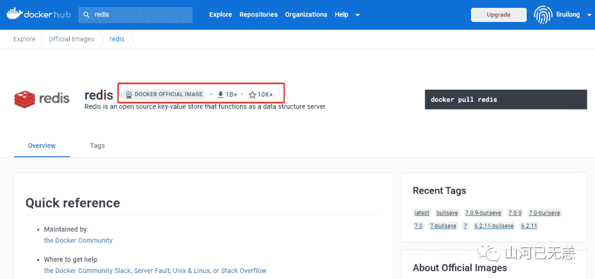

# Docker:关于 Dockerfile 编写优化的一些笔记

> 来源：[https://geekbang.feishu.cn/docx/N1Qtdb0I3o4dYOxkAp6cJUyxnkh](https://geekbang.feishu.cn/docx/N1Qtdb0I3o4dYOxkAp6cJUyxnkh)

> 👨🏻 作者：山河已无恙

> 📃 作者介绍：SRE，云原生相关技术干货分享，RHCA/RHCE/RHCAS、CKA 认证，CSDN/51CTO博客专家，InfoQ写作平台/Alibaba Cloud社区签约作者、Huawei Cloud社区云享专家、Tencent Cloud社区内容共创官

> ⏰ 收录时间：2024-05-27 11:15:56 (UTC+8)

> 🔗 原文链接：h[ttps://mp.weixin.q](https://mp.weixin.qq.com/s?__biz=MzkyNjIxNTYwMw==&mid=2247493462&idx=1&sn=a05c27924a74cf7ab50177286a2a4c7b&chksm=c2381b8af54f929c6b07c90299c985749f8b62dbc6195112c66de2e1d0781d4c170fbdf3ef1a#rd)q.com/s?__biz=Mz...


关注作者，获取更多相关知识

## **1 ****写在前面**

---

+   分享一些 Dockerfile 构建镜像优化方式的笔记

+   理解不足小伙伴帮忙指正

**对每**个人而言，真正的职责只有一个：找到自我。然后在心中坚守其一生，全心全意，永不停息。所有其它的路都是不完整的，是人的逃避方式，是对大众理想的懦弱回归，是随波逐流，是对内心的恐惧 ——赫尔曼·黑塞《德米安》

---

## **2 ****简单介绍**

在 Docker 中，常用的自定义构建新镜像的方式有两种：

+   通过当运行的容器来构建新的镜像

+   通过 Dockerfile 文件依托基础镜像来构建新的镜像

不管是那种方式， 自定义镜像 的原理都是一样，通过镜像的分层设计， 创建读写层 ， 修改配置 ， 重新打包

这里和小伙伴们分享一些 Dockerfile 构建自定义镜像的优化方式，所谓优化，也可以理解为相对较优的构建方式，对于 第一种构建镜像方式，我们这里简单介绍

通过当运行的容器来构建新的镜像，一般在运行的镜像中做一些预制的操作，比如内网环境没有依赖库，没办法直接拉取需要的依赖，我们可以在有网络的环境下拉取对应的依赖，然后做成有依赖的基础镜像。

比如一个 python 镜像，我们要在内网中使用，但是内网环境没有 pip 源，所以我们只能把对应的包先在外网环境下载做成镜像。

### ** ****运行的容器来构建新的镜像 **

```
┌──[root@vms100.liruilongs.github.io]-[~]
└─$docker run -d  python  python -m http.server 33333
009033ff4c0155f81647b857c0bf8975ee750a13d7aa2584638af032aafa758b
```

然后进入容器下载相关的依赖包，之后生成镜像导出

```
┌──[root@vms100.liruilongs.github.io]-[~]
└─$docker commit bcdd82ca5b48  my-python:latest
sha256:cb7c9965c541dfc794f78eb06ae1c4af0c77bb87c92e5e6e768c7770eb61a5bb
┌──[root@vms100.liruilongs.github.io]-[~]
└─$docker save  my-python:latest -o ./my-python.tar
```

在操作上有些繁琐，使用 Dockerfile 的方式可能方便一点

```
┌──[root@vms100.liruilongs.github.io]-[~]
└─$docker build -&lt;&lt;EOF
&gt; FROM python
&gt; RUN python -m pip config set global.index-url https://pypi.tuna.tsinghua.edu.cn/simple
&gt; RUN python -m pip install psycopg2
&gt; EOF
Sending build context to Docker daemon  2.048kB
Step 1/3 : FROM python
 ---&gt; a5d7930b60cc
Step 2/3 : RUN python -m pip config set global.index-url https://pypi.tuna.tsinghua.edu.cn/simple
 ---&gt; Running in 88140ad45551
Writing to /root/.config/pip/pip.conf
Removing intermediate container 88140ad45551
 ---&gt; df41fddd2cd2
Step 3/3 : RUN python -m pip install psycopg2
 ---&gt; Running in 1eddfbf7fa58
Looking in indexes: https://pypi.tuna.tsinghua.edu.cn/simple
Collecting psycopg2
  Downloading https://pypi.tuna.tsinghua.edu.cn/packages/89/d6/cd8c46417e0f7a16b4b0fc321f4ab676a59250d08fce5b64921897fb07cc/psycopg2-2.9.5.tar.gz (384 kB)
Building wheels for collected packages: psycopg2
  Building wheel for psycopg2 (setup.py): started
.....
  14/44f32ab3b3f40f2e9a1a9ab8281a40ff4a911a930121c928b1
Successfully built psycopg2
Installing collected packages: psycopg2
.......
Removing intermediate container 1eddfbf7fa58
 ---&gt; 8791cb1dc692
Successfully built 8791cb1dc692
┌──[root@vms100.liruilongs.github.io]-[~]
└─$
```

忘记打标签了。这里我们手动打一下。可以在 build 的时候通过 -t 命令指定

```
┌──[root@vms100.liruilongs.github.io]-[~]
└─$docker tag  8791cb1dc692 my-python:latest
┌──[root@vms100.liruilongs.github.io]-[~]
└─$docker images my-python
REPOSITORY   TAG       IMAGE ID       CREATED         SIZE
my-python    latest    8791cb1dc692   8 minutes ago   927MB
```

### ** **Dockerfile 自定义镜像

构建常用指令温习

+   FROM ：基础镜像

+   RUN ：制作镜像时执行的命令，可以有多个，每个命令一层

+   ADD ：复制文件到镜像，自动解压 (文件类型为: tar.gz 或 tar.bz2)

+   COPY ：复制文件到镜像，不解压

+   MAINTAINER ：镜像创建者信息(新版本以弃用，可以使用LABLE )

+   EXPOSE ：开放的端口

+   ENV ：设置变量

+   WORKDIR ：定义容器默认工作目录

+   CMD : 容器启动时执行的命令， 仅可以有一条CMD .

+   ENTRYPOINT :类似 CMD 指令的功能，用于为容器指定默认运行程序，从而使得容器像是一具单独的可执行程序

一些需要注意的事项：

+   当 docker run 命令中声明了参数时，Docker 守护程序会忽略 CMD 命令。

+   与 CMD 不同的是，由 ENTRYPOINT 启动的程序不会被 docker run 命令行指定的参数所覆盖，而且，这些命令行参数会被当作参数传递给 ENTRYPOINT 指定的程序。不过， docker run 命令的-- entrypoint 选项的参数可覆盖 ENTRYPOINT 指令指定的程序

+   Dockfile 中，如果没有使用 CMD 指定启动命令，则会继承上一个镜像的默认启动命令； CMD 容器的默认启动命令，有且 只能有一条 ；

根据 Dockerfile 生成新的镜像命令中, build 创建新的镜像； -t 指定新镜像的名字和标签； . 指定 Dockerfile 文件所在的目录

```
docker build -t imagename:latest Dockerfile所在目录
```

容器和镜像之间的主要区别在于顶部 可写层 。对容器的所有添加新数据或修改现有数据的写入都存储在此 可写层 中。删除容器时，可写层也会被删除。基础镜像保持不变。

这里利用了 写时复制 技术( COW ,copy on write) , 对于开发的小伙伴，可以结合 享元设计模式 理解，对于运维的小伙伴，可以结合 Openstack 组件 Glance 原理来理解

用通俗的话讲，当修改时，会把数据复制到容器层修改。当新增的时候直接在 容器层新增，当删除时，会屏蔽镜像层。

Docker 通过读取给定的指令来自动构建镜像。遵循特定的格式和指令集，其中的 每一条指令在容器镜像中创建一个层。这些层是堆叠的，每个层都是与前一层相比的变化的增量

这里我们以 redis:7 这个官方镜像为例,看看一个标准的 Dockerfile 如何书写，可以看到镜像构建了 16 层。

```
┌──[root@vms107.liruilongs.github.io]-[/etc/systemd]
└─$docker history --human=true  redis:7
IMAGE          CREATED       CREATED BY                                      SIZE      COMMENT
19c51d4327cf   6 weeks ago   /bin/sh -c #(nop)  CMD [&quot;redis-server&quot;]         0B
&lt;missing&gt;      6 weeks ago   /bin/sh -c #(nop)  EXPOSE 6379                  0B
&lt;missing&gt;      6 weeks ago   /bin/sh -c #(nop)  ENTRYPOINT [&quot;docker-entry…   0B
&lt;missing&gt;      6 weeks ago   /bin/sh -c #(nop) COPY file:e873a0e3c13001b5…   661B
&lt;missing&gt;      6 weeks ago   /bin/sh -c #(nop) WORKDIR /data                 0B
&lt;missing&gt;      6 weeks ago   /bin/sh -c #(nop)  VOLUME [/data]               0B
&lt;missing&gt;      6 weeks ago   /bin/sh -c mkdir /data &amp;&amp; chown redis:redis …   0B
&lt;missing&gt;      6 weeks ago   /bin/sh -c set -eux;   savedAptMark=&quot;$(apt-m…   32MB
&lt;missing&gt;      6 weeks ago   /bin/sh -c #(nop)  ENV REDIS_DOWNLOAD_SHA=06…   0B
&lt;missing&gt;      6 weeks ago   /bin/sh -c #(nop)  ENV REDIS_DOWNLOAD_URL=ht…   0B
&lt;missing&gt;      6 weeks ago   /bin/sh -c #(nop)  ENV REDIS_VERSION=7.0.8      0B
&lt;missing&gt;      7 weeks ago   /bin/sh -c set -eux;  savedAptMark=&quot;$(apt-ma…   4.13MB
&lt;missing&gt;      7 weeks ago   /bin/sh -c #(nop)  ENV GOSU_VERSION=1.14        0B
&lt;missing&gt;      7 weeks ago   /bin/sh -c groupadd -r -g 999 redis &amp;&amp; usera…   329kB
&lt;missing&gt;      7 weeks ago   /bin/sh -c #(nop)  CMD [&quot;bash&quot;]                 0B
&lt;missing&gt;      7 weeks ago   /bin/sh -c #(nop) ADD file:e2398d0bf516084b2…   80.5MB
┌──[root@vms107.liruilongs.github.io]-[/etc/systemd]
└─$docker history --human=true  redis:7 | wc -l
17
```

涉及 两个 Dockerfile 文件构建的镜像

基础镜像构建

```
FROM scratch
ADD rootfs.tar.xz /
CMD [&quot;bash&quot;]
```

reids 镜像构建

```
FROM debian:bullseye-slim

# add our user and group first to make sure their IDs get assigned consistently, regardless of whatever dependencies get added
RUN groupadd -r -g 999 redis &amp;&amp; useradd -r -g redis -u 999 redis

# grab gosu for easy step-down from root
# https://github.com/tianon/gosu/releases
ENV GOSU_VERSION 1.16
RUN set -eux; \
 savedAptMark=&quot;$(apt-mark showmanual)&quot;; \
 apt-get update; \
 apt-get install -y --no-install-recommends ca-certificates dirmngr gnupg wget; \
 rm -rf /var/lib/apt/lists/*; \
 dpkgArch=&quot;$(dpkg --print-architecture | awk -F- &#x27;{ print $NF }&#x27;)&quot;; \
 wget -O /usr/local/bin/gosu &quot;https://github.com/tianon/gosu/releases/download/$GOSU_VERSION/gosu-$dpkgArch&quot;; \
 wget -O /usr/local/bin/gosu.asc &quot;https://github.com/tianon/gosu/releases/download/$GOSU_VERSION/gosu-$dpkgArch.asc&quot;; \
 export GNUPGHOME=&quot;$(mktemp -d)&quot;; \
 gpg --batch --keyserver hkps://keys.openpgp.org --recv-keys B42F6819007F00F88E364FD4036A9C25BF357DD4; \
 gpg --batch --verify /usr/local/bin/gosu.asc /usr/local/bin/gosu; \
 gpgconf --kill all; \
 rm -rf &quot;$GNUPGHOME&quot; /usr/local/bin/gosu.asc; \
 apt-mark auto &#x27;.*&#x27; &gt; /dev/null; \
 [ -z &quot;$savedAptMark&quot; ] || apt-mark manual $savedAptMark &gt; /dev/null; \
 apt-get purge -y --auto-remove -o APT::AutoRemove::RecommendsImportant=false; \
 chmod +x /usr/local/bin/gosu; \
 gosu --version; \
 gosu nobody true

ENV REDIS_VERSION 7.0.9
ENV REDIS_DOWNLOAD_URL http://download.redis.io/releases/redis-7.0.9.tar.gz
ENV REDIS_DOWNLOAD_SHA f77135c2a47c9151d4028bfea3b34470ab4d324d1484f79a84c6f32a3cfb9f65

RUN set -eux; \
 \
 savedAptMark=&quot;$(apt-mark showmanual)&quot;; \
 apt-get update; \
 apt-get install -y --no-install-recommends \
  ca-certificates \
  wget \
  \
  dpkg-dev \
  gcc \
  libc6-dev \
  libssl-dev \
  make \
 ; \
 rm -rf /var/lib/apt/lists/*; \
 \
 wget -O redis.tar.gz &quot;$REDIS_DOWNLOAD_URL&quot;; \
 echo &quot;$REDIS_DOWNLOAD_SHA *redis.tar.gz&quot; | sha256sum -c -; \
 mkdir -p /usr/src/redis; \
 tar -xzf redis.tar.gz -C /usr/src/redis --strip-components=1; \
 rm redis.tar.gz; \
 \
# disable Redis protected mode [1] as it is unnecessary in context of Docker
# (ports are not automatically exposed when running inside Docker, but rather explicitly by specifying -p / -P)
# [1]: https://github.com/redis/redis/commit/edd4d555df57dc84265fdfb4ef59a4678832f6da
 grep -E &#x27;^ *createBoolConfig[(]&quot;protected-mode&quot;,.*, *1 *,.*[)],$&#x27; /usr/src/redis/src/config.c; \
 sed -ri &#x27;s!^( *createBoolConfig[(]&quot;protected-mode&quot;,.*, *)1( *,.*[)],)$!\10\2!&#x27; /usr/src/redis/src/config.c; \
 grep -E &#x27;^ *createBoolConfig[(]&quot;protected-mode&quot;,.*, *0 *,.*[)],$&#x27; /usr/src/redis/src/config.c; \
# for future reference, we modify this directly in the source instead of just supplying a default configuration flag because apparently &quot;if you specify any argument to redis-server, [it assumes] you are going to specify everything&quot;
# see also https://github.com/docker-library/redis/issues/4#issuecomment-50780840
# (more exactly, this makes sure the default behavior of &quot;save on SIGTERM&quot; stays functional by default)
 \
# https://github.com/jemalloc/jemalloc/issues/467 -- we need to patch the &quot;./configure&quot; for the bundled jemalloc to match how Debian compiles, for compatibility
# (also, we do cross-builds, so we need to embed the appropriate &quot;--build=xxx&quot; values to that &quot;./configure&quot; invocation)
 gnuArch=&quot;$(dpkg-architecture --query DEB_BUILD_GNU_TYPE)&quot;; \
 extraJemallocConfigureFlags=&quot;--build=$gnuArch&quot;; \
# https://salsa.debian.org/debian/jemalloc/-/blob/c0a88c37a551be7d12e4863435365c9a6a51525f/debian/rules#L8-23
 dpkgArch=&quot;$(dpkg --print-architecture)&quot;; \
 case &quot;${dpkgArch##*-}&quot; in \
  amd64 | i386 | x32) extraJemallocConfigureFlags=&quot;$extraJemallocConfigureFlags --with-lg-page=12&quot; ;; \
  *) extraJemallocConfigureFlags=&quot;$extraJemallocConfigureFlags --with-lg-page=16&quot; ;; \
 esac; \
 extraJemallocConfigureFlags=&quot;$extraJemallocConfigureFlags --with-lg-hugepage=21&quot;; \
 grep -F &#x27;cd jemalloc &amp;&amp; ./configure &#x27; /usr/src/redis/deps/Makefile; \
 sed -ri &#x27;s!cd jemalloc &amp;&amp; ./configure !&amp;&#x27;&quot;$extraJemallocConfigureFlags&quot;&#x27; !&#x27; /usr/src/redis/deps/Makefile; \
 grep -F &quot;cd jemalloc &amp;&amp; ./configure $extraJemallocConfigureFlags &quot; /usr/src/redis/deps/Makefile; \
 \
 export BUILD_TLS=yes; \
 make -C /usr/src/redis -j &quot;$(nproc)&quot; all; \
 make -C /usr/src/redis install; \
 \
# TODO https://github.com/redis/redis/pull/3494 (deduplicate &quot;redis-server&quot; copies)
 serverMd5=&quot;$(md5sum /usr/local/bin/redis-server | cut -d&#x27; &#x27; -f1)&quot;; export serverMd5; \
 find /usr/local/bin/redis* -maxdepth 0 \
  -type f -not -name redis-server \
  -exec sh -eux -c &#x27; \
   md5=&quot;$(md5sum &quot;$1&quot; | cut -d&quot; &quot; -f1)&quot;; \
   test &quot;$md5&quot; = &quot;$serverMd5&quot;; \
  &#x27; -- &#x27;{}&#x27; &#x27;;&#x27; \
  -exec ln -svfT &#x27;redis-server&#x27; &#x27;{}&#x27; &#x27;;&#x27; \
 ; \
 \
 rm -r /usr/src/redis; \
 \
 apt-mark auto &#x27;.*&#x27; &gt; /dev/null; \
 [ -z &quot;$savedAptMark&quot; ] || apt-mark manual $savedAptMark &gt; /dev/null; \
 find /usr/local -type f -executable -exec ldd &#x27;{}&#x27; &#x27;;&#x27; \
  | awk &#x27;/=&gt;/ { print $(NF-1) }&#x27; \
  | sort -u \
  | xargs -r dpkg-query --search \
  | cut -d: -f1 \
  | sort -u \
  | xargs -r apt-mark manual \
 ; \
 apt-get purge -y --auto-remove -o APT::AutoRemove::RecommendsImportant=false; \
 \
 redis-cli --version; \
 redis-server --version

RUN mkdir /data &amp;&amp; chown redis:redis /data
VOLUME /data
WORKDIR /data

COPY docker-entrypoint.sh /usr/local/bin/
ENTRYPOINT [&quot;docker-entrypoint.sh&quot;]

EXPOSE 6379
CMD [&quot;redis-server&quot;]
```

运行此镜像并创建一个容器时，我们实际上在底层之上添加了一个新的可写层（容器层）。对正在运行的容器所做的所有更改（例如写入新文件、修改现有文件和删除文件）都将写入此可写容器层。

可以看到上面的 Dockerfile 文件很庞大，通过这个文件我们来总结一些 在编写时需要注意的地方

## **3 ****Dockerfile 编写优化**

### ** ****使用小的基础镜像 **

在上面的 Dockerfile 中基础镜像使用有 FROM debian:bullseye-slim , FROM scratch

+   scratch 是一个空镜像，一般用不到，在构建最基础的镜像的时候会用到。

+   debian:bullseye-slim 是一个 debian 系统的 bullseye 版本的精简版镜像。看的出来，使用的镜像很小。

使用较小的镜像可以更快地 构建、推送和拉取 镜像。往往更安全，因为 只包含运行应用程序所需的必要库和系统依赖项 。尤其是在 CI/CD 等流水线中，庞大的 基础镜像 在每个环节都要消耗一些时间，从而使流水线的时间变得很长。镜像之间的区别主要在于底层的操作系统

#### ** 镜像选择类型 **

Official Image ：官方镜像，或者叫标准镜像，一般由官方维护的镜像，它是正确的选择，但是可能不是最优的。镜像基于最新的稳定 Debian 操作系统发行版，上面的 有 Dockerfile 构建完成的镜像即为 redis:7 的一个官网镜像。



Debian(bullseye/buster/stretch/jessie) ：不同的 Debian Linux 发行版镜像，jessie(8.0)，stretch(9.0) 是比较老旧的版本,buster(10.0) ,bullseye(11.0)为较新的版本

slim ：精简版，它通常会安装运行特定工具所需的最小包

alpine ：基于 Alpine Linux 项目，专门为在容器内部使用而构建的操作系统。相比较 Debian 来说 Alpine 很小很小，但是需要考虑一些时区，兼容性问题。

scratch : 一个明确的空镜像，特别是用于建立 "从头开始" 的镜像。

在选择最小基础镜像的同时，要尽量避免安装不必要的软件包

### ** ****指令链式运行 **

可以很明显的发现，上面 Dockerfile 中的 RUN 指令很长

这是由于每个指令都会创建一个可缓存单元并构建一个新的中间镜像层。所以可以通过链接所有命令来避免过多层级。此外，尽量避免链接过多的可缓存 RUN 命令，因为这会导致创建大型缓存并最终导致缓存突发。

```
RUN set -eux; \
 \
 savedAptMark=&quot;$(apt-mark showmanual)&quot;; \
 apt-get update; \
 apt-get install -y --no-install-recommends \
  ca-certificates \
  wget \
  \
  dpkg-dev \
  gcc \
  libc6-dev \
  libssl-dev \
  make \
 ; \
 rm -rf /var/lib/apt/lists/*; \
 \
 wget -O redis.tar.gz &quot;$REDIS_DOWNLOAD_URL&quot;; \
  ..................
```

### ** ****变动的指令放到最后 **

Dockerfile 编写往往需要重复的构建，每个层的构建都比较耗时，但是 Docker 为了加快后续构建的速度，会自动缓存每一层的构建，当对应的层指令以及前面的指令没有发生变动时，会直接使用缓存。当步骤对应指令更改时，缓存不仅会针对该特定步骤失效，还会使所有后续步骤失效。

所以 始终将最常更改的指令放在末尾 。会提高构建速度.

```
FROM python:3.9-slim

WORKDIR /app
COPY requirements.txt .
RUN pip install -r /requirements.txt
COPY app.py .
```

### ** ****首选数组而不是字符串语法 **

我们可以通过两种不同的方式编写 最后的进程启动 命令 ENTRYPOINT

+   数组： ENTRYPOINT ["python","-m","http.server","33333"]

+   字符串： ENTRYPOINT "python -m http.server 33333"

数组形式是首选。这是因为使用字符串形式会导致 Docker 使用 bash 运行您的进程 ，这无法正确处理 信号 。由于大多数 shell 不处理子进程的信号，因此如果使用 shell 格式，CTRL-C（生成 SIGTERM）可能不会停止子进程。

### ** ****COPY 而不是 ADD **

如果有多个步骤使用上下文中的不同文件，请 单独复制 它们，而不是一次全部复制。 这可确保每个步骤的生成缓存仅失效 ，并在特别需要的文件发生更改时强制重新运行该步骤。

```
COPY requirements.txt /tmp/
RUN pip install --requirement /tmp/requirements.txt
COPY . /tmp/
```

### ** **使用 .dockerignore

.dockerignore 文件的作用类似于 git 工程中的 .gitignore 。不同的是 .dockerignore 应用于 docker 镜像的构建，它存在于 docker 构建上下文的根目录，用来 忽略不需要打入镜像的文件

.dockerignore 文件的写法和 .gitignore 类似，支持正则和通配符，具体规则如下：

+   每行为一个条目；

+   以 # 开头的行为注释；

+   空行被忽略；

+   构建上下文路径为所有文件的根路径；

```
.git
script
static
!README*.md
```

### ** ****从 stdin 标准输入构建 **

Docker 引擎能够通过本地或远程构建上下文通过 stdin 管道传输 Dockerfile 来构建镜像

在 Dockerfile 不需要将文件复制到镜像中（COPY/ADD 将失败）的情况下，省略构建上下文非常有用，并且可以提高构建速度，因为不会将任何文件发送到 Docker 守护程序。适用于单纯的镜像构建

```
┌──[root@vms107.liruilongs.github.io]-[/etc/systemd]
└─$docker build -&lt;&lt;EOF
&gt; FROM busybox
&gt; RUN echo &quot;hello world&quot;
&gt; EOF
Sending build context to Docker daemon  2.048kB
Step 1/2 : FROM busybox
latest: Pulling from library/busybox
5cc84ad355aa: Pull complete
Digest: sha256:5acba83a746c7608ed544dc1533b87c737a0b0fb730301639a0179f9344b1678
Status: Downloaded newer image for busybox:latest
 ---&gt; beae173ccac6
Step 2/2 : RUN echo &quot;hello world&quot;
 ---&gt; Running in c56fb8343c72
hello world
Removing intermediate container c56fb8343c72
 ---&gt; 95bc7e444353
Successfully built 95bc7e444353
┌──[root@vms107.liruilongs.github.io]-[/etc/systemd]
└─$
```

### ** ****利用多阶段构建 **

多阶段构建使我们能够通过利用构建缓存大幅减小最终镜像的大小，而无需努力减少中间层和文件的数量。例如，让我们看一下以下内容：Dockerfile

```
FROM golang:1.18-alpine AS prebuild

# Install tools required for project
RUN go get github.com/golang/dep/cmd/dep
COPY Gopkg.lock Gopkg.toml /go/src/project/
WORKDIR /go/src/project/
RUN go build -o /bin/project

# This results in a single layer image
FROM scratch
COPY --from=prebuild /bin/project /bin/project
ENTRYPOINT [&quot;/bin/project&quot;]
```

可以使用多个语句。每个指令都可以使用不同的基础，并且每个指令都开始构建的新阶段。我们可以有选择地将伪影从一个阶段复制到另一个阶段，在最终镜像中留下我们不想要的所有内容。

```
#syntax=docker/dockerfile:1.4
FROM … AS build1
COPY –from=app1 . /src

FROM … AS build2
COPY –from=app2 . /src

FROM …
COPY –from=build1 /out/app1 /bin/
COPY –from=build2 /out/app2 /bin/
```

## **4 ****博文部分内容参考**

© 文中涉及参考链接内容版权归原作者所有，如有侵权请告知

---

https://www.docker.com/

https://docs.docker.com/engine/reference/builder/

https://www.docker.com/blog/dockerfiles-now-support-multiple-build-contexts/

https://blog.devgenius.io/devops-in-k8s-write-dockerfile-efficiently-37eaedf87163

---

© 2018-2023 liruilonger@gmail.com, All rights reserved. 保持署名-非商用-相同方式共享(CC BY-NC-SA 4.0)

© 2018-2023 liruilonger@gmail.com，保留所有权利。保持署名-非商用-相同方式共享（CC BY-NC-SA 4.0）