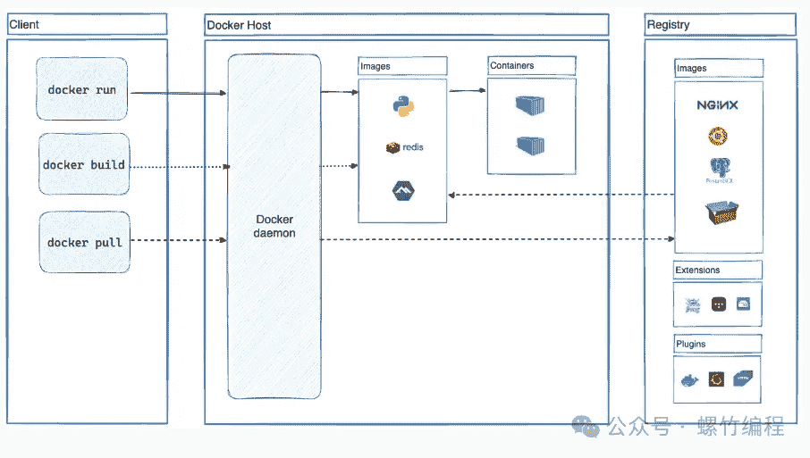

# Docker专题(二)：Docker架构、核心组件与概念

> 来源：[https://geekbang.feishu.cn/docx/JRmad8mQso2AApxUjsocsGMxnvb](https://geekbang.feishu.cn/docx/JRmad8mQso2AApxUjsocsGMxnvb)

> 👨🏻 作者：尼尔

> 📃 作者介绍：热爱技术的技术人

> 🛖 公众号：螺竹编程

> ⏰ 收录时间：2024-05-27 11:15:56 (UTC+8)

> 🔗 原文链接：h[ttps://mp.weixin.q](https://mp.weixin.qq.com/s/DxoNxRGuDcE8lC7PJW-MCg)q.com/s/DxoNxRGu...

关注作者，获取更多相关知识

**Docker架构**

1

在Docker架构中，有三个主要组件：Docker Client、Docker Host和Docker Registry。

1.  **Docker Client **：Docker Client是与用户交互的命令行工具或图形界面，用于与Docker进行通信。用户可以使用Docker Client执行各种Docker命令，例如构建、运行、停止和管理容器，以及管理Docker镜像和网络等。Docker Client与Docker守护进程（Docker daemon）通信，发送用户的命令并接收执行结果。

1.  **Docker Host **：Docker Host是安装了Docker引擎的物理或虚拟机。它负责运行Docker守护进程，并管理Docker容器和镜像。Docker Host可以是开发人员的本地机器，也可以是云服务提供商的虚拟机实例。Docker Host包含Docker daemon， Docker Daemon（Docker守护进程）是Docker引擎的守护进程，负责管理Docker对象（如容器、镜像、网络和卷等），接收来自Docker Client的命令并执行相应操作。

1.  Docker Registry ：Docker Registry是一个集中存储和分发Docker镜像的服务。它充当了Docker镜像的仓库，并提供了一个集中的位置供开发者上传、下载和共享镜像。Docker Hub是最常用的公共Docker Registry，提供了大量的官方和社区维护的镜像。此外，还可以搭建私有的Docker Registry，用于内部开发和部署需求。

**Docker核心组件与概念**

2

1.  **镜像（Image） **：镜像是一个只读的模板，包含了运行应用程序所需的所有文件系统、库、工具和配置。可以通过Docker镜像构建容器。镜像可以从Docker Hub或其他镜像仓库中获取，也可以通过Dockerfile定义自己的镜像。

1.  **容器（Container） **：容器是从镜像创建的运行实例。容器是一个独立的、轻量级的、可执行的软件包，包含了运行应用程序的所有内容。容器隔离了应用程序及其依赖项，使其可以在不同的环境中以一致的方式运行。

1.  Docker引擎（Docker Engine） ：Docker引擎是Docker的核心组件，负责构建和运行容器，同时它是运行在Docker Host上的软件集合。Docker引擎使用Linux内核的容器特性（如cgroups和命名空间）来提供容器化功能。Docker Engine包括以下几个关键组件：

+   **Docker Daemon **：Docker Daemon是Docker引擎的守护进程，负责管理Docker对象（如容器、镜像、网络和卷等）。它接收来自Docker Client的命令，并执行相应的操作，如创建、启动、停止和销毁容器，以及构建和拉取镜像等。Docker Daemon与Docker Client进行通信，并通过REST API提供服务。

+   **Docker Runtime **：Docker Runtime是负责运行和管理Docker容器的组件。它可以使用不同的容器运行时（如Docker Engine、containerd、CRI-O等）来创建和管理容器。容器运行时负责启动容器、隔离容器的文件系统、进程空间和网络，并提供容器与宿主机之间的通信和资源管理。

+   **Docker Storage **：Docker Storage负责管理Docker容器的持久化存储。它可以使用不同的存储驱动（如overlay2、aufs、btrfs等）来管理容器的镜像和数据卷。存储驱动负责在宿主机上创建、读取和写入容器的文件系统，并将数据存储在宿主机上的相应位置。

+   **Docker Network **：Docker Network负责创建和管理Docker容器之间的网络连接。它可以创建虚拟网络、子网和网络接口，并为容器分配IP地址。Docker Network还提供网络隔离和路由功能，使容器可以在独立的网络环境中运行，并与其他容器或外部网络通信。

1.  Docker文件（Dockerfile） ：Docker文件是一个文本文件，包含了一系列的指令和配置，用于自动化构建Docker镜像。通过编写Docker文件，开发者可以定义镜像的内容、依赖项和运行配置，以及执行构建过程。