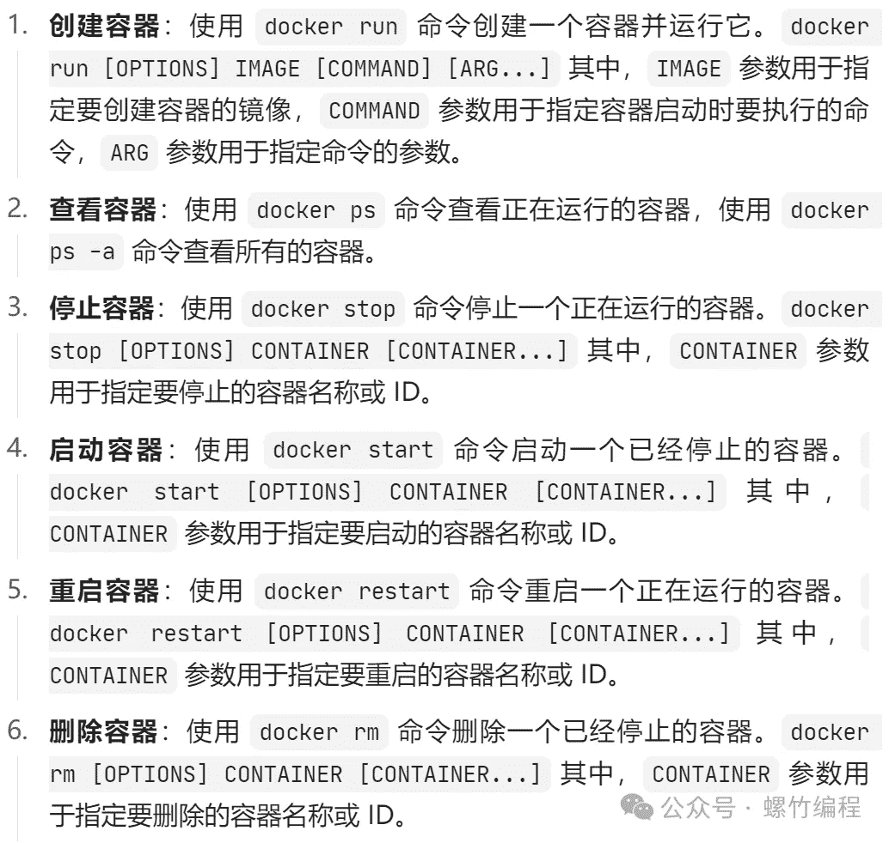

# Docker专题(四)：Docker容器

> 来源：[https://geekbang.feishu.cn/docx/VvE4dkOMJo201gxhzfPco29nnQd](https://geekbang.feishu.cn/docx/VvE4dkOMJo201gxhzfPco29nnQd)

> 👨🏻 作者：尼尔

> 📃 作者介绍：热爱技术的技术人

> 🛖 公众号：螺竹编程

> ⏰ 收录时间：2024-05-27 11:15:56 (UTC+8)

> 🔗 原文链接：h[ttps://mp.weixin.q](https://mp.weixin.qq.com/s/OfK5FyOdvX9hMEOPi8b0OA)q.com/s/OfK5FyOd...

关注作者，获取更多相关知识

**Docker容器介绍**

1

Docker容器是 Docker 中的一个核心概念，它是一个独立运行的应用程序的运行环境，类似于轻量级的虚拟机。

Docker 容器是由 Docker 镜像创建而来，镜像是一个只读的模板，容器是可读写的实例。

一个 Docker 容器包含了所需的文件系统、代码、运行时、系统工具和库等，它可以在任何 Docker 容器运行环境中运行，无需进行任何修改。

**Docker容器的优点**

2

Docker 容器的优点包括：

1.  **可移植性 **：容器化的应用程序可以在任何 Docker 容器运行环境中运行，无需进行任何修改，提高了应用程序的可移植性和可靠性。

1.  **轻量级 **：Docker 容器是轻量级的，通过共享主机系统的内核和其他资源，可以在同一主机上运行成千上万个容器，从而提高了资源利用率和系统的可伸缩性。

1.  **快速启动 **：Docker 容器启动非常快速，因为它们只需要启动应用程序和所需的依赖项，无需启动完整的操作系统。

1.  **操作简单 **：使用 Docker 容器可以简化应用程序的部署和管理，提高了开发和运维效率。

**Docker容器相关命令**

3

