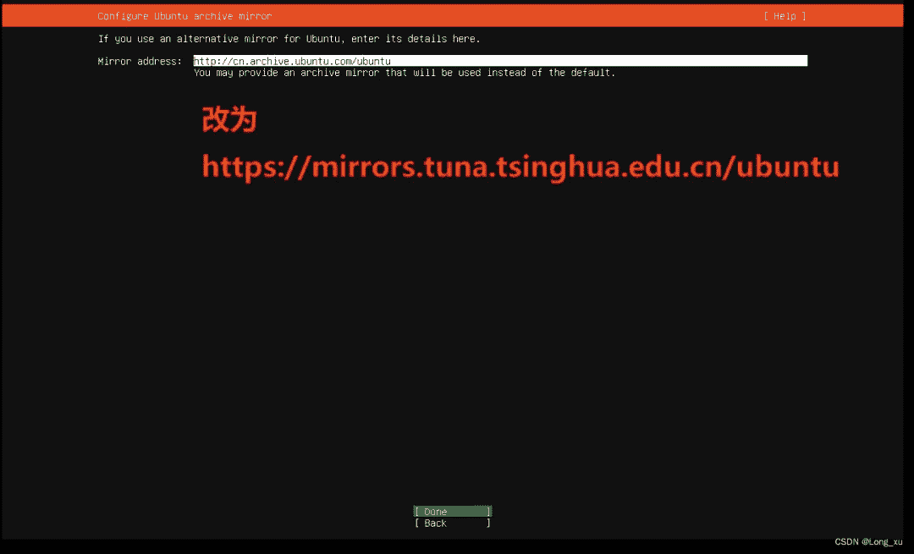
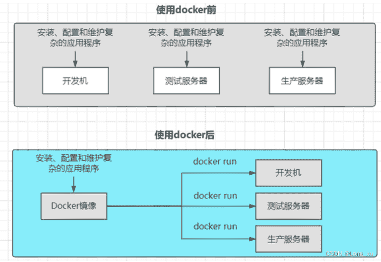
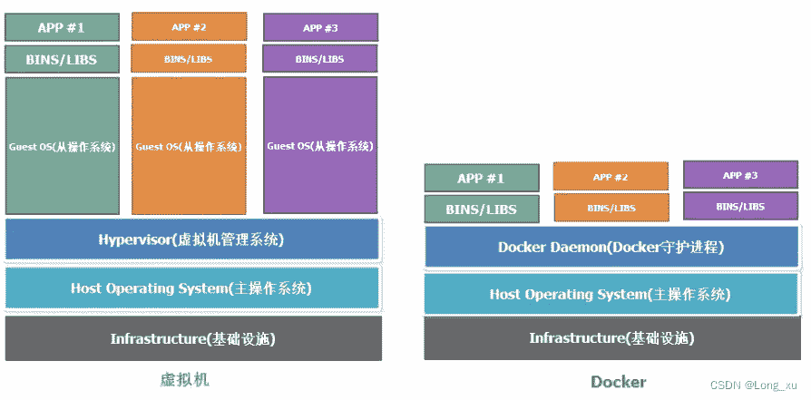
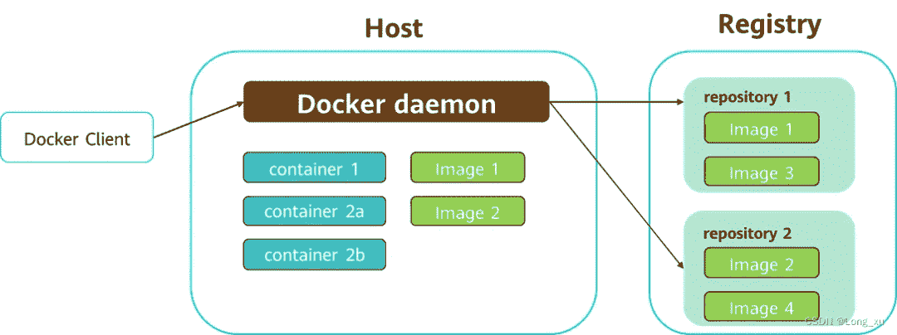

# 入门云原生：搭建Docker环境以及了解Docker架构

> 来源：[https://geekbang.feishu.cn/docx/JB4udkHnhomSmyxGBfMcr7CCnRh](https://geekbang.feishu.cn/docx/JB4udkHnhomSmyxGBfMcr7CCnRh)

> 👨🏻 作者：Lion莱恩呀

> 📃 作者介绍：专注分享高性能服务器后台开发知识，包括C/C++、Linux、网络协议、设计模式、中间件、云原生、数据库、分布式架构等领域知识。

> 🛖 👸号：Lion莱恩呀

> ⏰ 收录时间：2024-05-27 11:15:56 (UTC+8)

> 🔗 原文链接：h[ttps://mp.weixin.q](https://mp.weixin.qq.com/s?__biz=Mzk0ODUzNDc2Mw==&mid=2247485230&idx=1&sn=058025df5a21f27eab43fabff0d9cd68&scene=19#wechat_redirect)q.com/s?__biz=Mz...


关注作者，获取更多相关知识

# 一、主机环境

（1）ubuntu-20.04.4-live-server-amd64。下载地址https://mirrors.aliyun.com/ubuntu-releases/20.04/ubuntu-20.04.5-live-server-amd64.iso 。下载镜像后可以使用虚拟机安装主机环境系统。

（2）镜像源修改， 有两种方式。

第一种：在安装虚拟机时修改：




第二种：已经安装好系统的情况下，修改 /etc/apt/sources.list 将对应的地址替换，替换完成后执行apt-get update。注意，先备份/etc/apt/sourse.list文件。

```
sudo vim /etc/apt/sources.list
sudo apt-get update
```

# 二、Docker 安装

（1）基于apt包管理器安装。也可以根据官方的文档安装。

```
sudo apt install docker.io
```

如果要卸载Docker，可以使用如下指令删除相关目录：

```
sudo apt-get purge docker.io
sudo rm -rf /var/lib/docker
sudo rm -rf /var/lib/containerd
```

（2）将用户添加到docker组。将用户添加到docker用户组后，不需要每次都输入sudo来执行docker命令了。

```
# 将用户添加到docker 用户组
sudo addgroup -a &lt;username&gt; docker
sudo service docker restart
# 查看用户信息
id &lt;username&gt;
```

（3）安装openssh-server（可选）。

```
sudo apt-get install openssh-server

systemctl enable ssh #开机启动 
systemctl restart ssh #重启ssh 
systemctl status ssh #查看ssh状态
```

（4）设置自定义镜像库（可选）。

```
{
        &quot;registry-mirrors&quot;:[
        &quot;https://hub-mirror.c.163.com&quot;,
        &quot;https://docker.mirrors.ustc.edu.cn&quot;,
        &quot;https://registry.docker-cn.com&quot;
        ]
}
```

# 三、Docker简介

Docker是以Docker容器为资源分割和调度的基本单位，封装整个软件运行时环境，为开发者和系统管理员设计的，用于构建、发布和运行分布式应用的平台。

## 3.1、Docker解决的问题

1.  解决了应用程序本地运行环境与生产运行环境不一致的问题

1.  解决了应用程序资源使用的问题，docker会一开始就为每个程序指定内存分配和CPU分配

1.  让快速扩展、弹性伸缩变得简单

## 3.2、Docker技术边界

docker是容器化技术，针对的是应用及应用所依赖的环境做容器化。 遵循单一原则，一个容器只运行一个主进程 。

多个进程都部署在一个容器中，有很多弊端。比如更新某个进程的镜像时，其他进程也会被迫重启，如果一个进程出问题导致容器挂了，所有进程都将无法访问。再根据官网的提倡的原则而言， 容器 = 应用 + 依赖的执行环境 而不是像虚拟机一样，把一堆进程都部署在一起。

要在一个docker里面部署多个应用程序，就需要采用其他的办法，比如启动一个守护进程来指定多个应用程序。

## 3.3、Docker带来的改变



1.  软件交付方式发生了变化。

1.  替代了虚拟机。

1.  改变了我们体验软件的模式。

1.  降低了企业成本。

1.  促进了持续集成、持续部署的发展。

1.  促进了微服务的发展。

## 3.4、Docker和虚拟机的区别



1.  vm（虚拟机）与docker（容器）框架，直观上来讲vm多了一层guest OS，同时Hypervisor会对硬
件资源进行虚拟化，docker直接使用硬件资源，所以资源利用率相对docker低。

1.  服务器虚拟化解决的核心问题是资源调配，而容器解决的核心问题是应用开发、测试和部署。

1.  容器技术严格来说并不是虚拟化，没有客户机操作系统，是共享内核的。

## 3.5、Docker 架构图



1.  镜像（Image）：Docker 镜像是用于创建 Docker 容器的模板，比如 Ubuntu 系统。

1.  容器（Container）：容器是独立运行的一个或一组应用，是镜像运行时的实体。

1.  客户端（client）：Docker 客户端通过命令行或者其他工具使用 Docker SDK)与 Docker 的守护进程通信。

1.  主机（host）：一个物理或者虚拟的机器用于执行 Docker 守护进程和容器。

1.  注册中心（Registry）：Docker 仓库用来保存镜像，可以理解为代码控制中的代码仓库。Docker Hub 提供了庞大的镜像集合供使用。

1.  Docker Machine：Docker Machine是一个简化Docker安装的命令行工具，通过一个简单的命令行即可在相应的平台上安装Docker。

## 3.6、直观感受client请求server

（1）安装socat。

```
sudo apt install socat
```

（2）socat执行监听。

```
socat -v UNIX-LISTEN:/tmp/dockerapi.sock UNIX-CONNECT:/var/run/docker.sock &amp;
```

这条命令中，-v 用于提高输出的可读性，带有数据流的指示。UNIX-LISTEN 部分是让socat 在一个Unix套接字上进行监听，而UNIX-CONNECT 是让socat 连接到Docker 的Unix套接字。

（3）执行命令。

```
docker -H unix:///tmp/dockerapi.sock ps
```

输出：

```
&gt; 2022/12/04 09:21:30.864275  length=82 from=0 to=81
HEAD /_ping HTTP/1.1\r
Host: docker\r
User-Agent: Docker-Client/20.10.12 (linux)\r
\r
&lt; 2022/12/04 09:21:30.865645  length=281 from=0 to=280
HTTP/1.1 200 OK\r
Api-Version: 1.41\r
Cache-Control: no-cache, no-store, must-revalidate\r
Content-Length: 0\r
Content-Type: text/plain; charset=utf-8\r
Docker-Experimental: false\r
Ostype: linux\r
Pragma: no-cache\r
Server: Docker/20.10.12 (linux)\r
Date: Sun, 04 Dec 2022 09:21:30 GMT\r
\r
&gt; 2022/12/04 09:21:30.869675  length=97 from=82 to=178
GET /v1.41/containers/json HTTP/1.1\r
Host: docker\r
User-Agent: Docker-Client/20.10.12 (linux)\r
\r
&lt; 2022/12/04 09:21:30.870824  length=205 from=281 to=485
HTTP/1.1 200 OK\r
Api-Version: 1.41\r
Content-Type: application/json\r
Docker-Experimental: false\r
Ostype: linux\r
Server: Docker/20.10.12 (linux)\r
Date: Sun, 04 Dec 2022 09:21:30 GMT\r
Content-Length: 3\r
\r
[]
CONTAINER ID   IMAGE     COMMAND   CREATED   STATUS    PORTS     NAMES

```

# 总结

1.  Docker可以安装多个应用程序，但是Docker只有一个程序入口，也就是docker的启动命令只有一条。

1.  Docker和虚拟机不一样，Docker本身是一个软件，管理自己的进程，没有虚拟硬件设备。