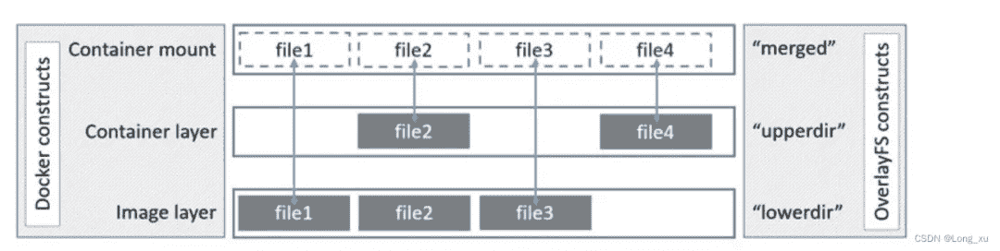
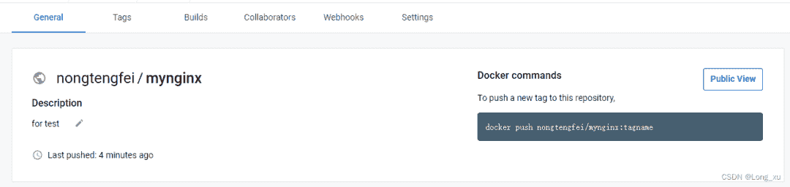

# 深度解析Docker镜像原理：理解云原生技术的核心动力

> 来源：[https://geekbang.feishu.cn/docx/AM5Ldy34PoclzPx8HDzcCLl7nqd](https://geekbang.feishu.cn/docx/AM5Ldy34PoclzPx8HDzcCLl7nqd)

> 👨🏻 作者：Lion莱恩呀

> 📃 作者介绍：专注分享高性能服务器后台开发知识，包括C/C++、Linux、网络协议、设计模式、中间件、云原生、数据库、分布式架构等领域知识。

> 🛖 👸号：Lion莱恩呀

> ⏰ 收录时间：2024-05-27 11:15:56 (UTC+8)

> 🔗 原文链接：https://mp.weixin.qq.com/s?__biz=Mzk0ODUzNDc2Mw==&mid=2247485411&idx=1&sn=9bf4cd613d6ab01959600972d0eb59f2&scene=19#wechat_redirect


关注作者，获取更多相关知识

## 一、镜像的概念

容器解决应用开发、测试和部署的问题，而镜像解决应用部署环境问题。镜像是一个只读的容器模板，打包了应用程序和应用程序所依赖的文件系统以及启动容器的配置文件，是启动容器的基础。镜像所打包的文件内容就是容器的系统运行环境——`rootfs`(根文件系统或根目录)。容器与镜像类似对象与类的关系。

## 二、Docker镜像原理

1. 分层：Docker镜像采用分层的方式构建，每一个镜像都由一组镜像组合而成。每一个镜像层都可以被需要的镜像所引用，实现了镜像之间共享镜像层的效果。这样的分层设计在镜像的上传与下载过程当中有效的减少了镜像传输的大小，在传输过程当中本地或注册中心只需要存在一份底层的基础镜像层即可，真正被保存和下载的内容是用户构建的镜像层。而在构建过程中镜像层通常会被缓存以缩短构建过程。

1. 写时复制：底层镜像层在多个容器间共享，每个容器启动时不需要复制一份镜像文件，而是将所有需要的镜像层以只读的方式挂载到一个挂载点，在只读层上再覆盖一层读写层。在容器运行过程中产生的新文件将会写入到读写层，被修改过的底层文件会被复制到读写层并且进行修改，而老文件则被隐藏。

1. 联合挂载：`docker`采用联合挂载技术，在同一个挂载点同时挂载多个文件系统，从而使得容器的根目录看上去包含了各个镜像层的所有文件。



1. `LowerDir`：被引用的镜像层，该层所有内容均为只读。

1. `UpperDir`：容器启动之后，创建的读写层。

1. `Merged`：容器启动后，会将`LowerDir`的所有条目的所有文件连同`UpperDir`的内容，一起挂载到`Merged`，从而形成一个完成的根目录。

1. 内容寻址：根据镜像层内容计算校验和，生成一个内容哈希值，并使用该值来充当镜像层ID、索引镜像层。内容寻址提高了镜像的安全性，在`pull`、`push`和`load`、`save`操作后检测数据的完整性。另外基于内容哈希来索引镜像层，对于来自不同构建的镜像层，只要拥有相同的内容哈希值，就能被不同的镜像所引用。

## 三、Docker镜像关键概念

1. `registry`：注册中心，用来保存docker镜像，其中包括镜像的层次结构和关于镜像的元数据。

1. `repository`：仓库，即由具有某个功能的Docker镜像的所有迭代版本构成的镜像组。

1. `manifest`：Docker镜像元数据文件，在`pull`、`push`、`save`和`load`中作为镜像结构和基础信息的描述文件。在镜像被`pull`或者`load`到Docker宿主机时，`manifest`被转化为本地的镜像配置文件`config`。

1. `image`：镜像，用来存储一组相关的元数据信息，主要包括镜像的架构（如amd64）、镜像默认配置信息、构建镜像的容器配置信息、包含所有镜像层的`rootfs`。

1. `layer`：镜像层，是docker用来管理镜像的中间概念，镜像是由镜像层组成的，单个镜像层可以被多个镜像和容器共享。

1. `dockerfile`：是一个镜像制作过程的定义，文档包含了镜像制作的所有命令和完整操作流程。

## 四、Docker镜像分层和联合挂载

`nginx` 镜像为例。

运行一个`nginx`容器 ：

```
docker run -d -p 81:80 --name mynginx1 nginx:latest
```

以shell终端访问该容器，目的直观的看到该容器下的文件目录 ：

```
docker exec -it mynginx1 /bin/bash
```

`docker save` 保存镜像到宿主机归档文件 ：

```
docker save -o nginx/nginx.tar nginx:latest
```

解压归档文件 ：

```
tar vxf nginx/nginx.tar
```

查看`manifest`：

```
vim manifest.json
```

查看每一层的文件内容，json等 ，将运行的容器提交为镜像，重复以上的动作，对比两个镜像的差别，可以看出镜像层被复用的现象。

示例：

```
fly@fly:~$ docker run -d -p 81:80 --name mynginx nginx:latest 
da4147207506f72e4f55e60a3689cc49d056872d953625738d3f6393e6af06a2
fly@fly:~$ docker exec -it mynginx /bin/bash
root@da4147207506:/# ls
bin  boot  dev        docker-entrypoint.d  docker-entrypoint.sh  etc        home  lib  lib64  media  mnt  opt  proc  root  run  sbin  srv  sys  tmp  usr  var
root@da4147207506:/# exit
exit
fly@fly:~$ docker save -o mynginx.tar nginx:latest 
fly@fly:~$ tar vxf mynginx.tar 
fly@fly:~$ ls
26550d9930d0bdd2810a51691f8c542a911ddb05aabd0698367d594e4901cbc1  ac8efec875ce36b619cb41f91d9db579487b9d45ed29393dc957a745b1e0024f.json  mynginx.tar
4088c9d8c670d11ccdfac71d5ee7413ed946b52c764005aa6b1e36af6c32ac8b  b13df80e0539e083f9d73c8d149e85a8d1ca91a81700edf253edc24b5fe43f47       repositories
8db6bb20fb34b706c9d46ea9eaac148187884ea13b1a36e8b9b6378156f293f0  f4f313a19904b366bab2361410d9c2e9d8e68863b381ce0b3c459ec70c41dac1
a96aabd486a1a063e2a12e8237cb9c7f2621a89ac4b17c83e102a8216a30dc9f  manifest.json
fly@fly:~$ vim manifest.json 
fly@fly:~$ sudo ls f4f313a19904b366bab2361410d9c2e9d8e68863b381ce0b3c459ec70c41dac1/
json  layer.tar  VERSION
fly@fly:~$ cd f4f313a19904b366bab2361410d9c2e9d8e68863b381ce0b3c459ec70c41dac1/
fly@fly:~/f4f313a19904b366bab2361410d9c2e9d8e68863b381ce0b3c459ec70c41dac1$ tar vxf layer.tar 
docker-entrypoint.d/
docker-entrypoint.d/20-envsubst-on-templates.sh

```

## 五、镜像分享

镜像分享有三种方式：

1. 命令行分享：`docker save` + `docker load`。

1. 通过公有库分享。

1. 通过私有库分享。

### 5.1、`docker save` + `docker load` 分享

通过`docker save` 保存一个或多个镜像包到.tar文件，通过`docker load` 加载tar文件中的镜像。

`docker save` : 将指定镜像保存成 tar 归档文件。

```
docker save -o images.tar nginx:latest
```

`docker load` : 导入使用 `docker save` 命令导出的镜像。

```
docker load -i images.tar
```

注意其和`docker import`/`export`的区别：`export`将正在运行的容器的整个根文件系统导出来；然后通过`import`导入为镜像；过程中可以指定镜像名称、`tag`等信息。而`save`和`load`是无法修改镜像名称和`tag`的。

### 5.2、公共仓库分享

（1）登录 创建公有的 `repository`，注意此处的`repository`具体到了镜像名。例如：本例 子使用的`repository` 为：`nongtengfei/mynginx` 表示 `nongtengfei` 这个账户下`mynginx`镜像。



（2）登录远程仓库。关于`docker login`的使用，可以看前面的文章《docker的镜像管理命令》。

```
docker login -u nongtengfei -p *********
```

（3）打`tag`。

```
docker tag nginx:latest nongtengfei/mynginx:1.0.0
```

（4）推送镜像。

```
docker push nongtengfei/mynginx:1.0.0
```

（5）镜像推送成功之后，即可通过`docker pull` 拉取到镜像。

```
docker pull nongtengfei/mynginx:1.0.0
```

示例：

```
fly@fly:~$ docker images 
REPOSITORY   TAG       IMAGE ID       CREATED      SIZE
nginx        latest    ac8efec875ce   6 days ago   142MB
fly@fly:~$ 
fly@fly:~$ 
fly@fly:~$ docker tag nginx:latest nongtengfei/mynginx:1.0.0
fly@fly:~$ docker images
REPOSITORY            TAG       IMAGE ID       CREATED      SIZE
nginx                 latest    ac8efec875ce   6 days ago   142MB
nongtengfei/mynginx   1.0.0     ac8efec875ce   6 days ago   142MB
fly@fly:~$ docker login -u nongtengfei -p *********
WARNING! Using --password via the CLI is insecure. Use --password-stdin.
WARNING! Your password will be stored unencrypted in /home/fly/.docker/config.json.
Configure a credential helper to remove this warning. See
https://docs.docker.com/engine/reference/commandline/login/#credentials-store

Login Succeeded
fly@fly:~$ docker push nongtengfei/mynginx:1.0.0 
The push refers to repository [docker.io/nongtengfei/mynginx]
7b72d5d921cb: Mounted from library/nginx 
aa3739f310f5: Mounted from library/nginx 
6906edffc609: Mounted from library/nginx 
f88642d922a1: Mounted from library/nginx 
2842e5d66803: Mounted from library/nginx 
b5ebffba54d3: Mounted from library/nginx 
1.0.0: digest: sha256:d5e4095bb4bcd2c40d6aba552f9ea66aacb1d0a5137a521dc6b0503b40b08921 size: 1570

fly@fly:~$ docker rmi nongtengfei/mynginx:1.0.0 
Untagged: nongtengfei/mynginx:1.0.0
Untagged: nongtengfei/mynginx@sha256:d5e4095bb4bcd2c40d6aba552f9ea66aacb1d0a5137a521dc6b0503b40b08921
fly@fly:~$ docker images
REPOSITORY   TAG       IMAGE ID       CREATED      SIZE
nginx        latest    ac8efec875ce   6 days ago   142MB
fly@fly:~$ docker pull nongtengfei/mynginx:1.0.0
1.0.0: Pulling from nongtengfei/mynginx
Digest: sha256:d5e4095bb4bcd2c40d6aba552f9ea66aacb1d0a5137a521dc6b0503b40b08921
Status: Downloaded newer image for nongtengfei/mynginx:1.0.0
docker.io/nongtengfei/mynginx:1.0.0
fly@fly:~$ docker images
REPOSITORY            TAG       IMAGE ID       CREATED      SIZE
nginx                 latest    ac8efec875ce   6 days ago   142MB
nongtengfei/mynginx   1.0.0     ac8efec875ce   6 days ago   142MB

```

### 5.3、私有注册中心搭建并分享镜像

说明：`htpasswd` 是开源 http 服务器 apache `httpd` 的一个命令工具，用于生成 http 基本认证的密码文件。

（1） 拉取一个`registry`。

```
docker run -d -p 5000:5000 --name registry --restart=always registry:2
```

可以使用`docker ps -a`查看容器，以及使用`curl`访问。


fly@fly:~$ docker run -d -p 5000:5000 --name registry --restart=always registry:2
Unable to find image 'registry:2' locally
2: Pulling from library/registry
ca7dd9ec2225: Pull complete
c41ae7ad2b39: Pull complete
1ed0fc8a6161: Pull complete
21df229223d2: Pull complete
626897ccab21: Pull complete
Digest: sha256:ce14a6258f37702ff3cd92232a6f5b81ace542d9f1631966999e9f7c1ee6ddba
Status: Downloaded newer image for registry:2
00880cb48c39db6865c26685c5c30e49d51c3924bfb84ad61158bacfd6f7d913
fly@fly:~$ docker images
REPOSITORY            TAG       IMAGE ID       CREATED       SIZE
nginx                 latest    ac8efec875ce   6 days ago    142MB
nongtengfei/mynginx   1.0.0     ac8efec875ce   6 days ago    142MB
registry              2         81c944c2288b   4 weeks ago   24.1MB
fly@fly:~$ docker ps -a
CONTAINER ID   IMAGE        COMMAND                  CREATED          STATUS          PORTS                                       NAMES
00880cb48c39   registry:2   "/entrypoint.sh /etc…"   20 seconds ago   Up 17 seconds   0.0.0.0:5000->5000/tcp, :::5000->5000/tcp   registry
66e14624a48a   nginx        "/docker-entrypoint.…"   3 days ago       Created                                                     great_germain

fly@fly:~$ curl http://localhost:5000/v2/_catalog
{"repositories":[]}

## （2）创建相关目录

`auth` 存放用户名和密码，`data` 存放镜像。

```
mkdir -p $HOME/registry/
mkdir -p $HOME/registry/auth
mkdir -p $HOME/registry/data
```

## （3）安装 `apache2-utils`

```
sudo apt install apache2-utils
```

## （4）创建用户名和密码

```
htpasswd -Bbn fly pwd > $HOME/registry/auth/htpasswd
```

## （5）若启用了 `user` 命名空间隔离，需要修改目录 owner 和组（可选项）

```
sudo chown 165536:165536 -R registry
```

## （6）启动本地注册中心

```
docker run -d -p 5000:5000 --name registry --restart=always -v $HOME/registry/data:/var/lib/registry -v $HOME/registry/auth:/auth -e "REGISTRY_AUTH=htpasswd" -e "REGISTRY_AUTH_HTPASSWD_REALM=Registry Realm" -e REGISTRY_AUTH_HTPASSWD_PATH=/auth/htpasswd registry:2
```

## （7）设置 `docker` 服务的配置，使本地的注册中心是受信任的

`--insecure-registry` 指定一个受信任的注册中心，`IP:Port` 或 `Domain:Port`。

```
sudo vim /lib/systemd/system/docker.service
```

修改如下：

```
ExecStart=/usr/bin/dockerd -H fd:// --containerd=/run/containerd/containerd.sock --insecure-registry localhost:5000
```

注意，`localhost` 最好使用真正的 IP 地址。

## （8）重启服务

```
sudo systemctl daemon-reload
sudo systemctl restart docker
```

## （9）登录本地仓库

```
docker login http://localhost:5000
```

## （10）打 `tag` 和推送

```
docker tag mynginx:1.1 localhost:5000/mynginx:1.0.0
docker push localhost:5000/mynginx:1.0.0
```

## 示例

```
fly@fly:~$ docker tag nginx:latest localhost:5000/mynginx:1.0.0
fly@fly:~$ docker images
REPOSITORY               TAG       IMAGE ID       CREATED       SIZE
localhost:5000/mynginx   1.0.0     ac8efec875ce   6 days ago    142MB
nginx                    latest    ac8efec875ce   6 days ago    142MB
nongtengfei/mynginx      1.0.0     ac8efec875ce   6 days ago    142MB
registry                 2         81c944c2288b   4 weeks ago   24.1MB
fly@fly:~$ docker push localhost:5000/mynginx
Using default tag: latest
The push refers to repository [localhost:5000/mynginx]
tag does not exist: localhost:5000/mynginx:latest
fly@fly:~$ 
fly@fly:~$ docker push localhost:5000/mynginx:1.0.0 
The push refers to repository [localhost:5000/mynginx]
7b72d5d921cb: Pushed 
aa3739f310f5: Pushed 
6906edffc609: Pushed 
f88642d922a1: Pushed 
2842e5d66803: Pushed 
b5ebffba54d3: Pushed 
1.0.0: digest: sha256:d5e4095bb4bcd2c40d6aba552f9ea66aacb1d0a5137a521dc6b0503b40b08921 size: 1570
fly@fly:~$ ls registry/data/
docker
fly@fly:~$ ls registry/data/docker/
registry
```

# 六、总结

本文全面解析了 Docker 镜像的原理及相关关键概念，使读者对镜像概念以及 Docker 镜像的原理有了更清晰的了解。另外，通过分享部分的讲解，读者也学会了如何通过不同的方式进行镜像的分享，从本地分享到公共仓库分享甚至搭建私有注册中心分享镜像。这些知识不仅对于 Docker 镜像的初学者有帮助，也对于需要进行镜像分享的使用者提供了实用的指导。
