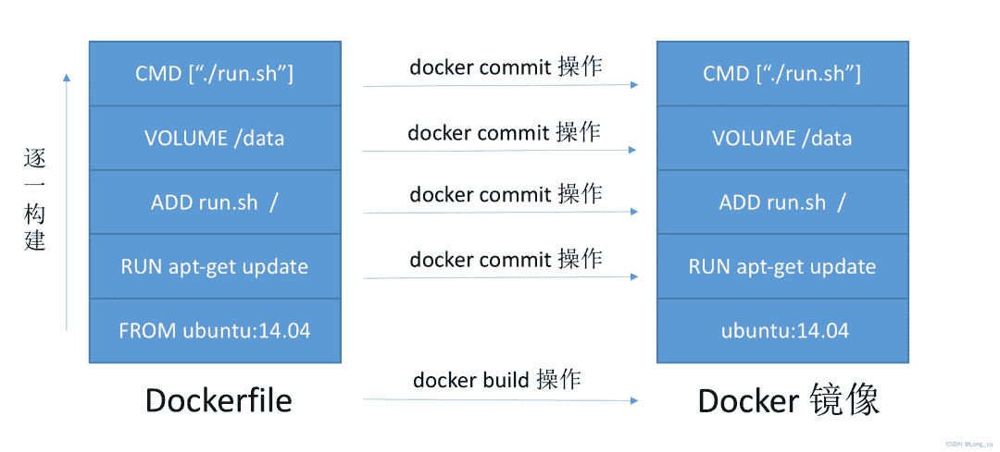

# 快速上手Dockerfile： 云原生工程师的利器

> 来源：[https://geekbang.feishu.cn/docx/H6oWdcyNeohZZIxxh6vcut3ynLb](https://geekbang.feishu.cn/docx/H6oWdcyNeohZZIxxh6vcut3ynLb)

> 👨🏻 作者：Lion莱恩呀

> 📃 作者介绍：专注分享高性能服务器后台开发知识，包括C/C++、Linux、网络协议、设计模式、中间件、云原生、数据库、分布式架构等领域知识。

> 🛖 👸号：Lion莱恩呀

> ⏰ 收录时间：2024-05-27 11:15:56 (UTC+8)

> 🔗 原文链接：h[ttps://mp.weixin.q](https://mp.weixin.qq.com/s?__biz=Mzk0ODUzNDc2Mw==&mid=2247485442&idx=1&sn=156413c35fc642ed5371c34c6ea1c66e&scene=19#wechat_redirect)q.com/s?__biz=Mz...


关注作者，获取更多相关知识

# 一、Dockerfile简介

Dockerfile是一个创建镜像所有命令的文本文件,，包含了一条条指令和说明，每条指令构建一层， 通过docker build命令，根据Dockerfile的内容构建镜像，因此每一条指令的内容，就是描述该层如何构建。有了Dockefile，就可以制定自己的docker镜像规则，只需要在Dockerfile上添加或者修改指令， 就可生成docker 镜像.。

## 1.1、Dockerfile解决的问题

1.  Dockerfile 包含了镜像制作的完整操作流程，其他开发者可以通过 Dockerfile 了解并复现制作过程。

1.  Dockerfile 中的每一条指令都会创建新的镜像层，这些镜像可以被 Docker Daemon 缓存。再次制作镜像时，Docker 会尽量复用缓存的镜像层（using cache），而不是重新逐层构建，这样可以节省时间和磁盘空间。

1.  Dockerfile 的操作流程可以通过docker image history [镜像名称]查询，方便开发者查看变更记录。

## 1.2、docker build 构建流程

docker build命令会读取Dockerfile的内容，并将Dockerfile的内容发送给 Docker 引擎，最终Docker引擎会解析Dockerfile中的每一条指令，构建出需要的镜像。

（1）docker build会将 context 中的文件打包传给 Docker daemon。如果 context 中 有.dockerignore文件，则会从上传列表中删除满足.dockerignore规则的文件。注意：如果上下文中有相当多的文件，可以明显感受到整个文件发送过程。这里有个例外，如果.dockerignore文件中有.dockerignore或者Dockerfile，docker build命令在排除文件时会忽略掉这两个文件。如果指定了镜像的 tag，还会对 repository 和 tag 进行验证。

（2）docker build命令向 Docker server 发送 HTTP 请求，请求 Docker server 构建镜像，请求中包含了需要的 context 信息。

（3）Docker server 接收到构建请求之后，会执行以下流程来构建镜像：

1.  创建一个临时目录，并将 context 中的文件解压到该目录下。

1.  读取并解析 Dockerfile，遍历其中的指令，根据命令类型分发到不同的模块去执行。

1.  Docker 构建引擎为每一条指令创建一个临时容器，在临时容器中执行指令，然后 commit 容器，生成一个新的镜像层。

1.  最后，将所有指令构建出的镜像层合并，形成 build 的最后结果。最后一次 commit 生成的镜像 ID就是最终的镜像 ID。

为了提高构建效率，docker build默认会缓存已有的镜像层。如果构建镜像时发现某个镜像层已经被缓存，就会直接使用该缓存镜像，而不用重新构建。如果不希望使用缓存的镜像，可以在执行docker build命令时，指定–no-cache=true参数。

Docker 匹配缓存镜像的规则为：遍历缓存中的基础镜像及其子镜像，检查这些镜像的构建指令是否和当前指令完全一致，如果不一样，则说明缓存不匹配。对于ADD、COPY指令，还会根据文件的校验和（checksum）来判断添加到镜像中的文件是否相同，如果不相同，则说明缓存不匹配。

注意，缓存匹配检查不会检查容器中的文件。比如，当使用RUN apt-get -y update命令更新了容器中的文件时，缓存策略并不会检查这些文件，来判断缓存是否匹配。

最后，可以通过docker history命令来查看镜像的构建历史。



## 1.3、关键字介绍

| 关键字 | 含义 |
| --- | --- |
| FROM | 设置镜像使用的基础镜像 |
| MAINTAINER | 设置镜像的作者 |
| RUN | 编译镜像时运行的脚步 |
| CMD | 设置容器的启动命令 |
| LABEL | 设置镜像标签 |
| EXPOSE | 设置镜像暴露的端口 |
| ENV | 设置容器的环境变量 |
| ADD | 编译镜像时复制上下文中文件到镜像中 |
| COPY | 编译镜像时复制上下文中文件到镜像中 |
| ENTRYPOINT | 设置容器的入口程序 |
| VOLUME | 设置容器的挂载卷 |
| USER | 设置运行 RUN CMD ENTRYPOINT的用户名 |
| WORKDIR | 设置 RUN CMD ENTRYPOINT COPY ADD 指令的工作目录 |
| ARG | 设置编译镜像时加入的参数 |
| ONBUILD | 设置镜像的ONBUILD 指令 |
| STOPSIGNAL | 设置容器的退出信号量 |

# 二、Dockerfile 实践

## 2.1、基本语法实践 — golang

（1）创建文件夹，存放Dockerfile。注意，默认Dockerfile文件的首字母要大写，当不指定Dockerfile时docker会自动去匹配。

```
mkdir example1 
cd example1
vim Dockerfile
```

（2）Dockerfile输入如下内容：

```
FROM golang:1.18
MAINTAINER fly
ENV env1=v1
ENV env2=v2
LABEL myhello 1.0.0
LABEL env prod
RUN git clone https://gitee.com/nickdemo/helloworld.git
WORKDIR helloworld
RUN CGO_ENABLED=0 GOOS=linux GOARCH=amd64 go build -o app .
EXPOSE 80
CMD [&quot;./app&quot;,&quot;--param1=p1&quot;,&quot;--param2=p2&quot;]
```

说明：

1.  FROM golang:1.18 表示使用golang语言v1.18版本的基础镜像。

1.  ENV设置容器的环境变量，一般是v1和v2。

1.  LABEL 可以设置多个。

1.  RUN设置编译时运行的脚本，可以有多个。

1.  WORKDIR类似于cd命令，WORKDIR helloworld是进入helloworld目录。

1.  CGO_ENABLED=0 GOOS=linux GOARCH=amd64 go build -o app . 是golang编译命令，go可以和c语言配合使用，CGO_ENABLED=0表示不打开CGO功能；app是编译出来的文件名，后面的.表示编译到当前路径。

（3）执行docker build命令。 要注意带有的“.” ，这是上下文，不可缺少 。

```
docker build -t hello:1.0.0 -f Dockerfile .
```

如果出现如下情况，编译不通过是因为没有设置golang的环境代理，因为golang服务器基本在国外，所以需要设置代理。

```
Sending build context to Docker daemon  2.048kB
Step 1/11 : FROM golang:1.18
1.18: Pulling from library/golang
32de3c850997: Pull complete 
fa1d4c8d85a4: Pull complete 
c796299bbbdd: Pull complete 
81283a9569ad: Pull complete 
c768848b86a2: Pull complete 
160a777925fe: Pull complete 
1be94824532a: Pull complete 
Digest: sha256:00d63686b480f6dc866e93ddc4b29efa2db03274a687e6495c2cfbfe615d638e
Status: Downloaded newer image for golang:1.18
 ---&gt; fffd0d9a59da
Step 2/11 : MAINTAINER fly
 ---&gt; Running in 115307734b60
Removing intermediate container 115307734b60
 ---&gt; 563fafbaa215
Step 3/11 : ENV env1=v1
 ---&gt; Running in cdc078b0e0f4
Removing intermediate container cdc078b0e0f4
 ---&gt; 00cf872c162e
Step 4/11 : ENV env2=v2
 ---&gt; Running in 9c5d21d9827a
Removing intermediate container 9c5d21d9827a
 ---&gt; 675573fda93f
Step 5/11 : LABEL myhello 1.0.0
 ---&gt; Running in 835edee10587
Removing intermediate container 835edee10587
 ---&gt; 7fe90336bfc0
Step 6/11 : LABEL env prod
 ---&gt; Running in 6b9a149d8760
Removing intermediate container 6b9a149d8760
 ---&gt; 1f518a4de736
Step 7/11 : RUN git clone https://gitee.com/nickdemo/helloworld.git
 ---&gt; Running in 3836f92a0cc1
Cloning into &#x27;helloworld&#x27;...
Removing intermediate container 3836f92a0cc1
 ---&gt; 497dfec57d8f
Step 8/11 : WORKDIR helloworld
 ---&gt; Running in 8f33d51a24f9
Removing intermediate container 8f33d51a24f9
 ---&gt; 581cbde35690
Step 9/11 : RUN CGO_ENABLED=0 GOOS=linux GOARCH=amd64 go build -o app .
 ---&gt; Running in ac2e563f44aa
go: downloading github.com/gomodule/redigo v1.8.9
go: downloading github.com/spf13/viper v1.12.0
hello/composeRedis.go:6:2: github.com/gomodule/redigo@v1.8.9: Get &quot;https://proxy.golang.org/github.com/gomodule/redigo/@v/v1.8.9.zip&quot;: dial tcp 142.251.42.241:443: i/o timeout
hello/printConfig.go:5:2: github.com/spf13/viper@v1.12.0: Get &quot;https://proxy.golang.org/github.com/spf13/viper/@v/v1.12.0.zip&quot;: dial tcp 142.251.42.241:443: i/o timeout
The command &#x27;/bin/sh -c CGO_ENABLED=0 GOOS=linux GOARCH=amd64 go build -o app .&#x27; returned a non-zero code: 1

```

（4）Dockerfile中设置代理：

```
FROM golang:1.18
MAINTAINER fly
ENV env1=v1
ENV env2=v2
LABEL myhello 1.0.0
LABEL env prod
RUN git clone https://gitee.com/nickdemo/helloworld.git
WORKDIR helloworld
RUN go env -w GOPROXY=&quot;https://proxy.golang.com.cn,https://goproxy.cn,direct&quot;
RUN CGO_ENABLED=0 GOOS=linux GOARCH=amd64 go build -o app .
EXPOSE 80
CMD [&quot;./app&quot;,&quot;--param1=p1&quot;,&quot;--param2=p2&quot;]
```

（5）再次执行docker build命令。

```
docker build -t hello:1.0.0 -f Dockerfile .
```

成功结果：

```
Sending build context to Docker daemon  2.048kB
Step 1/12 : FROM golang:1.18
 ---&gt; fffd0d9a59da
Step 2/12 : MAINTAINER fly
 ---&gt; Using cache
 ---&gt; 563fafbaa215
Step 3/12 : ENV env1=v1
 ---&gt; Using cache
 ---&gt; 00cf872c162e
Step 4/12 : ENV env2=v2
 ---&gt; Using cache
 ---&gt; 675573fda93f
Step 5/12 : LABEL myhello 1.0.0
 ---&gt; Using cache
 ---&gt; 7fe90336bfc0
Step 6/12 : LABEL env prod
 ---&gt; Using cache
 ---&gt; 1f518a4de736
Step 7/12 : RUN git clone https://gitee.com/nickdemo/helloworld.git
 ---&gt; Using cache
 ---&gt; 497dfec57d8f
Step 8/12 : WORKDIR helloworld
 ---&gt; Using cache
 ---&gt; 581cbde35690
Step 9/12 : RUN go env -w GOPROXY=&quot;https://proxy.golang.com.cn,https://goproxy.cn,direct&quot;
 ---&gt; Running in aa3d7b78e3ea
Removing intermediate container aa3d7b78e3ea
 ---&gt; 228d20762041
Step 10/12 : RUN CGO_ENABLED=0 GOOS=linux GOARCH=amd64 go build -o app .
 ---&gt; Running in 0b4899bd2333
go: downloading github.com/gomodule/redigo v1.8.9
go: downloading github.com/spf13/viper v1.12.0
go: downloading github.com/fsnotify/fsnotify v1.5.4
go: downloading github.com/mitchellh/mapstructure v1.5.0
go: downloading github.com/spf13/afero v1.8.2
go: downloading github.com/spf13/cast v1.5.0
go: downloading github.com/spf13/jwalterweatherman v1.1.0
go: downloading github.com/spf13/pflag v1.0.5
go: downloading golang.org/x/sys v0.0.0-20220520151302-bc2c85ada10a
go: downloading golang.org/x/text v0.3.7
go: downloading github.com/subosito/gotenv v1.3.0
go: downloading github.com/hashicorp/hcl v1.0.0
go: downloading gopkg.in/ini.v1 v1.66.4
go: downloading github.com/magiconair/properties v1.8.6
go: downloading github.com/pelletier/go-toml/v2 v2.0.1
go: downloading gopkg.in/yaml.v3 v3.0.0
go: downloading github.com/pelletier/go-toml v1.9.5
Removing intermediate container 0b4899bd2333
 ---&gt; 8a0543eb5966
Step 11/12 : EXPOSE 80
 ---&gt; Running in 5de109cc2133
Removing intermediate container 5de109cc2133
 ---&gt; 11f4f6f09a9e
Step 12/12 : CMD [&quot;./app&quot;,&quot;--param1=p1&quot;,&quot;--param2=p2&quot;]
 ---&gt; Running in 49caece0cdf7
Removing intermediate container 49caece0cdf7
 ---&gt; 308a6e93a8ff
Successfully built 308a6e93a8ff
Successfully tagged hello:1.0.0

```

（6）查看docker images。发现有了hello:1.0.0。

```
fly@fly:~/wokspace/example1$ docker images
REPOSITORY               TAG       IMAGE ID       CREATED              SIZE
hello                    1.0.0     308a6e93a8ff   About a minute ago   1.08GB
golang                   1.18      fffd0d9a59da   41 hours ago         965MB
nginx                    latest    ac8efec875ce   2 weeks ago          142MB
nongtengfei/mynginx      1.0.0     ac8efec875ce   2 weeks ago          142MB
localhost:5000/mynginx   1.0.0     ac8efec875ce   2 weeks ago          142MB
registry                 2         81c944c2288b   5 weeks ago          24.1MB

```

（7）运行镜像。

```
docker run -p 80:80 --name myhello hello:1.0.0
```

执行结果：

```
fly@fly:~/wokspace/example1$ docker run -p 80:80 --name myhello hello:1.0.0 
into main

```

也可以后台执行：

```
docker run -p 80:80 -d --name myhello hello:1.0.0
```

然后使用curl访问：

```
$ curl http://localhost:80/print/env
env list : env1 = v1 and env2 = v2

```

### 问题检查

上述制作的镜像有什么问题？

1.  镜像非常大，什么都没做就是1.08GB。不方便传输。

1.  使用了git软件，这个在golang的基础镜像默认有的，但是如果是是gcc环境，可能就没有这个git软件。

1.  构建时传输了上下文，但是上下文基本没有用到。

## 2.2、基本语法实践 — gcc

（1）创建文件夹，存放Dockerfile。注意，默认Dockerfile文件的首字母要大写，当不指定Dockerfile时docker会自动去匹配。

```
mkdir example2
cd example2
vim Dockerfile
```

（2）Dockerfile输入如下内容：

```
FROM gcc
MAINTAINER fly
COPY ./hello.c ./
RUN pwd
LABEL myhello 1.0.0
LABEL env prod
RUN gcc hello.c -o hello
CMD [&quot;./hello&quot;]
```

（3）创建hello.c并输入内容：

（hello.c）

```
#include &lt;stdio.h&gt;
int main(int argc,char **argv)
{
        printf(&quot;hello world\n&quot;);
        return 0;
}
```

（4）构建镜像：

```
docker build -t myhelloc .
```

执行结果：

```
Sending build context to Docker daemon  3.072kB
Step 1/8 : FROM gcc
latest: Pulling from library/gcc
32de3c850997: Already exists 
fa1d4c8d85a4: Already exists 
c796299bbbdd: Already exists 
81283a9569ad: Already exists 
60b38700e7fb: Pull complete 
0db15631b022: Pull complete 
becc68bc09a5: Pull complete 
c369162968fc: Pull complete 
ce5ec26c51fc: Pull complete 
Digest: sha256:6c101c7698a6ebe5cd153182889ffc9ab2f7192bf96a06fe292806116fdaafba
Status: Downloaded newer image for gcc:latest
 ---&gt; e94a76bddd72
Step 2/8 : MAINTAINER fly
 ---&gt; Running in e193e6e7dac1
Removing intermediate container e193e6e7dac1
 ---&gt; afa92db551f4
Step 3/8 : COPY ./hello.c ./
 ---&gt; 87b51ccd7de3
Step 4/8 : RUN pwd
 ---&gt; Running in 569f3ddfaf53
/
Removing intermediate container 569f3ddfaf53
 ---&gt; 2ee756f47004
Step 5/8 : LABEL myhello 1.0.0
 ---&gt; Running in 2deaebd60838
Removing intermediate container 2deaebd60838
 ---&gt; 1610bf7d0792
Step 6/8 : LABEL env prod
 ---&gt; Running in ce840c209a93
Removing intermediate container ce840c209a93
 ---&gt; b6158d8d3aac
Step 7/8 : RUN gcc hello.c -o hello
 ---&gt; Running in 6f01803e28b1
Removing intermediate container 6f01803e28b1
 ---&gt; 6c9223360ad5
Step 8/8 : CMD [&quot;./hello&quot;]
 ---&gt; Running in 9127f8f3e413
Removing intermediate container 9127f8f3e413
 ---&gt; a88d99f3d8e8
Successfully built a88d99f3d8e8
Successfully tagged myhelloc:latest

```

（5）执行镜像：

```
docker run myhelloc
```

执行结果：

```
fly@fly:~/wokspace/example2$ docker run myhelloc
hello world

```

如果是后台执行，可以通过docker log 查询到输出的hello world。

# 总结

1.  构建镜像时，选择上下文要注意，不要包含有不要用到的内容，通常使用项目的根目录作为上下文即可。

1.  COPY命令时，基本上是“./*”开始，没有绝对路径，因为构建的时候上下文已经发送到守护进程，不在宿主机了。

1.  go语言和c语言编译的区别，主要在FROM部分，依赖的基础环境；另外，编译命令也不一样。