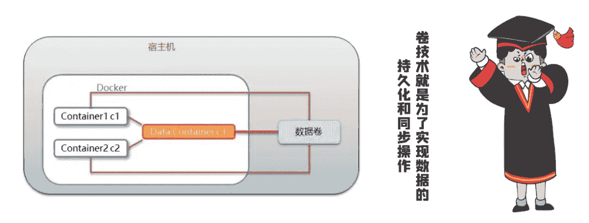

# 一篇文章教你轻松玩转Docker数据卷

> 来源：[https://geekbang.feishu.cn/docx/Db5rdb4nco8egRx4Z2IcRmLNnCh](https://geekbang.feishu.cn/docx/Db5rdb4nco8egRx4Z2IcRmLNnCh)

> 👨🏻 作者：Lion莱恩呀

> 📃 作者介绍：专注分享高性能服务器后台开发知识，包括C/C++、Linux、网络协议、设计模式、中间件、云原生、数据库、分布式架构等领域知识。

> 🛖 👸号：Lion莱恩呀

> ⏰ 收录时间：2024-05-27 11:15:56 (UTC+8)

> 🔗 原文链接：h[ttps://mp.weixin.q](https://mp.weixin.qq.com/s?__biz=Mzk0ODUzNDc2Mw==&mid=2247485543&idx=1&sn=9bf230565a0894ca021e86cec6ae98e1&scene=19#wechat_redirect)q.com/s?__biz=Mz...


关注作者，获取更多相关知识

# 一、数据卷产生背景

Docker的镜像是由一系列的只读层组合而来，当启动一个容器时，Docker加载镜像的所有只读层，并在最上层加入一个读写层。这个设计使得Docker可以提高镜像构建、存储和分发的效率，节省了时间和存储空间，然而也存在一些问题：

1.  容器中的文件在宿主机上存在形式复杂，不能在宿主机上很方便地对容器中的文件进行访问。

1.  多个容器之间的数据无法共享

1.  当删除容器时，容器产生的数据将丢失。

为了解决这些问题，Docker引入了数据卷（volume）机制。Volume 是存在于一个或多个容器中的特定文件或文件夹，这个目录以独立于联合文件系统的形式在宿主机中存在，并为数据的共享和持久化提供便利。

1.  volume 在容器创建时就会初始化，在容器运行时就可以使用其中的文件。

1.  volume 能在不同的容器之间共享和重用。

1.  对volume中数据的操作会马上生效。

1.  对volume中数据的操作不会影响镜像本身。

1.  volume的生存周期独立于容器的生命周期，即使删除容器，volume仍然会存在，没有任何容器使用的volume也不会被Docker删除。



# 二、数据卷的使用

```
Usage:  docker volume COMMAND

Manage volumes

Commands:
  create      Create a volume
  inspect     Display detailed information on one or more volumes
  ls          List volumes
  prune       Remove all unused local volumes
  rm          Remove one or more volumes
```

## 2.1、创建数据卷

创建一个名为 vol_simple的存储卷：

```
docker volume create --name vol_simple
```

查看数据卷的信息：

```
docker volume inspect vol_simple
```

示例：

```
fly@fly:~$ docker volume create --name vol_simple
vol_simple
fly@fly:~$ docker volume inspect vol_simple 
[
    {
        &quot;CreatedAt&quot;: &quot;2023-01-04T11:59:24Z&quot;,
        &quot;Driver&quot;: &quot;local&quot;,
        &quot;Labels&quot;: {},
        &quot;Mountpoint&quot;: &quot;/var/lib/docker/volumes/vol_simple/_data&quot;,
        &quot;Name&quot;: &quot;vol_simple&quot;,
        &quot;Options&quot;: {},
        &quot;Scope&quot;: &quot;local&quot;
    }
]

```

Docker run 和 docker create 通过指定-v参数 可以为容器挂载一个数据卷。

```
#没有指定volume卷，只指定了容器中的挂载点/data 
docker run -d -it -v /data ubuntu /bin/bash 
# 查看随机创建的volume位置，查看mounts的内容 
docker inspect {ID}
# 创建一个指定名字的volume ，并挂载到容器中的/data目录 
docker run -d -v vol_simple:/data ubuntu
```

示例：

```
fly@fly:~$ docker run -dit -v vol_simple:/data ubuntu
e86204b7a02ccb62e6cf4f00b7246ac0d70aadf0d9915df5418ad73f0bf8f00a
fly@fly:~$ docker ps
CONTAINER ID   IMAGE        COMMAND                  CREATED         STATUS          PORTS                                       NAMES
e86204b7a02c   ubuntu       &quot;bash&quot;                   4 seconds ago   Up 2 seconds                                                charming_bhaskara
fly@fly:~$ docker inspect charming_bhaskara 
...
&quot;Mounts&quot;: [
            {
                &quot;Type&quot;: &quot;volume&quot;,
                &quot;Name&quot;: &quot;vol_simple&quot;,
                &quot;Source&quot;: &quot;/var/lib/docker/volumes/vol_simple/_data&quot;,
                &quot;Destination&quot;: &quot;/data&quot;,
                &quot;Driver&quot;: &quot;local&quot;,
                &quot;Mode&quot;: &quot;z&quot;,
                &quot;RW&quot;: true,
                &quot;Propagation&quot;: &quot;&quot;
            }
        ],
...
```

测试数据持久性：

```
fly@fly:~$ docker exec -it charming_bhaskara bash
root@e86204b7a02c:/# ls
bin  boot  data  dev  etc  home  lib  lib32  lib64  libx32  media  mnt  opt  proc  root  run  sbin  srv  sys  tmp  usr  var
root@e86204b7a02c:/# echo abcd &gt;&gt; /data/1.txt
root@e86204b7a02c:/# cat data/1.txt 
abcd
root@e86204b7a02c:/# exit
exit
fly@fly:~$ docker stop charming_bhaskara 
charming_bhaskara
fly@fly:~$ docker rm charming_bhaskara 
charming_bhaskara
fly@fly:~$ docker ps
CONTAINER ID   IMAGE        COMMAND                  CREATED       STATUS          PORTS                                       NAMES
22634e72e7a3   registry:2   &quot;/entrypoint.sh /etc…&quot;   3 weeks ago   Up 21 minutes   0.0.0.0:5000-&gt;5000/tcp, :::5000-&gt;5000/tcp   registry
fly@fly:~$ sudo cat /var/lib/docker/volumes/vol_simple/_data/1.txt
abcd

```

## 2.2、挂载数据卷

使用docker run 或者 docker create 创建新容器是，可以使用-v标签为容器添加volume。可以将自行创建或者有Docker创建的volume挂载到容器中，也可以将宿主机上的目录或者文件作为volume挂载到容器中。

将宿主机中指定目录作为volume挂载到容器中的/data目录下，文件夹必须使用绝对路径，如果宿主机中不存在指定的目录，则会创建一个空文件夹；如果宿主机文件夹已经存在，容器可以通过访问挂载点/data 从而访问宿主机文件夹中的所有内容。如果容器下原本已经存在/data文件夹，且不为空，那么容器中文件夹下原有的内容将被隐藏，来保持与宿主机中的文件夹一致。

挂载方式：

（1）创建名为vol_simple的数据卷，并挂载到容器中的/data目录下：

```
docker volume create --name vol_simple 
docker run -d -v vol_simple:/data ubuntu /bin/bash
```

（2）创建一个随机的ID的volume，并将其挂载到容器中的/data目录下：

```
docker run -d -v /data ubuntu /bin/bash
```

（3）关联宿主机目录：

```
docker run -d -v $HOME/data:/data ubuntu /bin/bash
```

挂载权限，ro表示只读，rw表示读写，默认为rw：

```
# ro表示只读，rw表示读写，默认为rw 
docker run -it -v $HOME/data:/data:ro ubuntu /bin/bash 
# 通过修改文件验证 
echo 123456abcdefg &gt;&gt; /data/test
```

同时挂载多个数据卷：

```
docker run -it -v $HOME/data:/data:ro -v /data1 -v /data2 ubuntu /bin/bash
```

通过dockerfile指定数据卷挂载：

```
# dockerfile 添加指令 
VOLUME /data 
# 指定多个数据卷的挂载点 
VOLUME [&quot;/data1&quot;,&quot;/data2&quot;]
```

使用do**ckerfile VOLUME 指令，与docker run -v 不同的是，dockerfile指令不能挂载主机中指定的文件夹。这时为了**保证Dockerfile的可移植性，因为不能保证所有的宿主机都有对应的文件夹。如果镜像中存才/data文件夹，这个文件夹中的内容将全部被复制到宿主机上对应文件夹中，并且根据容器中的文件设置合适的权限和所有者。

注意：在Dockerfile中使用VOLUME指令后的代码，如果尝试对这个volume进行修改，这些修改都不会生效。因为：volume 是独立于rootfs的存储，镜像构建过程，每一层类似docker commit 提交临时镜像为镜像层，docker commit不会对挂载的volume进行保存。

**示例1 **：VOLUME指定了挂载点之后，再对挂载点进行操作，由于docker commit 提交临时镜像不会对volume进行保存，所以该data下的file并没有被保存，更不会同步到宿主机。

```
FROM ubuntu 
RUN useradd fly2
VOLUME /data 
RUN touch /data/file 
RUN chown -R fly2:fly2 /data
```

构建：

```
docker build -t test1:v1 -f Dockerfile . 
docker run -d -it test1:v1 /bin/bash
```

查看挂载点信息 ：

```
docker inspect 容器ID
```

查看宿主机存储卷目录 ：

```
sudo ls 宿主机存储卷目录
```

**示例2 **：由于挂载volume时，/data目录已经存在，所以/data中的文件以及它们的权限和所有者设置都会被复制到volume中。

```
FROM ubuntu 
RUN useradd fly2 
RUN mkdir /data &amp;&amp; touch /data/file 
RUN chown -R fly2:fly2 /data 
VOLUME /data
```

构建：

```
docker build -t test1:v2 -f Dockerfile1 . 
docker run -d -it test1:v2 /bin/bash
```

查看挂载点信息：

```
docker inspect 容器ID
```

查看宿主机存储卷目录 ：

```
sudo ls 宿主机存储卷目录
```

**示例3 **：通过CMD和ENTRYPOINT指令，在容器启动时执行挂载点下文件的初始化。

```
FROM ubuntu 
RUN useradd fly2
VOLUME /data 
CMD touch /data/file &amp;&amp; chown -R fly2:fly2 /data
```

## 2.3、共享数据卷

在使用docker run 或docker create创建新容器时，可以使用–volumes-from 标签使得容器与已有容器共享volume。可以使用多个–volumes-from标签，使得容器与多个已有容器共享volume。

一个容器挂载了一个volume，即使这个容器停止运行，该volume仍然存在，其他容器也可以使用–volumes-from与这个容器共享volume。

共享数据卷作用：**

**如果有一些数据，比如配置文件、数据文件等，要在多个容器之间共享，一种常见的做法是创建一个数据容器，其他的容器与之共享volume。

实践 创建一个带数据卷的容器。

创建目录和数据卷：

```
mkdir $HOME/data 
mkdir $HOME/readOlny_data 
docker volume create vol_simple 
docker volume create vol_simple1
```

创建一个数据容器 包含已创建数据卷，只读数据卷，私有数据卷等 ：

```
docker run -d -it -v vol_simple:/vol_simple -v $HOME/data:/data -v $HOME/readOlny_data:/readOlny_data:ro --name share_data ubuntu /bin/bash 
docker run -d -it -v vol_simple1:/vol_simple1 --name share_data1 ubuntu /bin/bash
```

进入容器查看 ：

```
docker exec -it 容器ID /bin/bash
```

运行新的容器通过数据容器共享数据卷 容器名：

```
volume_from1 docker run -d -it --volumes-from share_data --volumes-from share_data1 --name volume_from1 ubuntu /bin/bash
```

运行新的容器通过数据容器共享数据卷 容器名：

```
volume_from2 docker run -d -it --volumes-from share_data --volumes-from share_data1 --name volume_from2 ubuntu /bin/bash
```

1.  只读共享点不能被写入。

1.  可以同时共享多个容器的数据卷。

1.  docker inspect 查看容器元数据。

## 2.4、删除数据卷

如果创建容器时从容器中挂载了volume，在/var/lib/docker/volumes下会生产与volume对应的目录（可使用docker inspect 命令查看容器信息找到对应的信息）。

使用docker rm 删除容器并不会删除与volume对应的目录，这些目录会占据不必要的存储空间。

删除volume的三种方式：

1.  使用docker volume rm <volume_name> 删除数据卷。

1.  使用docker rm -v <container_name> 删除容器时一并删除它挂载的数据卷。

1.  在运行容器时使用docker run --rm 标签会在容器停止运行时删除容器以及容器所挂载的volume。

注意：

1.  在使用第一种docker volume rm 删除时，只有当没有任何容器使用该volume的时候，才能被删除成功。

1.  另外两种删除方式，只会对挂载在该容器上的未指定名称（匿名的）的volume进行删除，而会对用户指定名称的（具名的）volume进行保留。

1.  如果volume 是在创建容器时从宿主机中挂载的，无论对容器进行任何操作都不会导致其在宿主机中被删除，如果不需要这些文件，只能手动删除。（从宿主机中挂载是指 docker run -v dir:dir 这种模式）。

## 2.5、备份和迁移数据卷

volume 作为数据的载体，在很多情况下需要对其中的数据进行备份、迁移，或是从已有数据恢复。

最简单的备份还原的方式：

1.  通过inspect 命令查看容器信息，找到对应的数据卷，手动打包数据；

1.  同样的还原那就是把打包好的数据解压到对应的数据卷。

用–volumes-from实现备份与还原：

（1）备份：启动另外一个临时容器，共享挂载数据容器share_data，同时挂载当前目录到容器的/backup。启动容器时执行打包命令，将/data挂载点下的数据打包到/backup/data.tar 文件中。–rm 表示该容器停止后会删除该容器和该容器的数据卷。

```
docker run --rm --volumes-from share_data -v $(pwd):/backup ubuntu tar cvf /backup/data.tar /data
```

（2）恢复：创建临时容器，通过共享存储的方式与目标容器共享存储，同时挂载当前目录到容器的/backup。启动容器时从backup挂载点下的data.tar 解压文件到容器的根目录。

```
docker run -d -it --name vol_bck -v /data ubuntu /bin/bash
```

```
docker run --rm --volumes-from vol_bck -v $(pwd):/backup ubuntu tar xvf /backup/data.tar -C /
```

#

# 总结

1.  数据卷解决的问题就是容器数据的持久化问题，比如日志、容器间共享数据、配置文件等。

1.  容器和镜像使用的同一套文件，即依赖相同的镜像层，这是一个只读的权限；要修改底层文件内容，就需要将文件从只读层拷贝出来放到读写层进行改变；改变后会隐藏只读层的那个文件，使用读写层的文件。

1.  一般，底层文件系统是不允许改变的，所以容器关闭之后，容器的所有改变内容都会被删除，为解决这个问题引入了数据卷。

1.  匿名数据卷可以在删除容器的时候一并删除。