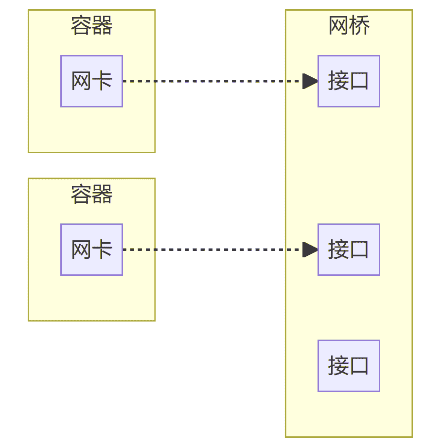

# Docker网络高级实战：隔离网络、检查路由表和自定义网络驱动

> 来源：[https://geekbang.feishu.cn/docx/VHxUdgHiQotomFx2NvRc3WpZn3d](https://geekbang.feishu.cn/docx/VHxUdgHiQotomFx2NvRc3WpZn3d)

> 👨🏻 作者：Lion莱恩呀

> 📃 作者介绍：专注分享高性能服务器后台开发知识，包括C/C++、Linux、网络协议、设计模式、中间件、云原生、数据库、分布式架构等领域知识。

> 🛖 👸号：Lion莱恩呀

> ⏰ 收录时间：2024-05-27 11:15:56 (UTC+8)

> 🔗 原文链接：h[ttps://mp.weixin.q](https://mp.weixin.qq.com/s?__biz=Mzk0ODUzNDc2Mw==&mid=2247485815&idx=1&sn=525d9f8aba9e547453610ee94d56fde8&scene=19#wechat_redirect)q.com/s?__biz=Mz...


关注作者，获取更多相关知识

## 一、相关概念

### 1.1、网桥

在一台未经特殊网络配置的Ubuntu机器上安装完Docker之后，在宿主机上通过`ifconfig`命令可以看到多了一块名为`docker0`的网卡。该网卡即是`docker0`网桥，网桥在这里的作用相当于交换机，为连接在其上的设备转发数据帧。

网桥上的`veth`网卡设备相当于交换机上的端口，可以将多个容器或虚拟机连接其上，这些端口工作在二层（链路层），所以是不需要配置IP信息的。

```
$ ifconfig
docker0: flags=4163<UP,BROADCAST,RUNNING,MULTICAST>  mtu 1500
        inet 172.17.0.1  netmask 255.255.0.0  broadcast 172.17.255.255
        inet6 fe80::42:40ff:fe65:67d8  prefixlen 64  scopeid 0x20<link>
        ether 02:42:40:65:67:d8  txqueuelen 0  (Ethernet)
        RX packets 0  bytes 0 (0.0 B)
        RX errors 0  dropped 0  overruns 0  frame 0
        TX packets 5  bytes 526 (526.0 B)
        TX errors 0  dropped 0 overruns 0  carrier 0  collisions 0

ens33: flags=4163<UP,BROADCAST,RUNNING,MULTICAST>  mtu 1500
        inet 192.168.11.72  netmask 255.255.240.0  broadcast 192.168.15.255
        inet6 fe80::20c:29ff:fe70:53ec  prefixlen 64  scopeid 0x20<link>
        ether 00:0c:29:70:53:ec  txqueuelen 1000  (Ethernet)
        RX packets 124134  bytes 8441977 (8.4 MB)
        RX errors 0  dropped 257  overruns 0  frame 0
        TX packets 271  bytes 49957 (49.9 KB)
        TX errors 0  dropped 0 overruns 0  carrier 0  collisions 0

lo: flags=73<UP,LOOPBACK,RUNNING>  mtu 65536
        inet 127.0.0.1  netmask 255.0.0.0
        inet6 ::1  prefixlen 128  scopeid 0x10<host>
        loop  txqueuelen 1000  (Local Loopback)
        RX packets 104  bytes 8112 (8.1 KB)
        RX errors 0  dropped 0  overruns 0  frame 0
        TX packets 104  bytes 8112 (8.1 KB)
        TX errors 0  dropped 0 overruns 0  carrier 0  collisions 0

veth0fdda42: flags=4163<UP,BROADCAST,RUNNING,MULTICAST>  mtu 1500
        inet6 fe80::c4fe:c7ff:feb0:8678  prefixlen 64  scopeid 0x20<link>
        ether c6:fe:c7:b0:86:78  txqueuelen 0  (Ethernet)
        RX packets 0  bytes 0 (0.0 B)
        RX errors 0  dropped 0  overruns 0  frame 0
        TX packets 17  bytes 1462 (1.4 KB)
        TX errors 0  dropped 0 overruns 0  carrier 0  collisions 0
```

`docker`的所有容器，都是通过网桥进行通信。



```
$ docker inspect registry
[
    {
        "Id": "22634e72e7a3f6fb38991d9e380e514e3ff4b89f418256a54c9f0a0cd5746f1f",
        "Created": "2022-12-13T03:42:35.725091364Z",
        "Path": "/entrypoint.sh",
        "Args": [
            "/etc/docker/registry/config.yml"
        ],
        ......
        "NetworkSettings": {
            "Bridge": "",
            "SandboxID": "e7822213c3aa7566f3ca1b410f57aeceb01a4666c177640d1574fab0024a00fb",
            "HairpinMode": false,
            "LinkLocalIPv6Address": "",
            "LinkLocalIPv6PrefixLen": 0,
            "Ports": {
                "5000/tcp": [
                    {
                        "HostIp": "0.0.0.0",
                        "HostPort": "5000"
                    },
                    {
                        "HostIp": "::",
                        "HostPort": "5000"
                    }
                ]
            },
            "SandboxKey": "/var/run/docker/netns/e7822213c3aa",
            "SecondaryIPAddresses": null,
            "SecondaryIPv6Addresses": null,
            "EndpointID": "51543b28d5845fc74095634960f21fd2a5ffed373695ace323ef6a0cd9080955",
            "Gateway": "172.17.0.1",
            "GlobalIPv6Address": "",
            "GlobalIPv6PrefixLen": 0,
            "IPAddress": "172.17.0.2",
            "IPPrefixLen": 16,
            "IPv6Gateway": "",
            "MacAddress": "02:42:ac:11:00:02",
            "Networks": {
                "bridge": {
                    "IPAMConfig": null,
                    "Links": null,
                    "Aliases": null,
                    "NetworkID": "f06e508f708d688af9608cf4310b086b09a546aa28cd9ed6a80446b077e0888e",
                    "EndpointID": "51543b28d5845fc74095634960f21fd2a5ffed373695ace323ef6a0cd9080955",
                    "Gateway": "172.17.0.1",
                    "IPAddress": "172.17.0.2",
                    "IPPrefixLen": 16,
                    "IPv6Gateway": "",
                    "GlobalIPv6Address": "",
                    "GlobalIPv6PrefixLen": 0,
                    "MacAddress": "02:42:ac:11:00:02",
                    "DriverOpts": null
                }
            }
        }
    }
]
```

在`NetworkSettings`可以看到一个`SandboxID`和`SandboxKey`。使用`lsns`查看网络命名空间，可以看到`SandboxKey`（`/var/run/docker/netns/e7822213c3aa`）。


```
$ sudo lsns --output-all 
        NS TYPE   PATH              NPROCS   PID  PPID COMMAND                                        UID USER                NETNSID NSFS
4026531835 cgroup /proc/1/ns/cgroup    211     1     0 /sbin/init auto automatic-ubiquity noprompt      0 root                        
4026531836 pid    /proc/1/ns/pid       210     1     0 /sbin/init auto automatic-ubiquity noprompt      0 root                        
4026531837 user   /proc/1/ns/user      211     1     0 /sbin/init auto automatic-ubiquity noprompt      0 root                        
4026531838 uts    /proc/1/ns/uts       207     1     0 /sbin/init auto automatic-ubiquity noprompt      0 root                        
4026531839 ipc    /proc/1/ns/ipc       210     1     0 /sbin/init auto automatic-ubiquity noprompt      0 root                        
4026531840 mnt    /proc/1/ns/mnt       202     1     0 /sbin/init auto automatic-ubiquity noprompt      0 root                        
4026531860 mnt    /proc/21/ns/mnt        1    21     2 kdevtmpfs                                        0 root                        
4026531992 net    /proc/1/ns/net       210     1     0 /sbin/init auto automatic-ubiquity noprompt      0 root             unassigned 
4026532548 mnt    /proc/534/ns/mnt       1   534     1 /lib/systemd/systemd-udevd                       0 root                        
4026532549 uts    /proc/534/ns/uts       1   534     1 /lib/systemd/systemd-udevd                       0 root                        
4026532622 mnt    /proc/773/ns/mnt       1   773     1 /lib/systemd/systemd-timesyncd                 102 systemd-timesync            
4026532623 uts    /proc/773/ns/uts       1   773     1 /lib/systemd/systemd-timesyncd                 102 systemd-timesync            
4026532624 mnt    /proc/854/ns/mnt       1   854     1 /lib/systemd/systemd-networkd                  100 systemd-network             
4026532625 mnt    /proc/856/ns/mnt       1   856     1 /lib/systemd/systemd-resolved                  101 systemd-resolve             
4026532635 mnt    /proc/1083/ns/mnt      1  1083     1 /usr/sbin/ModemManager                           0 root                        
4026532644 mnt    /proc/1494/ns/mnt      1  1494  1466 registry serve /etc/docker/registry/config.yml   0 root                        
4026532645 uts    /proc/1494/ns/uts      1  1494  1466 registry serve /etc/docker/registry/config.yml   0 root                        
4026532646 ipc    /proc/1494/ns/ipc      1  1494  1466 registry serve /etc/docker/registry/config.yml   0 root                        
4026532647 pid    /proc/1494/ns/pid      1  1494  1466 registry serve /etc/docker/registry/config.yml   0 root                        
4026532649 net    /proc/1494/ns/net      1  1494  1466 registry serve /etc/docker/registry/config.yml   0 root                      0 /run/docker/netns/e7822213c3aa
4026532690 mnt    /proc/909/ns/mnt       1   909     1 /lib/systemd/systemd-logind                      0 root                        
4026532691 mnt    /proc/888/ns/mnt       1   888     1 /usr/sbin/irqbalance --foreground                0 root                        
4026532747 uts    /proc/909/ns/uts       1   909     1 /lib/systemd/systemd-logind                      0 root
```

# 1.2、CNM

CNM（Container Network Model）译为容器网络模型，定义了构建容器虚拟化网络的模型。该模型主要包含三个核心组件 沙盒、端点、网络。

+ 沙盒：一个沙盒包含了一个容器网络栈的信息。沙盒可以对容器的接口、路由和DNS设置进行管理。一个沙盒可以有多个端点和网络。
+ 端点：一个端点可以加入一个沙盒和一个网络。一个端点只可以属于一个网络并且只属于一个沙盒。
+ 网络：一个网络是一组可以直接互相联通的端点。一个网络可以包含多个端点。

# 1.3、libnetwork

`libnetwork` 实现了CNM 的Docker网络组件库。`libnetwork`内置了几种网络驱动：

+ `bridge`驱动。此驱动为Docker的默认设置，使用这个驱动的时候，`libnetwork`将创建出来的docker容器连接到Docker网桥上。作为最常规的模式，`bridge`模式已经可以满足docker容器最基本的使用需求了。
+ `host`驱动。使用这种驱动的时候，`libnetwork`将不为docker容器创建网络协议栈，即不会创建独立的network namespace。Docker容器中的进程处于宿主机的网络环境中，相当于docker容器与宿主机共同使用一个network namespace，使用宿主机的网卡、IP和端口等信息。但是，容器的其他方面，如文件系统、进程列表等还是和宿主机隔离的。集群的时候使用。
+ `overlay`驱动。通过网络虚拟化技术，在同一个物理网络上构建出一张或多张虚拟的逻辑网络。适合大规模的云计算虚拟化环境。
+ `remote`驱动。这个驱动实际上并没有做真正的网络服务实现，而是调用了用户自行实现的网络驱动插件，使`libnetwork`实现了驱动的可插件化，更好的满足了用户的多种需求。用户只要根据`libnetwork`提供的协议标准，实现其所要求的各个接口并向Docker daemon进行注册。
+ `null`驱动。使用这种驱动的时候，Docker容器拥有自己的network namespace，但是并不为Docker容器进行任何网络配置。也就是说，这个Docker容器除了network namespace 自带的loopback网卡外，没有其他任何网卡、ip、路由等信息，需要用户为Docker容器添加网卡、配置IP等。这种模式如果不进行特定的配置是无法正常使用的，但优点也非常明显，它给了用户最大的自由度来定义容器的网络环境。

# 二、实操

## 2.1、`docker network`常用命令

```
# 连接一个容器到一个网络 
docker network connect #Connect a container to a network 
# 创建一个网络 
docker network create #Create a network 
# 将容器从一个网络中断开 
docker network disconnect #Disconnect a container from a network 
# 查看网络的详细信息 
docker network inspect #Display detailed information on one or more networks 
# 查看网络列表 
docker network ls #List networks 
# 移除所有为使用的网络 
docker network prune #Remove all unused networks 
# 移除一个或多个网络 
docker network rm #Remove one or more networks
```

（1）创建网络时，可以指定子网IP地址、网关、IP范围等信息，IP地址斜杆后面的数字表示固定了前面IP的多少位不能改变。（一个IP地址是32bit的）

```
docker network create --subnet=172.11.0.1/16 --gateway=172.11.11.11 --ip-range=172.11.1.2/24 mynet
```

（2）启动容器时绑定网络，注意`--network`要在容器名的前面。

```
docker run -d --network brigh nginx
```

## 2.2、运行一个docker容器，查看CNM三个概念

```
# 运行一个容器 
docker run -d -it --name myubuntu ubuntu /bin/bash 
# 查看容器详信息 
docker inspect myubuntu
```

## 2.3、查看`docker0`在内核路由表上的记录

```
$ route -n
Kernel IP routing table
Destination     Gateway         Genmask         Flags Metric Ref    Use Iface
0.0.0.0         192.168.8.1     0.0.0.0         UG    100    0        0 ens33
172.17.0.0      0.0.0.0         255.255.0.0     U     0      0        0 docker0
192.168.0.0     0.0.0.0         255.255.240.0   U     0      0        0 ens33
192.168.8.1     0.0.0.0         255.255.255.255 UH    100    0        0 ens33
```

通过以上命令可以找到一条静态路由，该路由表示所有目的IP地址为`172.17.0.0/16`的数据包都从`docker0`网卡发出。

## 2.4、查看网络列表

（1）查看宿主机已有网络列表：

```
$ docker network ls
NETWORK ID     NAME      DRIVER    SCOPE
f06e508f708d   bridge    bridge    local
75f3915547ea   host      host      local
a1b056f00f28   none      null      local
```

docker 安装后默认创建了以上的三个驱动的网络。

查看`bridge`网络详细信息：


# Docker 默认网桥（bridge）网络

默认情况下，我们启动的容器都接入到了默认的`bridge`网络中，该网络以`docker0`为网关同外界交互。

## 查看 bridge 网络详情

```
$ docker network inspect bridge
[
    {
        "Name": "bridge",
        "Id": "f06e508f708d688af9608cf4310b086b09a546aa28cd9ed6a80446b077e0888e",
        "Created": "2023-02-22T06:10:47.57011656Z",
        "Scope": "local",
        "Driver": "bridge",
        "EnableIPv6": false,
        "IPAM": {
            "Driver": "default",
            "Options": null,
            "Config": [
                {
                    "Subnet": "172.17.0.0/16",
                    "Gateway": "172.17.0.1"
                }
            ]
        },
        "Internal": false,
        "Attachable": false,
        "Ingress": false,
        "ConfigFrom": {
            "Network": ""
        },
        "ConfigOnly": false,
        "Containers": {
            "22634e72e7a3f6fb38991d9e380e514e3ff4b89f418256a54c9f0a0cd5746f1f": {
                "Name": "registry",
                "EndpointID": "51543b28d5845fc74095634960f21fd2a5ffed373695ace323ef6a0cd9080955",
                "MacAddress": "02:42:ac:11:00:02",
                "IPv4Address": "172.17.0.2/16",
                "IPv6Address": ""
            }
        },
        "Options": {
            "com.docker.network.bridge.default_bridge": "true",
            "com.docker.network.bridge.enable_icc": "true",
            "com.docker.network.bridge.enable_ip_masquerade": "true",
            "com.docker.network.bridge.host_binding_ipv4": "0.0.0.0",
            "com.docker.network.bridge.name": "docker0",
            "com.docker.network.driver.mtu": "1500"
        },
        "Labels": {}
    }
]
```

## 运行容器并查看网络接入情况

运行两个容器，它们会加入默认网络，同时网桥上会多出两个无 IP 地址的网卡，作为端口让容器接入网桥。

```
docker run -d -p 80:80 nginx
docker run -d -p 81:80 nginx
```

```
fly@fly:~$ docker run -d -p 80:80 nginx
da0d48e1d26db4b9ec644274cee230370397b153bfeaa6b4a97573d846dfbf6a
fly@fly:~$ docker run -d -p 81:80 nginx
7a1160ba5ce9bbdb6108d3c2f08a7e250b66e928baa469417138f9ace405bc9e
```

查看`bridge`网络有哪些容器被接入了（`Containers`部分）：

```
$ docker network inspect bridge
[
    {
        "Name": "bridge",
        "Id": "f06e508f708d688af9608cf4310b086b09a546aa28cd9ed6a80446b077e0888e",
        "Created": "2023-02-22T06:10:47.57011656Z",
        "Scope": "local",
        "Driver": "bridge",
        "EnableIPv6": false,
        "IPAM": {
            "Driver": "default",
            "Options": null,
            "Config": [
                {
                    "Subnet": "172.17.0.0/16",
                    "Gateway": "172.17.0.1"
                }
            ]
        },
        "Internal": false,
        "Attachable": false,
        "Ingress": false,
        "ConfigFrom": {
            "Network": ""
        },
        "ConfigOnly": false,
        "Containers": {
            "22634e72e7a3f6fb38991d9e380e514e3ff4b89f418256a54c9f0a0cd5746f1f": {
                "Name": "registry",
                "EndpointID": "51543b28d5845fc74095634960f21fd2a5ffed373695ace323ef6a0cd9080955",
                "MacAddress": "02:42:ac:11:00:02",
                "IPv4Address": "172.17.0.2/16",
                "IPv6Address": ""
            },
            "7a1160ba5ce9bbdb6108d3c2f08a7e250b66e928baa469417138f9ace405bc9e": {
                "Name": "elastic_hypatia",
                "EndpointID": "a06678d6825243103c923488c7c239c9d2ad8b96aee6f191e68eee0c58cb1405",
                "MacAddress": "02:42:ac:11:00:04",
                "IPv4Address": "172.17.0.4/16",
                "IPv6Address": ""
            },
            "da0d48e1d26db4b9ec644274cee230370397b153bfeaa6b4a97573d846dfbf6a": {
                "Name": "interesting_mestorf",
                "EndpointID": "1431bedade9c20d82ca78a147ace08b0e9c5fcf9bc43bcc541db4cee0380dfe3",
                "MacAddress": "02:42:ac:11:00:03",
                "IPv4Address": "172.17.0.3/16",
                "IPv6Address": ""
            }
        },
        "Options": {
            "com.docker.network.bridge.default_bridge": "true",
            "com.docker.network.bridge.enable_icc": "true",
            "com.docker.network.bridge.enable_ip_masquerade": "true",
            "com.docker.network.bridge.host_binding_ipv4": "0.0.0.0",
            "com.docker.network.bridge.name": "docker0",
            "com.docker.network.driver.mtu": "1500"
        },
        "Labels": {}
    }
]
```

## 查看宿主机网桥信息

通过`brctl show`查看宿主机上网桥信息（需要安装`bridge-utils`软件包）：

```
$ brctl show
bridge name        bridge id                STP enabled        interfaces
docker0                8000.0242406567d8        no                veth0fdda42
                                                        veth6a2fa56
                                                        vethdc1f5f2
```

可以看到网桥下面接入了很多虚拟网卡，这些网卡都没有 IP 地址，因为网桥是在链路层工作，是网络第二层，通讯方式不是通过 IP，所以这些虚拟网卡无需 IP，而这些网卡充当了网桥上端口的角色，为容器的接入提供支持。

通过`ifconfig`可以查看宿主机上的网卡信息：


```
$ ifconfig 
docker0: flags=4163<UP,BROADCAST,RUNNING,MULTICAST>  mtu 1500
        inet 172.17.0.1  netmask 255.255.0.0  broadcast 172.17.255.255
        inet6 fe80::42:40ff:fe65:67d8  prefixlen 64  scopeid 0x20<link>
        ether 02:42:40:65:67:d8  txqueuelen 0  (Ethernet)
        RX packets 0  bytes 0 (0.0 B)
        RX errors 0  dropped 0  overruns 0  frame 0
        TX packets 5  bytes 526 (526.0 B)
        TX errors 0  dropped 0 overruns 0  carrier 0  collisions 0

ens33: flags=4163<UP,BROADCAST,RUNNING,MULTICAST>  mtu 1500
        inet 192.168.11.72  netmask 255.255.240.0  broadcast 192.168.15.255
        inet6 fe80::20c:29ff:fe70:53ec  prefixlen 64  scopeid 0x20<link>
        ether 00:0c:29:70:53:ec  txqueuelen 1000  (Ethernet)
        RX packets 1112461  bytes 75138488 (75.1 MB)
        RX errors 0  dropped 2915  overruns 0  frame 0
        TX packets 1015  bytes 139048 (139.0 KB)
        TX errors 0  dropped 0 overruns 0  carrier 0  collisions 0

lo: flags=73<UP,LOOPBACK,RUNNING>  mtu 65536
        inet 127.0.0.1  netmask 255.0.0.0
        inet6 ::1  prefixlen 128  scopeid 0x10<host>
        loop  txqueuelen 1000  (Local Loopback)
        RX packets 104  bytes 8112 (8.1 KB)
        RX errors 0  dropped 0  overruns 0  frame 0
        TX packets 104  bytes 8112 (8.1 KB)
        TX errors 0  dropped 0 overruns 0  carrier 0  collisions 0

veth0fdda42: flags=4163<UP,BROADCAST,RUNNING,MULTICAST>  mtu 1500
        inet6 fe80::c4fe:c7ff:feb0:8678  prefixlen 64  scopeid 0x20<link>
        ether c6:fe:c7:b0:86:78  txqueuelen 0  (Ethernet)
        RX packets 0  bytes 0 (0.0 B)
        RX errors 0  dropped 0  overruns 0  frame 0
        TX packets 21  bytes 1742 (1.7 KB)
        TX errors 0  dropped 0 overruns 0  carrier 0  collisions 0

veth6a2fa56: flags=4163<UP,BROADCAST,RUNNING,MULTICAST>  mtu 1500
        inet6 fe80::8cab:c2ff:fe6c:4291  prefixlen 64  scopeid 0x20<link>
        ether 8e:ab:c2:6c:42:91  txqueuelen 0  (Ethernet)
        RX packets 0  bytes 0 (0.0 B)
        RX errors 0  dropped 0  overruns 0  frame 0
        TX packets 11  bytes 866 (866.0 B)
        TX errors 0  dropped 0 overruns 0  carrier 0  collisions 0

vethdc1f5f2: flags=4163<UP,BROADCAST,RUNNING,MULTICAST>  mtu 1500
        inet6 fe80::48f1:13ff:feed:4d31  prefixlen 64  scopeid 0x20<link>
        ether 4a:f1:13:ed:4d:31  txqueuelen 0  (Ethernet)
        RX packets 0  bytes 0 (0.0 B)
        RX errors 0  dropped 0  overruns 0  frame 0
        TX packets 11  bytes 866 (866.0 B)
        TX errors 0  dropped 0 overruns 0  carrier 0  collisions 0
```

（4）分别进入两个`nginx`容器尝试相互访问：

1. 通过`docker exec`进入容器。
2. 通过`docker inspect`查看容器IP。
3. 容器内部相互`curl`访问`http://IP:80`端口。

## 2.5、网络隔离效果展示

我们都知道，不同网络的机器是不能通信的。

（1）创建两个`bridge`网络。

```
docker network create backend
docker network create frontend
```

（2）通过一些命令展示创建后的网络的一些属性，以及计算机上的变化。

```
# 查看宿主机网卡变化 
ifconfig 
# 查看网络属性 
docker network ls 
docker network inspect backend 
docker network inspect frontend 
# 查看路由规则 
route -n
```

（3）运行两个`nginx`容器，分别指定到两个网络。

```
docker run -d -p 83:80 --name mynginx1 --net backend nginx 
docker run -d -p 84:80 --name mynginx2 --net frontend nginx
```

> 通过`docker exec`进入容器。
> 通过`docker inspect`查看容器IP。
> 容器内部相互`curl`访问`http://IP:80`端口。

上述操作，表明两个不在一个网络的两个容器间是无法相互访问的。那么我们增加一个网络，将两个容器接入到新增的网络中。查看容器详细信息，关注网络部分。

```
docker network create middle 
docker network connect middle mynginx1 
docker network connect middle mynginx2
```

从容器详情可以看出，容器多了一个网卡。容器每接入一个网络，就会生成一个对应的网卡。那么我们不难想象到，我们每新建一个容器，会产生两个网卡，第一个是容器内部的网卡用来与网桥通讯的；第二个是网桥上的无IP网卡，用来充当网桥端口的，供容器接入的。

（4）通过共同网络去实现容器间相互访问。

> 通过`docker exec`进入容器。
> 通过`docker inspect`查看容器IP。
> 容器内部相互`curl`访问`http://IP:80`端口。

## 2.6、`host`驱动网络

创建`host`驱动网络，向网络添加容器，演示网卡数，容器网络等情况。

（1）创建`host`驱动的网络实例，注意：一个宿主机只允许有一个`host`驱动的网络实例。

```
docker network create --driver host host1
```

（2）运行一个基于`host`的网络实例的`nginx`容器。

```
# 运行容器 
docker run -d --net host nginx 
# 访问本机80端口 
curl http://localhost
```

（3）查看各种信息。

```
# ifconfig 查看宿主机网卡，并没有因为创建了host网络上的容器而增加网卡信息 
ifconfig 
# 查看host网络实例信息 
docker network inspect host 
# 查看容器网络信息 
docker inspect <容器ID> 
```

容器在接入`host`网络后，已经不具备独立的IP地址了。甚至于运行容器 `-p` 参数都被禁用了。我们可以尝试运行一个`nginx` 指定`-p`参数，并查看容器运行日志。

# 总结

掌握Docker网络高级实战对于构建安全、高效且可扩展的云原生应用程序至关重要。

+   理解Docker网络隔离机制，并使用标签和策略实施网络隔离。

+   通过检查内核路由表和使用命令行工具，了解Docker容器与主机网络之间的连接。

+   自定义Docker网络驱动程序，以满足特定网络需求，例如多主机网络或软件定义网络（SDN）。

欢迎关注我的👸号

每日推送文章


长按上图，识别图中二维码即可关注
