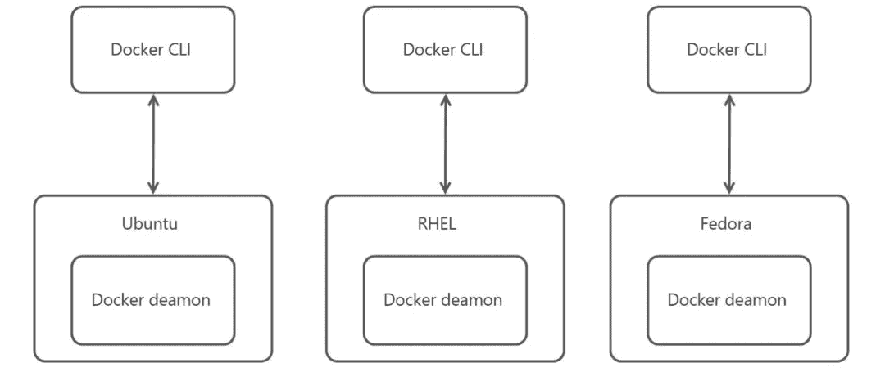
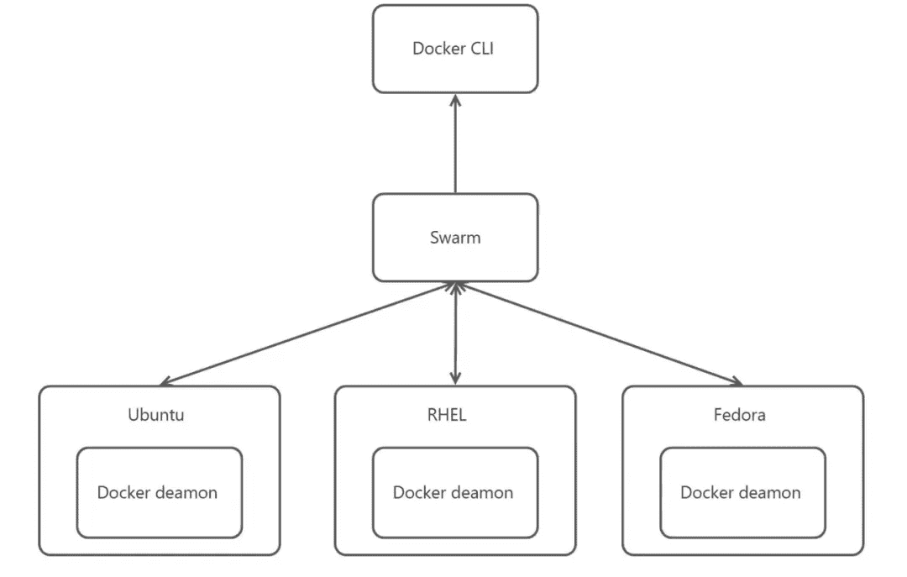
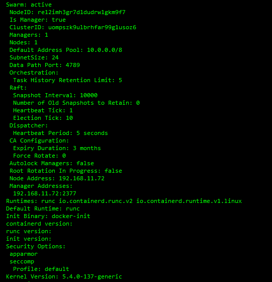
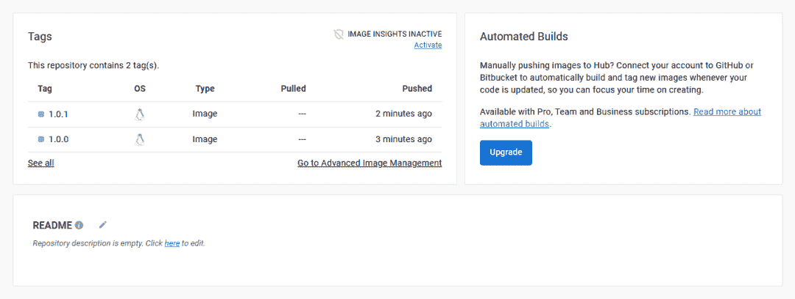
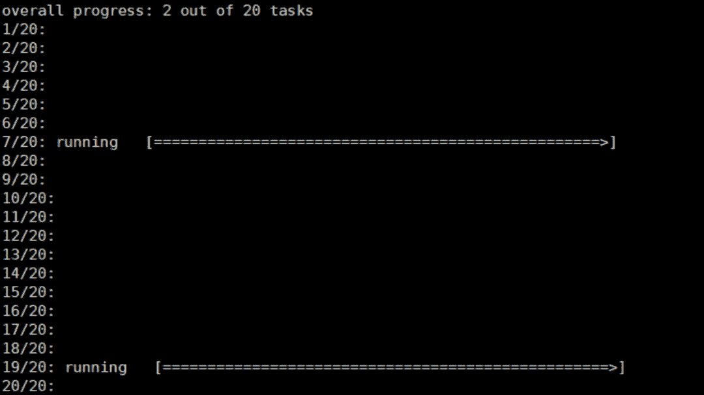
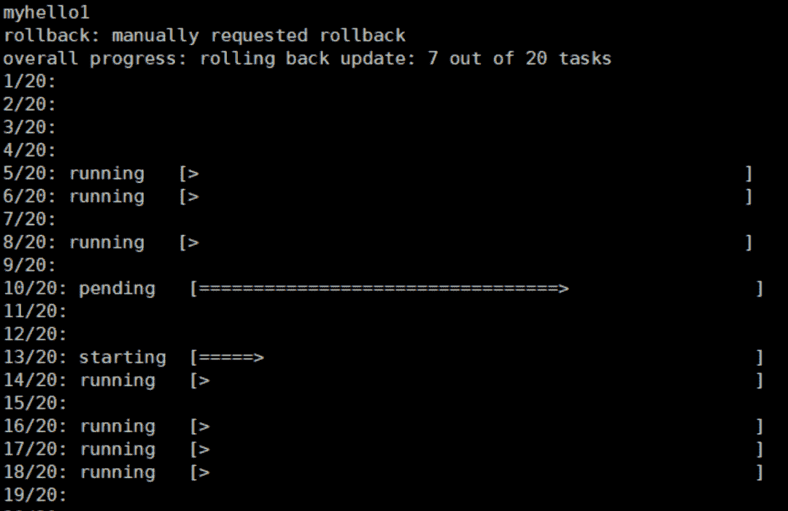

# Docker Swarm集群化管理详解，助你实现服务器集群化管理和部署！

> 来源：[https://geekbang.feishu.cn/docx/RPTRdU7wvo2WVqxevuOcJA0lnTf](https://geekbang.feishu.cn/docx/RPTRdU7wvo2WVqxevuOcJA0lnTf)
>
> 👨🏻 作者：Lion莱恩呀
>
> 📃 作者介绍：专注分享高性能服务器后台开发知识，包括C/C++、Linux、网络协议、设计模式、中间件、云原生、数据库、分布式架构等领域知识。
>
> 🛖 👸号：Lion莱恩呀
>
> ⏰ 收录时间：2024-05-27 11:15:56 (UTC+8)
>
> 🔗 原文链接：h[ttps://mp.weixin.q](https://mp.weixin.qq.com/s?__biz=Mzk0ODUzNDc2Mw==&mid=2247485951&idx=1&sn=7be57816c5257ab82ace92644fbaf33b&scene=19#wechat_redirect)q.com/s?__biz=Mz...

关注作者，获取更多相关知识

# 一、简介

Docker Swarm 是Docker官方的跨节点的容器编排工具。用户只需要在单一的管理节点上操作，即可管理集群下的所有节点和容器。

主要解决问题：

1. 解决`docker server`的集群化管理和部署。
2. `Swarm`通过对`Docker`宿主机上添加的标签信息来将宿主机资源进行细粒度分区，通过分区来帮助用户将容器部署到目标宿主机上，同样通过分区方式还能提供更多的资源调度策略扩展。

单对单的`Docker`宿主机使用方式：



单对多的`Docker`宿主机使用方式：



`swarm`能做什么：

1. 管理节点高可用，原生支持管理节点高可用，采用`raft`共识算法来支撑管理节点高可用。
2. 应用程序高可用，支持服务伸缩，滚动更新和应用回滚等部署策略。

## 1.1、涉及到哪些概念？

（1）`docker`的两种模式，单引擎模式和`swarm`集群模式。

+ 单引擎模式，`docker server`没有加入任何集群，且自身也没有加入初始化为`swarm`节点，简单的说就是我们平时所操作的孤立的`docker server`。

+ `swarm`模式，当`docker server`加入到任意`swarm`集群，或者通过`docker swarm init`初始化`swarm`集群时，`docker server`会自动切换到`swarm`集群模式。

（2）`swarm`集群中节点分类，分为：`manager`（管理节点）、`node`（工作节点）

+ `manager`：是`Swarm Daemon`工作的节点，包含了调度器、路由、服务发现等功能，负责接收客户端的集群管理请求以及调度`Node`进行具体工作。`manager`本身也是一个`node`节点。

+ `Node`：接受`manager`调度，对容器进行创建、扩容和销毁等具体操作。

（3）`raft`共识算法，是实现分布式共识的一种算法，主要用来管理日志复制的一致性。

+ 当`Docker`引擎在`swarm`模式下运行时，`manager`节点实现`Raft`一致性算法来管理全局集群状态。

+ `Docker swarm`模式之所以使用一致性算法，是为了确保集群中负责管理和调度任务的所有`manager`节点都存储相同的一致状态。

+ 在整个集群中具有相同的一致状态意味着，如果出现故障，任何管理器节点都可以拾取任务并将服务恢复到稳定状态。例如，如果负责在集群中调度任务的领导管理器意外死亡，则任何其他管理器都可以选择调度任务并重新平衡任务以匹配所需状态。

+ 使用一致性算法在分布式系统中复制日志的系统需要特别小心。它们通过要求大多数节点在值上达成一致，确保集群状态在出现故障时保持一致。

+ `Raft`最多可承受（`N-1`）/2次故障，需要（`N/2`）+1名成员的多数或法定人数才能就向集群提议的值达成一致。这意味着，在运行`Raft`的5个管理器集群中，如果3个节点不可用，系统将无法处理更多的请求来安排其他任务。现有任务保持运行，但如果管理器集不正常，调度程序无法重新平衡任务以应对故障。

（4）`Swarm`管理节点高可用。

+ `Swarm`管理节点内置有对`HA`的支持，即使有一个或多个节点发送故障，剩余管理节点也会继续保证`Swarm`运转。

+ `Swarm`实现了一种主从方式的多管理节点的`HA`，即使有多个管理节点也只有一个节点出于活动状态，处于活动状态的节点被称为主节点(`leader`)，而主节点也是唯一一个会对`Swarm`发送控制命令的节点，如果一个备用管理节点接收到了`Swarm`命令，则它会将其转发给主节点。

（5）集群管理，集群创建和组织。

（6）节点管理，集群下节点角色信息变更，节点任务情况监控。

（7）服务管理，集群服务部署，服务管理等。

## 1.2、需要注意什么？

`manager`节点容错。

`manager`数量最好设置为奇数个，可以减少脑裂(`Split-Brain`)出现情况。在网络被划分成2个部分情况下，奇数个`manager`节点能够较高程度的保证有投票结果的可能性。

不要部署太多的`manager`节点（通常3到5个）。对于所有共识算法来说，更多的参与节点意味着需要花费更多的时间来达成共识，所以最好部署5个或三个节点。

`Raft`最多可承受（`N-1`）/2次故障，需要（`N/2`）+1名成员的多数或法定人数才能就向集群提议的值达成一致。

| `manager`节点数 | 选举票数 | 允许`manager`不可用个数 |
| --- | --- | --- |
| 1 | 1 | 0 |
| 2 | 2 | 0 |
| 3 | 2 | 1 |
| 4 | 3 | 1 |
| 5 | 3 | 2 |
| 6 | 4 | 2 |
| 7 | 4 | 3 |
| 8 | 5 | 3 |
| 9 | 5 | 4 |

# 二、集群管理

## 2.1、创建集群

1. 不包含在任何`Swarm`中的`Docker`节点，该`Docker`节点被称为运行于单引擎(`Single-Engine`)模式，一旦加入`Swarm`集群，则切换为`Swarm`模式。

2. `docker swarm init` 会通知`Docker`来初始化一个新的`Swarm`，并且将自身设置为第一个管理节点。同时也会使该节点开启`Swarm`模式。

3. `--advertise-addr` `IP:2377` 指定其他节点用来连接到当前管理节点的IP和端口，这一指令是可选的，当节点有多个IP时，可以指定其中一个。

4. `--listen-addr` 指定用于承载`Swarm`流量的IP和端口，其设置通常与`--advertise-addr`相匹配，但是当节点上有多个IP的时候，可用于指定具体某个IP。

5. `--autolock` 启用管理器自动锁定（需要解锁密钥才能启动已停止的管理器）。

6. `--force-new-cluster` 强制从当前状态创建新群集。

```
docker swarm init
```

## 2.2、将节点加入集群

（1）生成`join-token`。

```
# 生成work节点 join-token
docker swarm join-token worker
# 生成manager节点 join-token
docker swarm join-token manager
```

示例：

```
fly@fly:~/wokspace$ docker swarm join-token worker 
To add a worker to this swarm, run the following command:

    docker swarm join --token SWMTKN-1-4zxv2c1ntyjoum1m3x8u6juej6kciexc05f30j9vsvr0hoieg4-19o9myylkb7bg1fb1jqcr1xcf 192.168.11.72:2377

```

（2）加入集群。

```
# 此命令为 join-token 命令执行结果，在相应的节点执行该结果即可加入到集群
docker swarm join --token SWMTKN-1-4zxv2c1ntyjoum1m3x8u6juej6kciexc05f30j9vsvr0hoieg4-19o9myylkb7bg1fb1jqcr1xcf 192.168.11.72:2377
```

## 2.3、查看集群状态。

```
docker info
```



## 2.4、将节点从集群中移除

（1）将节点从集群中移除（只能移除`worker`节点）。

```
docker swarm leave
```

（2）将节点从集群中强制移除（包括`manager`节点）。

```
docker swarm leave -f
```

## 2.5、更新集群

更新集群的部分参数

```
docker swarm update --autolock=false
```

## 2.6、锁定/解锁集群

+ 重启一个旧的管理节点或者进行备份恢复可能对集群造成影响，一个旧的管理节点重新接入`Swarm`会自动解密并获得`Raft`数据库中长时间序列的访问权，这会带来安全隐患。进行备份恢复可能会抹掉最新的`Swarm`配置。

+ 为了规避上述问题，`Docker`提供自动锁机制来锁定`Swarm`，这会强制要求重启的管理节点在提供一个集群解锁码之后才有权重新接入集群（也可以防止原来的主节点宕机后重新接入集群，和当前主节点一起成为双主，双主也是一种脑裂问题）。

（1）设置为自动锁定集群。

```
# 设置为自动锁定集群
docker swarm update --autolock=true
```

（2）当集群设置为`--autolock`后，可以通过该命令查询解锁集群的秘钥。

```
# 当集群设置为 --autolock后，可以通过该命令查询解锁集群的秘钥
# 该节点必须为集群有效的管理节点
docker swarm unlock-key
```

（3）重启管理节点，集群将被自动锁定。

```
# 重启管理节点，集群将被自动锁定
service docker restart
```

（4）重启后的管理节点必须提供解锁码后才能重新接入集群。

```
# 重启后的管理节点必须提供解锁码后才能重新接入集群
docker swarm unlock
```

# 三、节点管理

```
# 查看参数帮助
docker node -h
# 命令说明：
# 降级节点
demote Demote one or more nodes from manager in the swarm
# 查看节点详情
inspect Display detailed information on one or more nodes
# 查看所有节点
ls List nodes in the swarm
# 升级节点
promote Promote one or more nodes to manager in the swarm
# 查看节点上运行的任务，默认当前节点
ps List tasks running on one or more nodes, defaults to current node
# 删除节点
rm Remove one or more nodes from the swarm
# 更新节点
update Update a node
```

+ `demote`：降级节点。

+ `inspect`：查看节点详情。

+ `ls`：查看所有节点。

+ `promote`：升级节点。

+ `ps`：查看节点上运行的任务，默认当前节点。

+ `rm`：删除节点。

+ `update`：更新节点。

（1）查看集群节点列表。

```
docker node ls
```

```
fly@fly:~/wokspace$ docker node ls

ID                            HOSTNAME   STATUS    AVAILABILITY   MANAGER STATUS   ENGINE VERSION
re12imh3gr7d1dudrw1gkm9f7 *   fly        Ready     Active         Leader           20.10.12

```

（2）升级或降级节点。

```
# 降级一个或多个节点
docker node demote `<NODE>`
# 通过修改单个节点的role属性，来降级节点
docker node update --role worker `<NODE>`
# 升级一个或多个节点
docker node promote `<NODE>`
# 通过修改单个节点的role属性，来升级节点
docker node update --role manager `<NODE>`
```

（3）更改节点状态。

```
# 更改节点状态
docker node update --availability active|pause|drain `<NODE>`
# active: 正常
# pause：挂起
# drain：排除
```

+ 正常节点，可正常部署应用。

+ 挂起节点，已经部署的应用不会发生变化，新应用将不会部署到该节点。

+ 排除节点，已经部署在该节点的应用会被调度到其他节点。

（4）删除节点。

```
# 只能删除已关闭服务的工作节点
docker node rm `<node>`
# 只能强制删除工作节点
docker node rm -f `<node>`
```

注意：管理节点的删除只能先将管理节点降级为工作节点，再执行删除动作。

```
# 停止docker server
sudo service docker stop
```

# 四、服务部署

## 4.1、准备

（1）拉取代码，获取`tag`。

```
# 拉取代码
git clone https://gitee.com/long-xu/helloworld.git
# 进入代码目录
cd helloworld
# fetch
git fetch origin
```

（2）镜像制作。

```
# 切换到1.0.0 tag
git checkout 1.0.0
# 构建1.0.0镜像
docker build -f Dockerfile -t hello:1.0.0 .
# 切换到1.0.1 tag
git checkout 1.0.1
# 构建1.0.1镜像
docker build -f Dockerfile -t hello:1.0.1 .
```

（3）将镜像推送到仓库（这里使用公共仓库作为演示）。

```
# 登录注册中心
docker login
```

（4）为镜像重新打`tag`（格式：用户名/仓库名:`tag`）。

```
docker tag hello:1.0.0 long-xu/hello:1.0.0
docker push long-xu/hello:1.0.0
docker tag hello:1.0.1 long-xu/hello:1.0.1
docker push long-xu/hello:1.0.1
```

（5）登录`https://hub.docker.com/` 查看镜像情况。



## 4.2、服务管理

```
docker service -h
```

### 4.2.1、常用命令

```
# 创建一个服务
create                 Create a new service
# 查看服务详细信息
inspect         Display detailed information on one or more services
# 查看服务日志
logs                 Fetch the logs of a service or task
# 列出所有服务
ls                         List services
# 列出一个或多个服务的任务列表
ps                         List the tasks of one or more services
# 删除一个或多个服务
rm                         Remove one or more services
# 回滚
rollback         Revert changes to a service's configuration
# 弹性伸缩一个或多个服务
scale                 Scale one or multiple replicated services
# 更新服务
update                 Update a service
```

### 4.2.2、在集群上部署应用

（1）部署一个副本数量。

```
docker service create --name myhello --publish published=81,target=80 --replicas 3 long-xu/hello:1.0.0
# 若是采用私有注册中心请加上 --with-registry-auth 选项
```

（2）查看服务下的任务（容器）。

```
docker service ps myhello
```

（3）查看节点下的任务（容器）。

```
docker node ps `<NODE>`
```

（4）访问集群中任意节点（包括没有运行任务的节点）对应的端口号均能访问到应用程序，`swarm`为集群实现了负载均衡。

```
curl http://localhost:81/ping
```

（5）查看`service`详细信息。

```
docker service inspect myhello
```

（6）查看`service`日志。


```
docker service logs myhello
```

（7）伸缩服务。

```
docker service scale myhello=5
```

（8）修改节点状态，查看任务部署情况。

```
docker node update --availability active|pause|drain <NODE>
```

## 4.2.3、在集群上部署一个带更新策略和回滚策略的应用

（1）部署应用。

```
docker service create \
--name myhello1 \
--publish published=82,target=80 \
--replicas 20 \
--update-delay 5s \
--update-parallelism 2 \
--update-failure-action continue \
--rollback-parallelism 2 \
--rollback-monitor 10s \
--rollback-max-failure-ratio 0.2 \
long-xu/hello:1.0.0
# 若是采用私有注册中心请加上 --with-registry-auth 选项
#--update-delay 5s ：每个容器依次更新，间隔5s
# --update-parallelism 2 ： 每次允许两个服务一起更新
#--update-failure-action continue ： 更新失败后的动作是继续
# --rollback-parallelism 2 ： 回滚时允许两个一起
# --rollback-monitor 10s ：回滚监控时间10s
# --rollback-max-failure-ratio 0.2 ： 回滚失败率20%
```

（2）检查部署后的应用设置项是否都有被成功设置。

```
# 查看并打印友好的详细信息
docker service inspect --pretty myhello1
```

注意：查看详细信息时，详细信息中时间单位为 `ns`（纳秒）。友好格式下，时间单位为（s）。

（3）更新未设置成功的项。

```
docker service update --update-delay 5s --rollback-monitor 10s myhello1
```

（4）访问服务。

```
curl http://localhost:82/ping
curl http://localhost:82/ping/v1.0.1
```

## 4.2.4、更新服务

（1）启动更新。

```
docker service update --image long-xu/hello:1.0.1 myhello1
# 若是采用私有注册中心请加上 --with-registry-auth 选项
```



（2）访问服务。

```
curl http://localhost:82/ping
curl http://localhost:82/ping/v1.0.1
```

## 4.2.5、回滚服务

（1）启动回滚（策略是失败后回滚，目前没有失败的情况，我们手动回滚）。

```
docker service update --rollback myhello1
```



# 五、结合`docker-compose.yml`部署

## 5.1、部署应用

（1）常用命令：

```
# 部署或更新 stack
deploy                 Deploy a new stack or update an existing stack
# 查看 stack 列表
ls                         List stacks
# 查看 stack 的任务列表
ps                         List the tasks in the stack
# 删除 stack
rm                         Remove one or more stacks
# 查看stack 中的服务列表
services         List the services in the stack
```

（2）`docker-compose.yml` 文件。

```
version: "3.7"
  services:
    myhello2:
      image: long-xu/hello:1.0.0
      ports:
            - "83:80"
          depends_on:
            - redis
          deploy:
            mode: replicated
            replicas: 20
            endpoint_mode: vip
            rollback_config:
                  parallelism: 2
                  delay: 10s
                  monitor: 10s
                  max_failure_ratio: 0.2
            update_config:
                  parallelism: 2
                  delay: 5s
                  failure_action: continue
        redis:
          image: redis:alpine
          deploy:
                mode: replicated
                replicas: 6
                endpoint_mode: dnsrr
                labels:
                  description: "This redis service label"
                resources:
                  limits:
                        cpus: '0.50'
                        memory: 50M
                  reservations:
                        cpus: '0.25'
                        memory: 20M
          restart_policy:
                condition: on-failure
                delay: 5s
                max_attempts: 3
                window: 120s
```

（3）部署stack。

```
docker stack deploy -c docker-compose.yml mystack
```

（4）查看服务详情。

```
# 查看并打印友好的详细信息
docker service inspect --pretty mystack_myhello2
docker service inspect --pretty mystack_redis
```

## 5.2、语法说明

注意：仅支持 `V3.4` 及更高版本。

（1）`endpoint_mode`：访问集群服务的方式。

```
endpoint_mode: vip
# Docker 集群服务一个对外的虚拟 `ip`。所有的请求都会通过这个虚拟 `ip` 到达集群服务内部的机器。
endpoint_mode: dnsrr
# DNS 轮询（`DNSRR`）。所有的请求会自动轮询获取到集群 `ip` 列表中的一个 `ip` 地址。
```

（2）`labels`：在服务上设置标签。可以用容器上的 `labels`（跟 `deploy` 同级的配置） 覆盖 `deploy` 下的 `labels`。

（3）`mode`：指定服务提供的模式。

+   `replicated`：复制服务，复制指定服务到集群的机器上。

+   `global`：全局服务，服务将部署至集群的每个节点。

+   `replicas`：`mode` 为 `replicated` 时，需要使用此参数配置具体运行的节点数量。

（4）`resources`：配置服务器资源使用的限制，例如上例子，配置 `redis` 集群运行需要的 `cpu` 的百分比 和 内存的占用。避免占用资源过高出现异常。

（5）`restart_policy`：配置如何在退出容器时重新启动容器。

+   `condition`：可选 `none`，`on-failure` 或者 `any`（默认值：`any`）。

+   `delay`：设置多久之后重启（默认值：`0`）。

+   `max_attempts`：尝试重新启动容器的次数，超出次数，则不再尝试（默认值：一直重试）。

+   `window`：设置容器重启超时时间（默认值：`0`）。

（6）`rollback_config`：配置在更新失败的情况下应如何回滚服务。

+   `parallelism`：一次要回滚的容器数。如果设置为 `0`，则所有容器将同时回滚。

+   `delay`：每个容器组回滚之间等待的时间（默认为 `0s`）。

+   `failure_action`：如果回滚失败，该怎么办。其中一个 `continue` 或者 `pause`（默认 `pause`）。

+   `monitor`：每个容器更新后，持续观察是否失败了的时间（`ns`\|`us`\|`ms`\|`s`\|`m`\|`h`）（默认为 `0s`）。

+   `max_failure_ratio`：在回滚期间可以容忍的故障率（默认为 `0`）。

+   `order`：回滚期间的操作顺序。其中一个 `stop-first`（串行回滚），或者 `start-first`（并行回滚），默认 `stop-first` 。

（7）`update_config`：配置应如何更新服务，对于配置滚动更新很有用。

+   `parallelism`：一次更新的容器数。

+   `delay`：在更新一组容器之间等待的时间。

+   `failure_action`：如果更新失败，该怎么办。其中一个 `continue`，`rollback` 或者 `pause` （默认：`pause`）。

+   `monitor`：每个容器更新后，持续观察是否失败了的时间（`ns`\|`us`\|`ms`\|`s`\|`m`\|`h`）（默认为 `0s`）。

+   `max_failure_ratio`：在更新过程中可以容忍的故障率。

+   `order`：回滚期间的操作顺序。其中一个 `stop-first`（串行回滚），或者 `start-first`（并行回滚），默认 `stop-first`。

# 六、总结

本文通过对 `Docker Swarm` 的全面解析，使读者能够深入了解如何利用这一强大工具实现服务器的集群化管理和部署。`Docker Swarm`不仅可以有效地提高服务器资源利用率，还可以提升应用的可用性、扩展性和安全性。通过本文的学习，读者将具备充分的知识和技能，能够在实际工作中运用 `Docker Swarm` 来构建强大而稳定的服务器集群，助力业务的快速成长和持续发展。
