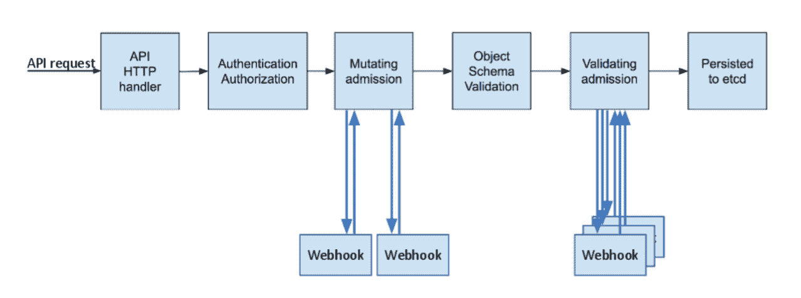

# 关于 Kubernetes 中 Admission Controllers（准入控制器）认知的一些笔记_kubeadm 启用准入控制器

> 来源：[https://geekbang.feishu.cn/docx/DKhUdnsC1oiC2nxIuiIczlICnBd](https://geekbang.feishu.cn/docx/DKhUdnsC1oiC2nxIuiIczlICnBd)

> 👨🏻 作者：山河已无恙

> 📃 作者介绍：SRE，云原生相关技术干货分享，RHCA/RHCE/RHCAS、CKA 认证，CSDN/51CTO博客专家，InfoQ写作平台/Alibaba Cloud社区签约作者、Huawei Cloud社区云享专家、Tencent Cloud社区内容共创官

> ⏰ 收录时间：2024-05-27 11:25:03 (UTC+8)

> 🔗 原文链接：h[ttps://liruilong.b](https://liruilong.blog.csdn.net/article/details/134755764)log.csdn.net/art...


关注作者，获取更多AI知识

## 写在前面

- 工作中遇到，简单整理记忆
- 博文为官方文档整理
- 涉及内置准入控制的分类理解
- 理解不足小伙伴帮忙指正

> 人活着就是为了忍受摧残，一直到死，想明了这一点，一切事情都能泰然处之 —— 王小波《黄金时代》

## 为什么需要准入控制器

准入控制器 可以简单理解为 埋点 。或者 web 中的 拦截器 ，编程中的，AOP 切面,顾名思义， 准入控制器用于在 `k8s` 中资源创建的时候做一些校验机制，判断创建的 API 资源是否可行。同时也可以对传递到准入控制器的 操作对象资源请求进行更改，在加工，或者完全拒绝。

通过 准入控制器，可以灵活的处理对API 资源的准入进行限制，除了提供的内置准入控制器，`K8s` 还提供了 `webhook` 的方式，即可以通过编码的方式编写自己的的埋点逻辑。

## 准入控制器

准入控制器可以执行验证（`Validating`） 或变更（`Mutating`） 操作。 变更（`mutating`）控制器可以根据被其接受的请求更改相关对象；验证（`validating`）控制器则不行。

准入控制器 限制创建、删除、修改 对象的请求。 准入控制器也可以阻止自定义动作，例如通过 `API` 服务器代理连接到 `Pod` 的请求。 准入控制器不会 （也不能）阻止读取（`get`、`watch` 或 `list` ）对象的请求。

通俗的讲，准入控制器是一段 代码 ，用于拦截对 `Kubernetes API` 服务器在 对象持久化 之前，但在 请求之后 已通过身份验证和授权 。具体的拦截阶段可以在下面的图片看到,准入控制过程分为两个阶段。第一阶段，运行变更准入控制器。第二阶段，运行验证准入控制器,某些控制器既是变更准入控制器又是验证准入控制器。



如果两个阶段之一的任何一个控制器拒绝了某请求，则整个请求将立即被拒绝，并向最终用户返回错误

## 如何启用一个准入控制器？

`Kubernetes API` 服务器的 `enable-admission-plugins` 标志接受一个（以逗号分隔的）准入控制插件列表， 这些插件会在集群修改对象之前被调用。

```
┌──[root@vms100.liruilongs.github.io]-[/etc/kubernetes/manifests]
└─$cat  kube-apiserver.yaml | grep enable-admission
    - --enable-admission-plugins=NodeRestriction
┌──[root@vms100.liruilongs.github.io]-[/etc/kubernetes/manifests]
└─$
```

## 怎么关闭准入控制器？

`Kubernetes API` 服务器的 `disable-admission-plugins` 标志，会将传入的（以逗号分隔的） 准入控制插件列表禁用，即使是默认启用的插件也会被禁用。

```
┌──[root@vms100.liruilongs.github.io]-[/etc/kubernetes/manifests]
└─$cat  kube-apiserver.yaml | grep desable-admission
┌──[root@vms100.liruilongs.github.io]-[/etc/kubernetes/manifests]
└─$
```

```
┌──[root@vms100.liruilongs.github.io]-[/etc/kubernetes/manifests]
└─$kubectl exec -it  kube-apiserver-vms100.liruilongs.github.io  -n kube-system  -- kube-apiserver --version
Kubernetes v1.25.1
┌──[root@vms100.liruilongs.github.io]-[/etc/kubernetes/manifests]
└─$
```

## 哪些插件是默认启用的？

```
┌──[root@vms100.liruilongs.github.io]-[/etc/kubernetes/manifests]
└─$kubectl exec -it  kube-apiserver-vms100.liruilongs.github.io  -n kube-system  -- kube-apiserver -h | grep enable-admission-plugins
      --admission-control strings              Admission is divided into two phases. In the first phase, only mutating admission plugins run. In the second phase, only validating admission plugins run. The names in the below list may represent a validating plugin, a mutating plugin, or both. The order of plugins in which they are passed to this flag does not matter. Comma-delimited list of: AlwaysAdmit, AlwaysDeny, AlwaysPullImages, CertificateApproval, CertificateSigning, CertificateSubjectRestriction, DefaultIngressClass, DefaultStorageClass, DefaultTolerationSeconds, DenyServiceExternalIPs, EventRateLimit, ExtendedResourceToleration, ImagePolicyWebhook, LimitPodHardAntiAffinityTopology, LimitRanger, MutatingAdmissionWebhook, NamespaceAutoProvision, NamespaceExists, NamespaceLifecycle, NodeRestriction, OwnerReferencesPermissionEnforcement, PersistentVolumeClaimResize, PersistentVolumeLabel, PodNodeSelector, PodSecurity, PodTolerationRestriction, Priority, ResourceQuota, RuntimeClass, SecurityContextDeny, ServiceAccount, StorageObjectInUseProtection, TaintNodesByCondition, ValidatingAdmissionWebhook. (DEPRECATED: Use --enable-admission-plugins or --disable-admission-plugins instead. Will be removed in a future version.)
      --enable-admission-plugins strings       admission plugins that should be enabled in addition to default enabled ones (NamespaceLifecycle, LimitRanger, ServiceAccount, TaintNodesByCondition, PodSecurity, Priority, DefaultTolerationSeconds, DefaultStorageClass, StorageObjectInUseProtection, PersistentVolumeClaimResize, RuntimeClass, CertificateApproval, CertificateSigning, CertificateSubjectRestriction, DefaultIngressClass, MutatingAdmissionWebhook, ValidatingAdmissionWebhook, ResourceQuota). Comma-delimited list of admission plugins: AlwaysAdmit, AlwaysDeny, AlwaysPullImages, CertificateApproval, CertificateSigning, CertificateSubjectRestriction, DefaultIngressClass, DefaultStorageClass, DefaultTolerationSeconds, DenyServiceExternalIPs, EventRateLimit, ExtendedResourceToleration, ImagePolicyWebhook, LimitPodHardAntiAffinityTopology, LimitRanger, MutatingAdmissionWebhook, NamespaceAutoProvision, NamespaceExists, NamespaceLifecycle, NodeRestriction, OwnerReferencesPermissionEnforcement, PersistentVolumeClaimResize, PersistentVolumeLabel, PodNodeSelector, PodSecurity, PodTolerationRestriction, Priority, ResourceQuota, RuntimeClass, SecurityContextDeny, ServiceAccount, StorageObjectInUseProtection, TaintNodesByCondition, ValidatingAdmissionWebhook. The order of plugins in this flag does not matter.
┌──[root@vms100.liruilongs.github.io]-[/etc/kubernetes/manifests]
└─$
```

上面的 `--admission-control` 为废弃的配置方式，下面的为当前的配置方式，

> (DEPRECATED: Use `--enable-admission-plugins` or `--disable-admission-plugins` instead. Will be removed in a future version.)

## 默认启动的准入控制器

> `NamespaceLifecycle`, `LimitRanger`, `ServiceAccount`, `TaintNodesByCondition`, `PodSecurity`, `Priority`, `DefaultTolerationSeconds`, `DefaultStorageClass`, `StorageObjectInUseProtection`, `PersistentVolumeClaimResize`, `RuntimeClass`, `CertificateApproval`, `CertificateSigning`, `CertificateSubjectRestriction`, `DefaultIngressClass`, `MutatingAdmissionWebhook`, `ValidatingAdmissionWebhook`, `ResourceQuota`

## 所有的准入控制器列表

> `AlwaysAdmit`, `AlwaysDeny`, `AlwaysPullImages`, `CertificateApproval`, `CertificateSigning`, `CertificateSubjectRestriction`, `DefaultIngressClass`, `DefaultStorageClass`, `DefaultTolerationSeconds`, `DenyServiceExternalIPs`, `EventRateLimit`, `ExtendedResourceToleration`, `ImagePolicyWebhook`, `LimitPodHardAntiAffinityTopology`, `LimitRanger`, `MutatingAdmissionWebhook`, `NamespaceAutoProvision`, `NamespaceExists`, `NamespaceLifecycle`, `NodeRestriction`, `OwnerReferencesPermissionEnforcement`, `PersistentVolumeClaimResize`, `PersistentVolumeLabel`, `PodNodeSelector`, `PodSecurity`, `PodTolerationRestriction`, `Priority`, `ResourceQuota`, `RuntimeClass`, `SecurityContextDeny`, `ServiceAccount`, `StorageObjectInUseProtection`, `TaintNodesByCondition`, `ValidatingAdmissionWebhook`. The order of plugins in this flag does not matter

## 每个准入控制器的作用是什么？

这里我们只看默认启用的准入控制器,方便理解记忆，整体分为 三类：

- 用于验证
- 用于变更修改
- 同时具有验证和变更修改

### 验证

#### ResourceQuota

此准入控制器会监测传入的请求，并确保它不违反任何一个 `Namespace` 中的 `ResourceQuota` 对象中列举的约束。如果你在 `Kubernetes` 部署中使用了 `ResourceQuota` ， 则必须使用这个准入控制器来 强制执行配额限制 。

`ResourceQuota` 在 `K8s` 中是一个用于配置 命名空间级别资源限制 的API 对象

#### NamespaceLifecycle

该准入控制器禁止在一个正在被终止的 `Namespace` 中创建新对象，并确保针对不存在的 `Namespace` 的请求被拒绝。该准入控制器还会禁止删除三个系统保留的名字空间，即 `default`、 `kube-system` 和 `kube-public`。

`Namespace` 的删除操作会触发一系列删除该名字空间中所有对象（`Pod`、`Service` 等）的操作。 为了确保这个过程的完整性，我们强烈建议启用这个准入控制器

#### PodSecurity

`PodSecurity` 准入控制器在新 `Pod` 被准入之前对其进行检查， 根据请求的 安全上下文 和 `Pod` 所在名字空间允许的 `Pod` 安全性标准的限制 来确定新 `Pod` 是否应该被准入。

`PodSecurity` 取代了一个名为 `PodSecurityPolicy` 的旧准入控制器。`PodSecurity` 的触发的前提是配置了安全上下文，在新旧版本中，安全管理略有不同，`1.25` 后的到达稳定版本，可以通过在创建命名空间的时候添加不同的安全标签实现不同的安全标准，只有配置了准入控制标签才会触发安全准入控制。

#### PersistentVolumeClaimResize

此准入控制器检查传入的 `PersistentVolumeClaim` 调整大小请求，对其执行额外的验证检查操作。

建议启用 `PersistentVolumeClaimResize` 准入控制器。除非 `PVC` 的 `StorageClass` 明确地将 `allowVolumeExpansion` 设置为 `true` 来 显式启用调整大小 。 否则，默认情况下该准入控制器会 阻止所有对 `PVC` 大小的调整 。

#### CertificateApproval

此准入控制器获取审批 `CertificateSigningRequest` 资源的请求并执行额外的鉴权检查， 以确保针对设置了 `spec.signerName` 的 `CertificateSigningRequest` 资源而言， 审批请求的用户有权限对证书请求执行 审批 操作。

对于 `CSR` 来讲，低版本的不需要 `signerName` ， 高版本是一个强制参数，必须要设置。

#### CertificateSigning


# 准入控制器

此准入控制器监视对 `CertificateSigningRequest` 资源的 `status.certificate` 字段的更新请求，并执行额外的鉴权检查，以确保针对设置了 `spec.signerName` 的 `CertificateSigningRequest` 资源而言，签发证书的用户有权限对证书请求执行签发操作。

## CertificateSubjectRestriction

此准入控制器监视 `spec.signerName` 被设置为 `kubernetes.io/kube-apiserver-client` 的 `CertificateSigningRequest` 资源创建请求，并拒绝所有将 `group`（或 `organization attribute`）设置为 `system:masters` 的请求

## ValidatingAdmissionWebhook

此准入控制器调用与请求匹配的所有验证性 Webhook。匹配的 Webhook 将被并行调用。如果其中任何一个拒绝请求，则整个请求将失败。该准入控制器仅在验证（Validating）阶段运行；与 `MutatingAdmissionWebhook` 准入控制器所调用的 Webhook 相反，它调用的 Webhook 不可以变更对象。

如果以此方式调用的 Webhook 有其它副作用（如：减少配额），则它 必须 具有协调机制。这是因为无法保证后续的 Webhook 或其他验证性准入控制器都允许请求完成。

如果你禁用了 `ValidatingAdmissionWebhook`，还必须通过 `--runtime-config` 标志来禁用 `admissionregistration.k8s.io/v1` 组/版本中的 `ValidatingWebhookConfiguration` 对象。

查看当前集群的 `validatingwebhookconfigurations`

```
┌──[root@vms100.liruilongs.github.io]-[~/ansible/k8s-hello-mutating-webhook/k8s-hello-mutating-webhook/k8s/csr]
└─$kubectl get validatingwebhookconfigurations
NAME                                     WEBHOOKS   AGE
config.webhook.pipeline.tekton.dev       1          203d
ingress-nginx-admission                  1          292d
istio-validator-istio-system             1          277d
istiod-default-validator                 1          277d
metallb-webhook-configuration            7          292d
release-name-kube-promethe-admission     1          276d
validating-webhook-configuration         11         285d
validation.webhook.pipeline.tekton.dev   1          203d
```

### 变更

变更相关对 准入控制器，更多是对默认值的设置，比如，默认 `SC` , `IC` 的配置，部分节点的默认标签的添加

#### DefaultStorageClass

此准入控制器监测没有请求任何特定存储类的 `PersistentVolumeClaim` 对象的创建请求，并自动向其添加默认存储类。这样，没有任何特殊存储类需求的用户根本不需要关心它们，它们将被设置为使用默认存储类。

当未配置默认存储类时，此准入控制器不执行任何操作。如果将多个存储类标记为默认存储类，此控制器将拒绝所有创建 `PersistentVolumeClaim` 的请求，并返回错误信息。要修复此错误，管理员必须重新检查其 `StorageClass` 对象，并仅将其中一个标记为默认。此准入控制器会忽略所有 `PersistentVolumeClaim` 更新操作，仅处理创建操作。

#### DefaultIngressClass

该准入控制器监测没有请求任何特定 `Ingress` 类的 `Ingress` 对象创建请求，并自动向其添加默认 `Ingress` 类。这样，没有任何特殊 `Ingress` 类需求的用户根本不需要关心它们，他们将被设置为默认 `Ingress` 类。

当未配置默认 `Ingress` 类时，此准入控制器不执行任何操作。如果有多个 `Ingress` 类被标记为默认 `Ingress` 类，此控制器将拒绝所有创建 `Ingress` 的操作，并返回错误信息。要修复此错误，管理员必须重新检查其 `IngressClass` 对象，并仅将其中一个标记为默认（通过注解 `ingressclass.kubernetes.io/is-default-class`）。此准入控制器会忽略所有 `Ingress` 更新操作，仅处理创建操作。

#### StorageObjectInUseProtection

`StorageObjectInUseProtection` 插件将 `kubernetes.io/pvc-protection` 或 `kubernetes.io/pv-protection` 终结器（finalizers）添加到新创建的持久卷申领（PVC）或持久卷（PV）中。如果用户尝试删除 PVC/PV，除非 PVC/PV 的保护控制器移除终结器，否则 PVC/PV 不会被删除

#### TaintNodesByCondition

该准入控制器为新创建的节点添加 `NotReady` 和 `NoSchedule` 污点。这些污点能够避免一些竞态条件的发生，而这类竞态条件可能导致 Pod 在更新节点污点以准确反映其所报告状况之前，就被调度到新节点上。

#### DefaultTolerationSeconds

此准入控制器基于 `k8s-apiserver` 的输入参数 `default-not-ready-toleration-seconds` 和 `default-unreachable-toleration-seconds` 为 Pod 设置默认的容忍度，以容忍 `notready:NoExecute` 和 `unreachable:NoExecute` 污点（如果 Pod 尚未容忍 `node.kubernetes.io/not-ready:NoExecute` 和 `node.kubernetes.io/unreachable:NoExecute` 污点的话）。`default-not-ready-toleration-seconds` 和 `default-unreachable-toleration-seconds` 的默认值是 5 分钟。

## MutatingAdmissionWebhook

此准入控制器调用任何与请求匹配的变更（Mutating）Webhook。匹配的 Webhook 将被顺序调用。每一个 Webhook 都可以自由修改对象。

`MutatingAdmissionWebhook`，顾名思义，仅在变更阶段运行。

如果由此准入控制器调用的 Webhook 有副作用（如：减少配额），则它 必须 具有协调系统，因为不能保证后续的 Webhook 和验证准入控制器都会允许完成请求。

如果你禁用了 `MutatingAdmissionWebhook`，那么还必须使用 `--runtime-config` 标志禁止 `admissionregistration.k8s.io/v1` 组/版本中的 `MutatingWebhookConfiguration`，二者都是默认启用的

当前集群默认的 `MutatingWebhookConfiguration`

```
┌──[root@vms100.liruilongs.github.io]-[~/ansible/k8s-hello-mutating-webhook/k8s-hello-mutating-webhook/k8s/csr]
└─$kubectl get MutatingWebhookConfiguration
NAME                                   WEBHOOKS   AGE           1          131m
istio-revision-tag-default             4          277d
istio-sidecar-injector                 4          277d
mutating-webhook-configuration         8          285d
release-name-kube-promethe-admission   1          276d
webhook.pipeline.tekton.dev            1          203d
```

### 变更和验证

#### LimitRanger

此准入控制器会监测传入的请求，并确保请求不会违反 Namespace 中 `LimitRange` 对象所设置的任何约束。如果你在 Kubernetes 部署中使用了 `LimitRange` 对象，则必须使用此准入控制器来执行这些约束。

`LimitRanger` 还可以用于将默认资源请求应用到没有设定资源约束的 Pod；当前，默认的 `LimitRanger` 对 `default` 名字空间中的所有 Pod 都设置 0.1 CPU 的需求。

#### ServiceAccount

此准入控制器实现了 `ServiceAccount` 的自动化。强烈推荐为 Kubernetes 项目启用此准入控制器。如果你打算使用 Kubernetes 的 `ServiceAccount` 对象，你应启用这个准入控制器。

#### RuntimeClass

如果你所定义的 `RuntimeClass` 包含 Pod 开销，这个准入控制器会检查新的 Pod。被启用后，此准入控制器会拒绝所有已经设置了 `overhead` 字段的 Pod 创建请求。对于配置了 `RuntimeClass` 并在其 `.spec` 中选定 `RuntimeClass` 的 Pod，此准入控制器会根据相应 `RuntimeClass` 中定义的值为 Pod 设置 `.spec.overhead`。

`.spec.overhead` 字段用于为 Pod 指定额外的资源开销。这些额外的开销是针对 Pod 本身的，而不是容器内的应用程序。`.spec.overhead` 字段的值应该小于或等于 Pod 容器中设置的资源限制（`resources.limits`）

`.spec.overhead` 字段通常用于指定与 Pod 相关的基础设施级别的开销，例如用于 Pod 网络、存储或其他基础设施组件的附加资源。

## 自定义准入控制器

内置的准入控制器并不是不可以改变的，可以通过 `AdmissionConfiguration` 来自定义准入控制器，调整部分参数，下面为对 `PodSecurity` 准入控制器参数自定义

```
apiVersion: apiserver.config.k8s.io/v1 # 查阅兼容性说明
kind: AdmissionConfiguration
plugins:
- name: PodSecurity
  configuration:
    apiVersion: pod-security.admission.config.k8s.io/v1
    kind: PodSecurityConfiguration
    # 当未设置 mode 标签时会应用的默认设置
    #
    # level 标签必须是以下取值之一：
    # - &quot;privileged&quot; (默认)
    # - &quot;baseline&quot;
    # - &quot;restricted&quot;
    #
    # version 标签必须是如下取值之一：
    # - &quot;latest&quot; (默认) 
    # - 诸如 &quot;v1.28&quot; 这类版本号
    defaults:
      enforce: &quot;privileged&quot;
      enforce-version: &quot;latest&quot;
      audit: &quot;privileged&quot;
      audit-version: &quot;latest&quot;
      warn: &quot;privileged&quot;
      warn-version: &quot;latest&quot;
    exemptions:
      # 要豁免的已认证用户名列表
      usernames: []
      # 要豁免的运行时类名称列表
      runtimeClasses: []
      # 要豁免的名字空间列表
      namespaces: []

```

需要说明的是 yaml 文件需要通过 `--admission-control-config-file` 指定到 `kube-apiserver`，不能直接 `apply`

### 博文部分内容参考

© 文中涉及参考链接内容版权归原作者所有，如有侵权请告知，这是一个开源项目，如果你认可它，不要吝啬星星哦 😃

---

准入控制器参考:

[https://kubernetes.io/docs/reference/access-authn-authz/admission-controllers/](https://kubernetes.io/docs/reference/access-authn-authz/admission-controllers/)

Kubernetes 准入控制器指南:

[https://kubernetes.io/blog/2019/03/21/a-guide-to-kubernetes-admission-controllers/](https://kubernetes.io/blog/2019/03/21/a-guide-to-kubernetes-admission-controllers/)

---

© 2018-2023 liruilonger@gmail.com, All rights reserved. 保持署名-非商用-相同方式共享(CC BY-NC-SA 4.0)
