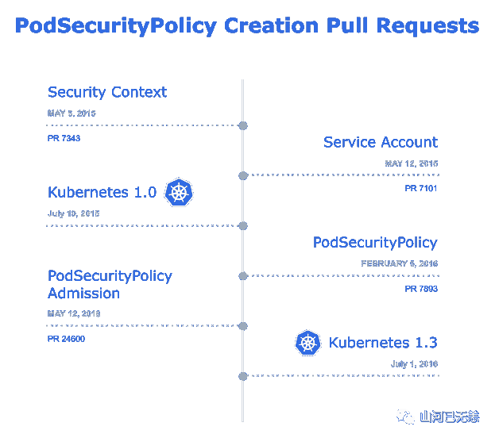

# K8s Pod 安全认知:从OpenShift SCC 到K8s PSP 弃用以及现在的 PSA

> 来源：[https://geekbang.feishu.cn/docx/Ulh1draSMoyjhNxvqKRcnxcwnkf](https://geekbang.feishu.cn/docx/Ulh1draSMoyjhNxvqKRcnxcwnkf)

> 👨🏻 作者：山河已无恙

> 📃 作者介绍：SRE，云原生相关技术干货分享，RHCA/RHCE/RHCAS、CKA 认证，CSDN/51CTO博客专家，InfoQ写作平台/Alibaba Cloud社区签约作者、Huawei Cloud社区云享专家、Tencent Cloud社区内容共创官

> ⏰ 收录时间：2024-05-27 11:48:42 (UTC+8)

> 🔗 原文链接： h[ttps://mp.weixin.q](https://mp.weixin.qq.com/s?__biz=MzkyNjIxNTYwMw==&mid=2247495178&idx=1&sn=fcd307e2dd38a99cca424f361dabaa7d&chksm=c23812d6f54f9bc0b9b3893580637cb1269b41e482a8ff7b6f77312c291ca03dbe0336262a14#rd)q.com/s?__biz=Mz...


关注作者，获取更多AI知识

## **1 ****写在前面**

---

+   简单整理，博文内容涉及：

+   PSP 的由来

+   PSA 的发展

+   不涉及使用，用于了解 Pod 安全 API 资源

+   理解不足小伙伴帮忙指正

**对每**个人而言，真正的职责只有一个：找到自我。然后在心中坚守其一生，全心全意，永不停息。所有其它的路都是不完整的，是人的逃避方式，是对大众理想的懦弱回归，是随波逐流，是对内心的恐惧 ——赫尔曼·黑塞《德米安》

---

对于和 containerd 类似，通过 Linux namespace 和 Cgroup 实现的一类 容器技术，本质上，容器就是 宿主节点的一个进程，出于安全考虑，最小权限原则，在生产中，很少使用 Root 来运行一些业务进程，即很少通过 根用户 来运行相关容器。避免 特权升级，容器逃逸，以及利用不必要权限来增加意外操作或者恶意行为。

## **2 ****PSP 的由来**

在 K8s 中，通过准入控制器来限制 Pod 的创建，当一个 apply 的 Pod 满足全部准入控制器时，才会被创建。对于 Pod 安全，K8s 也提供了自己的准入控制器。讲 K8s 的 安全策略，不得不提 openshift 的 SCC

Kubernetes 1.0 于 2015 年 7 月 10 日发布，除了 Alpha 阶段的 SecurityContextDeny 准入插件 （当时称为 scdeny）之外， 没有任何机制来限制安全上下文和工作负载的敏感选项 。

PSP 即为 K8s 最早的安全策略,即 PodSecurityPolicy ,PodSecurityPolicy 源自 OpenShift SecurityContextConstraints (SCC) ， SCC 出现在 Red Hat OpenShift 容器平台的第一个版本中，甚至在 Kubernetes 1.0 之前。PSP 是 SCC 的精简版。

### ** ****SCC **

熟悉 openshift 的小伙伴，或者参加过红帽 DO280 考试的小伙伴的，对 SCC 一定不陌生，SCC 即 SecurityContextConstraints(容器安全上下文) ,是 openshift 的一直沿用的 Pod 安全策略。

利用 SCC ，管理员能对Pod做如下的一些约束：

+   运行特权容器 (privileged container)

+   为容器增加能力 (capahiliticg)

+   用主机上的目录作为卷

+   容器的 SELinux 下文

+   运行用户 ID

+   主机命名空间和网络

+   为 Pod 的卷分配 FSGroup

+   配置允许的补充组

+   要求使用只读文件系统

+   控制允许使用的卷类型

+   控制允许使用的安全计算模式配置文件(seccop prorile)

查看当前命名空间下的所以的 SSC , OpenShift 有七个 SCC 级别

```
[root@master student]# oc get scc
NAME               PRIV      CAPS      SELINUX     RUNASUSER          FSGROUP     SUPGROUP    PRIORITY   READONLYROOTFS   VOLUMES
anyuid             false     []        MustRunAs   RunAsAny           RunAsAny    RunAsAny    10         false            [configMap downwardAPI emptyDir persistentVolumeClaim projected secret]
hostaccess         false     []        MustRunAs   MustRunAsRange     MustRunAs   RunAsAny    &lt;none&gt;     false            [configMap downwardAPI emptyDir hostPath persistentVolumeClaim projected secret]
hostmount-anyuid   false     []        MustRunAs   RunAsAny           RunAsAny    RunAsAny    &lt;none&gt;     false            [configMap downwardAPI emptyDir hostPath nfs persistentVolumeClaim projected secret]
hostnetwork        false     []        MustRunAs   MustRunAsRange     MustRunAs   MustRunAs   &lt;none&gt;     false            [configMap downwardAPI emptyDir persistentVolumeClaim projected secret]
nonroot            false     []        MustRunAs   MustRunAsNonRoot   RunAsAny    RunAsAny    &lt;none&gt;     false            [configMap downwardAPI emptyDir persistentVolumeClaim projected secret]
privileged         true      [*]       RunAsAny    RunAsAny           RunAsAny    RunAsAny    &lt;none&gt;     false            [*]
restricted         false     []        MustRunAs   MustRunAsRange     MustRunAs   RunAsAny    &lt;none&gt;     false            [configMap downwardAPI emptyDir persistentVolumeClaim projected secret]
[root@master student]#
```

默认情况下，任何容器的执行都只授予 restricted(受限制) 的 SCC，这个 SCC 是最严格的，适用于以非 root 权限运行的 pod。它限制了 pod 对主机文件系统和网络的访问。

对应 的7中 SCC 限制说明：

1.  restricted：这个 SCC 是最严格的，适用于以 非root 权限运行的 pod。它限制了 pod 对主机文件系统和网络的访问。

1.  privileged：这个 SCC 允许 pod 以完整的 root 权限运行，并访问所有主机资源。它适用于需要访问敏感主机资源的 pod。

1.  anyuid：这个 SCC 允许 pod 以任何用户 ID 和组 ID 运行。它适用于需要访问默认用户 ID 不可访问的主机资源的 pod。

1.  hostaccess：这个 SCC 允许 pod 挂载主机文件系统并访问主机设备。它适用于需要访问默认用户 ID 不可访问的主机资源的 pod。

1.  hostmount-anyuid：这个 SCC 允许 pod 挂载主机文件系统并以任何用户 ID 和组 ID 运行。它适用于需要访问默认用户 ID 不可访问的主机资源的 pod。

1.  nonroot：这个 SCC 适用于不需要 root 权限的 pod。它限制了 pod 对主机文件系统和网络的访问。

1.  hostnetwork：这个 SCC 允许 pod 使用主机网络命名空间。这意味着 pod 可以访问主机上的网络接口和端口，而不是被限制在容器网络命名空间中。这个 SCC 可能会增加 pod 对主机网络的访问权限，因此需要谨慎使用。

### ** ****PSP **

PodSecurityPolicy 与其他专门的准入控制插件一样，作为内置的策略 API，对有关 Pod 安全设置的特定字段提供细粒度的权限。它承认 集群管理员和集群用户通常不是同一个人 ，并且以 Pod 形式或任何将创建 Pod 的资源的形式创建工作负载的权限不应该等同于“集群上的 root 账户”。它还可以通过变更配置来应用更安全的默认值，并将底层 Linux 安全决策与部署过程分离来促进最佳实践。

使用 PodSecurityPolicy 的根源是早期关于安全策略的一个 拉取请求 ， 它以 SCC（安全上下文约束）为基础，增加了新的 PSP 对象的设计方案。这是一个长达 9 个月的漫长讨论， 基于 OpenShift 的 SCC 反复讨论， 多次变动，并重命名为 PodSecurityPolicy，最终在 2016 年 2 月进入上游 Kubernetes。现在 PSP 对象已经创建，下一步是添加一个可以执行这些政策的准入控制器。第一步是添加不考虑用户或组 的准入控制。2016 年 5 月，一个特定的使 PodSecurityPolicy 达到可用状态的问题被添加进来， 以跟踪进展，并在名为 PSP 准入的拉取请求中合并了准入控制器的第一个版本。然后大约两个月后，发布了 Kubernetes 1.3 。



在这里插入图片描述

之后，PSP 准入控制器通过添加最初被搁置的内容进行了增强。在 2016 年 11 月上旬 合并鉴权机制 ， 允许管理员在集群中使用多个策略，为不同类型的用户授予不同级别的访问权限。后来，2017 年 10 月合并的一个拉取请求 修复了 PodSecurityPolicies 在变更和字母顺序之间冲突的设计问题， 并继续构建我们所知道的 PSP 准入。之后，进行了许多改进和修复，以构建最近 Kubernetes 版本的 PodSecurityPolicy 功能。

对于 PSP 的使用，需要做 api-server 组件中启用配置 ,在 kube-apiserver 组件的启动配置中添加 --enable-admission-plugins=PodSecurityPolicy 参数

创建 PodSecurityPolicy ,创建了一个名为 "restricted-psp" 的 PodSecurityPolicy，其中容器不能以特权模式运行，必须以非 root 用户身份运行，并且在文件系统权限和存储卷方面宽松一些。

```
apiVersion: policy/v1beta1
kind: PodSecurityPolicy
metadata:
  name: restricted-psp
spec:
  privileged: false
  seLinux:
    rule: RunAsAny
  runAsUser:
    rule: MustRunAsNonRoot
  fsGroup:
    rule: RunAsAny
  volumes:
  - &#x27;*&#x27;
```

上述示例创建了一个名为 "restricted-psp" 的 PodSecurityPolicy，其中容器不能以特权模式运行，必须以非 root 用户身份运行，并且在文件系统权限和存储卷方面宽松一些。

配置 PodSecurityPolicy ：PSP 直接和角色绑定，然后通过角色绑定用户或者 SA 来实现 pod 对 PSP 的应用。

+   创建一个 ClusterRole，并将 PodSecurityPolicy 绑定到该 ClusterRole。

+   创建一个 ClusterRoleBinding，将该 ClusterRole 绑定到您希望使用该 PodSecurityPolicy 的用户、服务账号或命名空间。

```
apiVersion: rbac.authorization.k8s.io/v1
kind: ClusterRole
metadata:
  name: psp-demo-role
rules:
- apiGroups:
  - policy
  resources:
  - podsecuritypolicies
  verbs:
  - use
  resourceNames:
  - restricted-psp

---

apiVersion: rbac.authorization.k8s.io/v1
kind: ClusterRoleBinding
metadata:
  name: psp-demo-rolebinding
roleRef:
  apiGroup: rbac.authorization.k8s.io
  kind: ClusterRole
  name: psp-demo-role
subjects:
- kind: User
  name: &lt;your-username&gt;
```

通过 服务账号 sa 的方式绑定，在之后的 pod 创建中，使用对应的服务账号创建 Pod 即可应用 PSP 对应的策略

```
apiVersion: rbac.authorization.k8s.io/v1
kind: RoleBinding
metadata:
  name: my-rolebinding
  namespace: my-namespace
roleRef:
  apiGroup: rbac.authorization.k8s.io
  kind: ClusterRole
  name: psp:restricted-psp
subjects:
- kind: ServiceAccount
  name: my-serviceaccount
  namespace: my-namespace
```

## **3 ****PSA 的发展**

尽管 PodSecurityPolicy 试图解决的是一个关键问题，但它却包含一些重大缺陷：

+   有缺陷的鉴权模式 - 如果用户针对 PSP 具有执行 use 动作的权限，而此 PSP 准许该 Pod 或者该 Pod 的服务帐户对 PSP 执行 use 操作，则用户可以创建一个 Pod。

+   难以推广 - PSP 失败关闭。也就是说，在没有策略的情况下，所有 Pod 都会被拒绝。这主要意味着默认情况下无法启用它，并且用户必须在启用该功能之前为所有工作负载添加 PSP

+   不一致的无边界 API - API 的发展有很多不一致的地方，特别是由于许多小众场景的请求：如标签、调度、细粒度的卷控制等。它的可组合性很差，优先级模型较弱，会导致意外的变更优先级。这使得 PSP 与其他第三方准入控制器的结合真的很困难。

+   需要安全知识 - 有效使用 PSP 仍然需要了解 Linux 的安全原语。例如： MustRunAsNonRoot + AllowPrivilegeEscalation 。

PodSecurityPolicy 的经验得出的结论是，大多数用户关心两个或三个策略，这导致了 Pod 安全标准(PSS)的创建，它定义了 三个策略 ：

+   Privileged(特权的):        不受限制的策略，提供最大可能范围的权限许可。此策略允许已知的特权提升。

+   Baseline(基线的):        限制性最弱的策略，禁止已知的策略提升。允许使用默认的（规定最少）Pod 配置。

+   Restricted(受限的):        限制性非常强的策略，遵循当前的保护 Pod 的最佳实践

作为 PSP 的替代品，新的 Pod 安全准入(Pod Security Admission ,PSA) 是 Kubernetes v1.25 的稳定的准入插件，用于在命名空间级别强制执行这些标准。无需深入的安全知识，就可以更轻松地实施基本的 Pod 安全性。

从 Kubernetes 1.21 版本开始， PodSecurityPolicy（PSP） 已被 标记为已弃用 ，,从 Kubernetes v1.25 开始， PodSecurityPolicy (PSP) 准入控制器已被 移除 。

作为 PSP 的替代品，新的 Pod 安全性准入（Pod Security Admission）在 Kubernetes v1.22 作为 Alpha 特性发布， 在 Kubernetes v1.23 中作为 Beta 特性默认可用。从 1.25 版本起， 此特性进阶至正式发布（Generally Available）。用于在命名空间级别强制执行这些标准。无需深入的安全知识，就可以更轻松地实施基本的 Pod 安全性。

从 Kubernetes 1.21 版本开始， PodSecurityPolicy（PSP） 已被 标记为已弃用 ，,从 Kubernetes v1.25 开始 PodSecurityPolicy (PSP) 准入控制器已被 移除 。

## **4 ****博文部分内容参考**

© 文中涉及参考链接内容版权归原作者所有，如有侵权请告知，这是一个开源项目，如果你认可它，不要吝啬星星哦 :)

---

https://kubernetes.io/zh-cn/blog/2022/08/23/podsecuritypolicy-the-historical-context/

https://kubernetes.io/zh-cn/docs/concepts/security/pod-security-admission/

https://kubernetes.io/zh-cn/docs/tasks/configure-pod-container/enforce-standards-namespace-labels/

---

© 2018-2023 liruilonger@gmail.com, All rights reserved. 保持署名-非商用-相同方式共享(CC BY-NC-SA 4.0)