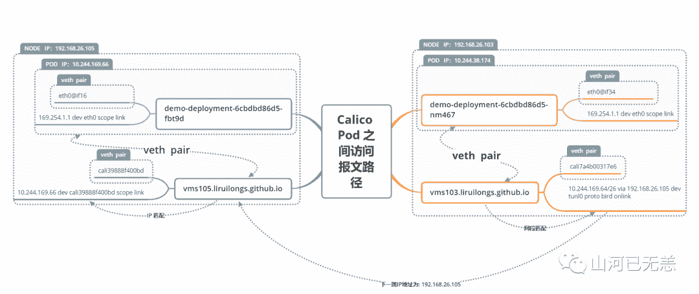

# K8s 中跨主机 Pod 之间是如何通信的(SDN 使用 Calico)？

> 来源：[https://geekbang.feishu.cn/docx/GioYdsdrFoEs7sxSseIcHpWtnPc](https://geekbang.feishu.cn/docx/GioYdsdrFoEs7sxSseIcHpWtnPc)

> 👨🏻 作者：山河已无恙

> 📃 作者介绍：SRE，云原生相关技术干货分享，RHCA/RHCE/RHCAS、CKA 认证，CSDN/51CTO博客专家，InfoQ写作平台/Alibaba Cloud社区签约作者、Huawei Cloud社区云享专家、Tencent Cloud社区内容共创官

> ⏰ 收录时间：2024-05-27 11:48:42 (UTC+8)

> 🔗 原文链接： h[ttps://mp.weixin.q](https://mp.weixin.qq.com/s?__biz=MzkyNjIxNTYwMw==&mid=2247493800&idx=1&sn=b9bee4c11e15ae39fe306f00b11d4d40&chksm=c2381474f54f9d62b2fc752eca356093d4fadfa57865adf84186fb8ad4c153d8d11dadabc302#rd)q.com/s?__biz=Mz...


关注作者，获取更多AI知识

## ** 写在前面**

---

+   被问到这个问题，整理相关笔记

+   博文内容涉及：

+   K8s 中 Pod 之间是如何通信的简单介绍，报文路径解析

+   Linux network namespace && veth pair 简单介绍

+   理解 跨节点 Pod 通信，需要理解 network namespace 和 veth pair

+   没接触的小伙伴可以先看这两部分

+   理解不足小伙伴帮忙指正

**中国**式催婚：爱不爱不重要，重要的是把婚结了。过的幸不幸福不重要，重要的是把婚结了。有钱没钱不重要，重要的是把婚结了。父母催你结婚的意义在于，你只要成家了，他们作父母的责任就尽完了。(余华)

---

##  K8s 中 Pod 之间是如何通信的(SDN 使用 Calico)？

目前只接触过 calico，所以默认 SDN 实现为 calico，下文不在赘述。

### ** 简单介绍 **

在 Kubernetes 中，每个 Pod 都会被分配一个唯一的 IP 地址，并且这些 IP 地址将用于在 Pod 之间进行通信。

Pod 通信本质上是 不同机器上的两个 network namespace 通信， network namespace 通过 veth pair 会在容器内部和宿主机映射一对虚拟网卡(veth pair)。这对虚拟网卡类似一个通道一样，一端在容器，一端在宿主机，可以直接通信，在部署的好的 K8s 集群中，可以在节点上看到好多虚拟网卡，这些就是 veth pair 宿主机的虚拟网卡。

Calico 使用 Linux 内核的网络堆栈来实现网络功能(宿主机的 calico 组件的 Felix 程序会在内核的 路由表 里面写入数据,注明这个IP出去时下一跳地址和进来时的由那个网卡解析), 同时路由程序会获取ip变换，通过 BPG 路由协议扩散到其他宿主机上，这里也包括使用代理 ARP 来处理 Pod 到节点的 ARP 请求。

宿主机，也就是工作节点，可以看做是一个路由器。pod 可以看做是连接到路由器上的网络终端。

### ** 报文路径跟踪 **

下面的思维导图为 两个不同节点 Pod 报文的访问路径



这里创建两个 Pod ，简单分析一下，编写 YAML 文件通过拓扑分布约束调度在不同的节点。

```
apiVersion: apps/v1
kind: Deployment
metadata:
  name: demo-deployment
  labels:
    app: os
spec:
  replicas: 2
  selector:
    matchLabels:
      app: os
  template:
    metadata:
      labels:
        app: os
    spec:
      containers:
      - name: centos
        image: centos:latest
        args:
         - tail
         - -f
         - /dev/null
      topologySpreadConstraints:
        - maxSkew: 1
          topologyKey: kubernetes.io/hostname
          whenUnsatisfiable: ScheduleAnyway
          labelSelector:
            matchLabels:
              app: os
```

应用之后，查看 Pod 信息

```
┌──[root@vms100.liruilongs.github.io]-[~/docker]
└─$kubectl get pods -n demo -o wide
NAME                               READY   STATUS    RESTARTS   AGE   IP              NODE                          NOMINATED NODE   READINESS GATES
demo-deployment-6cbdbd86d5-fbt9d   1/1     Running   0          17m   10.244.169.66   vms105.liruilongs.github.io   &lt;none&gt;           &lt;none&gt;
demo-deployment-6cbdbd86d5-nm467   1/1     Running   0          16m   10.244.38.174   vms103.liruilongs.github.io   &lt;none&gt;           &lt;none&gt;
┌──[root@vms100.liruilongs.github.io]-[~/docker]
└─$
```

分别调度到了不同节点：

+   vms105.liruilongs.github.io ：demo-deployment-6cbdbd86d5-fbt9d

+   vms103.liruilongs.github.io ：demo-deployment-6cbdbd86d5-nm467

进入容器查看 Pod IP 信息

demo-deployment-6cbdbd86d5-fbt9d Pod 对应 IP 为 ： 10.244.169.66 , 生成的 veth pair 容器侧的虚拟网卡为 eth0@if16

```
┌──[root@vms100.liruilongs.github.io]-[~/docker]
└─$kubectl exec -it demo-deployment-6cbdbd86d5-fbt9d -n demo -- bash
[root@demo-deployment-6cbdbd86d5-fbt9d /]# ip a
1: lo: &lt;LOOPBACK,UP,LOWER_UP&gt; mtu 65536 qdisc noqueue state UNKNOWN group default qlen 1000
    link/loopback 00:00:00:00:00:00 brd 00:00:00:00:00:00
    inet 127.0.0.1/8 scope host lo
       valid_lft forever preferred_lft forever
2: tunl0@NONE: &lt;NOARP&gt; mtu 1480 qdisc noop state DOWN group default qlen 1000
    link/ipip 0.0.0.0 brd 0.0.0.0
4: eth0@if16: &lt;BROADCAST,MULTICAST,UP,LOWER_UP&gt; mtu 1480 qdisc noqueue state UP group default
    link/ether 42:17:dd:38:6a:10 brd ff:ff:ff:ff:ff:ff link-netnsid 0
    inet 10.244.169.66/32 scope global eth0
       valid_lft forever preferred_lft forever
[root@demo-deployment-6cbdbd86d5-fbt9d /]# exit
exit
```

demo-deployment-6cbdbd86d5-nm467 Pod 对应 IP 为 10.244.38.174 ,生成的 veth pair 容器侧的虚拟网卡为 eth0@if34

```
┌──[root@vms100.liruilongs.github.io]-[~/docker]
└─$kubectl exec -it demo-deployment-6cbdbd86d5-nm467 -n demo -- bash
[root@demo-deployment-6cbdbd86d5-nm467 /]# ip a
1: lo: &lt;LOOPBACK,UP,LOWER_UP&gt; mtu 65536 qdisc noqueue state UNKNOWN group default qlen 1000
    link/loopback 00:00:00:00:00:00 brd 00:00:00:00:00:00
    inet 127.0.0.1/8 scope host lo
       valid_lft forever preferred_lft forever
2: tunl0@NONE: &lt;NOARP&gt; mtu 1480 qdisc noop state DOWN group default qlen 1000
    link/ipip 0.0.0.0 brd 0.0.0.0
4: eth0@if34: &lt;BROADCAST,MULTICAST,UP,LOWER_UP&gt; mtu 1480 qdisc noqueue state UP group default
    link/ether 36:a2:81:c4:84:f9 brd ff:ff:ff:ff:ff:ff link-netnsid 0
    inet 10.244.38.174/32 scope global eth0
       valid_lft forever preferred_lft forever
[root@demo-deployment-6cbdbd86d5-nm467 /]# exit
exit
```

进入 demo-deployment-6cbdbd86d5-nm467 Pod 简单做 ping 测试,来看一下这个 ICMP 包是如何出去的。

```
┌──[root@vms100.liruilongs.github.io]-[~/ansible]
└─$kubectl exec -it demo-deployment-6cbdbd86d5-nm467 -n demo -- bash
[root@demo-deployment-6cbdbd86d5-nm467 /]# ping -c 3  10.244.169.66
PING 10.244.169.66 (10.244.169.66) 56(84) bytes of data.
64 bytes from 10.244.169.66: icmp_seq=1 ttl=62 time=0.497 ms
64 bytes from 10.244.169.66: icmp_seq=2 ttl=62 time=0.460 ms
64 bytes from 10.244.169.66: icmp_seq=3 ttl=62 time=0.391 ms

--- 10.244.169.66 ping statistics ---
3 packets transmitted, 3 received, 0% packet loss, time 2044ms
rtt min/avg/max/mdev = 0.391/0.449/0.497/0.047 ms
```

当前容器 IP 为 10.244.38.174 , ping 侧的容器 IP 为 10.244.169.66 ，不在同一个网络内，所以当前容器会在路由表获取一下跳地址.

查看容器路由信息

```
[root@demo-deployment-6cbdbd86d5-nm467 /]# ip route
default via 169.254.1.1 dev eth0
169.254.1.1 dev eth0 scope link
```

下一跳地址为 169.254.1.1 ，这是预留的本地 IP 网段，这里的容器里的路由规则在所有的容器都是一样的，不需要动态更新.

容器会查询下一跳 168.254.1.1 的 MAC 地址，这个 ARP 请求(查找目标设备的 MAC 地址)会如何发出？

这里通过 veth pair 发出，容器内部的虚拟网卡 eth0@if34 发到宿主节点的对应的虚拟网卡 cali7a4b00317e6

如何确定一对 veth pair 虚拟网卡？

```
[root@demo-deployment-6cbdbd86d5-nm467 /]# ethtool -S eth0
NIC statistics:
     peer_ifindex: 34
     rx_queue_0_xdp_packets: 0
     rx_queue_0_xdp_bytes: 0
     rx_queue_0_xdp_drops: 0
[root@demo-deployment-6cbdbd86d5-nm467 /]#
```

在容器内部我们通过 ethtool -S eth0 可以查看到网卡索引为 34 。

```
┌──[root@vms100.liruilongs.github.io]-[~/ansible]
└─$ansible-console -i host.yaml --limit 192.168.26.103
Welcome to the ansible console.
Type help or ? to list commands.

root@all (1)[f:5]# ip a | grep 34
192.168.26.103 | CHANGED | rc=0 &gt;&gt;
34: cali7a4b00317e6@if4: &lt;BROADCAST,MULTICAST,UP,LOWER_UP&gt; mtu 1480 qdisc noqueue state UP
root@all (1)[f:5]# ifconfig cali7a4b00317e6
192.168.26.103 | CHANGED | rc=0 &gt;&gt;
cali7a4b00317e6: flags=4163&lt;UP,BROADCAST,RUNNING,MULTICAST&gt;  mtu 1480
        inet6 fe80::ecee:eeff:feee:eeee  prefixlen 64  scopeid 0x20&lt;link&gt;
        ether ee:ee:ee:ee:ee:ee  txqueuelen 0  (Ethernet)
        RX packets 0  bytes 0 (0.0 B)
        RX errors 0  dropped 0  overruns 0  frame 0
        TX packets 0  bytes 0 (0.0 B)
        TX errors 0  dropped 0 overruns 0  carrier 0  collisions 0      
       
```

在宿主节点上对应的索引的虚拟网卡即为 veth pair 的另一端,由前面可知，这个pod 调度到了 192.168.26.103 节点，进入节点可以获取到索引对应的虚拟网卡。

这里小伙伴会发现这个虚拟网卡没有随机 MAC 地址，所有的 MAC 地址为 ee:ee:ee:ee:ee:ee , 也没有IP地址。

向所在的节点发送 ARP 请求后，节点上的代理 ARP 进程将接收到这个请求，应答报文中MAC地址是自己的MAC地址，容器的后续报文 IP 地址还是 目的容器，但是 MAC 地址就变成了主机上该网卡的地址,也就是说， 所有的报文都会发给主机，主机根据IP地址再进行转发. (这里不是特别清晰，和书里的有些出入，书的这部分感觉有点问题)

主机上这块网卡不管 ARP 请求的内容，直接用自己的 MAC 地址作为应答的行为被称为 ARP proxy ，可以通过以下内核参数检查

```
┌──[root@vms100.liruilongs.github.io]-[~/ansible]
└─$ansible-console -i host.yaml --limit 192.168.26.103
Welcome to the ansible console.
Type help or ? to list commands.

root@all (1)[f:5]# cat /proc/sys/net/ipv4/conf/cali7a4b00317e6/proxy_arp
192.168.26.103 | CHANGED | rc=0 &gt;&gt;
1
root@all (1)[f:5]#
```

可以认为 Calico 把主机作为容器的默认网关使用，所有的报文发到主机，主机根据路由表进行转发。和经典的网络架构不同的是， Calico 并没有给默认网关配置一个 IP 地址，而是通过 ARP proxy 和修改容器路由表的机制实现。

主机上的 cali7a4b00317e6 网卡接收到报文之后，所有的报文会根据路由表转发，查看节点的路由表

```
root@all (1)[f:5]# route
192.168.26.103 | CHANGED | rc=0 &gt;&gt;
Kernel IP routing table
Destination     Gateway         Genmask         Flags Metric Ref    Use Iface
default         gateway         0.0.0.0         UG    0      0        0 ens32
10.244.31.64    vms106.liruilon 255.255.255.192 UG    0      0        0 tunl0
10.244.38.128   0.0.0.0         255.255.255.192 U     0      0        0 *
10.244.38.151   0.0.0.0         255.255.255.255 UH    0      0        0 cali39ccd735ea3
10.244.38.154   0.0.0.0         255.255.255.255 UH    0      0        0 calif39455d9c24
10.244.38.174   0.0.0.0         255.255.255.255 UH    0      0        0 cali7a4b00317e6
10.244.63.64    vms102.liruilon 255.255.255.192 UG    0      0        0 tunl0
10.244.169.64   vms105.liruilon 255.255.255.192 UG    0      0        0 tunl0
10.244.198.0    vms101.liruilon 255.255.255.192 UG    0      0        0 tunl0
10.244.239.128  vms100.liruilon 255.255.255.192 UG    0      0        0 tunl0
link-local      0.0.0.0         255.255.0.0     U     1002   0        0 ens32
172.17.0.0      0.0.0.0         255.255.0.0     U     0      0        0 docker0
192.168.26.0    0.0.0.0         255.255.255.0   U     0      0        0 ens32
```

访问 IP 为 10.244.169.66 ,可以看到匹配这一条路由

```
root@all (1)[f:5]# route | grep 169
192.168.26.103 | CHANGED | rc=0 &gt;&gt;
10.244.169.64   vms105.liruilon 255.255.255.192 UG    0      0        0 tunl0
root@all (1)[f:5]# ip route | grep 169
192.168.26.103 | CHANGED | rc=0 &gt;&gt;
10.244.169.64/26 via 192.168.26.105 dev tunl0 proto bird onlink
。。。。
```

10.244.169.64/26 : 表示一个 IP 地址范围，其中 /26(255.255.255.192) 表示子网掩码，确定了网络的大小。具体来说，这个 IP 地址范围包括从 10.244.169.64 到 10.244.169.127 的所有 IP 地址。

通过设备 tunl0 使用协议 bird 和 onlink 选项发送，下一跳IP地址为 192.168.26.105(vms105.liruilon...) 。

这里的 bird 和 onlink 是路由表中的两个选项:

+   bird：是一种路由协议，它可以帮助路由器动态地学习和适应网络拓扑结构的变化。Calico 使用 BGP 协议来实现网络功能，Bird 可以用于实现 BGP 路由器.

+   onlink：选项表示下一跳 IP 地址是直接可达的，也就是说，它是在同一子网内的。如果下一跳 IP 地址不在同一子网内，则需要使用网关来转发数据包。

然后我们来到下一跳 IP 地址对应的工作节点 192.168.26.105

```
┌──[root@vms100.liruilongs.github.io]-[~/ansible]
└─$kubectl get pods -n demo -o wide
NAME                               READY   STATUS    RESTARTS   AGE     IP              NODE                          NOMINATED NODE   READINESS GATES
demo-deployment-6cbdbd86d5-fbt9d   1/1     Running   0          4h36m   10.244.169.66   vms105.liruilongs.github.io   &lt;none&gt;           &lt;none&gt;
demo-deployment-6cbdbd86d5-nm467   1/1     Running   0          4h36m   10.244.38.174   vms103.liruilongs.github.io   &lt;none&gt;           &lt;none&gt;
┌──[root@vms100.liruilongs.github.io]-[~/ansible]
└─$
```

这个地址实际上是 目标 Pod 所在节点的 IP 地址，查看节点的路由信息。

```
┌──[root@vms100.liruilongs.github.io]-[~/ansible]
└─$ansible-console -i host.yaml --limit 192.168.26.105
Welcome to the ansible console.
Type help or ? to list commands.

root@all (1)[f:5]# ip route
192.168.26.105 | CHANGED | rc=0 &gt;&gt;
default via 192.168.26.2 dev ens32
10.244.31.64/26 via 192.168.26.106 dev tunl0 proto bird onlink
10.244.38.128/26 via 192.168.26.103 dev tunl0 proto bird onlink
10.244.63.64/26 via 192.168.26.102 dev tunl0 proto bird onlink
blackhole 10.244.169.64/26 proto bird
10.244.169.65 dev calid5e76ad523e scope link
10.244.169.66 dev cali39888f400bd scope link
10.244.169.70 dev cali0fdeca04347 scope link
10.244.169.73 dev cali7cf9eedbe64 scope link
10.244.169.77 dev calia011d753862 scope link
10.244.169.78 dev caliaa36e67b275 scope link
10.244.169.90 dev califc24aa4e3bd scope link
10.244.169.119 dev calibdca950861e scope link
10.244.169.120 dev cali40813694dd6 scope link
10.244.169.121 dev calie1fd05af50d scope link
10.244.198.0/26 via 192.168.26.101 dev tunl0 proto bird onlink
10.244.239.128/26 via 192.168.26.100 dev tunl0 proto bird onlink
169.254.0.0/16 dev ens32 scope link metric 1002
172.17.0.0/16 dev docker0 proto kernel scope link src 172.17.0.1
192.168.26.0/24 dev ens32 proto kernel scope link src 192.168.26.105
```

通过路由信息 会匹配 10.244.169.66 dev cali39888f400bd scope link 这个路由规则

```
root@all (1)[f:5]# ip route | grep 66
192.168.26.105 | CHANGED | rc=0 &gt;&gt;
10.244.169.66 dev cali39888f400bd scope link
root@all (1)[f:5]#
```

这个规则匹配的是一个IP地址，而不是网段。也就是说，主机上的每个容器都会有一个对应的路由表项。报文被发送到 cali39888f400bd 这个 veth pair

```
root@all (1)[f:5]# ip a | grep -A 4 cali39888f400bd
192.168.26.105 | CHANGED | rc=0 &gt;&gt;
16: cali39888f400bd@if4: &lt;BROADCAST,MULTICAST,UP,LOWER_UP&gt; mtu 1480 qdisc noqueue state UP
    link/ether ee:ee:ee:ee:ee:ee brd ff:ff:ff:ff:ff:ff link-netnsid 9
    inet6 fe80::ecee:eeff:feee:eeee/64 scope link
       valid_lft forever preferred_lft forever
root@all (1)[f:5]#
```

然后从 cali39888f400bd 一端发送给目标容器的 eth0@if16 。目标容器接收到报文之后，回复 ICMP 报文，应答报文原路返回。

```
┌──[root@vms100.liruilongs.github.io]-[~/ansible]
└─$kubectl exec -it demo-deployment-6cbdbd86d5-fbt9d -n demo -- bash
[root@demo-deployment-6cbdbd86d5-fbt9d /]# ip a
1: lo: &lt;LOOPBACK,UP,LOWER_UP&gt; mtu 65536 qdisc noqueue state UNKNOWN group default qlen 1000
    link/loopback 00:00:00:00:00:00 brd 00:00:00:00:00:00
    inet 127.0.0.1/8 scope host lo
       valid_lft forever preferred_lft forever
2: tunl0@NONE: &lt;NOARP&gt; mtu 1480 qdisc noop state DOWN group default qlen 1000
    link/ipip 0.0.0.0 brd 0.0.0.0
4: eth0@if16: &lt;BROADCAST,MULTICAST,UP,LOWER_UP&gt; mtu 1480 qdisc noqueue state UP group default
    link/ether 42:17:dd:38:6a:10 brd ff:ff:ff:ff:ff:ff link-netnsid 0
    inet 10.244.169.66/32 scope global eth0
       valid_lft forever preferred_lft forever
```

简单来回顾一下，跨主机的 Pod 如何通信？

本质是 Linux 中两个不同机器网络命名空间(network namespace)的通信，通过当前容器(网络命名空间)和宿主机内的一对虚拟网卡 veth pair ，把数据包发送到宿主节点上(这里涉及到ARP 代理)，然后通过匹配路由表(这里是网段匹配)，下一跳到 目标Pod 所在宿主节点，到达 目标Pod 宿主节点 上之后，在通过 路由匹配(IP 匹配)到宿主节点上的虚拟网卡(和容器对应的一对虚拟网卡 veth pair )，然后从这个虚拟网卡到容器内部的虚拟网卡，实现请求，之后原路返回。

所以从网络命名空间角度理解，是容器 network namespace 到节点 root network namespace ，然后 节点 root network namespace 到 容器 network namespace

##  network namespace 简单介绍

network namespace 在Linux内核 2.6 版本引入，作用是隔离 Linux 系统的网络设备，以及 IP地址、端口、路由表、防火墙规则等网络资源 。因此， 每个网络 namespace 里都有自己的网络设备(如IP地址、路由表、端口范围、/proc/net目录等) .

从网络的角度看， network namespace 使得容器非常有用，一个直观的例子就是：由于每个容器都有自己的(虚拟)网络设备，并且 容器里的进程可以放心地绑定在端口 上而不必担心端口冲突，这就使得 在一个主机上同时运行多个监听80端口的Web服务器变为可能 .

###  初识network namespace

network namespace 可以通过系统调用来创建, 当前 network namespace 的增删改查功能已经集成到 Linux的 ip 工具的 netns 子命令中。

创建一个名为 netns_demo 的network namespace

```
┌──[root@liruilongs.github.io]-[~]
└─$ip netns add netns_demo
```

查看当前系统的 network namespace

```
┌──[root@liruilongs.github.io]-[~]
└─$ip netns list 
netns_demo
```

创建了一个 network namespace 时，系统会在 /var/run/netns 路径下面生成一个挂载点

```
┌──[root@liruilongs.github.io]-[~]
└─$ls /var/run/netns/netns_demo 
/var/run/netns/netns_demo
```

挂载点的作用

+   方便对 namespace 的管理

+   使 namespace 即使没有进程运行也能继续存在

一个 network namespace 被创建出来后，可以使用 ip netns exec 命令进入，做一些网络 查询/配置 的工作。

查看网络命名空间信息,没有任何配置，因此只有一块系统默认的本地回环设备lo。

```
┌──[root@liruilongs.github.io]-[~]
└─$ip netns exec netns_demo ip a
1: lo: &lt;LOOPBACK&gt; mtu 65536 qdisc noop state DOWN qlen 1
    link/loopback 00:00:00:00:00:00 brd 00:00:00:00:00:00
```

对于删除 network namespace，可以通过以下命令实现：

```
┌──[root@liruilongs.github.io]-[~]
└─$ip netns delete netns_demo
┌──[root@liruilongs.github.io]-[~]
└─$ip netns list
┌──[root@liruilongs.github.io]-[~]
└─$
```

注意，上面这条命令实际上并没有删除netns_demo这个network namespace，它只是移除了这个network namespace对应的挂载点。只要里面还有进程运行着，network namespace便会一直存在。

###  配置 network namespace

当尝试访问创建的 网络 命名空间的本地回环地址时，网络是不通的

```
┌──[root@liruilongs.github.io]-[~]
└─$ip netns exec netns_demo ip a
1: lo: &lt;LOOPBACK&gt; mtu 65536 qdisc noop state DOWN qlen 1
    link/loopback 00:00:00:00:00:00 brd 00:00:00:00:00:00
```

这是因为本地回环地址对应的网卡设备连接默认是禁用的，需要下面的方式激活。

```
┌──[root@liruilongs.github.io]-[~]
└─$ip netns exec netns_demo ip  link set dev lo up
```

激活之后，查看网络命名空间网卡的详细信息

```
┌──[root@liruilongs.github.io]-[~]
└─$ip netns exec netns_demo ip a
1: lo: &lt;LOOPBACK,UP,LOWER_UP&gt; mtu 65536 qdisc noqueue state UNKNOWN qlen 1
    link/loopback 00:00:00:00:00:00 brd 00:00:00:00:00:00
    inet 127.0.0.1/8 scope host lo
       valid_lft forever preferred_lft forever
    inet6 ::1/128 scope host
       valid_lft forever preferred_lft forever
```

做 ping 测试

```
┌──[root@liruilongs.github.io]-[~]
└─$ip netns exec netns_demo ping 127.0.0.1
PING 127.0.0.1 (127.0.0.1) 56(84) bytes of data.
64 bytes from 127.0.0.1: icmp_seq=1 ttl=64 time=0.047 ms
64 bytes from 127.0.0.1: icmp_seq=2 ttl=64 time=0.047 ms
64 bytes from 127.0.0.1: icmp_seq=3 ttl=64 time=0.048 ms
^C
--- 127.0.0.1 ping statistics ---
3 packets transmitted, 3 received, 0% packet loss, time 2022ms
rtt min/avg/max/mdev = 0.047/0.047/0.048/0.005 ms
┌──[root@liruilongs.github.io]-[~]
└─$
```

仅有一个本地回环设备是没法与外界通信的。如果我们想与外界(比如主机上的网卡)进行通信，需要构建一个通道，就需要在 namespace 里再 创建一对虚拟的以太网卡 ，即所谓的 veth pair 。

顾名思义， veth pair 总是成对出现且相互连接，它就像 Linux 的双向管道(pipe)，报文从 veth pair 一端进去就会由另一端收到

创建 veth0 和 veth1 这么一对虚拟以太网卡

```
┌──[root@liruilongs.github.io]-[~]
└─$ip link add veth0 type veth peer name veth1
```

在默认情况下，它们都在主机的 root network namespce 中，将其中一块虚拟网卡 veth1 通过 ip link set 命令移动到 之前创建的 network namespace`。

```
┌──[root@liruilongs.github.io]-[~]
└─$ip link set veth1 netns  netns_demo
```

查看 创建的网络命名空间内的网络设备信息，添加了一块新的网卡 veth1@if4

```
┌──[root@liruilongs.github.io]-[~]
└─$ip netns exec netns_demo ip a
1: lo: &lt;LOOPBACK,UP,LOWER_UP&gt; mtu 65536 qdisc noqueue state UNKNOWN qlen 1
    link/loopback 00:00:00:00:00:00 brd 00:00:00:00:00:00
    inet 127.0.0.1/8 scope host lo
       valid_lft forever preferred_lft forever
    inet6 ::1/128 scope host
       valid_lft forever preferred_lft forever
3: veth1@if4: &lt;BROADCAST,MULTICAST&gt; mtu 1500 qdisc noop state DOWN qlen 1000
    link/ether 5a:af:75:80:a6:ba brd ff:ff:ff:ff:ff:ff link-netnsid 0
```

主机网卡信息查看，多了一块 veth0@if3 的虚拟网卡

```
┌──[root@liruilongs.github.io]-[~]
└─$ip a
1: lo: &lt;LOOPBACK,UP,LOWER_UP&gt; mtu 65536 qdisc noqueue state UNKNOWN qlen 1
    link/loopback 00:00:00:00:00:00 brd 00:00:00:00:00:00
    inet 127.0.0.1/8 scope host lo
       valid_lft forever preferred_lft forever
    inet6 ::1/128 scope host
       valid_lft forever preferred_lft forever
2: ens32: &lt;BROADCAST,MULTICAST,UP,LOWER_UP&gt; mtu 1500 qdisc pfifo_fast state UP qlen 1000
    link/ether 00:0c:29:e5:68:68 brd ff:ff:ff:ff:ff:ff
    inet 192.168.26.152/24 brd 192.168.26.255 scope global dynamic ens32
       valid_lft 1377sec preferred_lft 1377sec
    inet6 fe80::20c:29ff:fee5:6868/64 scope link
       valid_lft forever preferred_lft forever
4: veth0@if3: &lt;BROADCAST,MULTICAST&gt; mtu 1500 qdisc noop state DOWN qlen 1000
    link/ether be:2a:81:c1:e4:24 brd ff:ff:ff:ff:ff:ff link-netnsid 0
┌──[root@liruilongs.github.io]-[~]
└─$
```

这两块网卡刚创建出来还都是 DOWN 状态，需要手动把状态设置成 UP ，这里同时设置 IP 地址

```
┌──[root@liruilongs.github.io]-[~]
└─$ip netns exec netns_demo ifconfig veth1 10.1.1.1/24 up
┌──[root@liruilongs.github.io]-[~]
└─$ifconfig veth0 10.1.1.2/24 up
```

ping 测试。在网络命名空间内 ping 主机的 veth pair 对应的网卡 IP 。

```
┌──[root@liruilongs.github.io]-[~]
└─$ip netns exec  netns_demo ping 10.1.1.2 -c 3
PING 10.1.1.2 (10.1.1.2) 56(84) bytes of data.
64 bytes from 10.1.1.2: icmp_seq=1 ttl=64 time=0.058 ms
64 bytes from 10.1.1.2: icmp_seq=2 ttl=64 time=0.060 ms
64 bytes from 10.1.1.2: icmp_seq=3 ttl=64 time=0.060 ms

--- 10.1.1.2 ping statistics ---
3 packets transmitted, 3 received, 0% packet loss, time 2020ms
rtt min/avg/max/mdev = 0.058/0.059/0.060/0.006 ms
┌──[root@liruilongs.github.io]-[~]
└─$
```

不同 network namespace 之间的 路由表和防火墙规则 等也是隔离的，因此我们刚刚创建的 network namespace 没法和主机共享路由表和防火墙

需要注意的是，用户可以随意将虚拟网络设备分配到自定义的 network namespace 里，而连接真实硬件的物理设备则只能放在系统的根 network namesapce 中。并且， 任何一个网络设备最多只能存在于一个 network namespace 中 。

## ** veth pair 简单介绍**

在 Docker 或 Kubernetes 的环境中，如果在主机上查询网卡信息的时候，总会出来一大堆虚拟网卡，这些虚拟网卡就是Docker/Kubernetes为容器而创建的。

veth 是虚拟以太网卡(Virtual Ethernet)的缩写，veth 设备总是成对的，因此我们称之为 veth pair

veth pair 一端发送的数据会在另外一端接收，非常像 Linux 的双向管道。根据这一特性， veth pair 常被用于跨 network namespace 之间的通信，即分别将 veth pair 的两端放在不同的 namespace 里。

仅有 veth pair 设备，容器是无法访问外部网络的。为什么呢？因为从容器发出的数据包，实际上是直接进了 veth pair 设备的协议栈。

如果容器需要访问网络，则需要使用网桥等技术将 veth pair 设备接收的数据包通过某种方式转发出去。在 docker 中，我们通过 网桥的方式访问，docker 在启动时会自动创建一个 docker0 的 Linux 网桥.

###  veth pair的创建和使用

通过下面的命令创建一对 veth pair

```
┌──[root@liruilongs.github.io]-[~]
└─$ip  link add veth3 type veth peer name veth4
```

创建的veth pair在主机上表现为两块网卡，我们可以通过ip link 命令查看：

```
┌──[root@liruilongs.github.io]-[~]
└─$ip link list
........
5: veth4@veth3: &lt;BROADCAST,MULTICAST,M-DOWN&gt; mtu 1500 qdisc noop state DOWN mode DEFAULT qlen 1000
    link/ether de:3a:5e:42:2d:ff brd ff:ff:ff:ff:ff:ff
6: veth3@veth4: &lt;BROADCAST,MULTICAST,M-DOWN&gt; mtu 1500 qdisc noop state DOWN mode DEFAULT qlen 1000
    link/ether 06:8f:b5:e8:e9:f6 brd ff:ff:ff:ff:ff:ff
```

新创建的 veth pair 设备的默认 mtu 是 1500，设备初始状态是 DOWN。我们同样可以使用 ip link 命令将这两块网卡的状态设置为UP。

```
┌──[root@liruilongs.github.io]-[~]
└─$ip link set dev veth3 up
┌──[root@liruilongs.github.io]-[~]
└─$ip link set dev veth4 up
```

veth pair 设备同样可以配置IP地址，命令如下：

```
┌──[root@liruilongs.github.io]-[~]
└─$ifconfig veth3 10.20.30.40/24
┌──[root@liruilongs.github.io]-[~]
└─$ifconfig veth4 10.20.30.41/24
┌──[root@liruilongs.github.io]-[~]
└─$
```

可以将veth pair设备放到namespace中。把 veth4 放到 网络命令空间 netns_demo 中

```
┌──[root@liruilongs.github.io]-[~]
└─$ip link  set veth4 netns netns_demo
```

在命令空间中查看

```
┌──[root@liruilongs.github.io]-[~]
└─$ip netns exec netns_demo ip link list
......
5: veth4@if6: &lt;BROADCAST,MULTICAST&gt; mtu 1500 qdisc noop state DOWN mode DEFAULT qlen 1000
    link/ether de:3a:5e:42:2d:ff brd ff:ff:ff:ff:ff:ff link-netnsid 0
```

主机环境中，原来索引为 6 的 veth4 虚拟网卡已经看不到了

```
┌──[root@liruilongs.github.io]-[~]
└─$ifconfig
...........
veth3: flags=4099&lt;UP,BROADCAST,MULTICAST&gt;  mtu 1500
        inet 10.20.30.40  netmask 255.255.255.0  broadcast 10.20.30.255
        inet6 fe80::48f:b5ff:fee8:e9f6  prefixlen 64  scopeid 0x20&lt;link&gt;
        ether 06:8f:b5:e8:e9:f6  txqueuelen 1000  (Ethernet)
        RX packets 8  bytes 648 (648.0 B)
        RX errors 0  dropped 0  overruns 0  frame 0
        TX packets 8  bytes 648 (648.0 B)
        TX errors 0  dropped 0 overruns 0  carrier 0  collisions 0

┌──[root@liruilongs.github.io]-[~]
└─$
```

veth pair 设备的原理较简单，就是向 veth pair 设备的一端输入数据，数据通过内核协议栈后从 veth pair 的另一端出来。 veth pair 的基本工作原理:

### ** veth pair内核实现 **

在 veth pair 设备上，任意一端(RX)接收的数据都会在另一端(TX)发送出去， veth pair 在转发过程中不会篡改数据包的内容

###  容器与 host veth pair 的关系

经典容器组网模型就是 veth pair+bridge 的模式。容器中的 eth0 实际上和外面 host 上的某个 veth 是成对的(pair)关系.

可以通过下面两种方式来获取对应关系

#### ** 方法一 **

容器里面看 /sys/class/net/eth0/iflink

```
┌──[root@liruilongs.github.io]-[/]
└─$ docker exec -it  6471704fd03a sh
/ # cat /sys/class/net/eth0/if
ifalias  ifindex  iflink
/ # cat /sys/class/net/eth0/iflink
95
/ # exit
```

然后，在主机上遍历 /sys/claas/net 下面的全部目录，查看子目录 ifindex 的值和容器里查出来的 iflink 值相当的 veth 名字，这样就找到了容器和主机的 veth pair 关系。

```
┌──[root@liruilongs.github.io]-[/]
└─$ grep -c 95 /sys/class/net/*/ifindex | grep 1
/sys/class/net/veth2e08884/ifindex:1
```

#### ** 方法二 **

从上面的命令输出可以看到 116:eth0@if117，其中116是eth0接口的 index，117是和它成对的veth的index。当host执行下面的命令时，可以看到对应117的veth网卡是哪一个， 这样就得到了容器和veth pair的关系(这整句忽略哈，忘记调整了 ^_^)

在目标容器里执行以下命令,获取网卡索引为 94 ,其中 94 是 eth0 接口的index，95 是和它成对的veth的index。

```
┌──[root@liruilongs.github.io]-[/]
└─$ docker exec -it  6471704fd03a sh
/ # ip link show eth0
94: eth0@if95: &lt;BROADCAST,MULTICAST,UP,LOWER_UP,M-DOWN&gt; mtu 1500 qdisc noqueue
    link/ether 02:42:ac:11:00:03 brd ff:ff:ff:ff:ff:ff
/ # exit
```

通过 95 index 来定位主机上对应的虚拟网卡

```
┌──[root@liruilongs.github.io]-[/]
└─$ ip link show | grep 95
95: veth2e08884@if94: &lt;BROADCAST,MULTICAST,UP,LOWER_UP&gt; mtu 1500 qdisc noqueue master docker0 state UP mode DEFAULT
┌──[root@liruilongs.github.io]-[/]
└─$
```

关于 K8s 中 Pod 之间是如何通信的(SDN 使用 Calico)？就和小伙伴们分享到这里，生活加油 ^_^

## ** 博文内容参考**

© 文中涉及参考链接内容版权归原作者所有，如有侵权请告知 :)

---

《Kubernetes网络权威指南：基础、原理与实践》

---

© 2018-2023 liruilonger@gmail.com, All rights reserved. 保持署名-非商用-相同方式共享(CC BY-NC-SA 4.0)

