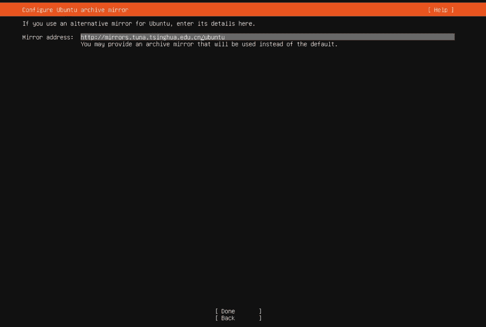
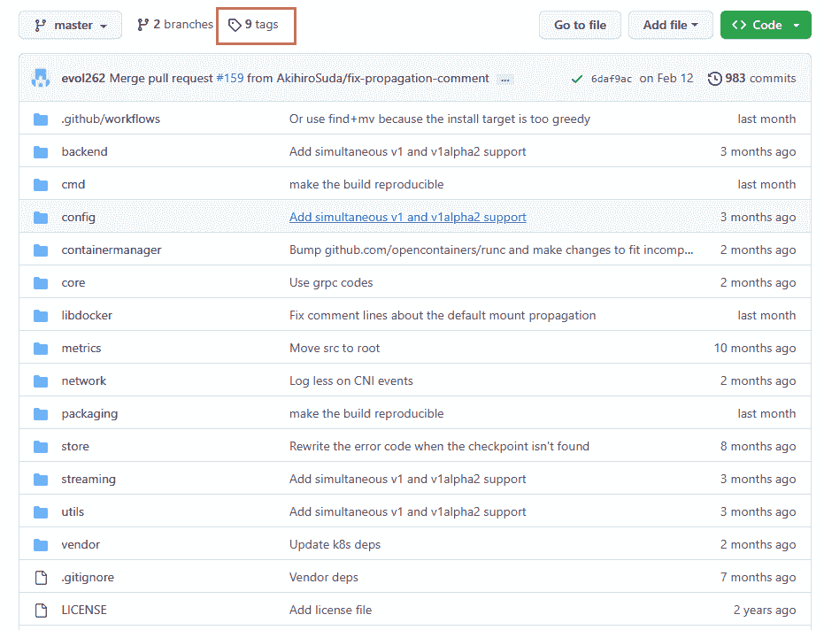
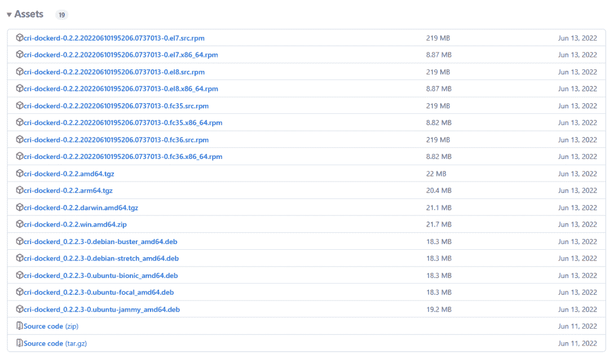
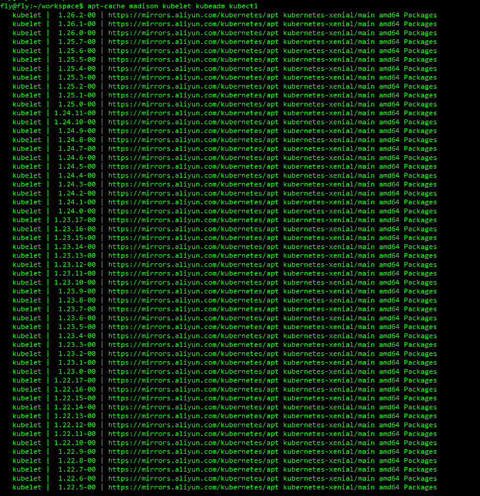

# Kubernetes集群安装与配置：环境准备及工具安装全程解密！

> 来源：[https://geekbang.feishu.cn/docx/XKwSdCUucoo9t6xDC5qcDYPbnkI](https://geekbang.feishu.cn/docx/XKwSdCUucoo9t6xDC5qcDYPbnkI)

> 👨🏻 作者：Lion莱恩呀

> 📃 作者介绍：专注分享高性能服务器后台开发知识，包括C/C++、Linux、网络协议、设计模式、中间件、云原生、数据库、分布式架构等领域知识。

> 🛖 👸号：Lion莱恩呀

> ⏰ 收录时间：2024-05-27 11:15:56 (UTC+8)

> 🔗 原文链接：h[ttps://mp.weixin.q](https://mp.weixin.qq.com/s?__biz=Mzk0ODUzNDc2Mw==&mid=2247486040&idx=1&sn=8b48750a26643b9fda5d4b347e540752&scene=19#wechat_redirect)q.com/s?__biz=Mz...


关注作者，获取更多相关知识

## 一、环境准备


### （1）系统要求

1. 一台或多台运行兼容 deb/rpm 的 Linux 操作系统的计算机；例如：Ubuntu 或 CentOS。
1. 每台机器 2 GB 以上的内存，内存不足时应用会受限制。
1. 用作控制平面节点的计算机上至少有2个 CPU。
1. 集群中所有计算机之间具有完全的网络连接。你可以使用公共网络或专用网络。

### （2）主机环境

1. 宿主机环境 `ubuntu-20.04.4-live-server-amd64`，点击这里下载。
1. apt 包管理器，镜像源修改：将 `http://cn.archive.ubuntu.com/ubuntu` 改为`https://mirrors.tuna.tsinghua.edu.cn/ubuntu`。
1. 两种修改方式：

第一种在安装虚拟机时，修改图下图。

第二种：已经安装好系统的情况下，修改 `/etc/apt/sources.list` 将对应的地址替换，替换完成后执行`apt-get update`，注意：先备份`/etc/apt/sourse.list`文件。



1. `docker`安装，`docker`版本 20.10.17，安装参考之前的博客`docker`安装。

## 二、docker容器运行时安装


### 2.1、`cri-dockerd`安装

过去，使用 Docker 容器运行时（Docker Engine）开发者和管理员只能使用Docker官方推荐的容器运行时(CRI-O)。

CRi-O是一个非常轻量级的、容器原生的运行时，专为Kubernetes集群而设计，并且它被设计为符合Kuberenetes的容器运行时接口（CRI）标准。然而，自Kuberenetes 1.20版本开始，官方支持了 `CRI-Dockerd`，它实际上是Docker的`kubelet` CRI插件。

源码地址：https://github.com/Mirantis/cri-dockerd.git

#### 2.1.1、方式一：二进制文件下载安装

（1）查看内核信息

```
cat /proc/version
```

（2）找到下载地址：






（3）根据内核信息选择对应的文件下载地址。

（4）下载并安装：

```
# 下载
wget https://github.com/Mirantis/cri-dockerd/releases/download/v0.2.6/cri-dockerd-0.2.6.amd64.tgz
# 解压到/tmp目录
tar -zxvf cri-dockerd-0.2.6.amd64.tgz -C /tmp
# 安装
sudo cp /tmp/cri-dockerd/cri-dockerd /usr/bin/
```

#### 2.1.2、方式二：通过docker来构建

（1）下载代码：

```
# 下载代码
git clone https://github.com/Mirantis/cri-dockerd.git
# 进入目录
cd cri-dockerd
# 查看tag
git tag
# 选择需要的tag
git checkout v0.2.6
```

（2）创建Dockerfile文件：

```
FROM golang:1.18
ADD ./ /go/src/cri-dockerd
WORKDIR /go/src/cri-dockerd
RUN go env -w GOPROXY=https://proxy.golang.com.cn,https://goproxy.cn,direct
RUN go build -o cri-dockerd
```

（3）构建镜像：

```
# 构建镜像
docker build -t cri-dockerd:latest .
# 运行容器
docker run --rm -d -it --name cri-dockerd cri-dockerd:latest bash
# 将容器中编译好的二进制文件拷贝的宿主机
docker cp cri-dockerd:/go/src/cri-dockerd/cri-dockerd ./
# 将二进制文件安装到/usr/bin/
sudo cp cri-dockerd /usr/bin/
```

### 2.2、`cri-dockerd`服务配置和启动

参考。

（1）获取源码，将源中`systemd`配置文件拷贝到相应目录：

```
# 获取源码，如果已经下载了无需重复下载
git clone https://github.com/Mirantis/cri-dockerd.git
# 将源中systemd配置文件拷贝到相应目录
sudo cp cri-dockerd/packaging/systemd/* /etc/systemd/system/
```

（2）文件 `/etc/systemd/system/cri-docker.socket` 内容无需修改。

```
[Unit]
Description=CRI Docker Socket for the API
PartOf=cri-docker.service

[Socket]
ListenStream=%t/cri-dockerd.sock
SocketMode=0660
SocketUser=root
SocketGroup=docker

[Install]
WantedBy=sockets.target

```

（3）文件 `/etc/systemd/system/cri-docker.service` `Service.ExecStart` 字段增加 `--network-plugin` 与 `--pod-infra-container-image` 选项。`–pod-infra-container-image` 镜像`tag`需要根据具体`k8s`安装版本指定。也就是要修改网络和根容器镜像。

```
[Unit]
Description=CRI Interface for Docker Application Container Engine
Documentation=https://docs.mirantis.com
After=network-online.target firewalld.service docker.service
Wants=network-online.target
Requires=cri-docker.socket
[Service]
Type=notify
ExecStart=/usr/bin/cri-dockerd --container-runtime-endpoint fd:// --network-plugin=cni --pod-infra-container-image=registry.aliyuncs.com/google_containers/pause:3.7
ExecReload=/bin/kill -s HUP $MAINPID
TimeoutSec=0
RestartSec=2
Restart=always
```

（4）启动服务。

```
# 重新加载配置
sudo systemctl daemon-reload
# 设置为开机自启动
sudo systemctl enable cri-docker
# 启动服务
sudo systemctl start cri-docker
# 检查服务状态
sudo systemctl status cri-docker
```


```
$ sudo systemctl status cri-docker
● cri-docker.service - CRI Interface for Docker Application Container Engine
     Loaded: loaded (/etc/systemd/system/cri-docker.service; enabled; vendor preset: enabled)
     Active: active (running) since Fri 2023-03-17 06:57:35 UTC; 6s ago
TriggeredBy: ● cri-docker.socket
       Docs: https://docs.mirantis.com
   Main PID: 6200 (cri-dockerd)
      Tasks: 8
     Memory: 10.9M
     CGroup: /system.slice/cri-docker.service
             └─6200 /usr/bin/cri-dockerd --container-runtime-endpoint fd:// --network-plugin=cni --pod-infra-container-image==registry.al>

Mar 17 06:57:35 fly cri-dockerd[6200]: time="2023-03-17T06:57:35Z" level=info msg="The binary conntrack is not installed, this can cause >
Mar 17 06:57:35 fly cri-dockerd[6200]: time="2023-03-17T06:57:35Z" level=info msg="The binary conntrack is not installed, this can cause >
Mar 17 06:57:35 fly cri-dockerd[6200]: time="2023-03-17T06:57:35Z" level=info msg="Loaded network plugin cni"
Mar 17 06:57:35 fly cri-dockerd[6200]: time="2023-03-17T06:57:35Z" level=info msg="Docker cri networking managed by network plugin cni"
Mar 17 06:57:35 fly cri-dockerd[6200]: time="2023-03-17T06:57:35Z" level=info msg="Docker Info: &{ID:VGW7:H3EQ:B56E:TDMW:2RJV:4PUH:LVB3:U>
Mar 17 06:57:35 fly cri-dockerd[6200]: time="2023-03-17T06:57:35Z" level=info msg="Setting cgroupDriver cgroupfs"
Mar 17 06:57:35 fly cri-dockerd[6200]: time="2023-03-17T06:57:35Z" level=info msg="Docker cri received runtime config &RuntimeConfig{Netw>
Mar 17 06:57:35 fly cri-dockerd[6200]: time="2023-03-17T06:57:35Z" level=info msg="Starting the GRPC backend for the Docker CRI interface>
Mar 17 06:57:35 fly cri-dockerd[6200]: time="2023-03-17T06:57:35Z" level=info msg="Start cri-dockerd grpc backend"
Mar 17 06:57:35 fly systemd[1]: Started CRI Interface for Docker Application Container Engine.
lines 1-21/21 (END)...skipping...
● cri-docker.service - CRI Interface for Docker Application Container Engine
     Loaded: loaded (/etc/systemd/system/cri-docker.service; enabled; vendor preset: enabled)
     Active: active (running) since Fri 2023-03-17 06:57:35 UTC; 6s ago
TriggeredBy: ● cri-docker.socket
       Docs: https://docs.mirantis.com
   Main PID: 6200 (cri-dockerd)
      Tasks: 8
     Memory: 10.9M
     CGroup: /system.slice/cri-docker.service
             └─6200 /usr/bin/cri-dockerd --container-runtime-endpoint fd:// --network-plugin=cni --pod-infra-container-image==registry.aliyuncs.com/google_containers/pause:3.7

Mar 17 06:57:35 fly cri-dockerd[6200]: time="2023-03-17T06:57:35Z" level=info msg="The binary conntrack is not installed, this can cause failures in network connection cleanup."
Mar 17 06:57:35 fly cri-dockerd[6200]: time="2023-03-17T06:57:35Z" level=info msg="The binary conntrack is not installed, this can cause failures in network connection cleanup."
Mar 17 06:57:35 fly cri-dockerd[6200]: time="2023-03-17T06:57:35Z" level=info msg="Loaded network plugin cni"
Mar 17 06:57:35 fly cri-dockerd[6200]: time="2023-03-17T06:57:35Z" level=info msg="Docker cri networking managed by network plugin cni"
Mar 17 06:57:35 fly cri-dockerd[6200]: time="2023-03-17T06:57:35Z" level=info msg="Docker Info: &{ID:VGW7:H3EQ:B56E:TDMW:2RJV:4PUH:LVB3:U2ER:5OVK:YTTO:A6ZQ:EDGS Containers:0 ContainersRunning:0 ContainersPaused:0 ContainersStopped:0 Images:>
Mar 17 06:57:35 fly cri-dockerd[6200]: time="2023-03-17T06:57:35Z" level=info msg="Setting cgroupDriver cgroupfs"
Mar 17 06:57:35 fly cri-dockerd[6200]: time="2023-03-17T06:57:35Z" level=info msg="Docker cri received runtime config &RuntimeConfig{NetworkConfig:&NetworkConfig{PodCidr:,},}"
Mar 17 06:57:35 fly cri-dockerd[6200]: time="2023-03-17T06:57:35Z" level=info msg="Starting the GRPC backend for the Docker CRI interface."
Mar 17 06:57:35 fly cri-dockerd[6200]: time="2023-03-17T06:57:35Z" level=info msg="Start cri-dockerd grpc backend"
Mar 17 06:57:35 fly systemd[1]: Started CRI Interface for Docker Application Container Engine.
```

# 三、`kubeadm`和相关工具


`kubeadm`是`Kubernetes`从1.4版本开始引入的命令行工具，致力于简化集群的安装过程，并解决`Kubernetes`集群高可用问题。

1. 源码地址。
1. 安装说明文档地址。

## 3.1、安装`kubeadm`、`kubelet`、`kubectl`：

（1）更新包管理器索引，并安装相关软件支持`HTTPS`访问。

```
sudo apt-get update
sudo apt-get install -y apt-transport-https ca-certificates curl
```

（2）下载`gpg`秘钥。

```
sudo curl -fsSLo /usr/share/keyrings/kubernetes-archive-keyring.gpg https://mirrors.aliyun.com/kubernetes/apt/doc/apt-key.gpg
```

（3）设置`Kubernetes`镜像源。

```
echo "deb [signed-by=/usr/share/keyrings/kubernetes-archive-keyring.gpg] https://mirrors.aliyun.com/kubernetes/apt/ kubernetes-xenial main" | sudo tee /etc/apt/sources.list.d/kubernetes.list
```

（4）更新`apt`软件索引，并查看相关软件的可用版本。

```
sudo apt-get update
apt-cache madison kubelet kubeadm kubectl
```



（5）安装特定版本。

```
sudo apt-get install -y kubelet=<VERSION_STRING> kubeadm=<VERSION_STRING> kubectl=<VERSION_STRING>
```

例如：

```
sudo apt-get install -y kubelet=1.24.1-00 kubeadm=1.24.1-00 kubectl=1.24.1-00
```

（6）安装最新版本：

```
sudo apt-get install -y kubelet kubeadm kubectl
```

（7）锁定软件版本：

```
# 防止自动升级更新
sudo apt-mark hold kubelet kubeadm kubectl
```

（8）检查`kubelet`状态：

```
systemctl status kubelet
```

注意：`kubelet`在刚安装完成时，会处于一个自动启动状态，每10s启动一次，在没有完成初始化之前它一致处于这种状态，所以不要纠结于`kubelet`安装之后没有启动。

## 3.2、卸载

```
sudo apt-get remove kubelet kubectl kubeadm
```

# 四、主机环境调整

## 4.1、修改节点上`Docker` 的`cgroup driver`为`systemd`

由于`Kubernetes`中`kubelet`组件默认使用的`cgroupdriver`为 `systemd`，所以我们将`docker`的`cgroupdriver`也修改为 `systemd`。

参考文档：

+   `configure-cgroup-driver`

+   `container-runtimes`

（1）打开`docker`配置文件进行修改，该文件默认情况下不存在，可以新建一个，不同操作系统的文件位置不一样。

```
sudo vim /etc/docker/daemon.json
```

（2）增加配置内容：

```
"exec-opts": [
        "native.cgroupdriver=systemd"
]
```

（3）重新加载配置并重启服务：

```
sudo systemctl daemon-reload
sudo systemctl restart docker
```

（4）最终配置文件内容如下：

```
{
        "exec-opts": [
                        "native.cgroupdriver=systemd"
        ]
}
```

## 4.2、关闭防火墙

```
sudo systemctl stop firewalld
sudo systemctl disable firewalld
```

## 4.3、禁用`selinux`

`selinux`，这个是用来加强安全性的一个组件，但非常容易出错且难以定位，一般上来装完系统就先给禁用了。

```
# 查看 selinux 状态
sudo apt install selinux-utils
getenforce
# 禁用
sudo setenforce 0
```

## 4.4、禁用`swap`

```
# 查看交换区
free
# 禁用交换区
sudo swapoff -a
# 打开文件注释交换区定义
sudo vim /etc/fstab
```

注释`/swap.img`一行：

```
# /etc/fstab: static file system information.
# 
# Use 'blkid' to print the universally unique identifier for a
# device; this may be used with UUID= as a more robust way to name devices
# that works even if disks are added and removed. See fstab(5).
#
# <file system> <mount point>   <type>  <options>       <dump>  <pass>
# / was on /dev/ubuntu-vg/ubuntu-lv during curtin installation
/dev/disk/by-id/dm-uuid-LVM-P6zL7vPKbBTRUnirliIyM4zbR4bNr6fERoQHPjV6FsHDBNZpidJ6kb98rN02CCYB / ext4 defaults 0 1
# /boot was on /dev/sda2 during curtin installation
/dev/disk/by-uuid/78bed4d5-bb1b-4723-a5f1-f908860f7603 /boot ext4 defaults 0 1
# /swap.img     none    swap    sw      0       0
```

查看交换区是否关闭：

```
fly@fly:~$ free
              total        used        free      shared  buff/cache   available
Mem:        3994704      373356     2904464        1604      716884     3379752
Swap:             0           0           0
```

## 4.5、修改主机名

（1）`/etc/hosts`文件增加主机名与本机ip映射：`127.0.1.1` `k8s-master1`。


## 主机名配置

### 配置 hosts 文件

```
127.0.0.1 localhost
127.0.1.1 fly
127.0.1.1 k8s-master1
# The following lines are desirable for IPv6 capable hosts
::1     ip6-localhost ip6-loopback
fe00::0 ip6-localnet
ff00::0 ip6-mcastprefix
ff02::1 ip6-allnodes
ff02::2 ip6-allrouters
```

### 修改系统主机名

```
sudo hostnamectl set-hostname k8s-master1
# 查看主机名
hostname
```

注意修改顺序，会有时间上的差异。

# 总结


这里使用的是`v1.24.1`版本及之后的版本，因为`docker`和`kubernetes`在`1.24`版本开始弃用了高可的容器运行时，所以安装起来和`1.24`之前的版本不一样。
