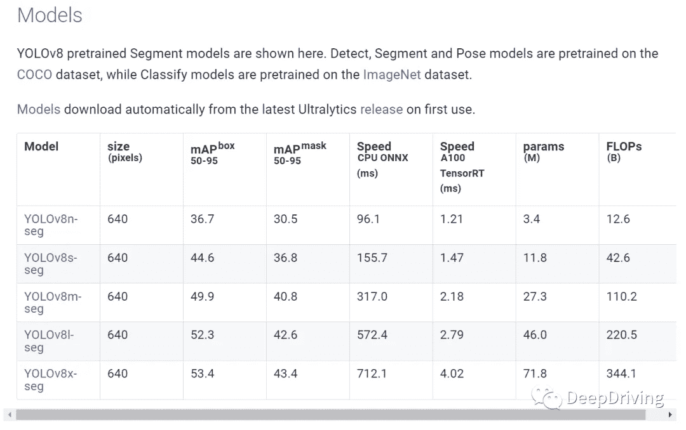
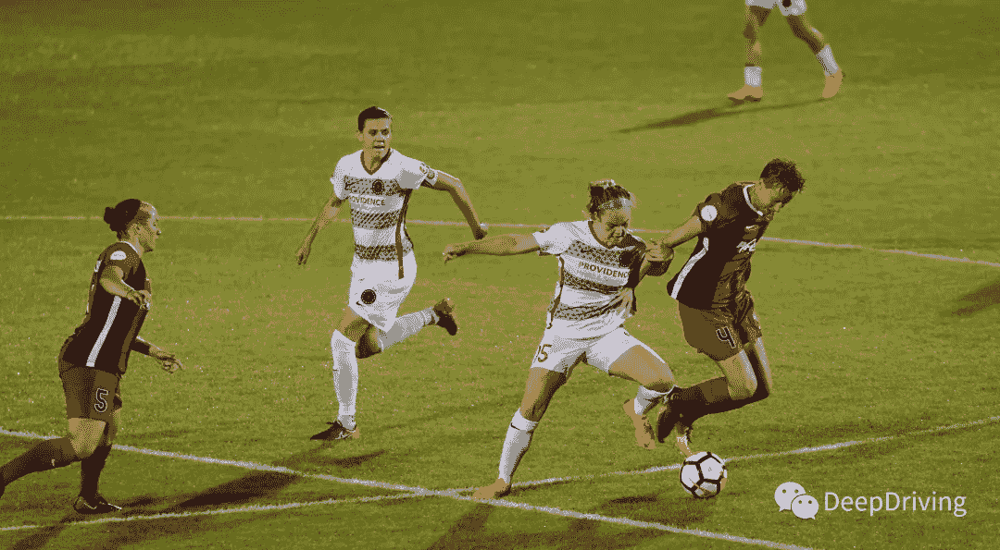
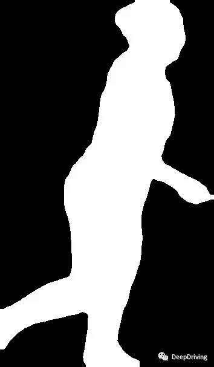
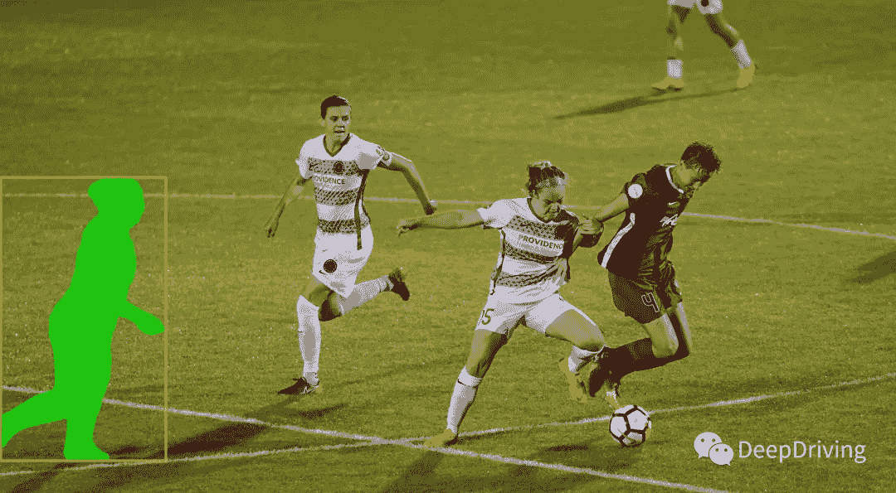
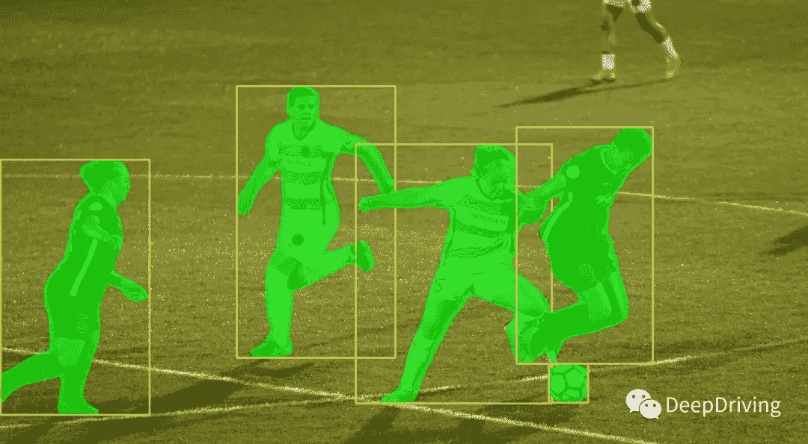
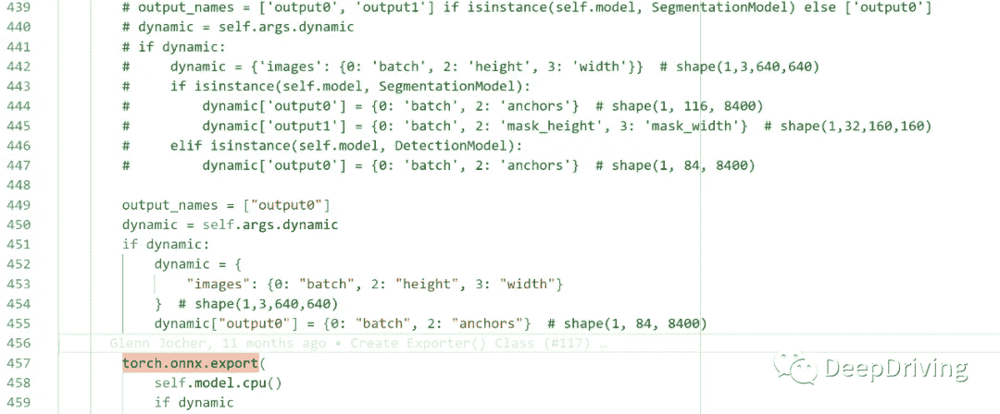
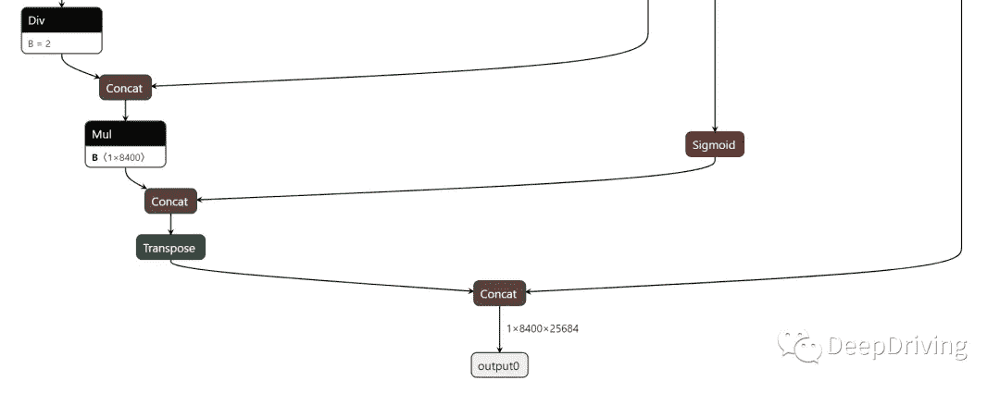

# AI模型部署 | onnxruntime部署YOLOv8分割模型详细教程

> 来源：[https://geekbang.feishu.cn/docx/UC5ldNQ3monnsZxYrHccVHXHnjF](https://geekbang.feishu.cn/docx/UC5ldNQ3monnsZxYrHccVHXHnjF)

> 👨🏻 作者：一天到晚潜水的鱼

> 📃 作者介绍：分享计算机视觉、机器学习、深度学习、无人驾驶等内容

> 🛖 👸号：DeepDriving

> ⏰ 收录时间：2024-05-27 11:20:58 (UTC+8)

> 🔗 原文链接： h[ttps://mp.weixin.q](https://mp.weixin.qq.com/s?__biz=MzkwNjE2ODMyMQ==&mid=2247485038&idx=1&sn=839b4a9d8ae1cb06a46d6739dc0c4405&chksm=c0edd700f79a5e16c3b2c5096458346df9a0eb9bc12bc4530129ed9ade1322bb5fc12d5897cb&token=1923064180&lang=zh_CN#rd)q.com/s?__biz=Mz...


关注作者，获取更多AI知识

##

### ** 0. 引言 **

我之前写的文章《 基于YOLOv8分割模型实现垃圾识别 》介绍了如何使用 YOLOv8 分割模型来实现垃圾识别，主要是介绍如何用自定义的数据集来训练 YOLOv8 分割模型。那么训练好的模型该如何部署呢？ YOLOv8 分割模型相比检测模型多了一个实例分割的分支，部署的时候还需要做一些后处理操作才能得到分割结果。

本文将详细介绍如何使用 onnxruntime 框架来部署 YOLOv8 分割模型，为了方便理解，代码采用 Python 实现。

### ** 1. 准备工作 **

+   **「安装onnxruntime」**

+   onnxruntime 分为 GPU 版本和 CPU 版本，均可以通过 pip 直接安装：

```
pip install onnxruntime-gpu  #安装GPU版本
pip install onnxruntime  #安装CPU版本
```

+   **「注意:」 **GPU 版本和 CPU 版本建议只选其中一个安装，否则默认会使用 CPU 版本 。

+   **「下载 ****YOLOv8**** 分割模型权重」**

+   Ultralytics 官方提供了用 COCO 数据集训练的模型权重，我们可以直接从官方网站 https://docs.ultralytics.com/tasks/segment/ 下载使用，本文使用的模型为 yolov8m-seg.pt 。



+   **「转换onnx模型」**

+   调用下面的命令可以把 YOLOv8m-seg.pt 模型转换为 onnx 格式的模型：

```
yolo task=segment mode=export model=yolov8m-seg.pt format=onnx
```

+   转换成功后得到的模型为 yolov8m-seg.onnx 。

### ** 2. 模型部署 **

#### ** 2.1 加载onnx模型 **

首先导入 onnxruntime 包，然后调用其 API 加载模型即可:

```
import onnxruntime as ort

session = ort.InferenceSession(&quot;yolov8m-seg.onnx&quot;, providers=[&quot;CUDAExecutionProvider&quot;])
```

因为我使用的是 GPU 版本的 onnxruntime ，所以 providers 参数设置的是 "CUDAExecutionProvider" ；如果是 CPU 版本，则需设置为 "CPUExecutionProvider" 。

模型加载成功后，我们可以查看一下模型的输入、输出层的属性：

```
for input in session.get_inputs():
    print(&quot;input name: &quot;, input.name)
    print(&quot;input shape: &quot;, input.shape)
    print(&quot;input type: &quot;, input.type)

for output in session.get_outputs():
    print(&quot;output name: &quot;, output.name)
    print(&quot;output shape: &quot;, output.shape)
    print(&quot;output type: &quot;, output.type)
```

结果如下：

```
input name:  images
input shape:  [1, 3, 640, 640]
input type:  tensor(float)
output name:  output0
output shape:  [1, 116, 8400]
output type:  tensor(float)
output name:  output1
output shape:  [1, 32, 160, 160]
output type:  tensor(float)
```

从上面的打印信息可以知道，模型有一个尺寸为 [1, 3, 640, 640] 的输入层和两个尺寸分别为 [1, 116, 8400] 和 [1, 32, 160, 160] 的输出层。

#### ** 2.2 数据预处理 **

数据预处理采用 OpenCV 和 Numpy 实现，首先导入这两个包

```
import cv2
import numpy as np
```

用 OpenCV 读取图片后，把数据按照 YOLOv8 的要求做预处理

```
image = cv2.imread(&quot;soccer.jpg&quot;)
image_height, image_width, _ = image.shape
input_tensor = prepare_input(image, model_width, model_height)
print(&quot;input_tensor shape: &quot;, input_tensor.shape)
```

其中预处理函数 prepare_input 的实现如下：

```
def prepare_input(bgr_image, width, height):
    image = cv2.cvtColor(bgr_image, cv2.COLOR_BGR2RGB)
    image = cv2.resize(image, (width, height)).astype(np.float32)
    image = image / 255.0
    image = np.transpose(image, (2, 0, 1))
    input_tensor = np.expand_dims(image, axis=0)
    return input_tensor
```

处理流程如下：

```
1. 把OpenCV读取的BGR格式的图片转换为RGB格式；
2. 把图片resize到模型输入尺寸640x640；
3. 对像素值除以255做归一化操作；
4. 把图像数据的通道顺序由HWC调整为CHW；
5. 扩展数据维度，将数据的维度调整为NCHW。
```

经过预处理后，输入数据 input_tensor 的维度变为 [1, 3, 640, 640] ，与模型的输入尺寸一致。

#### ** 2.3 模型推理 **

输入数据准备好以后，就可以送入模型进行推理：

```
outputs = session.run(None, {session.get_inputs()[0].name: input_tensor})
```

前面我们打印了模型的输入输出属性，可以知道模型有两个输出分支，其中一个 output0 是目标检测分支，另一个 output1 则是实例分割分支，这里打印一下它们的尺寸看一下

```
#squeeze函数是用于删除shape中为1的维度，对output0做transpose操作是为了方便后续操作
output0 = np.squeeze(outputs[0]).transpose()
output1 = np.squeeze(outputs[1])
print(&quot;output0 shape:&quot;, output0.shape)
print(&quot;output1 shape:&quot;, output1.shape)
```

结果如下：

```
output0 shape: (8400, 116)
output1 shape: (32, 160, 160)
```

处理后目标检测分支的维度为 [8400, 116] ，表示模型总共可以检测出 8400 个目标（大部分是无效的目标），每个目标包含 116 个参数。刚接触 YOLOv8 分割模型的时候可能会对 116 这个数字感到困惑，这里有必要解释一下：每个目标的参数包含 4 个坐标属性（ x,y,w,h ）、 80 个类别置信度和 32 个实例分割参数，所以总共是 116 个参数。实例分割分支的维度为 [32, 160, 160] ，其中第一个维度 32 与目标检测分支中的 32 个实例分割参数对应，后面两个维度则由模型输入的宽和高除以 4 得到，本文所用的模型输入宽和高都是 640 ，所以这两个维度都是 160 。

#### ** 2.4 后处理 **

首先把目标检测分支输出的数据分为两个部分，把实例分割相关的参数从中剥离。

```
boxes = output0[:, 0:84]
masks = output0[:, 84:]
print(&quot;boxes shape:&quot;, boxes.shape)
print(&quot;masks shape:&quot;, masks.shape)
```

```
boxes shape: (8400, 84)
masks shape: (8400, 32)
```

然后实例分割这部分数据 masks 要与模型的另外一个分支输出的数据 output1 做矩阵乘法操作，在这之前要把 output1 的维度变换为二维。

```
output1 = output1.reshape(output1.shape[0], -1)
masks = masks @ output1
print(&quot;masks shape:&quot;, masks.shape)
```

```
masks shape: (8400, 25600)
```

做完矩阵乘法后，就得到了 8400 个目标对应的实例分割掩码数据 masks ，可以把它与目标检测的结果 boxes 拼接到一起。

```
detections = np.hstack([boxes, masks])
print(&quot;detections shape:&quot;, detections.shape)
```

```
detections shape: (8400, 25684)
```

到这里读者应该就能理解清楚了， YOLOv8 模型总共可以检测出 8400 个目标，每个目标的参数包含 4 个坐标属性（ x,y,w,h ）、 80 个类别置信度和一个 160x160=25600 大小的实例分割掩码。

由于 YOLOv8 模型检测出的 8400 个目标中有大量的无效目标，所以先要通过置信度过滤去除置信度低于阈值的目标，对于满足置信度满足要求的目标还需要通过非极大值抑制（NMS）操作去除重复的目标。

```
objects = []
for row in detections:
    prob = row[4:84].max()
    if prob &lt; 0.5:
        continue
    class_id = row[4:84].argmax()
    label = COCO_CLASSES[class_id]
    xc, yc, w, h = row[:4]
    // 把x1, y1, x2, y2的坐标恢复到原始图像坐标
    x1 = (xc - w / 2) / model_width * image_width
    y1 = (yc - h / 2) / model_height * image_height
    x2 = (xc + w / 2) / model_width * image_width
    y2 = (yc + h / 2) / model_height * image_height
    // 获取实例分割mask
    mask = get_mask(row[84:25684], (x1, y1, x2, y2), image_width, image_height)
    // 从mask中提取轮廓
    polygon = get_polygon(mask, x1, y1)
    objects.append([x1, y1, x2, y2, label, prob, polygon, mask])

// NMS
objects.sort(key=lambda x: x[5], reverse=True)
results = []
while len(objects) &gt; 0:
    results.append(objects[0])
    objects = [object for object in objects if iou(object, objects[0]) &lt; 0.5]
```

这里重点讲一下获取实例分割掩码的过程。

前面说了每个目标对应的实例分割掩码数据大小为 160x160 ，但是这个尺寸是对应整幅图的掩码。对于单个目标来说，还要从这个 160x160 的掩码中去截取属于自己的掩码，截取的范围由目标的 box 决定。上面的代码得到的 box 是相对于原始图像大小，截取掩码的时候需要把 box 的坐标转换到相对于 160x160 的大小，截取完后再把这个掩码的尺寸调整回相对于原始图像大小。截取到 box 大小的数据后，还需要对数据做 sigmoid 操作把数值变换到 0 到 1 的范围内，也就是求这个 box 范围内的每个像素属于这个目标的置信度。最后通过阈值操作，置信度大于 0.5 的像素被当做目标，否则被认为是背景。

具体实现的代码如下：

```
def get_mask(row, box, img_width, img_height):
  mask = row.reshape(160, 160)
  x1, y1, x2, y2 = box
  // box坐标是相对于原始图像大小，需转换到相对于160*160的大小
  mask_x1 = round(x1 / img_width * 160)
  mask_y1 = round(y1 / img_height * 160)
  mask_x2 = round(x2 / img_width * 160)
  mask_y2 = round(y2 / img_height * 160)
  mask = mask[mask_y1:mask_y2, mask_x1:mask_x2]
  mask = sigmoid(mask)
  // 把mask的尺寸调整到相对于原始图像大小
  mask = cv2.resize(mask, (round(x2 - x1), round(y2 - y1)))
  mask = (mask &gt; 0.5).astype(&quot;uint8&quot;) * 255
  return mask
```

这里需要注意的是， 160x160 是相对于模型输入尺寸为 640x640 来的，如果模型输入是其他尺寸，那么上面的代码需要做相应的调整。

如果需要检测的是下面这个图片：



通过上面的代码可以得到最左边那个人的分割掩码为



但是我们需要的并不是这样一张图片，而是需要用于表示这个目标的轮廓，这可以通过 OpenCV 的 findContours 函数来实现。 findContours 函数返回的是一个用于表示该目标的点集，然后我们可以在原始图像中用 fillPoly 函数画出该目标的分割结果。



全部目标的检测与分割结果如下：



### ** 3. 一点其他的想法 **

从前面的部署过程可以知道，做后处理的时候需要对实例分割的数据做矩阵乘法、 sigmoid 激活、维度变换等操作，实际上这些操作也可以在导出模型的时候集成到 onnx 模型中去，这样就可以简化后处理操作。

首先需要修改 ultralytics 代码仓库中 ultralytics/nn/modules/head.py 文件的代码，把 Segment 类 Forward 函数最后的代码修改为：

```
if self.export:
    output1 = p.reshape(p.shape[0], p.shape[1], -1)
    boxes = x.permute(0, 2, 1)
    masks = torch.sigmoid(mc.permute(0, 2, 1) @ output1)
    out = torch.cat([boxes, masks], dim=2)
    return out
else:
    return (torch.cat([x[0], mc], 1), (x[1], mc, p))
```

然后修改 ultralytics/engine/exporter.py 文件中 torch.onnx.export 的参数，把模型的输出数量改为 1 个。



代码修改完成后，执行命令 pip install -e '.[dev]' 使之生效，然后再重新用 yolo 命令导出模型。用 netron 工具可以看到模型只有一个 shape 为 [1,8400,25684] 的输出。



这样在后处理的时候就可以直接去解析 box 和 mask 了，并且 mask 的数据不需要进行 sigmoid 激活。

### ** 4. 参考资料 **

+   How to implement instance segmentation using YOLOv8 neural network

+   https://github.com/AndreyGermanov/yolov8_segmentation_python