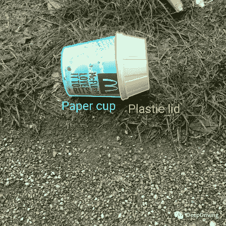
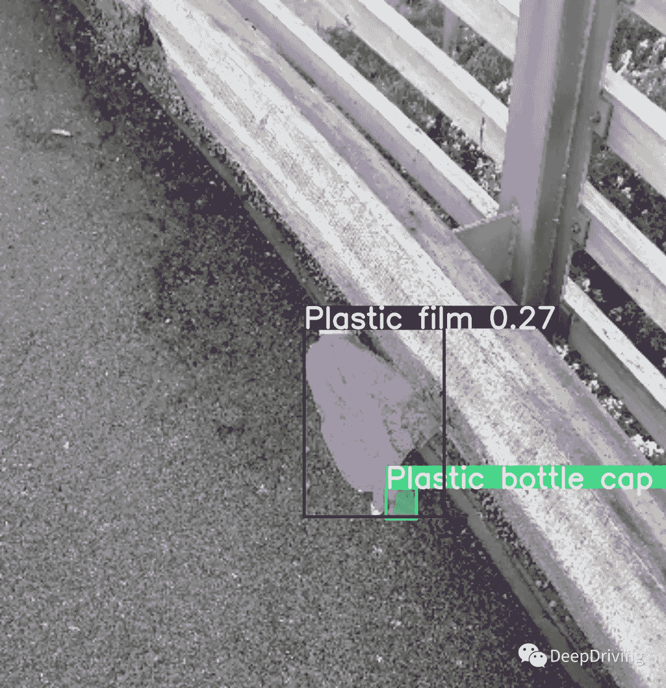
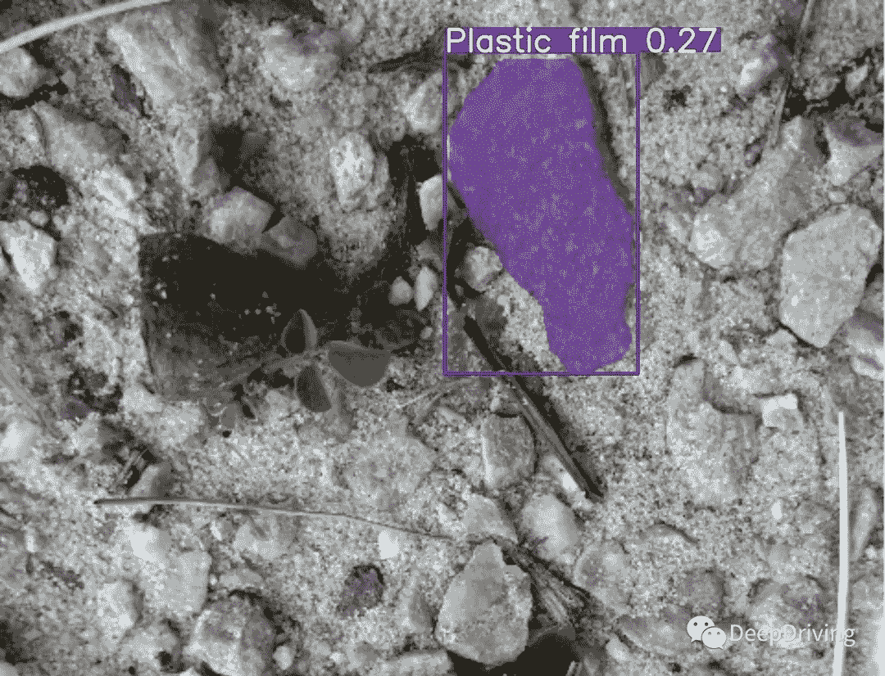

# 基于YOLOv8分割模型实现垃圾识别

> 来源：[https://geekbang.feishu.cn/docx/Ez5id4dMyoqHDgxbySycLYmmnqK](https://geekbang.feishu.cn/docx/Ez5id4dMyoqHDgxbySycLYmmnqK)

> 👨🏻 作者：一天到晚潜水的鱼

> 📃 作者介绍：分享计算机视觉、机器学习、深度学习、无人驾驶等内容

> 🛖 公众号：DeepDriving

> ⏰ 收录时间：2024-05-27 11:20:58 (UTC+8)

> 🔗 原文链接： h[ttps://mp.weixin.q](https://mp.weixin.qq.com/s?__biz=MzkwNjE2ODMyMQ==&mid=2247484976&idx=1&sn=22390d7995c75a7594d1026067cafc20&chksm=c0edd75ef79a5e481bf2211149b5d81120fff3542ba59c8f0aba8765819f3b840ba81d8737fa&token=1923064180&lang=zh_CN#rd)q.com/s?__biz=Mz...


关注作者，获取更多AI知识

##

### **0. 引言**

YOLOv8 是 Ultralytics 开源的一个非常火的 AI 算法，目前支持目标检测、实例分割、姿态估计等任务。如果对 YOLOv8 的安装和使用还不了解的可以参考我之前写的这篇文章：

YOLOv8初体验：检测、跟踪、模型部署

本文将介绍如何使用 YOLOv8 的分割模型实现垃圾识别，其中所使用的训练数据来自TACO垃圾数据集。

### ** 1. 数据集介绍 **

TACO 是一个包含在不同环境下（室内、树林、道路和海滩）拍摄的垃圾图像数据集，这些图像中的垃圾对象被精细地用方框和多边形进行了标注，标注信息采用与 COCO 数据集一样的格式，总共有 60 个类别，不过有的类别标注得很少甚至没有。下图是 TACO 数据集中的一些标注示例：



如果需要下载数据集，先执行下面的命令拉取官方的 GitHub 仓库：

```
git clone https://github.com/pedropro/TACO.git
```

然后用 Python 运行脚本即可下载数据集：

```
python3 download.py
```

如果下载过程中被中断了，只需重新执行 download 脚本即可继续下载。

### ** 2. 训练模型 **

#### ** 2.1 转换标注格式 **

TACO 数据集原始的标注信息被保存在一个名为 annotations.json 的文件中，在使用该数据集训练 YOLOv8 分割模型前，需要先把原始的标注信息转换为 YOLOv8 要求的格式。 YOLOv8 分割模型训练时需要的标注格式如下：

```
&lt;id&gt; &lt;x_1&gt; &lt;y_1&gt; ... &lt;x_n&gt; &lt;y_n&gt;
```

一个对象的标注信息放在一行，首先是该对象类别的 id （从 0 开始算），接着将多边形各点像素坐标的 x 和 y 值依次排列，其中 x 和 y 的值需要分别除以图像的宽度和高度进行归一化，一幅图像的所有标注信息放在一个与图像同名的 txt 文件中。

进行格式转换后， txt 文件中的内容类似于这样：

```
5 0.5183 0.4892 0.5480 0.4840 0.4840 0.5627 0.4840 0.5724 0.4853 0.5822 0.4879 0.5900
7 0.6227 0.5211 0.6232 0.5250 0.5074 0.6154 0.5081 0.6183 0.5107 0.5068 0.6120 0.6290
```

用于格式转换的关键 Python 代码如下：

```
img = cv2.imread(image_path)
height, width, _ = img.shape

label_writer = open(label_path, &quot;w&quot;)
for annotation in annotations:
    category_id = annotation[&quot;category_id&quot;]
    seg_labels = []
    for segmentation in annotation[&quot;segmentation&quot;]:
        points = np.array(segmentation).reshape((int(len(segmentation) / 2), 2))
        for point in points:
            x = point[0] / width
            y = point[1] / height
            seg_labels.append(x)
            seg_labels.append(y)
    label_writer.write(str(category_id) + &quot; &quot; + &quot; &quot;.join([str(a) for a in seg_labels]) + &quot;\n&quot;)
label_writer.close()
```

#### ** 2.2 创建配置文件 **

首先仿照 ultralytics/cfg/datasets/coco128-seg.yaml 创建一个 TACO 数据集的配置文件 taco-seg.yaml ，文件内容如下：

```
path: /home/test/TACO/data  #数据集所在的目录
train: train.txt  # 训练集路径，相对于path目录
val: val.txt  # 验证集路径，相对于path目录
test:  test.txt # 测试集路径，相对于path目录，可以不写

# 类别id和名称
names:
  0: Aluminium foil
  1: Battery
  2: Aluminium blister pack
  3: Carded blister pack
  4: Other plastic bottle
  5: Clear plastic bottle
  6: Glass bottle
  7: Plastic bottle cap
  8: Metal bottle cap
  9: Broken glass
  10: Food Can
  ...
```

数据集的设置的方式有几种形式，我的方式是建立 images 和 labels 两个目录，分别用于存放图像和 txt 标注文件，然后把数据集按照 8:1:1 的比例划分训练集、验证集、测试集，再把三个数据集图片的绝对路径分别写入 train.txt 、 val.txt 和 test.txt 三个文件中。所以上面的 taco-seg.yaml 文件中设置的路径 path 就是 train.txt 、 val.txt 和 test.txt 这三个文件所在的目录，这三个文件中包含的是对应数据集中图片的绝对路径，类似于这样：

```
/home/test/TACO/data/images/batch_13/000077.jpg
/home/test/TACO/data/images/batch_11/000032.jpg
/home/test/TACO/data/images/batch_15/000073.jpg
```

配置好数据集后，还要设置模型参数。首先将 ultralytics/cfg/models/v8/yolov8-seg.yaml 文件拷贝一份，命名为 yolov8-seg-taco.yaml ，然后把文件中的类别数量 nc 从 80 改为 TACO 数据集的 60 ：

```
...
# Parameters
nc: 60  # number of classes
scales: # model compound scaling constants, i.e. &#x27;model=yolov8n-seg.yaml&#x27; will call yolov8-seg.yaml with scale &#x27;n&#x27;
  # [depth, width, max_channels]
  n: [0.33, 0.25, 1024]
  s: [0.33, 0.50, 1024]
  m: [0.67, 0.75, 768]
  l: [1.00, 1.00, 512]
  x: [1.00, 1.25, 512]

...
```

其他有关模型结构的参数如果没有必要就不需要修改了。

#### ** 2.3 训练 **

训练 YOLOv8 可以使用命令行也可以编写 Python 代码实现，个人觉得还是使用命令行比较方便，所以本文采用命令行的方式进行训练，调用的命令如下：

```
yolo task=segment mode=train data=taco-seg.yaml model=yolov8n-seg-taco.yaml epochs=100 batch=16 imgsz=640 device=0 name=taco-seg
```

这里 data 参数用于指定数据集配置文件， model 参数用于指定模型配置文件，如果不知道有哪些参数可以参考 ultralytics/cfg/default.yaml 文件，这个文件里面包含所有需要的参数。需要注意的是，我这里指定的模型配置文件名为 yolov8n-seg-taco.yaml ，但是前面我创建的文件名为 yolov8-seg-taco.yaml ，这是为什么呢？因为我这里想使用的模型是 yolov8n 。假如我想使用 yolov8x 模型，那么训练的时候设置参数 model=yolov8x-seg-taco.yaml 就可以了。

训练的结果保存在 runs/segment/taco-seg 目录下，其中权重保存在该目录下的 weights 文件夹中。

### ** 3. 结果 **

训练完成后，我们可以调用命令测试一下模型的效果：

```
yolo task=segment mode=predict model=runs/segment/taco-seg/weights/best.pt source=/home/test/TACO/data/images/batch_9/000096.jpg show=True
```

下面是我在测试集的两张图片上测试的结果：



