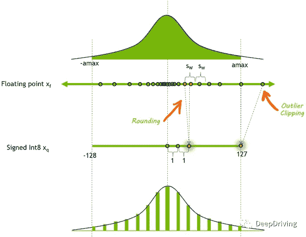
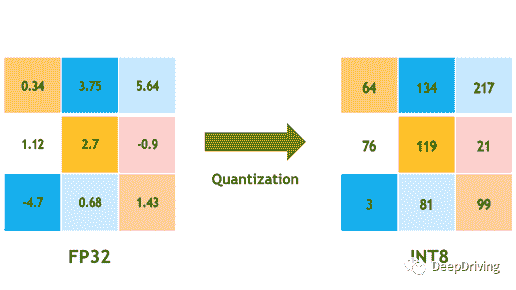
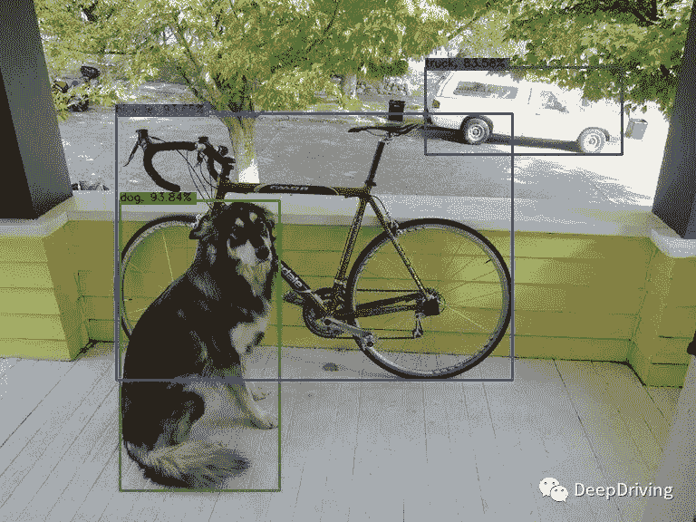
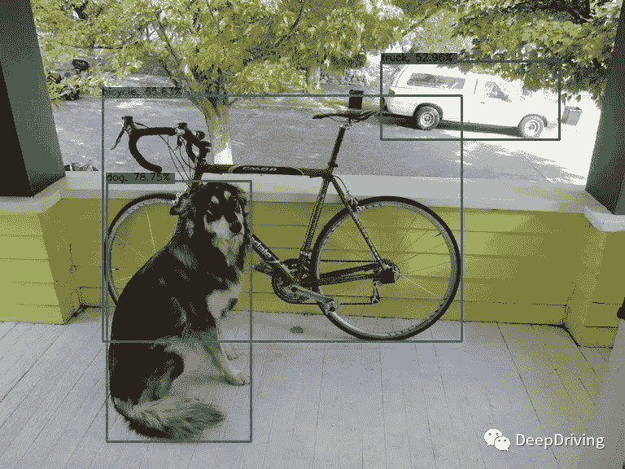

# AI模型部署 | TensorRT模型INT8量化的Python实

> 来源：[https://geekbang.feishu.cn/docx/Iv3zdMRbcoHJroxLp0tc4ZO7ndh](https://geekbang.feishu.cn/docx/Iv3zdMRbcoHJroxLp0tc4ZO7ndh)

> 👨🏻 作者：一天到晚潜水的鱼

> 📃 作者介绍：分享计算机视觉、机器学习、深度学习、无人驾驶等内容

> 🛖 👸号：DeepDriving

> ⏰ 收录时间：2024-05-27 11:20:58 (UTC+8)

> 🔗 原文链接： h[ttps://mp.weixin.q](https://mp.weixin.qq.com/s?__biz=MzkwNjE2ODMyMQ==&mid=2247484947&idx=1&sn=5ead86f785827dd7d55b7dec843fd7a1&chksm=c0edd77df79a5e6bb02972f2a431a9fa0d450def886d0d45930e89fb9be7a5bd6ff3acd8ad47&token=1923064180&lang=zh_CN#rd)q.com/s?__biz=Mz...


关注作者，获取更多AI知识

### **概述 **

目前深度学习模型的参数在训练阶段基本上都是采用 32 位浮点（ FP32 ）来表示，以便能有更大的动态范围用于在训练过程中更新参数。然而在推理阶段，采用 FP32 的精度会消耗较多的计算资源和内存空间，为此，在部署模型的时候往往会采用降低模型精度的方法，用 16 位浮点（ FP16 ）或者 8 位有符号整型（ INT8 ）来表示。从 FP32 转换为 FP16 一般不会有什么精度损失，但是 FP32 转换为 INT8 则可能会造成较大的精度损失，尤其是当模型的权重分布在较大的动态范围内时。



虽然有一定的精度损失，但是转换为 INT8 也会带来很多好处，比如减少对存储空间、内存、 CPU 的占用，提升计算吞吐量等，这在计算资源受限的嵌入式平台是很有意义的。

把模型参数张量从 FP32 转换为 INT8 ，也就是将浮点张量的动态范围映射到 [-128,127] 的范围，可以使用下面的公式：

其中，  和  分别代表截断和取整操作。从上面的公式可以看出，把 FP32 转换为 INT8 的关键是需要设置一个比例因子  来做映射，这个映射过程就叫做量化，上面的公式是对称量化的公式。



量化的关键在于寻找一个合适的比例因子，使得量化后的模型精度尽量接近原始模型。对模型进行量化的方式有两种：

+   **「训练后量化」 **（ **Post-**training quantization，PTQ ）是在模型训练好后，再通过一个 「校准」 （ Calibration ）流程去计算比例因子，从而实现量化过程。

+   **「量化感知训练」 **（ Quantization-aware training，QAT ）是在模型训练过程中去计算比例因子，允许在训练过程中补偿量化和反量化操作带来的精度误差。

本文只介绍如何调用 TensorRT 的 Python 接口实现 INT8 量化。关于 INT8 量化的理论知识，由于牵涉的内容比较多，等我有空再专门写一篇文章来做介绍。

###  TensorRT INT8量化的具体实现

#### ** TensorRT中的校准器 **

在训练后量化过程中， TensorRT 需要计算模型中每个张量的比例因子，这个过程被称为校准。校准过程中需要提供具有代表性的数据，以便 TensorRT 在这个数据集上运行模型然后收集每个张量的统计信息用于寻找一个最佳的比例因子。寻找最佳比例因子需要平衡离散化误差（随着每个量化值表示的范围变大而变大）和截断误差（其值被限制在可表示范围的极限内）这两个误差源， TensorRT 提供了几种不同的校准器：

+   「IInt8EntropyCalibrator2」 ：当前推荐的熵校准器，默认情况下校准发生在层融合之前，推荐用于 CNN 模型中。

+   「IInt8MinMaxCalibrator」 ：该校准器使用激活分布的整个范围来确定比例因子，默认情况下校准发生在层融合之前，推荐用于 NLP 任务的模型中。

+   「IInt8EntropyCalibrator」 ：该校准器是 TensorRT 最原始的熵校准器，默认情况下校准发生在层融合之后，目前已不推荐使用。

+   「IInt8LegacyCalibrator」 ：该校准器需要用户进行参数化，默认情况下校准发生在层融合之后，不推荐使用。

TensorRT 构建 INT8 模型引擎时，会执行下面的步骤：

1.  构建一个 32 位的模型引擎，然后在校准数据集上运行这个引擎，然后为每个张量激活值的分布记录一个直方图；

1.  从直方图构建一个校准表，为每个张量计算出一个比例因子；

1.  根据校准表和模型的定义构建一个 INT8 的引擎。

校准的过程可能会比较慢，不过第二步生成的校准表可以输出到文件并可以被重用，如果校准表文件已存在，那么校准器就直接从该文件中读取校准表而无需执行前面两步。另外，与引擎文件不同的是，校准表是可以跨平台使用的。因此，我们在实际部署模型过程中可以先在带通用 GPU 的计算机上生成校准表，然后在 Jetson Nano 等嵌入式平台上去使用。为了编码方便，我们可以用 Python 编程来实现 INT8 量化过程来生成校准表。

#### ** 具体实现 **

##### ** 1. 加载校准数据 **

首先定义一个数据加载类用于加载校准数据，这里的校准数据为 JPG 格式的图片，图片读取后需要根据模型的输入数据要求进行缩放、归一化、交换通道等预处理操作：

```
class CalibDataLoader:
    def __init__(self, batch_size, width, height, calib_count, calib_images_dir):
        self.index = 0
        self.batch_size = batch_size
        self.width = width
        self.height = height
        self.calib_count = calib_count
        self.image_list = glob.glob(os.path.join(calib_images_dir, &quot;*.jpg&quot;))
        assert (
            len(self.image_list) &gt; self.batch_size * self.calib_count
        ), &quot;{} must contains more than {} images for calibration.&quot;.format(
            calib_images_dir, self.batch_size * self.calib_count
        )
        self.calibration_data = np.zeros((self.batch_size, 3, height, width), dtype=np.float32)

    def reset(self):
        self.index = 0

    def next_batch(self):
        if self.index &lt; self.calib_count:
            for i in range(self.batch_size):
                image_path = self.image_list[i + self.index * self.batch_size]
                assert os.path.exists(image_path), &quot;image {} not found!&quot;.format(image_path)
                image = cv2.imread(image_path)
                image = Preprocess(image, self.width, self.height)
                self.calibration_data[i] = image
            self.index += 1
            return np.ascontiguousarray(self.calibration_data, dtype=np.float32)
        else:
            return np.array([])

    def __len__(self):
        return self.calib_count
```

预处理操作代码如下：

```
def Preprocess(input_img, width, height):
    img = cv2.cvtColor(input_img, cv2.COLOR_BGR2RGB)
    img = cv2.resize(img, (width, height)).astype(np.float32)
    img = img / 255.0
    img = np.transpose(img, (2, 0, 1))
    return img
```

##### ** 2. 实现校准器 **

想要实现校准器的功能，需继承 TensorRT 提供的四个校准器类中的一个，然后重写父校准器的几个方法：

+   get_batch_size : 用于获取 batch 的大小

+   get_batch : 用于获取一个 batch 的数据

+   read_calibration_cache : 用于从文件中读取校准表

+   write_calibration_cache : 用于把校准表从内存中写入文件中

由于我需要量化的是 CNN 模型，所以选择继承 IInt8EntropyCalibrator2 校准器：

```
import tensorrt as trt
import pycuda.driver as cuda
import pycuda.autoinit

class Calibrator(trt.IInt8EntropyCalibrator2):
    def __init__(self, data_loader, cache_file=&quot;&quot;):
        trt.IInt8EntropyCalibrator2.__init__(self)
        self.data_loader = data_loader
        self.d_input = cuda.mem_alloc(self.data_loader.calibration_data.nbytes)
        self.cache_file = cache_file
        data_loader.reset()

    def get_batch_size(self):
        return self.data_loader.batch_size

    def get_batch(self, names):
        batch = self.data_loader.next_batch()
        if not batch.size:
            return None
        # 把校准数据从CPU搬运到GPU中
        cuda.memcpy_htod(self.d_input, batch)

        return [self.d_input]

    def read_calibration_cache(self):
        # 如果校准表文件存在则直接从其中读取校准表
        if os.path.exists(self.cache_file):
            with open(self.cache_file, &quot;rb&quot;) as f:
                return f.read()

    def write_calibration_cache(self, cache):
        # 如果进行了校准，则把校准表写入文件中以便下次使用
        with open(self.cache_file, &quot;wb&quot;) as f:
            f.write(cache)
            f.flush()
```

##### ** 3. 生成INT8引擎 **

关于生成 FP32 模型引擎的流程我之前在一篇文章里专门介绍过，不过那篇文章里是用 C++ 实现的。调用 Python 接口实现其实更简单，具体代码如下：

```
def build_engine():
    builder = trt.Builder(TRT_LOGGER)
    network = builder.create_network(1 &lt;&lt; (int)(trt.NetworkDefinitionCreationFlag.EXPLICIT_BATCH))
    config = builder.create_builder_config()
    parser = trt.OnnxParser(network, TRT_LOGGER)
    assert os.path.exists(onnx_file_path), &quot;The onnx file {} is not found&quot;.format(onnx_file_path)
    with open(onnx_file_path, &quot;rb&quot;) as model:
        if not parser.parse(model.read()):
            print(&quot;Failed to parse the ONNX file.&quot;)
            for error in range(parser.num_errors):
                print(parser.get_error(error))
            return None

    print(&quot;Building an engine from file {}, this may take a while...&quot;.format(onnx_file_path))

    # build tensorrt engine
    config.set_memory_pool_limit(trt.MemoryPoolType.WORKSPACE, 1 * (1 &lt;&lt; 30))  
    if mode == &quot;INT8&quot;:
        config.set_flag(trt.BuilderFlag.INT8)
        calibrator = Calibrator(data_loader, calibration_table_path)
        config.int8_calibrator = calibrator
    else mode == &quot;FP16&quot;:
        config.set_flag(trt.BuilderFlag.FP16)

    engine = builder.build_engine(network, config)
    if engine is None:
        print(&quot;Failed to create the engine&quot;)
        return None
    with open(engine_file_path, &quot;wb&quot;) as f:
        f.write(engine.serialize())

    return engine
```

上面的代码首先用 OnnxParser 去解析模型，然后通过 config 设置引擎的精度。如果是构建 INT8 引擎，那么需要设置相应的 Flag ，并且要把之前实现的校准器对象传入其中，这样在构建引擎时 TensorRT 就会自动读取校准数据去生成校准表。

### ** 测试结果 **

为了验证 INT8 量化的效果，我用 YOLOv5 的几个模型在 GeForce GTX 1650 Ti 显卡上做了一下对比测试。不同精度的推理耗时测试结果如下：

| **模型** | **输入尺寸** | **模型精度** | **推理耗时（ms）** |
| --- | --- | --- | --- |
| yolov5s.onnx | 640x640 | INT8 | 7 |
| yolov5m.onnx | 640x640 | INT8 | 10 |
| yolov5l.onnx | 640x640 | INT8 | 15 |
| yolov5s.onnx | 640x640 | FP32 | 12 |
| yolov5m.onnx | 640x640 | FP32 | 23 |
| yolov5l.onnx | 640x640 | FP32 | 45 |

yolov5l 模型 FP32 和 INT8 精度的目标检测结果分别如下面两张图片所示：





可以看到，检测结果还是比较接近的。

### ** 参考资料 **

1.  https://developer.nvidia.com/zh-cn/blog/tensorrt-int8-cn/

1.  https://developer.nvidia.com/blog/chieving-fp32-accuracy-for-int8-inference-using-quantization-aware-training-with-tensorrt/

1.  https://docs.nvidia.com/deeplearning/tensorrt/archives/tensorrt-861/developer-guide/index.html#working-with-int8

1.  https://github.com/xuanandsix/Tensorrt-int8-quantization-pipline.git