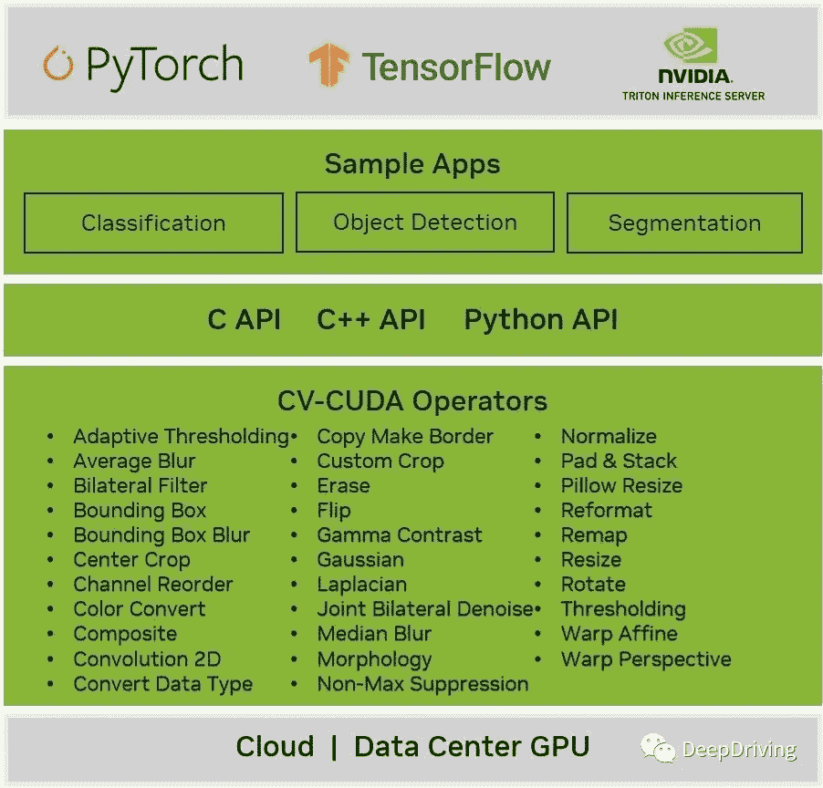
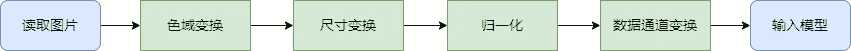

# AI模型部署实战 | 利用CV-CUDA加速视觉模型部署流程

> 来源：[https://geekbang.feishu.cn/docx/NhBOdhahOoIMwix8XTCcpYCEn3c](https://geekbang.feishu.cn/docx/NhBOdhahOoIMwix8XTCcpYCEn3c)

> 👨🏻 作者：一天到晚潜水的鱼

> 📃 作者介绍：分享计算机视觉、机器学习、深度学习、无人驾驶等内容

> 🛖 👸号：DeepDriving

> ⏰ 收录时间：2024-05-27 11:20:58 (UTC+8)

> 🔗 原文链接： h[ttps://mp.weixin.q](https://mp.weixin.qq.com/s?__biz=MzkwNjE2ODMyMQ==&mid=2247484932&idx=1&sn=83003d5a0a5acc7c8b1c2600a2bd848f&chksm=c0edd76af79a5e7c1954651ef2169523fe8c3a653e5f86a62d95a07477be969ae99611cea296&token=1923064180&lang=zh_CN#rd)q.com/s?__biz=Mz...


关注作者，获取更多AI知识

### ** ****CV-CUDA简介 **

随着深度学习技术在计算机视觉领域的发展，越来越多的 AI 算法模型被用于目标检测、图像分割、图像生成等任务中，如何高效地在云端或者边缘设备上部署这些模型是工程师迫切需要解决的问题。一个完整的 AI 模型部署流程一般分为三个阶段：预处理、模型推理、后处理，一般情况下会把模型推理放在 GPU 或者专用的硬件上进行处理，预处理和后处理则是放在 CPU 上。对于一个计算机视觉任务来说，预处理和后处理操作往往会消耗较多的 CPU 资源且非常耗时，这点在嵌入式平台上尤其明显，如果可以将预处理和后处理的这些操作放到 GPU 上去实现将会极大地提升整个流程的执行效率。


CV-CUDA 是由英伟达和字节跳动联合开发的一个开源库，该库提供了一组专门的 GPU 运算符用于加速图像处理和计算机视觉算法，以实现高效的预处理和后处理过程，从而显著提高视觉 AI 任务的整体吞吐量。 CV-CUDA 库的主要特性包括：

+   一套统一、专业的高性能计算机视觉和图像处理运算符

+   支持 C/C++ 和 Python 这 3 种编程语言的 API

+   支持批处理

+   为 PyTorch 和 TensorFlow 提供零拷贝接口

+   提供端到端的计算机视觉应用样例



代码仓库地址：https://github.com/CVCUDA/CV-CUDA

在线文档地址：https://cvcuda.github.io/

**本文将以部署 ****YOLOv6**** 目标检测模型为例介绍 ****CV-CUDA** 在计算机视觉任务中的应用，代码获取方式见文末 。

### ** ****CV-CUDA的具体应用 **

#### ** OpenCV图像预处理 **

我之前写了一篇介绍如何用 TensorRT 部署 YOLOv6 的文章： 如何用TensorRT部署YOLOv6 。在这篇文章中，图像的预处理都是通过调用 OpenCV 的函数在 CPU 上实现的，在介绍用 CV-CUDA 做图像预处理之前，让我们先来回顾一下图像预处理需要做的操作。



如上图所示，一般计算机视觉任务中的图像预处理包含以下操作：

+   色域变换：读取图片后，一般需要做色域变换，比如用 OpenCV 读取的图片格式为 BGR ,但是模型需要的格式为 RGB ， OpenCV 中做色域变换的函数为 cvtColor 。

+   尺寸变换：原始图像的尺寸一般都不与模型要求的输入尺寸不一致，所以需要做尺寸变换， OpenCV 中做尺寸变换的函数为 resize 。

+   归一化：在训练模型的时候需要的是浮点型数据，并且要对图像像素值除以 255 进行归一化， OpenCV 中可以调用函数 convertTo 实现。

+   数据通道顺序变换：原始图像的数据通道为 HWC ，但是一般模型要求的数据通道顺序为 CHW ，所以要对数据通道顺序进行重排。

#### ** CV-CUDA使用方法 **

CV-CUDA 目前最新版本为 v0.3.0 ，官方要求在如下软件环境中运行：

+   Ubuntu >= 20.04

+   CUDA driver >= 11.7 （实测 CUDA 11.6 也可以）

首先从 CV-CUDA 的GitHub仓库中下载下面两个包

+   nvcv-dev-0.3.0_beta-cuda11-x86_64-linux.tar.xz

+   nvcv-lib-0.3.0_beta-cuda11-x86_64-linux.tar.xz

然后用下面的命令进行解压：

```
tar -xvf nvcv-dev-0.3.0_beta-cuda11-x86_64-linux.tar.xz
tar -xvf nvcv-lib-0.3.0_beta-cuda11-x86_64-linux.tar.xz
```

解压后会在 opt/nvidia/cvcuda0 目录下生成 CV-CUDA 的头文件和库文件。

CV-CUDA 的使用方法可以参考GitHub仓库中 samples/classification 目录下的样例。在 CV-CUDA 中， GPU 上的数据都用 nvcv::Tensor 来表示，图像预处理操作需要用到两个 Tensor ：原始输入图像 Tensor 和模型输入数据 Tensor 。这两个 Tensor 可以根据原始输入图像的尺寸和模型输入尺寸预先构建好：

```
// Allocating memory for input image batch
nvcv::TensorDataStridedCuda::Buffer inBuf;
const int input_channels = input_image.channels();
const int input_width = input_image.cols;
const int input_height = input_image.rows;
inBuf.strides[3] = sizeof(uint8_t);
inBuf.strides[2] = input_channels * inBuf.strides[3];
inBuf.strides[1] = input_width * inBuf.strides[2];
inBuf.strides[0] = input_height * inBuf.strides[1];
cudaMalloc(&amp;inBuf.basePtr, 1 * inBuf.strides[0]);
nvcv::Tensor::Requirements inReqs = nvcv::Tensor::CalcRequirements(
    1, {input_width, input_height}, nvcv::FMT_BGR8);

nvcv::TensorDataStridedCuda inData(
    nvcv::TensorShape{inReqs.shape, inReqs.rank, inReqs.layout},
    nvcv::DataType{inReqs.dtype}, inBuf);
nvcv::TensorWrapData input_image_tensor(inData);

// Allocate input layer buffer based on input layer dimensions and batch size
// Calculates the resource requirements needed to create a tensor with given
// shape
nvcv::Tensor::Requirements reqsInputLayer = nvcv::Tensor::CalcRequirements(
    1, {model_width_, model_height_}, nvcv::FMT_RGBf32p);
// Calculates the total buffer size needed based on the requirements
int64_t inputLayerSize = nvcv::CalcTotalSizeBytes(
    nvcv::Requirements{reqsInputLayer.mem}.cudaMem());
nvcv::TensorDataStridedCuda::Buffer bufInputLayer;
std::copy(reqsInputLayer.strides,
        reqsInputLayer.strides + NVCV_TENSOR_MAX_RANK,
        bufInputLayer.strides);
// Allocate buffer size needed for the tensor
cudaMalloc(&amp;bufInputLayer.basePtr, inputLayerSize);
// Wrap the tensor as a CVCUDA tensor
nvcv::TensorDataStridedCuda inputLayerTensorData(
    nvcv::TensorShape{reqsInputLayer.shape, reqsInputLayer.rank,
                    reqsInputLayer.layout},
    nvcv::DataType{reqsInputLayer.dtype}, bufInputLayer);
nvcv::TensorWrapData model_input_tensor(inputLayerTensorData);
```

构建好原始输入图像的 Tensor 后，先把图像数据拷贝到 Tensor 中，

```
// copy image data to tensor
  auto input_image_data =
      input_image_tensor.exportData&lt;nvcv::TensorDataStridedCuda&gt;();
  cudaMemcpy(input_image_data-&gt;basePtr(), input_image.data,
             input_image_data-&gt;stride(0), cudaMemcpyHostToDevice);
```

然后就可以调用 CV-CUDA 中的算子对数据进行处理了。

下面以尺寸变换为例介绍 CV-CUDA 中算子的使用方法。 CV-CUDA 中尺寸变换对应的算子类为 cvcuda::Resize ，在调用算子之前需要为其构建一个 Tensor 保存算子输出的数据：

```
nvcv::Tensor resizedTensor(batch_size, {width, height}, nvcv::FMT_BGR8);
```

算子调用的方式非常简单，只需要两行代码：

```
cvcuda::Resize resizeOp;
resizeOp(stream_, input_image_tensor, resizedTensor,NVCV_INTERP_LINEAR);
```

可以看到，上面两个的代码只做了两件事：创建 cvcuda::Resize 对象 resizeOp 、调用 () 操作符。具体怎么实现的呢？有兴趣的话看看源码分析一下，我这里就不贴代码了。主要思想就是上层 cvcuda::Resize 类在构造函数中创建底层 CUDA 算子对象，然后在 () 操作符重载函数中调用 CUDA 算子的执行函数去执行算子的具体操作，其它算子都是这样的设计方式，所以用 CV-CUDA 做图像预处理其实非常简单，需要用到的算子如下：

+   色域变换： cvcuda::CvtColor

+   尺寸变换： cvcuda::Resize

+   归一化： cvcuda::ConvertTo

+   数据通道顺序变换： cvcuda::Reformat

整个预处理流程的代码如下：

```
const int batch_size = 1;

// Resize to the dimensions of input layer of network
nvcv::Tensor resizedTensor(batch_size, {width, height}, nvcv::FMT_BGR8);
cvcuda::Resize resizeOp;
resizeOp(stream, input_image_tensor), resizedTensor,
        NVCV_INTERP_LINEAR);

// convert BGR to RGB
nvcv::Tensor rgbTensor(batch_size, {width, height}, nvcv::FMT_RGB8);
cvcuda::CvtColor cvtColorOp;
cvtColorOp(stream, resizedTensor, rgbTensor, NVCV_COLOR_BGR2RGB);

// Convert to data format expected by network (F32). Apply scale 1/255.
nvcv::Tensor floatTensor(batch_size, {width, height}, nvcv::FMT_RGBf32);
cvcuda::ConvertTo convertOp;
convertOp(stream, rgbTensor, floatTensor, 1.0 / 255.0, 0.0);

// Convert the data layout from HWC to CHW
cvcuda::Reformat reformatOp;
reformatOp(stream, floatTensor, model_input_tensor);
```

以上就是用 CV-CUDA 做图像预处理的全部代码，是不是非常简单？

### ** ****总结 **

本文以 YOLOv6 目标检测中的图像预处理为例介绍了 CV-CUDA 在计算机视觉任务中的应用，还有很多算子本文没有做介绍，感兴趣的读者可以直接查看 CV-CUDA 的文档和代码学习使用。目前 CV-CUDA 只提供 x86 版本的库，如果能提供 arm 版本的就更好了，毕竟在嵌入式平台上才是刚需（在嵌入式平台上用源码进行编译我还没试过，有兴趣的读者可以试一下）。