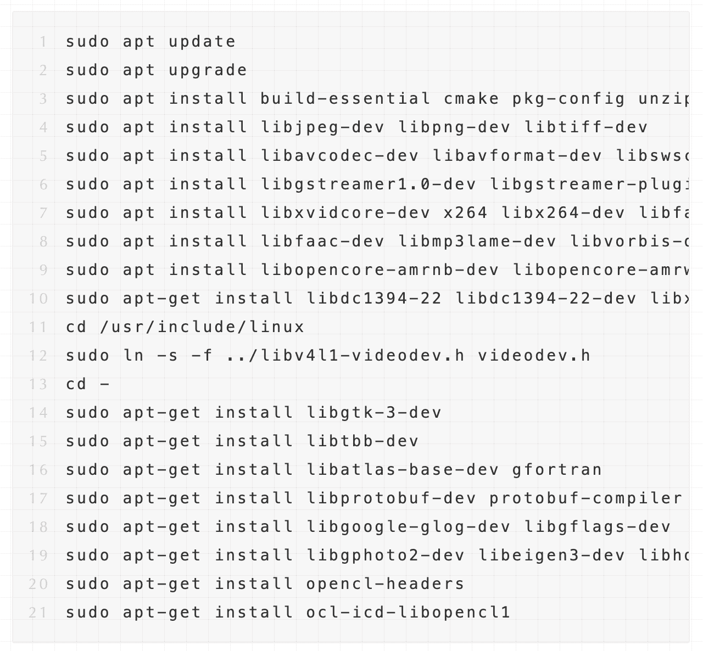
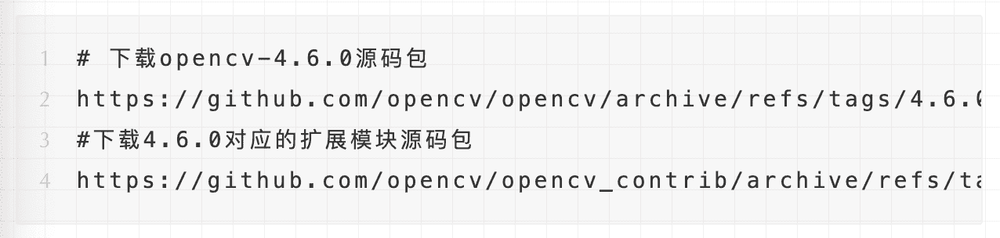
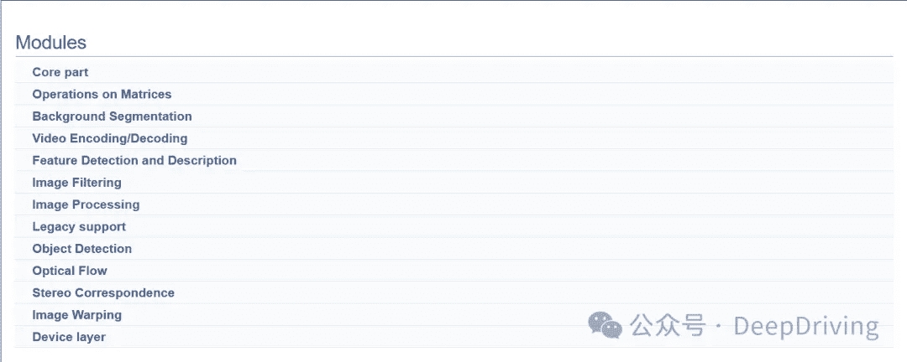
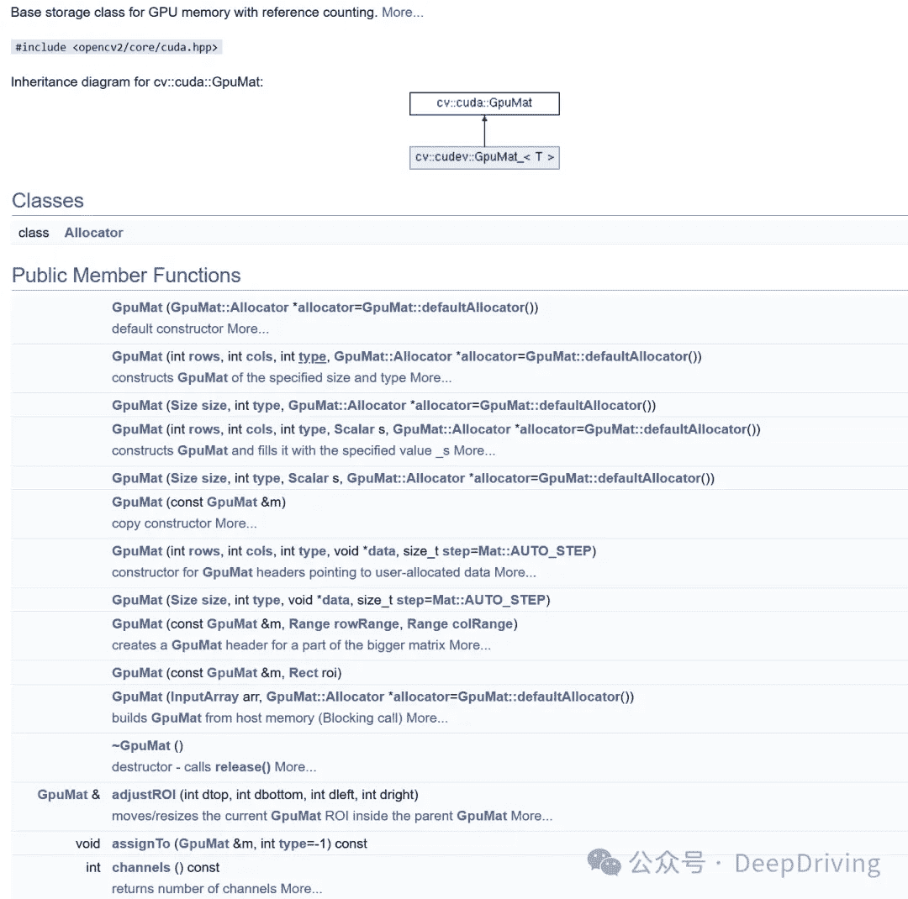
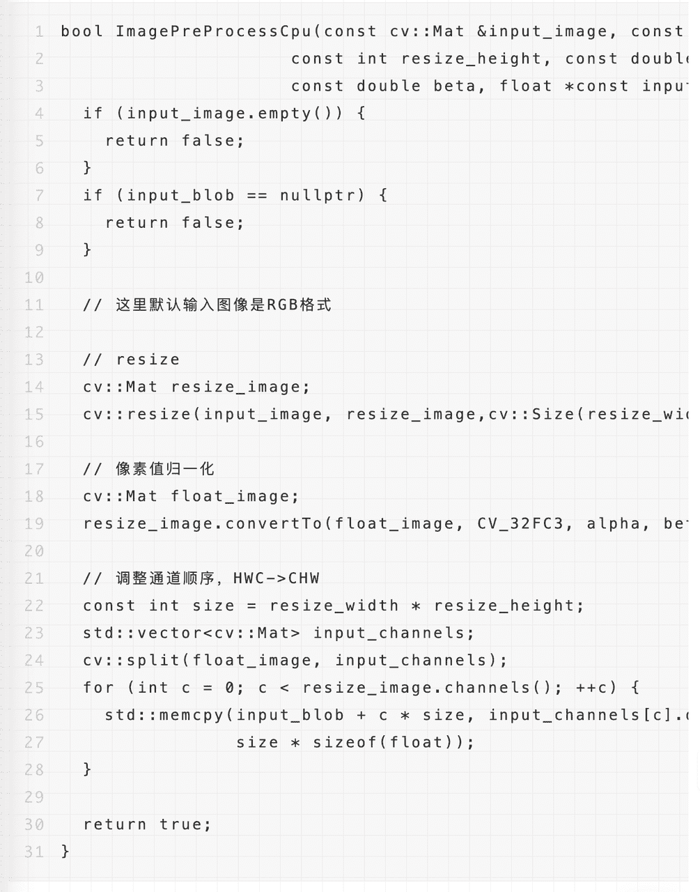
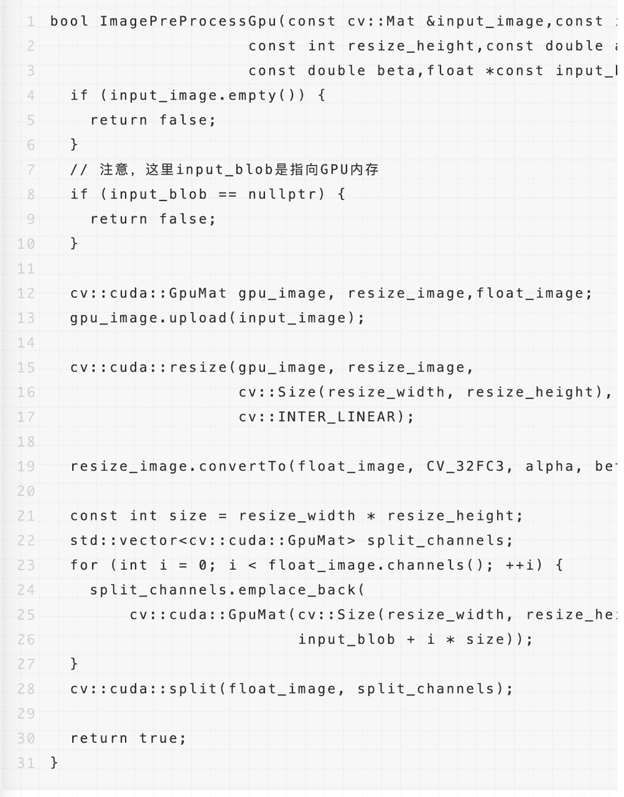

# AI模型部署实战：利用OpenCV的CUDA模块加速视觉模型部署流程

> 来源：[https://geekbang.feishu.cn/docx/DiIPdR3F3oQEBhxVqIzcOv8gn6c](https://geekbang.feishu.cn/docx/DiIPdR3F3oQEBhxVqIzcOv8gn6c)

> 👨🏻 作者：一天到晚潜水的鱼

> 📃 作者介绍：分享计算机视觉、机器学习、深度学习、无人驾驶等内容

> 🛖 公众号：DeepDriving

> ⏰ 收录时间：2024-05-27 11:20:58 (UTC+8)

> 🔗 原文链接： h[ttps://mp.weixin.q](https://mp.weixin.qq.com/s?__biz=MzkwNjE2ODMyMQ==&mid=2247485103&idx=1&sn=6337ff0be31f65834bf8544e2181b6a4&chksm=c0edd7c1f79a5ed7cfaa1fb09d65c20f3accebb6c0f7db390dbf507c2832f10fd7cc9de27b90&token=1923064180&lang=zh_CN#rd)q.com/s?__biz=Mz...


关注作者，获取更多AI知识

### ** 一. 前言 **

我在之前的文章《 AI模型部署实战：利用CV-CUDA加速视觉模型部署流程 》中介绍了如何使用 CV-CUDA 库来加速视觉模型部署的流程，但是 CV-CUDA 对系统版本和 CUDA 版本的要求比较高，在一些低版本的系统中可能无法使用。对于像我这种不会写 CUDA 代码又想用 CUDA 来加速模型部署流程的人来说要怎么办呢，其实还有一种方式， 「那就是使用OpenCV的CUDA接口」 。

本文将介绍 OpenCV CUDA 模块的基本使用方法（ C++ ），以及如何使用这些接口来加速视觉模型部署。

### ** 二. 安装 ****CUDA**** 版本 ****OpenCV**** **

在 Ubuntu 20.04 系统中使用 apt install 命令安装 OpenCV 是不会安装 CUDA 模块的，要想使用 CUDA 模块只能用源码进行编译安装。在 Ubuntu 系统中用源码编译安装 OpenCV 4.6 版本的过程如下：

1.  安装必要的依赖

在用源码编译安装 OpenCV 之前，需要先执行下面一系列命令安装必要的依赖：



1.  从 GitHub 网站分别下载 OpenCV 4.6.0 的源码包和扩展模块源码包



下载好以后把两个包进行解压。

1.  按照下面的步骤编译源码并进行安装：

```
cd opencv-4.6.0
mkdir build &amp;&amp; cd build
cmake -D CMAKE_BUILD_TYPE=RELEASE \    
-D CMAKE_INSTALL_PREFIX=/usr/local \    
-D INSTALL_PYTHON_EXAMPLES=OFF \    
-D INSTALL_C_EXAMPLES=OFF \    
-D WITH_TBB=ON \    
-D WITH_CUDA=ON \    
-D BUILD_opencv_cudacodec=OFF \    
-D ENABLE_FAST_MATH=1 \    
-D CUDA_FAST_MATH=1 \    
-D WITH_CUBLAS=1 \    
-D WITH_V4L=OFF \    
-D WITH_LIBV4L=ON \    
-D WITH_QT=OFF \    
-D WITH_GTK=ON \    
-D WITH_GTK_2_X=ON \    
-D WITH_OPENGL=ON \    
-D WITH_GSTREAMER=ON \    
-D OPENCV_GENERATE_PKGCONFIG=ON \    
-D OPENCV_PC_FILE_NAME=opencv.pc \    
-D OPENCV_ENABLE_NONFREE=ON \    
-D CUDA_nppicom_LIBRARY=stdc++ \    
-D OPENCV_PYTHON3_INSTALL_PATH=/usr/lib/python3/dist-packages \    
-D OPENCV_EXTRA_MODULES_PATH=../../opencv_contrib-4.6.0/modules \    
-D PYTHON_EXECUTABLE=/usr/bin/python3 \    
-D BUILD_EXAMPLES=OFF ..

make -j8 &amp;&amp; sudo make install
```

CMake 的几个参数需要注意一下：

```
-D WITH_CUDA=ON  # 这里必须设置为ON，否则无法使用CUDA模块
-D CMAKE_INSTALL_PREFIX=/usr/local # OpenCV的安装路径，可以按照自己的需求指定
-D OPENCV_EXTRA_MODULES_PATH=../../opencv_contrib-4.6.0/modules # 扩展模型源码包的路径
```

> **❝**

> 因为 CMake 过程中要下载很多依赖文件，如果速度很慢，可以加上配置选项 -DOPENCV_DOWNLOAD_MIRROR_ID=gitcode ，这样就可以从国内镜像下载了，速度会快很多。

> ❞

安装成功后，还需要设置一下环境变量：

```
export LD_LIBRARY_PATH=${LD_LIBRARY_PATH}:/usr/local/opencv-4.6/lib/
```

### ** 三. ****OpenCV CUDA**** 模块的基本使用方法 **

OpenCV CUDA 模块的官方文档详细阐述了 CUDA 模块提供的函数接口以及使用方法，在写代码之前我们应该好好学习一下这些文档。



#### ** 基础数据结构 ****GpuMat**** **

在使用 CPU 的时候， OpenCV 是使用数据结构 cv::Mat 来作为数据容器的；而在 GPU 上，则是使用一个新的数据结构 cv::gpu::GpuMat ，所有在 GPU 上调用的接口都是使用该数据结构作为输入或输出的。 GpuMat 与 Mat 的使用方式非常相似，封装的接口基本上是一致的，详细内容可以参考GpuMat的文档。



#### ** ****CPU**** 与 ****GPU**** 之间的数据传输 **

OpenCV 提供了非常简单的接口实现 CPU 与 GPU 之间的数据传输，也就是 cv::Mat 与 cv::gpu::GpuMat 之间的转换：

+   upload : 把数据从 CPU 拷贝到 GPU 上；

+   download : 把数据从 GPU 拷贝到 CPU 上；

下面是一个简单的示例：

```
#include &lt;opencv2/opencv.hpp&gt;
#include &lt;opencv2/cudaimgproc.hpp&gt; 

cv::Mat img = cv::imread(&quot;test.jpg&quot;);
// 把数据从CPU拷贝到GPU上
cv::cuda::GpuMat gpu_mat;
gpu_mat.upload(img); 
// 在GPU上对数据做处理
// 把结果从GPU拷贝到CPU上 
cv::Mat result;
gpu_mat.download(result);
```

#### ** 使用 ****GPU**** 做图像预处理 **

在做视觉 AI 模型部署时，图像数据预处理的基本流程如下：

```
1. 把OpenCV读取的BGR格式的图片转换为RGB格式；
2. 把图片resize到模型输入尺寸；
3. 对像素值做归一化操作；
4. 把图像数据的通道顺序由HWC调整为CHW；
```

以部署 YOLOv6 模型为例，在 CPU 上做图像预处理的的代码如下：



调用 OpenCV CUDA 模块的接口做预处理的代码如下：



可以看到， CPU 和 GPU 版本调用的函数名是一样的，只不过 GPU 版本的多了一个 cuda 命名空间。所以使用 OpenCV 的 CUDA 模块基本上是没有什么难度的，只需要查一下之前调用的 CPU 接口是否有对应的 GPU 版本就可以了。

#### ** 使用 ****CUDA**** 流 **

CUDA 流是一系列异步操作的集合，通过在一个设备上并发地运行多个内核任务来实现任务的并发执行，这种方式使得设备的利用率更高。上面代码调用的 OpenCV CUDA 模块接口都是没有使用 CUDA 流的，不过 CUDA 模块为每个函数都提供了一个使用 CUDA 流的版本，使用起来也非常简单。

OpenCV CUDA 模块的 CUDA 流封装在 cv::cuda::Stream 类中，使用之前首先创建一个类对象

```
cv::cuda::Stream stream;
```

然后在调用每个 CUDA 接口的时候传入该对象

```
gpu_image.upload(input_image,stream);
```

再在最后调用 waitForCompletion() 函数进行同步，确保该流上的所有操作都已完成。

使用 CUDA 流的图像预处理代码如下：

```

bool ImagePreProcessGpuStream(const cv::Mat &amp;input_image,const int resize_width,                    const int resize_height,const double alpha,                     const double beta,float *const input_blob) {  if (input_image.empty()) {    return false;  }  if (input_blob == nullptr) {    return false;  }
  cv::cuda::Stream stream;
  cv::cuda::GpuMat gpu_image, resize_image,float_image;  gpu_image.upload(input_image,stream);
  cv::cuda::resize(gpu_image, resize_image,                   
  cv::Size(resize_width, resize_height), 0, 0,                   
  cv::INTER_LINEA,stream);
  resize_image.convertTo(float_image, CV_32FC3, alpha, beta,stream);
  const int size = resize_width * resize_height;  
  std::vector[cv::cuda::GpuMat](cv::cuda::GpuMat) split_channels;  
  for (int i = 0; i &lt; float_image.channels(); ++i) {   
   split_channels.emplace_back(        
   cv::cuda::GpuMat(cv::Size(resize_width, resize_height), CV_32FC1,                         input_blob + i * size));  }  cv::cuda::split(float_image, split_channels,stream);
  stream.waitForCompletion();
  return true;}
```

OpenCV 的 CUDA 流和原生的 CUDA 流可以通过结构体 cv::cuda::StreamAccessor 提供的两个静态函数进行转换：

```
// 把OpenCV的CUDA流转换为原生CUDA流static cudaStream_t 
cv::cuda::StreamAccessor::getStream        
(const Stream &amp; stream        )        
// 把原生CUDA流转换为OpenCV的CUDA流static Stream 
cv::cuda::StreamAccessor::wrapStream       
 (cudaStream_t stream)        
```

> **❝**

> 如果对 CUDA[ 流不了解](https://mp.weixin.qq.com/s?__biz=MzkwNjE2ODMyMQ==&mid=2247484391&idx=1&sn=955af8cd4de629230bf529e808185f28&chksm=c0edd289f79a5b9fecf043d8f2babf51947853afa1f5ed1a1e3e5da4b8cea28e6b4ace888225&token=1184272121&lang=zh_CN&scene=21#wechat_redirect)，可以参考我之前写的 这篇文章 。

> ❞

### ** 四. 总结 **

本文介绍了 OpenCV CUDA 模块中图像处理接口的基本使用方法，用这些 CUDA 接口基本上可以满足视觉 AI 模型的部署需求，在嵌入式平台上可以有效减少 CPU 资源的消耗。当然， OpenCV 提供的 CUDA 版本接口也有限，必要的时候也只能自己手搓 CUDA 代码了。

### ** 五. 参考资料 **

1.  CUDA-accelerated Computer Vision 
CUDA加速的计算机视觉

1.  How To Run Inference Using TensorRT C++ API 
如何使用 TensorRT C++ API 运行推理

1.  Using TensorRT with OpenCV CUDA 
将 TensorRT 与 OpenCV CUDA 结合使用

1.  Getting Started with OpenCV CUDA Module 
OpenCV CUDA 模块入门

1.  GPU-accelerated Computer Vision 
GPU 加速的计算机视觉

1.  OpenCV CUDA samples  OpenCV CUDA 示例