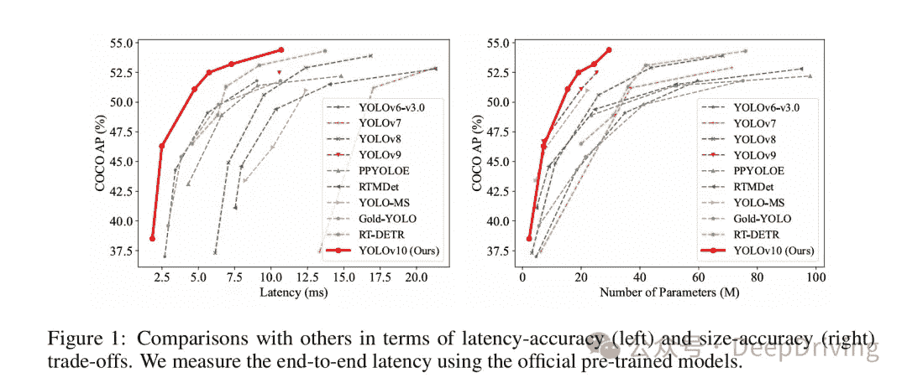
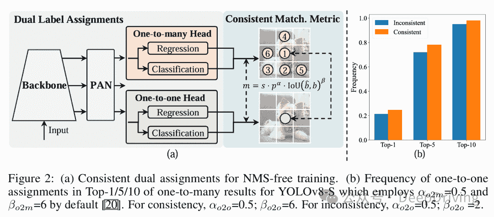
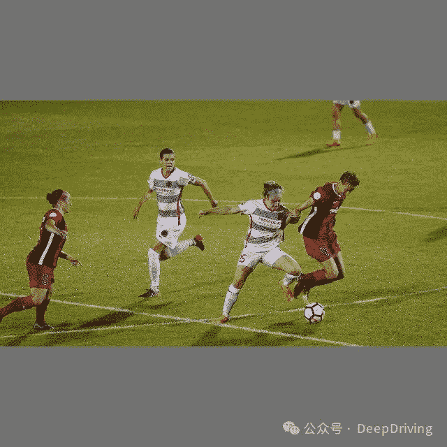
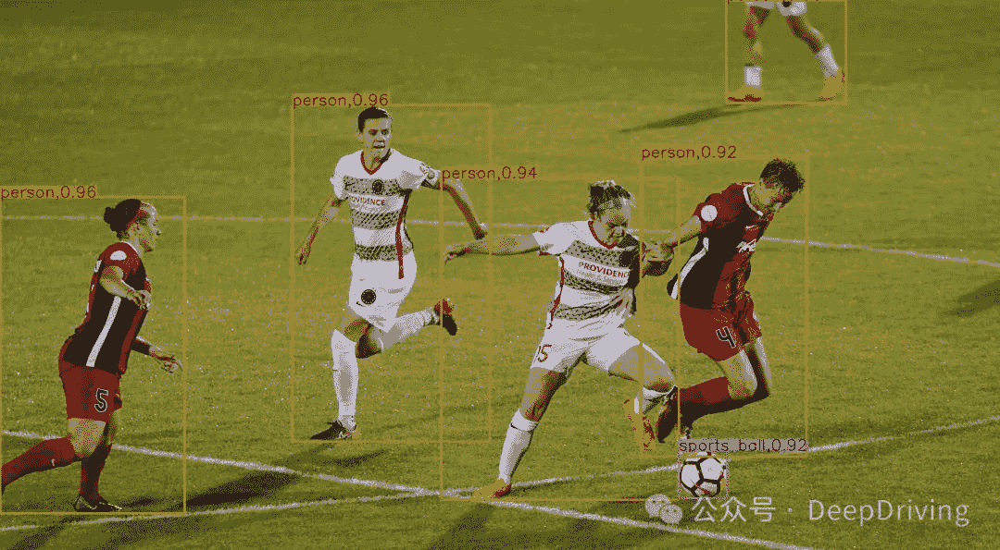
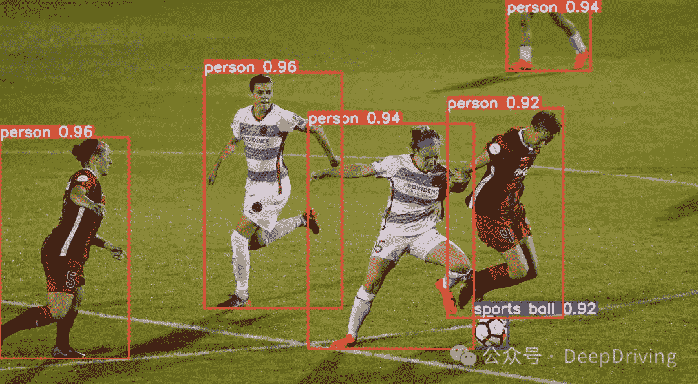

# YOLOv10来啦！ONNX模型部署和性能对比了解一下

> 来源：[https://geekbang.feishu.cn/docx/QK5bdDSCGowSAixg3aKcJrDVn5d](https://geekbang.feishu.cn/docx/QK5bdDSCGowSAixg3aKcJrDVn5d)

> 👨🏻 作者：一天到晚潜水的鱼

> 📃 作者介绍：分享计算机视觉、机器学习、深度学习、无人驾驶等内容

> 🛖 公众号：DeepDriving

> ⏰ 收录时间：2024-05-27 11:20:58 (UTC+8)

> 🔗 原文链接： h[ttps://mp.weixin.q](https://mp.weixin.qq.com/s?__biz=MzkwNjE2ODMyMQ==&mid=2247485189&idx=1&sn=2b27abb295a9c739019fb4736ec50690&chksm=c1245db18be8930b5526e90bd47f2ef441e03668b659044142ca14568eb416ecb68d5e5e4365&scene=132&exptype=timeline_recommend_article_extendread_samebiz&show_related_article=1&subscene=189&scene=132#wechat_redirect)q.com/s?__biz=Mz...


关注作者，获取更多AI知识

### ** 0. YOLOv10简介 **

YOLOv10 是清华大学最近开源的一个实时端到端的目标检测算法，解决了以往版本 YOLO 系列目标检测算法在后处理和模型架构方面的不足。通过消除非极大值抑制（ NMS ）操作和优化模型架构， YOLOv10 在显著降低计算开销的同时还实现了最先进的性能。



YOLOv10 的模型架构由以下几个部分组成：

+   主干网络：使用增强版的 CSPNet 来提取图像特征，它能改善梯度流并减少计算量。

+   颈部：采用 PAN 结构汇聚不同尺度的特征，有效地实现多尺度特征融合。

+   一对多预测头：在训练过程中为每个对象生成多个预测，用来提供丰富的监督信号从而提高学习的准确性；在推理阶段不生效，从而减少计算量。

+   一对一预测头：在推理过程中为每个对象生成一个最佳预测，无需 NMS 操作，从而减少延迟并提高推理效率。



YOLOv10 的主要特点如下：

+   利用一致的双重分配来消除对 NMS 的需求，从而减少推理延迟。

+   从推理效率和准确性的角度出发全面优化各种组件，包括轻量级分类头、空间通道去耦下采样和等级引导块设计。

+   引入大核卷积和部分自注意模块，在不增加大量计算成本的情况下提高性能。

官方发布了从 N 到 X 各种型号的模型，以满足不同应用的需求：

+   YOLOv10-N ：用于资源极其有限环境的超小型版本。

+   YOLOv10-S ：兼顾速度和精度的小型版本。

+   YOLOv10-M ：通用的中型版本。

+   YOLOv10-B ：平衡型，宽度增加，精度更高。

+   YOLOv10-L ：大型版本，精度更高，但计算资源增加。

+   YOLOv10-X ：超大型版本，可实现最高的精度和性能。

**「本文主要介绍如何基于 ****ONNXRuntime**** 框架部署 ****onnx**** 格式的 ****YOLOv10**** 模型，以及 ****YOLOv10**** 与 ****RT-DETR**** 等算法的性能对比。」**

### ** 1. 准备工作 **

首先把代码从 GitHub 上 clone 下来

```
git clone https://github.com/THU-MIG/yolov10.git
```

然后执行下面的命令用 conda 创建 Python 环境并安装相关的依赖库和 YOLOv10

```
conda create -n yolov10 python=3.9
conda activate yolov10
pip install -r requirements.txt
pip install -e .
```

这里需要注意的是，如果使用的是低版本的 pip ，可能会报类似下面的错误：

```
ERROR: File &quot;setup.py&quot; or &quot;setup.cfg&quot; not found. Directory cannot be installed in editable mode: /path/to/yolov10(A &quot;pyproject.toml&quot; file was found, but editable mode currently requires a setuptools-based build.)
```

这种情况需要升级 pip 的版本，最新版本 24.0 实测是没有问题的。

```
pip install --upgrade pip
```

安装成功后，从GitHub的release中下载 PyTorch 格式的模型权重，然后执行下面的命令就可以导出 onnx 模型了。

```
yolo export model=yolov10n/s/m/b/l/x.pt format=onnx opset=13 simplify
```

### ** 2. onnx模型部署 **

#### ** 2.1 加载onnx模型 **

首先导入 onnxruntime 包，然后调用其 API 加载模型即可:

```
import onnxruntime as ort
session = ort.InferenceSession(&quot;yolov10m.onnx&quot;, providers=[&quot;CUDAExecutionProvider&quot;])
```

这里的 providers 参数根据自己的实际情况设置，我使用的是 GPU 所以设置的是 "CUDAExecutionProvider" 。如果用 CPU 进行推理，则需设置为 "CPUExecutionProvider" ；如果有 TensorRT 的环境，还可以设置为 "TensorrtExecutionProvider" 。

模型加载成功后，我们可以查看一下模型的输入、输出层的属性：

```
for input in session.get_inputs():    
    print(&quot;input name: &quot;, input.name)    
    print(&quot;input shape: &quot;, input.shape)    
    print(&quot;input type: &quot;, input.type)
for output in session.get_outputs():    
    print(&quot;output name: &quot;, output.name)    
    print(&quot;output shape: &quot;, output.shape)    
    print(&quot;output type: &quot;, output.type)
```

结果如下：

```
input name:  images
input shape:  [1, 3, 640, 640]
input type:  tensor(float)
output name:  output0
output shape:  [1, 300, 6]
output type:  tensor(float)
```

从上面的打印信息可以知道，模型有一个尺寸为 [1, 3, 640, 640] 的输入层和一个尺寸分别为 [1, 300, 6] 的输出层。

#### ** 2.2 数据预处理 **

用 OpenCV 读入图片后，首先需要对图片做预处理：

```
image = cv2.imread(&quot;soccer.jpg&quot;)print(&quot;image shape: &quot;, image.shape)image_height, image_width, _ = image.shape_, _, model_height, model_width = session.get_inputs()[0].shape
input_tensor, ratio, x_offset, y_offset = preprocess(image,             image_width, image_height, model_width, model_height)
```

YOLOv10 在做数据预处理的时候是对原始图像做等比例缩放的，如果缩放后的图像某个维度上比目标值小，那么就需要进行填充。举个例子：假设输入图像尺寸为 1920x1058 ，模型输入尺寸为 640x640 ，按照等比例缩放的原则缩放后的图像尺寸为 640x352 ，那么在 y 方向上还需要填充 640-352=288 ，即分别在图像的顶部和底部各填充 144 行像素。最终实现的效果如下：



整个数据预处理的流程如下：

1.  把 OpenCV 读取的 BGR 格式图片转换为 RGB 格式；

1.  计算缩放比例和需要填充的区域，把原始图片进行等比例缩放，对不足的区域进行填充让输入图片的尺寸匹配模型的输入尺寸；

1.  对像素值除以 255 做归一化操作；

1.  把图像数据的通道顺序由 HWC 调整为 CHW ；

1.  扩展数据维度，将数据的维度调整为 NCHW 。

实现上述功能的预处理函数 preprocess 的代码如下：

```
def preprocess(bgr_image, src_w, src_h, dst_w, dst_h):    
image = cv2.cvtColor(bgr_image, cv2.COLOR_BGR2RGB)        
ratio = min(dst_w/src_w, dst_h/src_h)    
border_w = int(round(src_w * ratio / 2) * 2)    
border_h = int(round(src_h * ratio / 2) * 2)    
x_offset = (dst_w - border_w ) // 2      
y_offset = (dst_h - border_h ) // 2

    image = cv2.resize(image, (border_w, border_h))    
    image = cv2.copyMakeBorder(        
        image, y_offset, y_offset, x_offset, x_offset,                  cv2.BORDER_CONSTANT, value=(114, 114, 114)        )
    image = image.astype(np.float32) / 255.0    
    image = np.transpose(image, (2, 0, 1))    
    input_tensor = np.expand_dims(image, axis=0)    
    return input_tensor, ratio, x_offset, y_offset
```

经过预处理后，输入数据 input_tensor 的维度变为 [1, 3, 640, 640] ，与模型要求的输入尺寸一致。

#### ** 2.3 模型推理 **

准备好输入数据以后，就可以送入模型进行推理：

```
outputs = session.run(None, {session.get_inputs()[0].name: input_tensor})output = np.squeeze(outputs[0])print(&quot;output shape: &quot;, output.shape)
```

YOLOv10 只有一个输出分支，所以只要取 outputs[0] 的数据进行处理，去掉 batch 这个维度后，模型输出的维度为 300x6 。

```
output.shape:  (300, 6)
```

#### ** 2.4 后处理 **

从前文知道模型输出的维度为 300x6 ，其中 300 表示模型在一张图片上最多能检测的目标数量， 6 则表示每个目标包含 4 个坐标属性（ xmin,ymin,xmax,ymax ）和 1 个类别置信度以及 1 个类别索引。每个目标的坐标信息都是相对于模型的输入尺寸的，由于预处理的时候在边上做了填充，所以后处理的时候要把每个坐标值减掉对应的偏移值；如果要恢复到原始图像的尺寸，还需要除以预处理时使用的缩放比例系数。与 RT-DETR 一样， YOLOv10 的检测结果不需要再做 NMS 这些额外的后处理操作，处理过程非常简单。后处理的代码如下：

```
for i in range(output.shape[0]):  
# 读取类别置信度  
confidence = output[i][4]  
# 用阈值进行过滤  
if confidence &gt; 0.5:      
    # 读取类别索引      
    label = int(output[i][5])      
    # 读取类坐标值，把坐标还原到原始图像      
    xmin = int((output[i][0] - x_offset) / ratio)      
    ymin = int((output[i][1] - y_offset) / ratio)      
    xmax = int((output[i][2] - x_offset) / ratio)      
    ymax = int((output[i][3] - y_offset) / ratio)
    
      # 可视化      
      class_name = COCO_CLASSES[label]      
      box_color = np.array(COLOR_LIST[label]) * 255                   
      box_color = (int(box_color[0]), int(box_color[1]), int(box_color[2]))      
      cv2.rectangle(image, (xmin, ymin), (xmax, ymax), box_color, 4)      
      # 省略.....
```

来看一下检测效果：



下面是用官方代码基于 PyTorch 推理的结果：



可以看到， ONNXRuntime 和 PyTorch 推理的结果是一致的。

### ** 3. 推理耗时对比 **

这里的对比仅对比模型本身的推理耗时，不包含后处理操作。本文在 GeForce GTX 1650 Ti 显卡上，基于 ONNXRuntime 框架分别采用 CUDA 和 TensorRT 后端对 YOLOv10 、 YOLOv9 和 RT-DETR 的各个模型进行测试，数据精度统一采用 FP32 ，模型输入尺寸统一设置为 640x640 。各模型的推理耗时（单位为毫秒）测试结果如下：

| 模型 | CUDA | TensorRT |
| --- | --- | --- |
| yolov10n | 10 | 7 |
| yolov10s | 17 | 13 |
| yolov10m | 34 | 27 |
| yolov10b | 44 | 37 |
| yolov10l | 55 | 46 |
| yolov10x | 80 | 64 |
| yolov9-c | 52 | 41 |
| yolov9-e | 106 | 82 |
| rtdetr_r18vd_6x | 52 | 26 |
| rtdetr_r34vd_6x | 66 | 36 |
| rtdetr_r50vd_6x | 94 | 52 |
| rtdetr_r50vd_m_6x | 66 | 40 |
| rtdetr_r101vd_6x | 133 | 89 |

YOLOv10 的论文里说 YOLOv10-S 比 RT-DETR-R18 快 1.8 倍， YOLOv10-X 比 RT-DETR-R101 快 1.3 倍， YOLOv10-B 的推理延迟比 YOLOv9-C 减少了 46% 。从我测试的结果来看， YOLOv10-S/X 不止比 RT-DETR-R18/R101 快一点几倍， YOLOv10-B 则没有比 YOLOv9-C 快那么多。

总的来说， YOLOv10 的性能确实比之前的模型要强一些，新一代卷王名不虚传。

### ** 4. 参考资料 **

+   YOLOv10: Real-Time End-to-End Object Detection

+   https://docs.ultralytics.com/zh/models/yolov10/