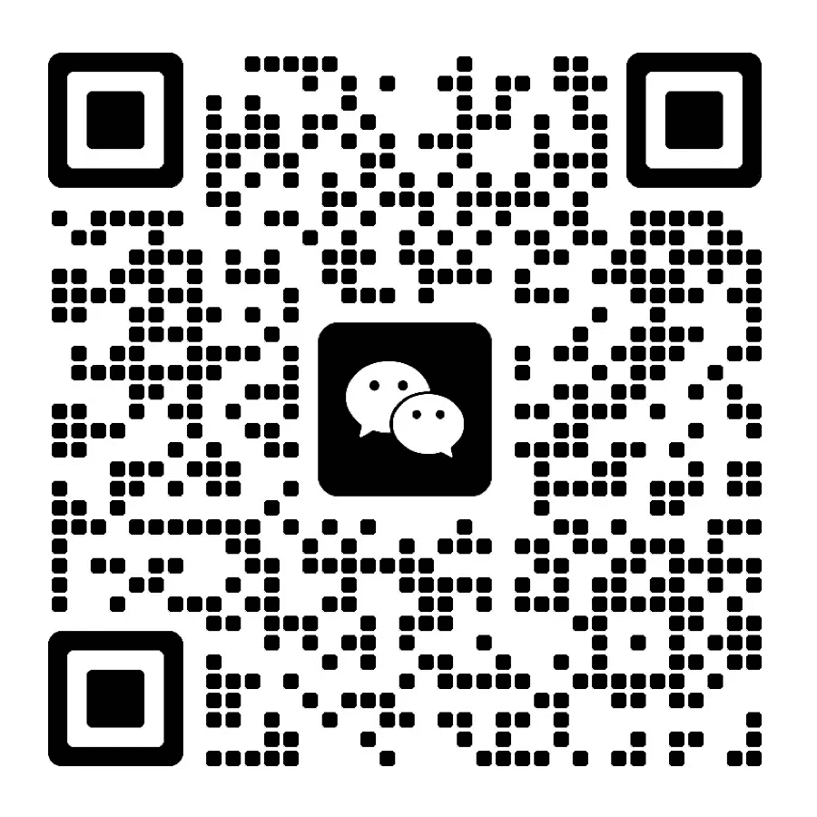
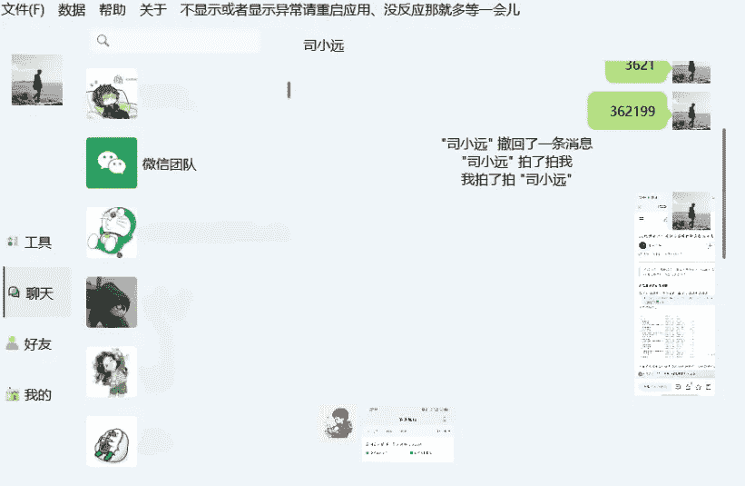
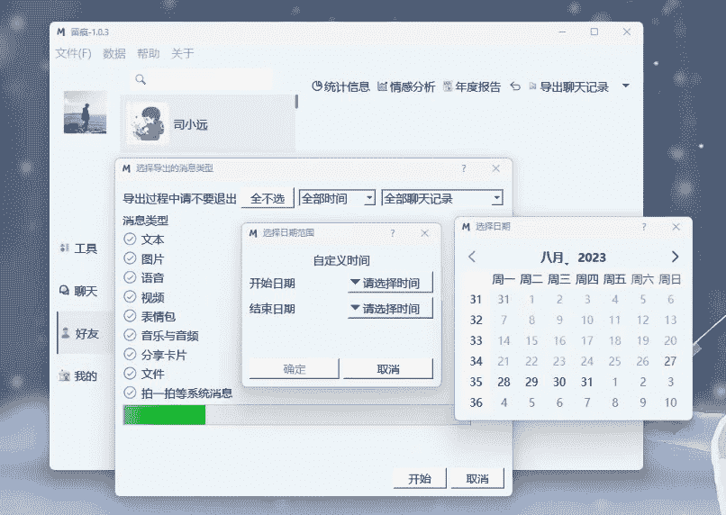
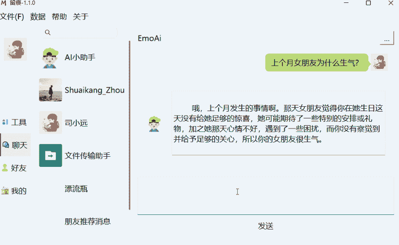
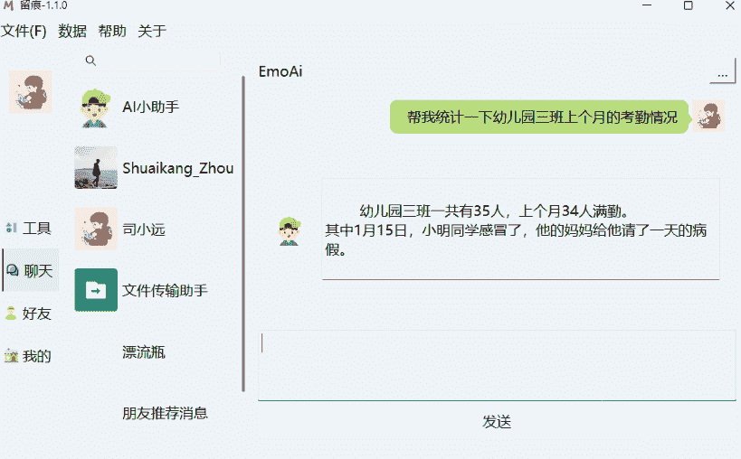

# WeChatMsg：用🛰️聊天记录训练私人AI助手，快速搜索和回溯信息，还能生成年度聊天报告

> 来源：[https://geekbang.feishu.cn/docx/QdXNdlezXo3qm2x7vkRc12ySntg](https://geekbang.feishu.cn/docx/QdXNdlezXo3qm2x7vkRc12ySntg)

**板块主理人：尼福财**

**·向量光年科技有限公司创始人**

·《开源AI项目落地》👸号及社群主理人

专注于AI产品开发落地，移动端、PC端软件快速高质量交付

愿景：加速全行业向AI转变

**项目简介**

WeChatMsg专注于提取🛰️聊天记录，并将其导出为HTML、Word和Excel文档以便永久保存。此外，它还能对聊天记录进行深入分析，生成年度聊天报告，并利用这些数据训练个人专属的AI聊天助手。

**扫码加入AI交流群**

**获得更多技术支持和交流**

**（请注明自己的职业）**

**功能**

**1.恢复🛰️聊天界面： **包括文本、图片和系统消息等。

别人撤回的消息对你无效了

**2.数据导出： **支持将🛰️数据导出为HTML、CSV、TXT和Word格式。HTML导出支持多种内容类型，如视频、语音、文件等，并有时间轴跳转、超链接跳转等功能。

如果有需要可以导出全部聊天记录

**3.聊天数据分析： **生成可视化年度聊天报告。

帮你把这些记忆永久保存

**4.AI聊天助手训练： **使用聊天数据训练个人专属的AI聊天助手。

对于经常出现的查询或问题，AI聊天助手可以提供快速搜索和回溯功能，减少重复性工作，提高效率。

**使用**

你可以通过以下步骤下载和运行软件：

1. 访问下载页面：memotrace.cn

2. 下载exe文件，然后双击运行。

3. 如果程序启动时出现闪退，尝试以管理员身份运行exe文件。

4. 如果杀毒软件警告，选择忽略提示。

5. 如果遇到问题，尝试重启电脑。

请确保在使用软件时注意安全和兼容性问题。

**常见问题解决**

如果在PC端使用时遇到问题，可以尝试以下步骤解决：

1. 删除消息数据库：移除位于 app/Database/Msg 的文件夹。

2. 重启🛰️：关闭并重新启动🛰️应用。

3. 重启程序：关闭并重新启动exe程序。

4. 重启电脑：如果以上步骤未解决问题，尝试重启电脑。

5. 更换电脑：如果问题依旧存在，考虑在另一台电脑上运行程序。

请注意，该软件不支持Windows 7和Mac操作系统。如果在运行程序时出现闪退，请尝试以管理员权限运行exe文件。

**项目链接**

https://github.com/LC044/WeChatMsg

关注「 开源AI项目落地 」👸号

与AI时代更靠近一点