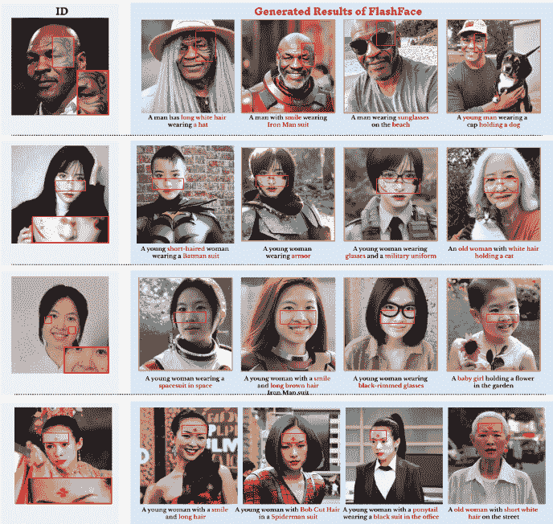
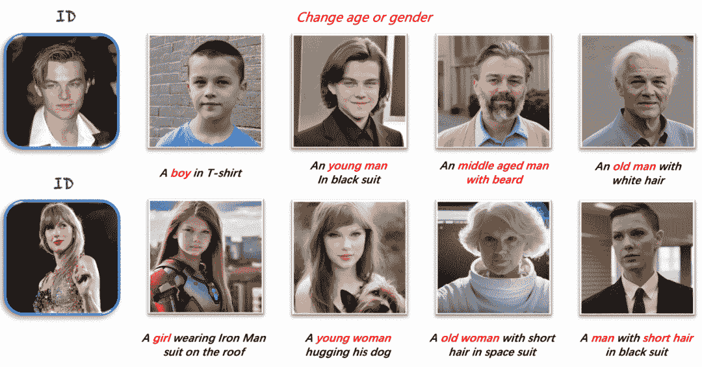
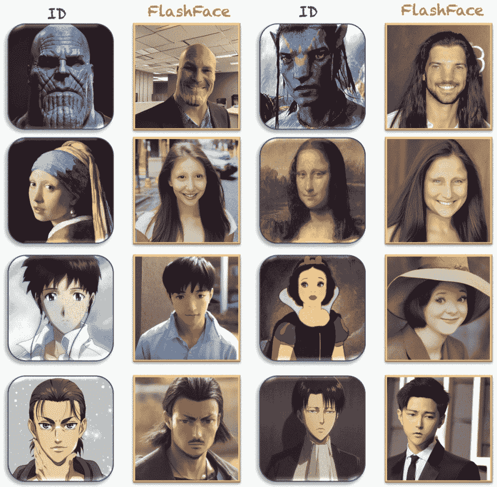
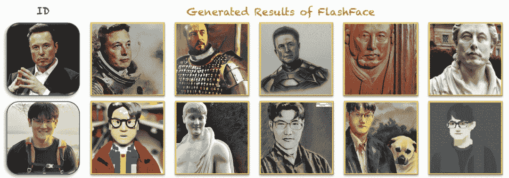
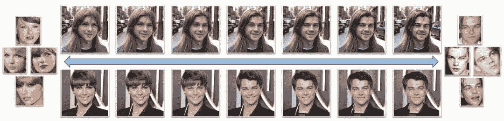
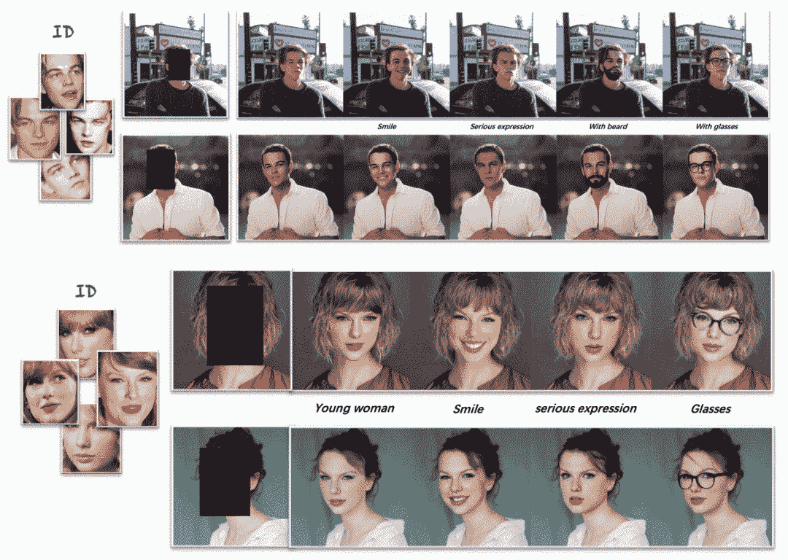

# FlashFace：一个能改变你年龄的个性化照片工具，不止这一个功能哦

> 来源：[https://geekbang.feishu.cn/docx/ViVTdEMltoZu0Xxh96tczoHOnic](https://geekbang.feishu.cn/docx/ViVTdEMltoZu0Xxh96tczoHOnic)


**板块主理人：尼福财**

**·向量光年科技有限公司创始人**

·《开源AI项目落地》👸号及社群主理人

专注于AI产品开发落地，移动端、PC端软件快速高质量交付

愿景：加速全行业向AI转变


**项目简介**

FlashFace 是一个开源的人像个性化生成工具，专注于高保真的身份保持。该项目能够在几秒钟内使用一个或多个参考面部，进行零次人像定制，并强调保持非名人的身份。它支持根据语言提示进行年龄或性别的改变，并允许用户自定义身份图像控制和语言提示控制的强度。此外，FlashFace 支持各种参数调整以优化生成效果，特别对亚洲人脸有良好的适应性。

**扫码加入AI交流群**

**获得更多技术支持和交流**

**（请注明自己的职业）**


**功能**

**·人像个性化结果**

FlashFace生成了多样化的人像个性化结果，具有以下特点：

**1. **在很大程度上保留参考面部的身份特征（例如，纹身、疤痕，甚至虚拟角色的稀有面部形状）；

**2. **当文本提示与参考图像相矛盾时，能够精确地遵循指令（例如，将成人自定义为“儿童”或“老者”）。



**·更改年龄或性别**



**·将虚拟角色转变为真实人物**



**·将真实人物转化为艺术品**



**·身份混合**



**·在语言控制下的面部交换**



**安装**

**1.克隆FlashFace**

```
git clone https://github.com/ali-vilab/FlashFace.gitcd FlashFace
```

**2.创建环境**

```
conda create -n flashface python=3.10 -yconda activate flashfacepip install -r requirements.txt
```

**项目链接**

https://github.com/ali-vilab/FlashFace

关注「 开源AI项目落地 」👸号

与AI时代更靠近一点