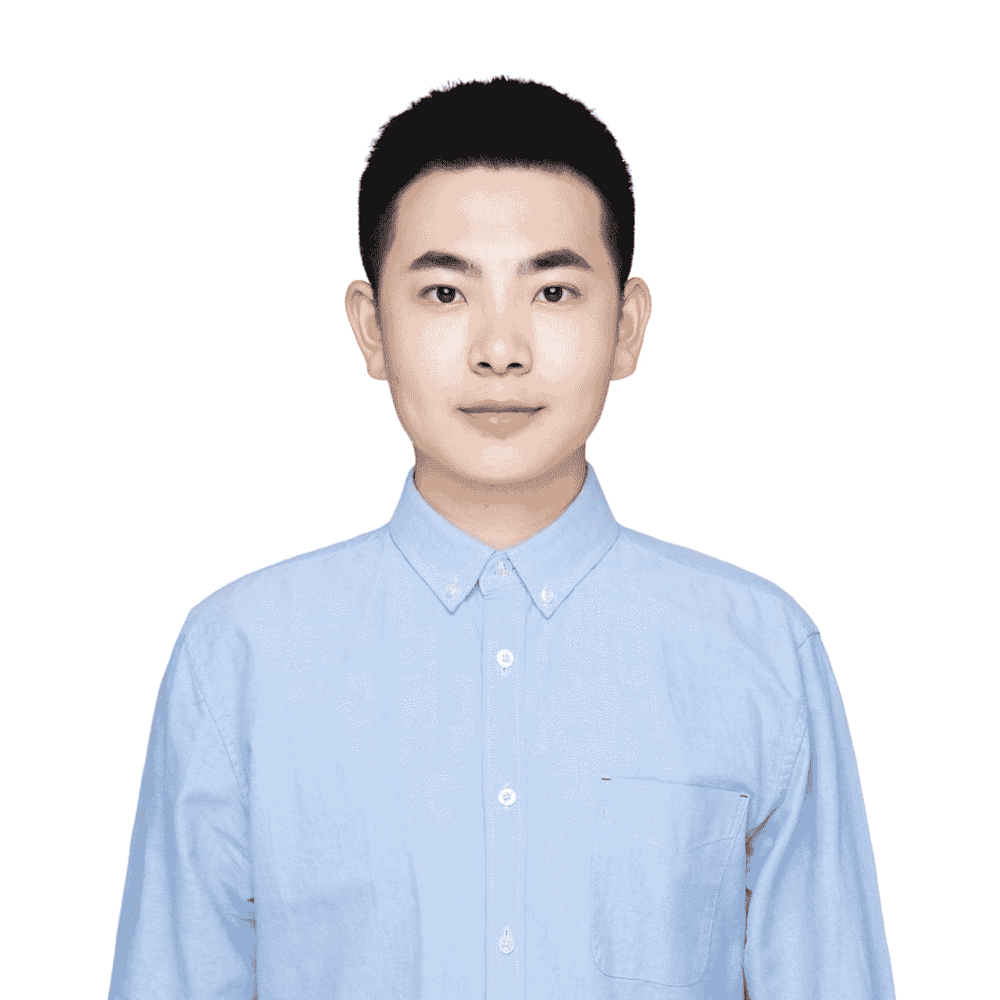
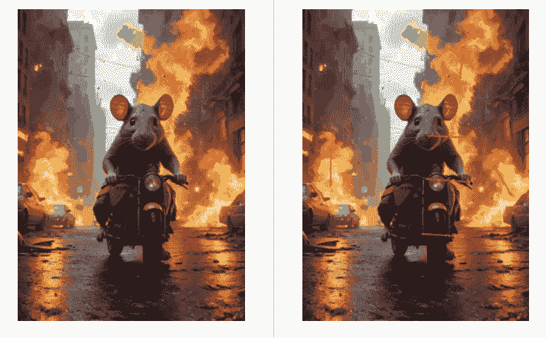
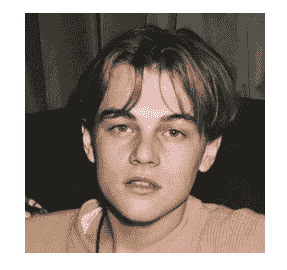
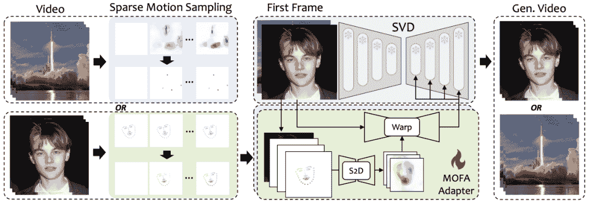

# AI视频革新，东京大学、腾讯共同开源图片生成视频项目，可控制运动轨迹

> 来源：[https://geekbang.feishu.cn/docx/WkvPdUSISoWr6SxGvlUc01lInZg](https://geekbang.feishu.cn/docx/WkvPdUSISoWr6SxGvlUc01lInZg)

**板块主理人：尼福财**

**·向量光年科技有限公司创始人**

·《开源AI项目落地》公众号及社群主理人

专注于AI产品开发落地，移动端、PC端软件快速高质量交付

愿景：加速全行业向AI转变

**项目简介**

MOFA-Video是一款基于Pytorch的官方实现，专注于通过生成性运动场适应技术在冻结的图像到视频扩散模型中实现可控制的图像动画。该项目的核心在于运用稳定视频扩散模型，引入ControlNet灵感的MOFA适配器，使得用户能够根据多种稀疏控制信号将输入图像动画化。MOFA-Video具备在多个域之间调整动作的能力，使其成为在视频生成和图像处理领域的一个创新工具。

**扫码加入AI交流群**

**获得更多技术支持和交流**

**（请注明自己的职业）**

**DEMO**

**1. 轨迹控制 + 地标控制**

**2. 轨迹控制**

**3. 地标控制**

[🎦 点击观看视频](https://mpvideo.qpic.cn/0bc35qaaiaaad4ani226zztfb3gdatwaabaa.f10002.mp4?dis_k=683bb1555614398cd40aaa65b25ec9c0&dis_t=1718085180&play_scene=10120&auth_info=Ctf4gcB4cycN0vOUzHNQfll1MDARRTFiHzwzNxphNUhjQA8nahtaHS0gZlw7G0o6Xns4ak1MKVhmaSpqQjdgBjdfBQ==&auth_key=df83965c90a75dc3d59b9447b2f20a05&vid=wxv_3487943548232581121&format_id=10002&support_redirect=0&mmversion=false)

**技术**

MOFA-Video是一种设计用来将不同领域中的动作适应到冻结的视频扩散模型的方法。通过使用稀疏到密集（S2D）运动生成和基于流的运动适应，MOFA-Video能够使用各种类型的控制信号有效地对单个图像进行动画处理，包括轨迹、关键点序列及其组合。

在训练阶段，通过稀疏运动采样生成稀疏控制信号，然后训练不同的MOFA-适配器通过预训练的SVD生成视频。在推理阶段，不同的MOFA-适配器可以组合在一起，共同控制冻结的SVD。

**项目链接**

https://github.com/MyNiuuu/MOFA-Video

关注「 开源AI项目落地 」公众号

与AI时代更靠近一点