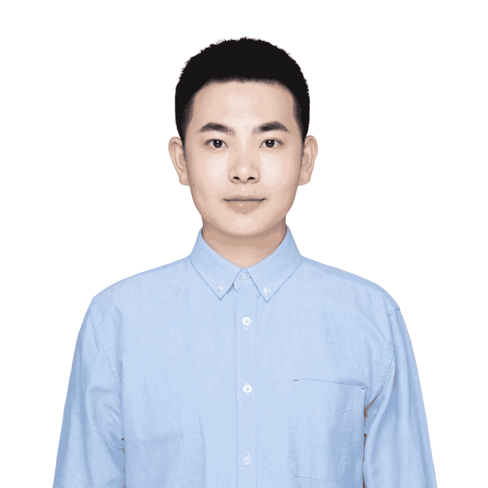
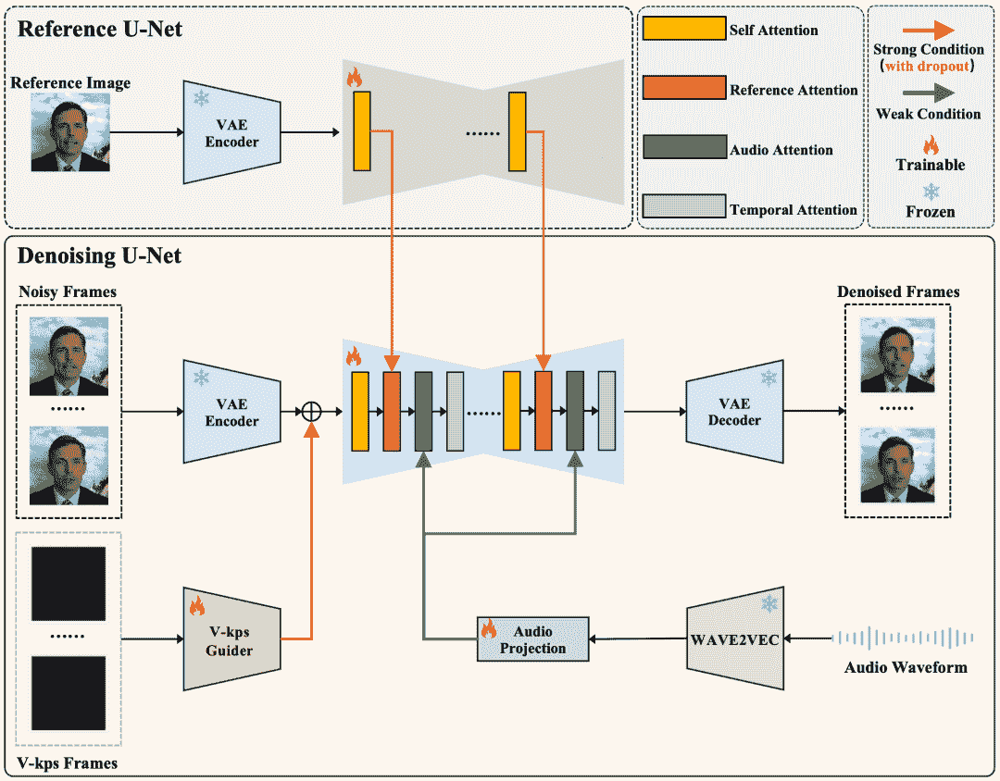
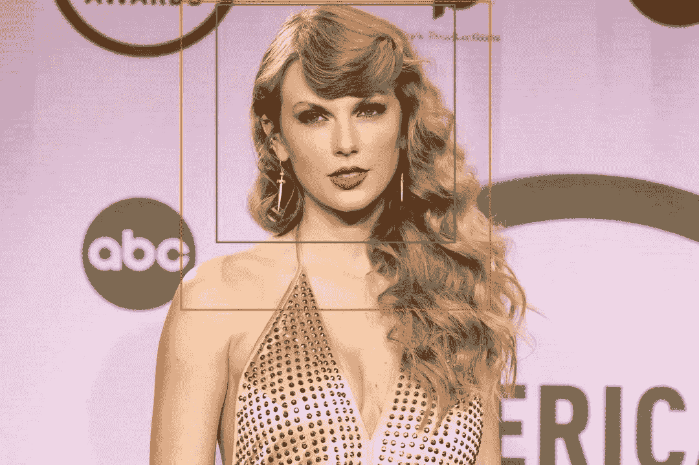

# V-Express：音频驱动图片生成讲话视频，又一数字人免费平替

> 来源：[https://geekbang.feishu.cn/docx/ZyG2dEcJ8opUGKxfmyRc2ClInTb](https://geekbang.feishu.cn/docx/ZyG2dEcJ8opUGKxfmyRc2ClInTb)



**板块主理人：尼福财**

**·向量光年科技有限公司创始人**

·《开源AI项目落地》👸号及社群主理人

专注于AI产品开发落地，移动端、PC端软件快速高质量交付

愿景：加速全行业向AI转变


**项目简介**

V-Express是由南京大学和腾讯AI实验室共同开发的一项技术，旨在通过一系列渐进式的控制信号衰减操作，实现由单张图片生成讲话头像视频。这个项目解决了在肖像视频生成中控制信号强度不均的问题，尤其是在使用较弱的音频信号时。V-Express通过逐步使弱条件有效控制生成过程，能够同时考虑姿态、输入图像和音频，有效生成由音频控制的肖像视频。这种方法为同时有效使用各种强度的条件提供了一种潜在解决方案。

**扫码加入AI交流群**

**获得更多技术支持和交流**

**（请注明自己的职业）**


**底层技术**

在肖像视频生成领域，使用单张图片生成肖像视频的做法越来越普遍。常见的方法包括利用生成模型增强适配器以实现可控生成。

然而，控制信号的强度可能不同，包括文本、音频、图像参考、姿态、深度图等。在这些中，较弱的条件经常因为较强条件的干扰而难以发挥效果，这在平衡这些条件中构成了挑战。

在关于肖像视频生成的工作中，发现音频信号特别弱，常常被姿态和原始图像这些较强的信号所掩盖。然而，直接使用弱信号进行训练往往导致收敛困难。为了解决这个问题，提出了一种名为V-Express的简单方法，通过一系列逐步的弱化操作来平衡不同的控制信号。该方法逐渐使弱条件能够有效控制，从而实现同时考虑姿态、输入图像和音频的生成能力。



**使用**

**重要提醒~**

在讲话面孔生成任务中，当目标视频中的人物与参考人物不同时，面部的重定向将是非常重要的部分。选择与参考面孔姿势更相似的目标视频将能够获得更好的结果。

**运行演示（第一步，可选）**

如果你有目标讲话视频，你可以按照下面的脚本从视频中提取音频和面部V-kps序列。你也可以跳过这一步，直接运行第二步中的脚本，尝试提供的示例。

```
python scripts/extract_kps_sequence_and_audio.py \    --video_path &quot;./test_samples/short_case/AOC/gt.mp4&quot; \    --kps_sequence_save_path &quot;./test_samples/short_case/AOC/kps.pth&quot; \    --audio_save_path &quot;./test_samples/short_case/AOC/aud.mp3&quot;
```

建议裁剪一个清晰的正方形面部图像，如下面的示例所示，并确保分辨率不低于512x512。下图中的绿色到红色框是推荐的裁剪范围。



**运行演示（第二步，核心）**

**·场景1 **（A的照片和A的讲话视频）

如果你有A的一张照片和另一个场景中A的讲话视频，那么你应该运行以下脚本。模型能够生成与给定视频一致的讲话视频。你可以在项目页面上看到更多示例。

+

+

+

+

+

+

+

```
python inference.py \    --reference_image_path &quot;./test_samples/short_case/AOC/ref.jpg&quot; \    --audio_path &quot;./test_samples/short_case/AOC/aud.mp3&quot; \    --kps_path &quot;./test_samples/short_case/AOC/kps.pth&quot; \    --output_path &quot;./output/short_case/talk_AOC_no_retarget.mp4&quot; \    --retarget_strategy &quot;no_retarget&quot; \    --num_inference_steps 25
```

视频详情

**·场景2 **（A的照片和任意讲话音频）

如果你只有一张照片和任意的讲话音频。使用以下脚本，模型可以为固定的面孔生成生动的嘴部动作。

```
python inference.py \    --reference_image_path &quot;./test_samples/short_case/tys/ref.jpg&quot; \    --audio_path &quot;./test_samples/short_case/tys/aud.mp3&quot; \    --output_path &quot;./output/short_case/talk_tys_fix_face.mp4&quot; \    --retarget_strategy &quot;fix_face&quot; \    --num_inference_steps 25
```

视频详情

**·场景3 **（A的照片和B的讲话视频）

使用下面的脚本，模型能生成生动的嘴部动作，并伴有轻微的面部动作。

```
python inference.py \    --reference_image_path &quot;./test_samples/short_case/tys/ref.jpg&quot; \    --audio_path &quot;./test_samples/short_case/tys/aud.mp3&quot; \    --kps_path &quot;./test_samples/short_case/tys/kps.pth&quot; \    --output_path &quot;./output/short_case/talk_tys_offset_retarget.mp4&quot; \    --retarget_strategy &quot;offset_retarget&quot; \    --num_inference_steps 25
```

视频详情

使用下面的脚本，模型可以生成一个视频，其动作与目标视频相同，且角色的唇动与目标音频匹配。

```
python inference.py \    --reference_image_path &quot;./test_samples/short_case/tys/ref.jpg&quot; \    --audio_path &quot;./test_samples/short_case/tys/aud.mp3&quot; \    --kps_path &quot;./test_samples/short_case/tys/kps.pth&quot; \    --output_path &quot;./output/short_case/talk_tys_naive_retarget.mp4&quot; \    --retarget_strategy &quot;naive_retarget&quot; \    --num_inference_steps 25
```

**·更多参数**

对于不同类型的输入条件，如参考图像和目标音频，提供了参数来调整这些条件信息在模型预测中的作用。将这两个参数称为 reference_attention_weight 和 audio_attention_weight。

可以使用以下脚本应用不同的参数以达到不同的效果。通过实验，建议 reference_attention_weight 取值在 0.9-1.0 之间，而 audio_attention_weight 取值在 1.0-3.0 之间。

在下面的视频中展示了不同参数产生的不同效果。你可以根据自己的需要相应地调整参数。

**安装**

```
# install requirementspip install diffusers==0.24.0pip install imageio-ffmpeg==0.4.9pip install insightface==0.7.3pip install omegaconf==2.2.3pip install onnxruntime==1.16.3pip install safetensors==0.4.2pip install torch==2.0.1pip install torchaudio==2.0.2pip install torchvision==0.15.2pip install transformers==4.30.2pip install einops==0.4.1pip install tqdm==4.66.1pip install xformers==0.0.22pip install av==11.0.0
# download the codesgit clone https://github.com/tencent-ailab/V-Express
# download the modelscd V-Expressgit lfs installgit clone https://huggingface.co/tk93/V-Expressmv V-Express/model_ckpts model_ckpts
# then you can use the scripts
```

**模型下载**

你可以从https://huggingface.co/tk93/V-Express 下载模型。已经在模型卡中包含了所有所需的模型。你也可以从原始仓库单独下载模型。

**· **stabilityai/sd-vae-ft-mse

**· **runwayml/stable-diffusion-v1-5。这里只需要unet的模型配置文件。

**· **facebook/wav2vec2-base-960h

**· **insightface/buffalo_l

**项目链接**

https://github.com/tencent-ailab/V-Express

关注「 开源AI项目落地 」👸号

与AI时代更靠近一点