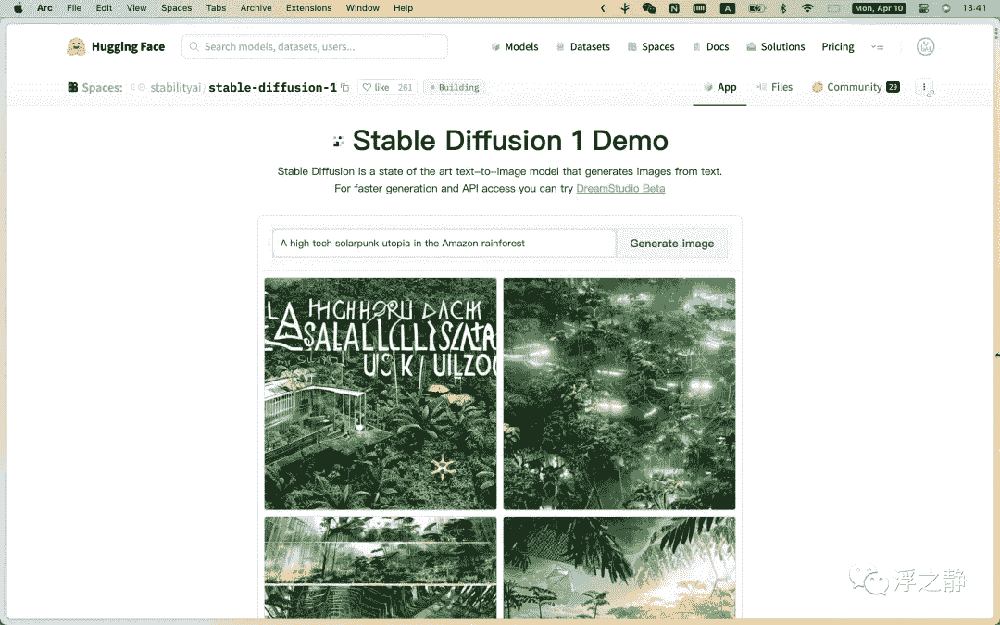
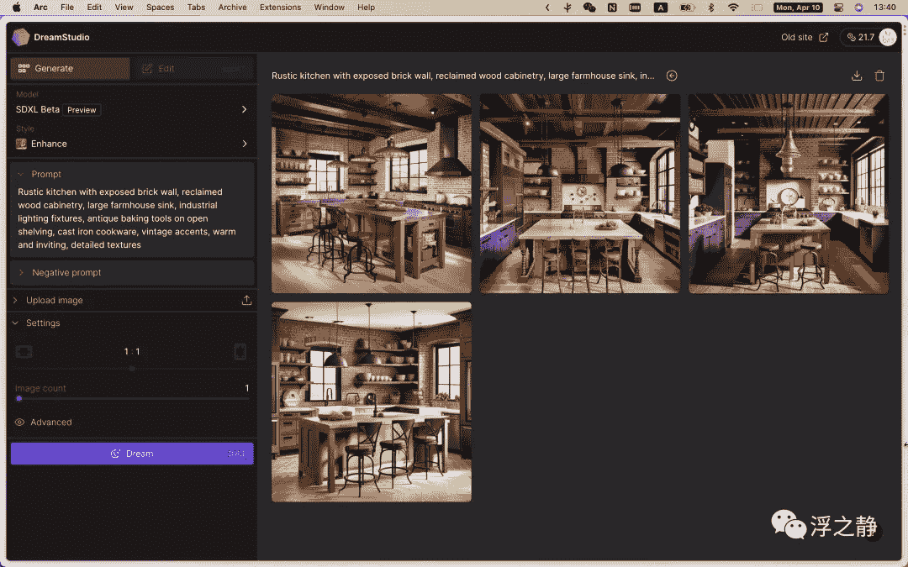
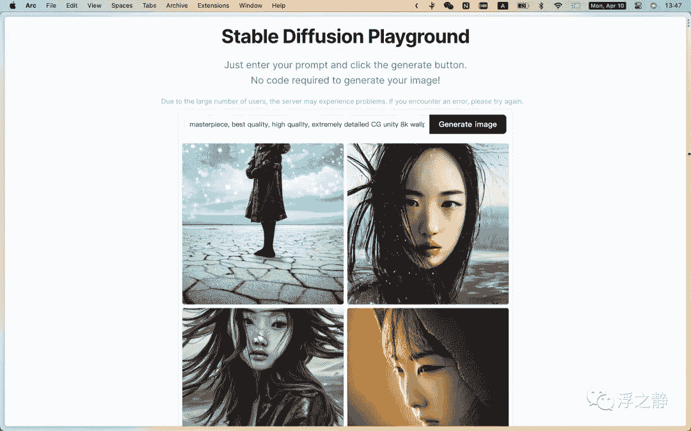
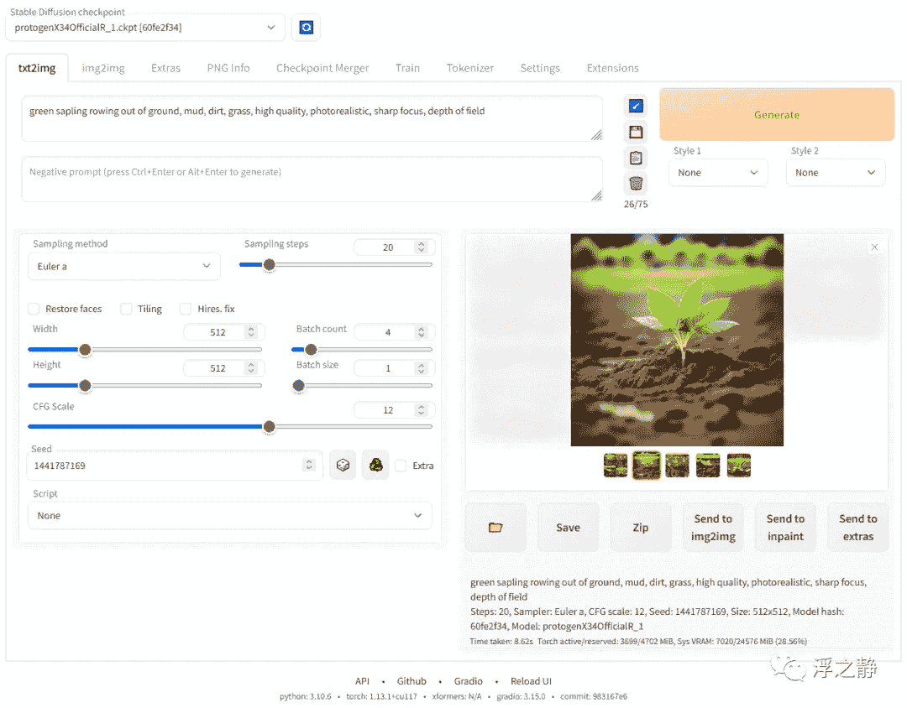
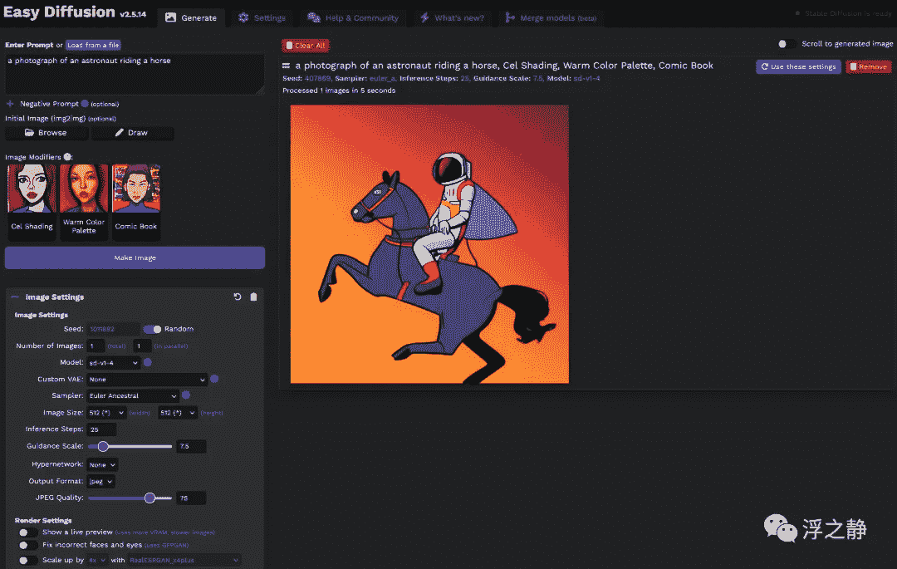
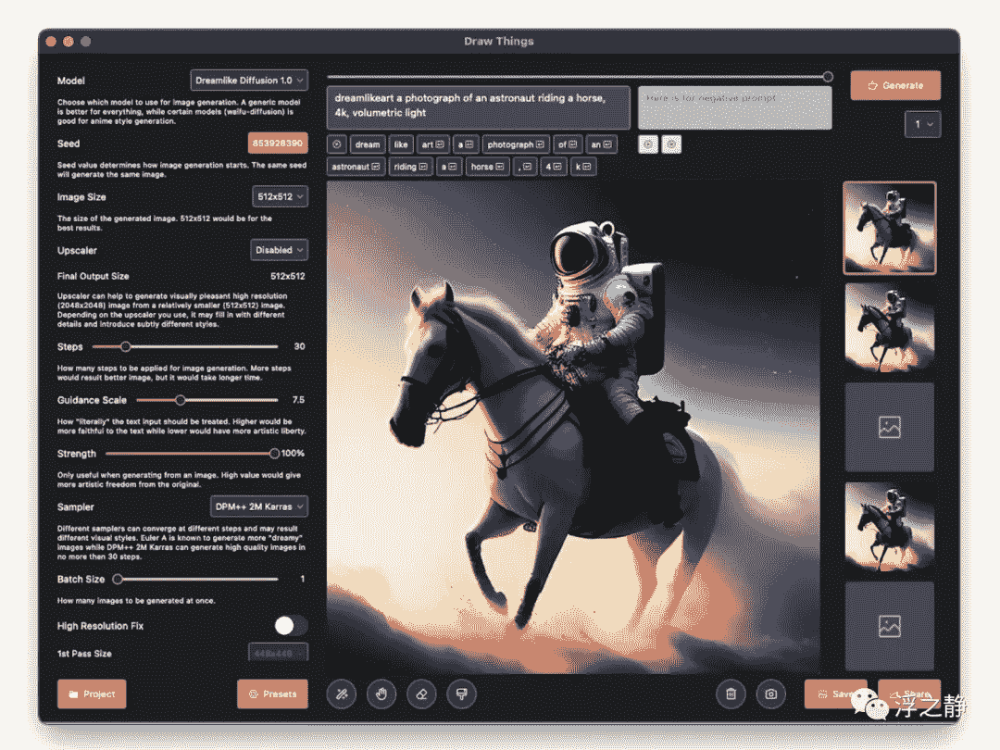
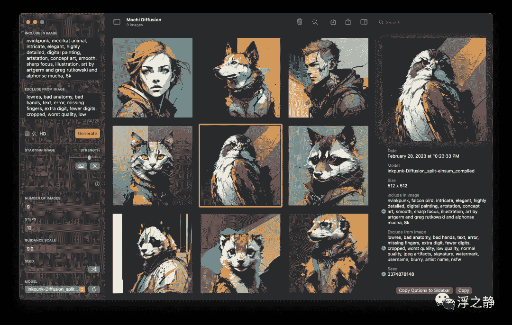
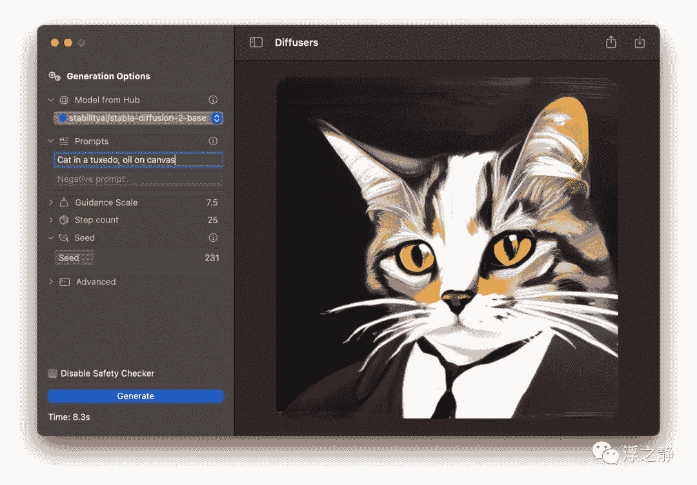
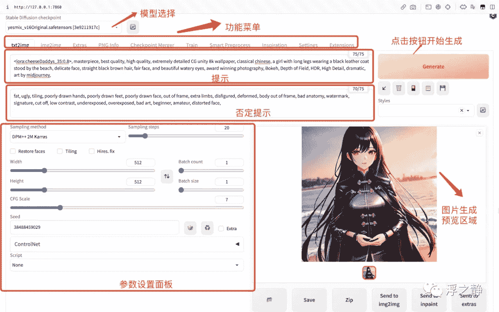

# Stable Diffusion 入门篇

> 来源：[https://geekbang.feishu.cn/docx/W4RCdyNn4o62KOxJyYAcMJ8tnxd](https://geekbang.feishu.cn/docx/W4RCdyNn4o62KOxJyYAcMJ8tnxd)

> 🤵作者： lencx

> 📃 作者介绍：AI 初学者，喜欢分享，热爱开源（GitHub Stars 60k+）。

> ⏰ 收录时间：2024-06-05 15:30:16 (UTC+8)

> 🔗 原文链接： h[ttps://mp.weixin.q](https://mp.weixin.qq.com/s/FrCbX3DpJJaBpzDn4SrqfQ)q.com/s/FrCbX3Dp...


在 Midjourney 关闭免费通道后，本地部署似乎才是更快乐的玩法。经过两天折腾，我深深迷上了 Stable Diffusion。

AI 零基础的我也在探索中，不断学习。AI 绘画背后的技术值得每一个人去学习，对技术的好奇心远比玩弄一个工具更有趣！

## 什么是 Stable Diffusion？

2022 年发布的稳定扩散（Stable Diffusion [1]）是一个文本到图像生成的深度学习模型。它主要用于根据文本的描述产生详细图像，尽管它也可以应用于其他任务，如内补绘制、外补绘制，以及基于文本提示（英文）生成图像到图像的转换。该模型是由初创公司 Stability AI [2] 与一些学术研究机构和非营利组织合作开发的。

Stable Diffusion 是一种潜在扩散模型，它的开发由初创公司 Stability AI 资助和塑造，模型的技术许可证由慕尼黑大学的 CompVis 小组发布。开发工作由 Runway [3] 的 Patrick Esser 和 CompVis [4] 的 Robin Rombach 领导，他们是早期发明稳定扩散使用的潜在扩散模型架构的研究人员之一。Stability AI 还将 EleutherAI [5] 和 LAION [6]（一家德国非营利组织，他们组织了 Stable Diffusion 训练的数据集）列为该项目的支持者。

Stable Diffusion 的代码和模型权重已开源，并且可以在大多数消费级硬件上运行，配备至少 8 GB VRAM（Video random-access memory [7]）的适度 GPU。而以前的专有文生图模型（如 DALL-E [8] 和 Midjourney [9]）只能通过云服务访问。

## 在线访问

Stable Diffusion 在线版虽然使用简单，但是大部分为阉割版（不支持模型选择，不支持否定提示（Negative Prompt），不支持插件等等），无法发挥其更大的能力。

+ `Stable Diffusion 2.1 Demo` [10]：Stable Diffusion 2.1 是 StabilityAI 最新的文本到图像模型。

+ `Stable Diffusion 1 Demo` [11]：Stable Diffusion 是一种最先进的文本到图像模型（旧版），可从文本生成图像。



+ `DreamStudio Beta` [12]：更快的生成图片及 API 访问。初始额度 25 credits，每次生成图片需要消耗 credits，消耗完了需要进行购买（$10 = 1,000 credits）。



+ `Stable Diffusion Online` [13]：只需输入提示，然后单击生成按钮。无需代码即可生成图像！



从以上几个网站大致可以看出，图片生成主要包含四部分：

+ `Prompt` 输入框：输入提示，即需要生成图片的文字描述，一般为英文短句或单词，以逗号进行分隔。

+ `Negative Prompt` 输入框：除了一些功能阉割网站不支持此功能外，Stable Diffusion 早期版本也不支持。否定提示也是一种输入提示，用来指定生成的图像中不应包含的内容。这些提示可用于微调模型的输出并确保它不会生成包含某些元素或特征的图像（达到过滤的目的）。和提示用法一样，以逗号进行分隔。（注意：否定提示可以阻止生成特定的事物、样式或修复某些图像异常，但并非 100% 有效）

+ `Generate image` 按钮：提示输入完成后，点击此按钮则开始生成图片。

+ 图片展示区：此区域用来展示图片生成后的结果。

## 本机安装

+ `Stable Diffusion web UI` [14]：基于 `Gradio` [15] 开发的浏览器界面。提供了众多实用功能，支持插件，强烈推荐。



+ `Easy Diffusion 2.5` [16]：在计算机上安装和使用 Stable Diffusion 的最简单的一键式方法。提供用于从文本提示和图像生成图像的浏览器 UI。只需输入文本提示，然后查看生成的图像（注意：Windows 有安装程序，Mac，Linux 需要下载项目后通过脚本启动）。



+ `Draw Things` (Mac 版) [17]：基于流行的 Stable Diffusion 模型，Draw Things 可帮助你在几分钟而不是几天内创建你心中的图像。它是免费的，在你的设备上 100% 离线运行所有内容以保护你的隐私（同时支持 iPhone 和 iPad）。



+ `MochiDiffusion` (Mac 版) [18]：在 Mac 上原生运行 Stable Diffusion



+ `Diffusers` (Mac 版) [19]：集成了 `Core ML` 的 Stable Diffusion 简单应用



在新版 Mac（M1，M2 芯片）上，`Draw Things` 和 `MochiDiffusion` 都可以启用 `CoreML`（机器学习）来加速图片生成。但它们和 `Stable Diffusion web UI` 相比，功能上还是差了一些（比如：插件，更多参数配置等）。

## 安装 Stable Diffusion web UI

> 仓库地址：`https://github.com/AUTOMATIC1111/stable-diffusion-webui`

系统环境（前置条件）：

+ `Python`：项目依赖 `Python` 环境来运行，所以先保证系统中已安装过 `Python`，并将其加入环境变量（`Python` 下载 [20]）。

+ `Git`：需要使用 `git` 来同步最新代码到本地（`Git` 下载 [21]）

+ 下载项目：`Git` 安装完成后，可以通过以下命令将下载到本地

```
git clone https://github.com/AUTOMATIC1111/stable-diffusion-webui.git
```

注意：因为项目是通过 `git clone` 方式下载到本地的，所以如果远程仓库有最新发布，我们只需在项目根目录下执行 `git pull` 即可同步最新代码（如果你二次编辑了项目中的文件，请查看 `git` 文档，了解如何合并代码，解决冲突等）。

### Windows

1. 安装 `Python 3.10.6` 和 `git`，并将它添加到系统环境变量中。

1. 下载项目

```
git clone https://github.com/AUTOMATIC1111/stable-diffusion-webui.git
```

1. 以普通非管理员权限从 Windows 资源管理器运行 `webui-user.bat`。

1. 它会自动下载相关依赖并启动一个服务。默认 URL 为 `http://127.0.0.1:7860`。

### Linux

1. 安装依赖：

```
# 基于 Debian:
sudo apt install wget git python3 python3-venv

# 基于 Red Hat:
sudo dnf install wget git python3

# 基于 Arch:
sudo pacman -S wget git python3
```

1. 下载项目：

```
bash <(wget -qO- https://raw.githubusercontent.com/AUTOMATIC1111/stable-diffusion-webui/master/webui.sh)
```

1. 在项目根路径下找到 `webui.sh`，通过命令行来运行它。

1. 它会自动下载相关依赖并启动一个服务。默认 URL 为 `http://127.0.0.1:7860`。

### Mac

1. 检查系统是否安装过 `brew` [22]

1. 通过 `brew` 安装依赖，如果系统中已存在某个依赖则跳过它：

```
brew install cmake protobuf rust python@3.10 git wget
```

1. 下载项目：

```
git clone https://github.com/AUTOMATIC1111/stable-diffusion-webui
```

1. 在项目根路径下找到 `webui.sh`，通过命令行来运行它。

1. 它会自动下载相关依赖并启动一个服务。默认 URL 为 `http://127.0.0.1:7860`。

## 模型

### 基础模型

如果你还没有任何可用模型，可以从 `Hugging Face` [23] 下载 Stable Diffusion 模型。模型格式一般使用 `.ckpt` 或 `.safetensors` 作为文件扩展名。找到文件，点击即可下载。这里推荐一些常用官方模型：

+ `Stable DIffusion 1.4` [24]（`sd-v1-4.ckpt` [25]）

+ `Stable Diffusion 1.5` [26]（`v1-5-pruned-emaonly.ckpt` [27]）

+ `Stable Diffusion 1.5 Inpainting` [28]（`sd-v1-5-inpainting.ckpt` [29]）

Stable Diffusion 2.0 和 2.1 需要模型和配置文件，生成图像时图像宽度和高度需要设置为 768 或更高：

+ `Stable Diffusion 2.0` [30]（`768-v-ema.ckpt` [31]）

+ `Stable Diffusion 2.1` [32]（`v2-1_768-ema-pruned.ckpt` [33]）

### 模型市场

除 `Hugging Face` 可以下载模型外，以下这些地方也可以探索：

+ `Civitai` [34]：是一个稳定扩散 AI 艺术模型的平台。收集了来自 250 多位创作者的 1,700 多个模型。我们还收集了来自社区的 1200 条评论以及 12,000 多张带有提示的图像，来帮助你入门。

+ `Stable Foundation - models-embeddings`：在 `models-embeddings` [35] 频道中用户分享了各种模型预览，附带下载链接。

### 模型协议

每个模型在发布时都会发布声明或协议，我们在使用模型时，一定要仔细阅读它们（比如：禁止使用真人训练，禁止商用等等）。我们应该在不违反法律，道德，协议的情况下，进行自己的创作。

## 项目初识

`stable-diffusion-webui` 是一个包含源代码的项目，所以对于非编程人员来说，它可能是复杂的存在。但是我们刚上手时，只需要关注几个文件夹和文件就够了。

```
.
├── models # 下载的模型存放在此处
│   ├── Lora # 📁 Lora 模型
│   │   ├── lyriel_v13.safetensors # 模型文件
│   │   └── ... # 其他模型文件
│   ├── Stable-diffusion # 📁 基础模型
│   │   ├── v1-5-pruned.ckpt # 模型文件
│   │   └── ... # 其他模型文件
│   ├── VAE # 📁 VAE 模型
│   │   ├── vae-ft-mse-840000-ema-pruned.safetensors # 模型文件
│   │   └── ... # 其他模型文件
│   └── ... # 其他
├── outputs # 🏞️ 图片输出位置
│   ├── img2img-grids # 网格图（2x2）
│   ├── img2img-images # 图生图
│   ├── txt2img-grids # 网格图（2x2）
│   ├── txt2img-images # 文字生图
│   └── ... # 其他
├── repositories # 🗑️ 缓存仓库，可删除
├── venv # 🗑️ 虚拟环境，一个独立的 Python 运行环境，可删除
├── webui-user.bat # ⚙️ Windows 启动脚本用户配置
├── webui-user.sh # ⚙️ Linux，Mac 启动脚本用户配置
├── webui.bat # 🟢  Windows 启动脚本
├── webui.sh # 🟢 Linux，Mac 启动脚本
└── ... # 其他
```

### Windows

+ 启动项目：执行 `webui.bat`

+ 配置环境变量，追加启动参数：编辑 `webui-user.bat`

### Mac 或 Linux

+ 启动项目：执行 `webui.sh`

+ 配置环境变量，追加启动参数：编辑 `webui-user.sh`



## 名词解释

+ `LoRA` 模型（`LoRA`: Low-Rank Adaptation of Large Language Models [36]）：`LoRA` 是一种在大型语言模型的预训练权重基础上，注入可训练秩分解矩阵，从而减少可训练参数数量，提高训练吞吐量和减少 GPU 内存需求的方法。相比于完全微调模型，`LoRA` 可以在不增加推理延迟的情况下，达到相当甚至更好的模型性能（简单来说它就是基础模型的微调模型，比如修改风格为国风，水墨风等）。

+ `VAE`（`Variational Autoencoder` [37]）：`VAE` 代表变分自动编码器。它是神经网络模型的一部分，可对来自较小潜在空间的图像进行编码和解码（极大减少了显存），从而使计算速度更快。

+ `Model` 与 `LoRA` 的关系（以书本世界为例）：

+ `Model`：百科全书

+ `LoRA`: 百科全书中的一个额外条目，作为一个“便利贴”塞进其中。

+ `.ckpt` 与 `.safetensors`：它们都是一种用于分发模型的文件格式。

+ `.ckpt`：是很多包含 `Python` 代码的压缩文件，利用它们就像解压缩一样简单。因包含大量代码，意味着它可能包含恶意代码，加载未知不信任来源的 `.ckpt` 文件，很可能会危害你的计算机。

+ `.safetensors`：只包含生成所需的数据，更难被利用。不包含代码，所以加载 `.safetensors` 文件也更安全和快速。

## 常见问题

### 安装依赖失败

首次启动服务时，`stable-diffusion-webui` 需要下载大量依赖包，主要会出现以下情况：

+ 卡住不动：大概率是网络不佳，因为有些依赖资源地址在国内是无法访问的，这时需全程启用代理，避免网络连接问题。

+ 下载报错：有些依赖版本和自身系统不兼容，会导致报错，这时可根据具体报错信息去网上搜索解决方案。

+ 启动成功，但部分依赖下载失败：可以通过手动安装来解决此类问题（例如在项目根路径下执行 `pip3 install xxx`，至于执行什么命令可根据报错信息中的提示进行尝试）。

### Mac 常见错误

#### ERROR: No matching distribution found for tensorflow


```
Error running install.py for extension /Users/lencx/github/lencx/ai-art/stable-diffusion-webui/extensions/sd_smartprocess.
Command: &quot;/Users/lencx/github/lencx/ai-art/stable-diffusion-webui/venv/bin/python3&quot; &quot;/Users/lencx/github/lencx/ai-art/stable-diffusion-webui/extensions/sd_smartprocess/install.py&quot;
Error code: 1
stdout: loading Smart Crop reqs from /Users/lencx/github/lencx/ai-art/stable-diffusion-webui/extensions/sd_smartprocess/requirements.txt
Checking Smart Crop requirements.

stderr: Traceback (most recent call last):
  File &quot;/Users/lencx/github/lencx/ai-art/stable-diffusion-webui/extensions/sd_smartprocess/install.py&quot;, line 9, in &lt;module&gt;
    run(f&#x27;&quot;{sys.executable}&quot; -m pip install -r &quot;{req_file}&quot;&#x27;, f&quot;Checking {name} requirements.&quot;,
  File &quot;/Users/lencx/github/lencx/ai-art/stable-diffusion-webui/launch.py&quot;, line 97, in run
    raise RuntimeError(message)
RuntimeError: Couldn&#x27;t install Smart Crop requirements..
Command: &quot;/Users/lencx/github/lencx/ai-art/stable-diffusion-webui/venv/bin/python3&quot; -m pip install -r &quot;/Users/lencx/github/lencx/ai-art/stable-diffusion-webui/extensions/sd_smartprocess/requirements.txt&quot;
Error code: 1
stdout: Collecting ipython==8.6.0
  Using cached ipython-8.6.0-py3-none-any.whl (761 kB)
Collecting seaborn==0.12.1
  Using cached seaborn==0.12.1-py3-none-any.whl (288 kB)

stderr: ERROR: Could not find a version that satisfies the requirement tensorflow (from versions: none)
ERROR: No matching distribution found for tensorflow
```

解决方案：打开 `stable-diffusion-webui/extensions/sd_smartprocess/requirements.txt` 文件修改 `tensorflow` 为 `tensorflow-macos` ，这是因为在 mac 上匹配不到 `tensorflow` 安装包，将其修改为 `tensorflow-macos` 即可。

+ What is the proper way to install TensorFlow on Apple M1 in 2022 [38]

+ Get started with tensorflow-metal [39]

## ModuleNotFoundError: No module named 'fairscale'

```
Civitai: API loaded
Error loading script: main.py
Traceback (most recent call last):
  File &quot;/Users/lencx/github/lencx/ai-art/stable-diffusion-webui/modules/scripts.py&quot;, line 256, in load_scripts
    script_module = script_loading.load_module(scriptfile.path)
  File &quot;/Users/lencx/github/lencx/ai-art/stable-diffusion-webui/modules/script_loading.py&quot;, line 11, in load_module
    module_spec.loader.exec_module(module)
  File &quot;&lt;frozen importlib._bootstrap_external&gt;&quot;, line 883, in exec_module
  File &quot;&lt;frozen importlib._bootstrap&gt;&quot;, line 241, in _call_with_frames_removed
  File &quot;/Users/lencx/github/lencx/ai-art/stable-diffusion-webui/extensions/sd_smartprocess/scripts/main.py&quot;, line 3, in &lt;module&gt;
    from extensions.sd_smartprocess import smartprocess
  File &quot;/Users/lencx/github/lencx/ai-art/stable-diffusion-webui/extensions/sd_smartprocess/smartprocess.py&quot;, line 15, in &lt;module&gt;
    from extensions.sd_smartprocess.clipinterrogator import ClipInterrogator
  File &quot;/Users/lencx/github/lencx/ai-art/stable-diffusion-webui/extensions/sd_smartprocess/clipinterrogator.py&quot;, line 14, in &lt;module&gt;
    from models.blip import blip_decoder, BLIP_Decoder
  File &quot;/Users/lencx/github/lencx/ai-art/stable-diffusion-webui/repositories/BLIP/models/blip.py&quot;, line 11, in &lt;module&gt;
    from models.vit import VisionTransformer, interpolate_pos_embed
  File &quot;/Users/lencx/github/lencx/ai-art/stable-diffusion-webui/repositories/BLIP/models/vit.py&quot;, line 21, in &lt;module&gt;
    from fairscale.nn.checkpoint.checkpoint_activations import checkpoint_wrapper
ModuleNotFoundError: No module named &#x27;fairscale&#x27;
```

解决方案：手动安装 `fairscale` 依赖（相关 issue： installed but it says ModuleNotFound? [40] ）

```
pip3 install fairscale
```

## References

[1] Stable Diffusion: https://github.com/Stability-AI/stablediffusion
[2] Stability AI: https://stability.ai
[3] Runway: https://runwayml.com
[4] CompVis: https://github.com/CompVis
[5] EleutherAI: https://www.eleuther.ai
[6] LAION: https://laion.ai
[7] Video random-access memory: https://en.wikipedia.org/wiki/Video_random-access_memory
[8] DALL-E: https://openai.com/research/dall-e
[9] Midjourney: https://midjourney.com
[10] Stable Diffusion 2.1 Demo: https://huggingface.co/spaces/stabilityai/stable-diffusion
[11] Stable Diffusion 1 Demo: https://huggingface.co/spaces/stabilityai/stable-diffusion-1
[12] DreamStudio Beta: https://beta.dreamstudio.ai/generate
[13] Stable Diffusion Online: https://stablediffusionweb.com
[14] Stable Diffusion web UI: https://github.com/AUTOMATIC1111/stable-diffusion-webui
[15] Gradio: https://github.com/gradio-app/gradio
[16] Easy Diffusion 2.5: https://github.com/cmdr2/stable-diffusion-ui
[17] Draw Things (Mac 版): https://drawthings.ai
[18] MochiDiffusion (Mac 版): https://github.com/godly-devotion/MochiDiffusion
[19] Diffusers (Mac 版): https://github.com/huggingface/swift-coreml-diffusers
[20] Python 下载: https://www.python.org/downloads
[21] Git 下载: https://git-scm.com/download
[22] `brew`: https://brew.sh
[23] Hugging Face: https://huggingface.co/models?pipeline_tag=text-to-image&sort=downloads
[24] Stable DIffusion 1.4: https://huggingface.co/CompVis/stable-diffusion-v-1-4-original
[25] `sd-v1-4.ckpt`: https://huggingface.co/CompVis/stable-diffusion-v-1-4-original/resolve/main/sd-v1-4.ckpt
[26] Stable Diffusion 1.5: https://huggingface.co/runwayml/stable-diffusion-v1-5
[27] `v1-5-pruned-emaonly.ckpt`: https://huggingface.co/runwayml/stable-diffusion-v1-5/resolve/main/v1-5-pruned-emaonly.ckpt
[28] Stable Diffusion 1.5 Inpainting: https://huggingface.co/runwayml/stable-diffusion-inpainting
[29] `sd-v1-5-inpainting.ckpt`: https://huggingface.co/runwayml/stable-diffusion-inpainting/resolve/main/sd-v1-5-inpainting.ckpt
[30] Stable Diffusion 2.0: https://huggingface.co/stabilityai/stable-diffusion-2
[31] `768-v-ema.ckpt`: https://huggingface.co/stabilityai/stable-diffusion-2/resolve/main/768-v-ema.ckpt
[32] Stable Diffusion 2.1: https://huggingface.co/stabilityai/stable-diffusion-2-1
[33] `v2-1_768-ema-pruned.ckpt`: https://huggingface.co/stabilityai/stable-diffusion-2-1/resolve/main/v2-1_768-ema-pruned.ckpt
[34] Civitai: https://civitai.com
[35] `models-embeddings`: https://discord.com/channels/1002292111942635562/1047197565365538826
[36] LoRA: Low-Rank Adaptation of Large Language Models: https://arxiv.org/abs/2106.09685
[37] Variational Autoencoder: https://en.wikipedia.org/wiki/Variational_autoencoder
[38] What is the proper way to install TensorFlow on Apple M1 in 2022: https://stackoverflow.com/questions/72964800/what-is-the-proper-way-to-install-tensorflow-on-apple-m1-in-2022
[39] Get started with tensorflow-metal: https://developer.apple.com/metal/tensorflow-plugin/
[40] installed but it says ModuleNotFound?: https://github.com/d8ahazard/sd_smartprocess/issues/29
