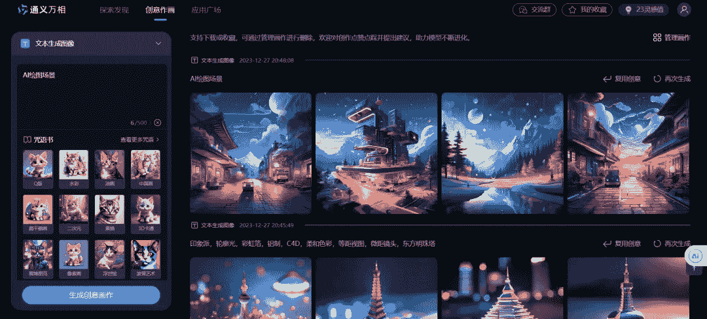
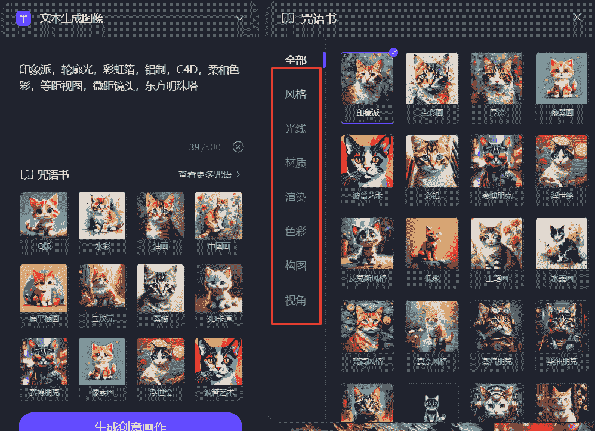
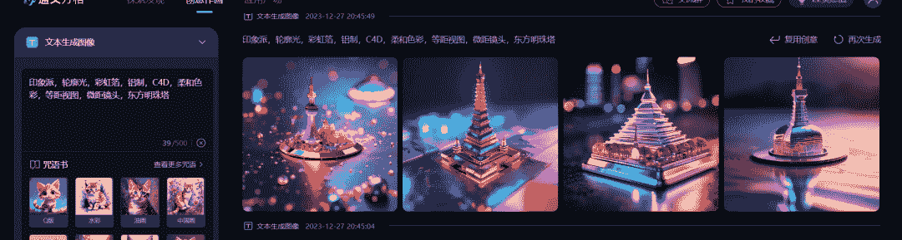
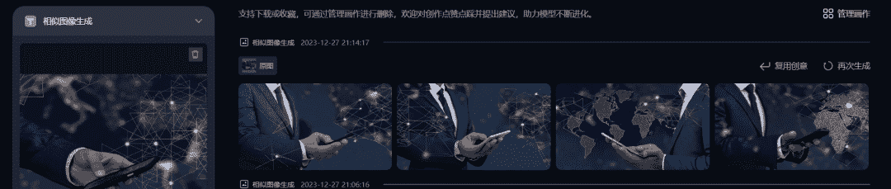
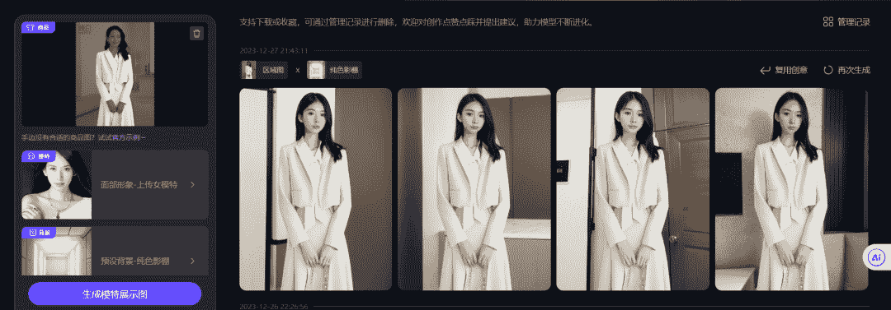
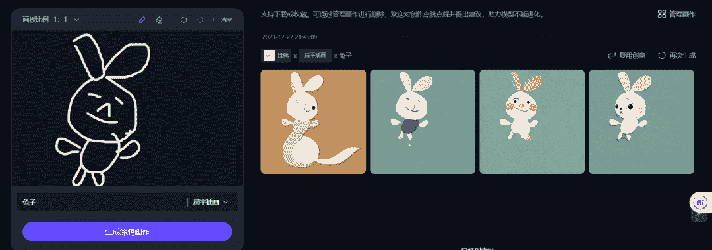

# 【通义万相】两天了解一个AI工具之【绘画工具（免费）】

> 来源：[https://geekbang.feishu.cn/docx/F9fKdqigRob45Lxy9WLcHnuen1g](https://geekbang.feishu.cn/docx/F9fKdqigRob45Lxy9WLcHnuen1g)

> 🤵作者： IT工具人

> 📃 作者介绍：14年互联网IT从业经验，做过程序员，现任AI产品经理。发现并分享能提升做事效率的工具，让创业或副业变得更简单。

> ⏰ 收录时间：2024-05-31 11:47:17 (UTC+8)

> 🔗 原文链接：   h[ttps://mp.weixin.q](https://mp.weixin.qq.com/s/HekTAcgtk5gUTpGK71Rkbw)q.com/s/HekTAcgt...

欢迎关注👸号👆

本文将介绍阿里的通义万相，封面是用通义万相生成。我们先了解一下AI绘画能做什么，再介绍通义万相怎么用，最后再列一下其他的AI绘图工具。

AI绘画是给了职场人、艺术类或自媒体行业提供了极大便利，主要是应用在以下几个场景：

1、 **影视动漫游戏创作 **。在影视、动漫、游戏中可以采用AI绘图创作生成人物、场景。

2、 **艺术创作 **。艺术家可以用AI绘出原型图，以激发灵感。教育工作者可以

3、 **工业设计 **。采用AI绘图设计元器件的外观，还有建筑设计、景观设计、装修设计的效果图等均可以采用AI绘图辅助。

4、 **图片生产岗位 **。广告设计岗位、前端、宣传海报等需要图片，又担心图片侵权，可以采用AI绘图辅助设计，避免在大量图中找寻，提高内容生产效率。

通义万相是一款免费的AI绘图工具，是今年7月份发布，得到大家的好评，时隔小半年，这款AI绘图工具的细节做得越来越好。

绘图有三种方式，一是文本生成图像，二是相似图像生成，三是图像风格迁移，根据场景需要可以选择不同的方式生成图片，接下来我们详细介绍这三种生成方式。

**文本生成图像 **，这种方式是用文字描述所要生成图片的细节，因此对于图片的细节需详细描述，越详细描述，生成的图片离你预期的就越接近。如果不懂得怎么描述，工具给出了“咒语书”，可以根据咒语书中的图片展示选择提示词。例如点击风格类型时，可以看到多个图像风格选项，当选择印象派，左侧的文本就会记录印象派。除了风格之外，还可以选择光线、材质、渲染、色彩、构图、视角等多类型提示词。

采用 **咒语书 **，设计一个东方明珠塔的摆件。提示词是“印象派，轮廓光，彩虹箔，铝制，C4D，柔和色彩，等距视图，微距镜头，东方明珠塔”。这种文本生成图像无疑是适合专业的人士所用，起码要熟练提示词，才能画出心中所想的图像。

**相似图像生成 **，是在有参照图片时，按照参照图片生成图片，这种是比较适合领导说，你就参考某某图片画就行，这时 候用AI绘图就是几秒的事，如果担心图片相似度比较高，可以用生成的图片再重新生成相似图像，直到相似度降低为止。

**图像风格迁移 **，即给目标图片换风格，这在工作中是很常见。

通义万相应用广场中有好玩的应用，虚拟模特、涂鸦作画、写真馆。

**虚拟模特 **，在电商中应该是很好用，可以把你的衣服商品穿在自己身上进行拍照，然后找一个模特形象和背景，这样就可以生成图片， 在预设的背景中 模特穿你的衣服。这种在电商中上商品的效率是很高，都不用请模特现场拍。

**涂鸦作画 **，这个是很好玩的应用，用鼠标画画，然后给出提示词，工具会生成相关的作品。

**写真馆 **，是头像和写真模板结合，相当于头像与写真模板拼接。

总结一下，这款AI工具可以给你的工作带来便利是毋庸置疑，尤其是给专业的图片设计人士，更能提升效率。当然工具还是会出现人脸的五官扭曲等细节不到位的问题，相信阿里正在努力改进中，在2024年可能这个问题会有较大的改善。