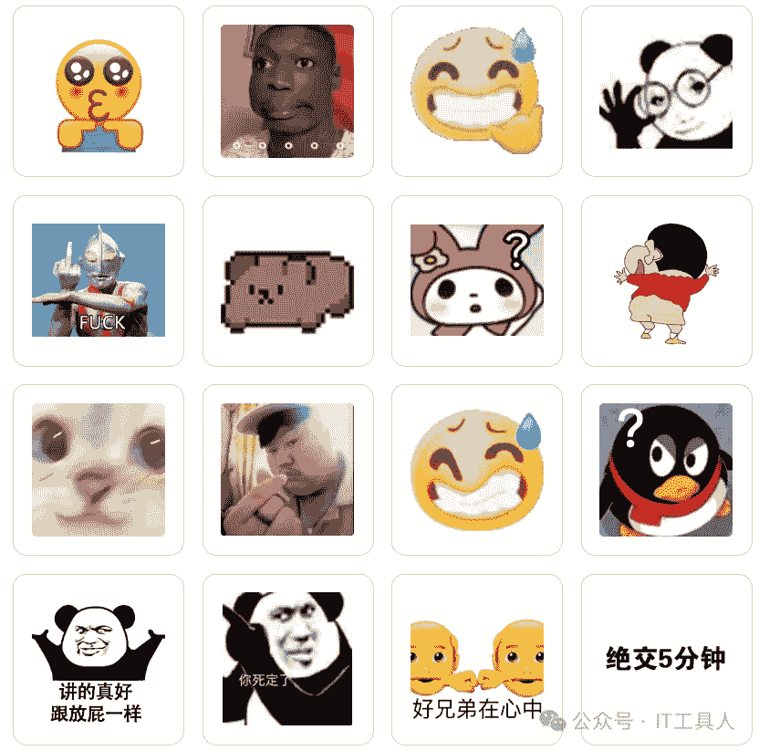
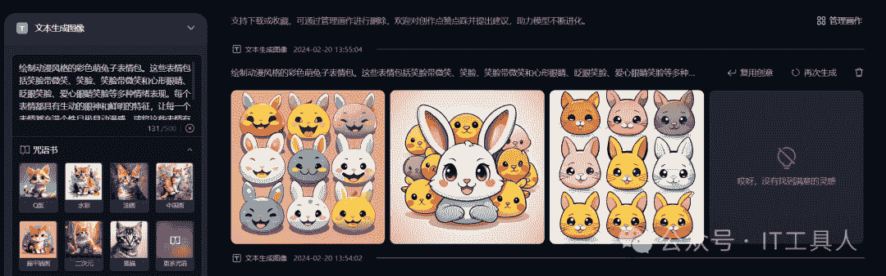
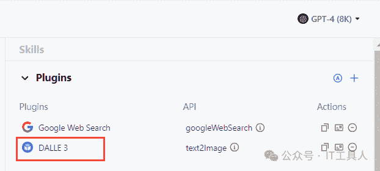
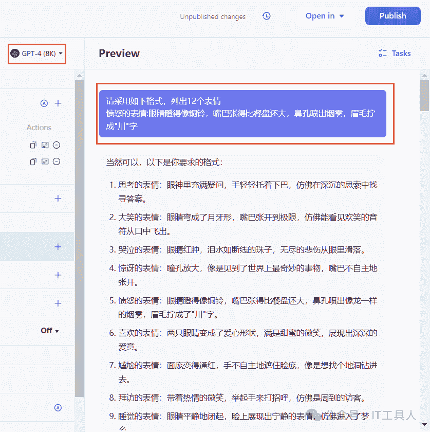
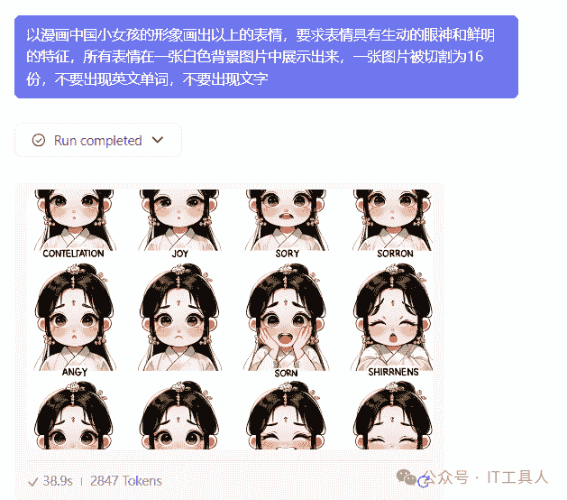
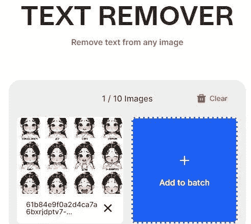
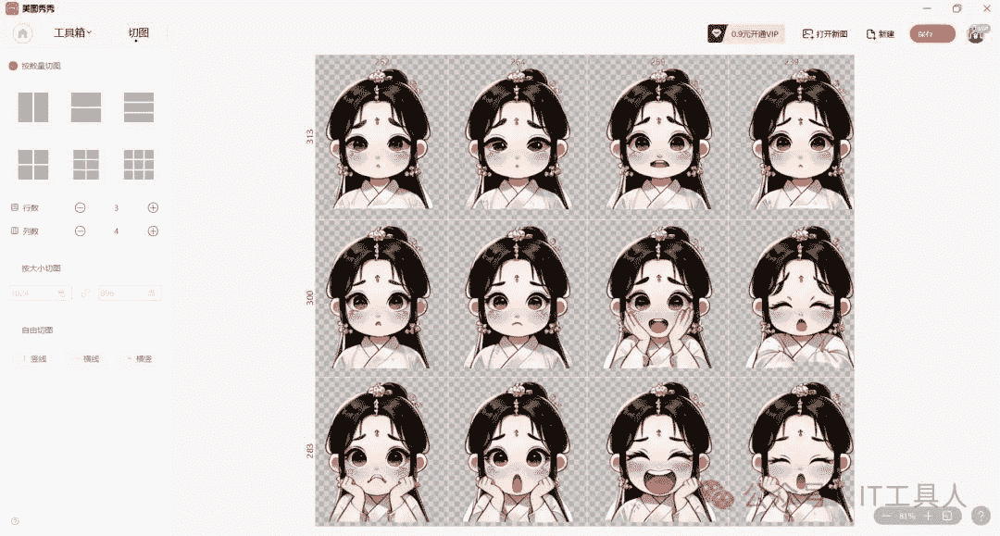
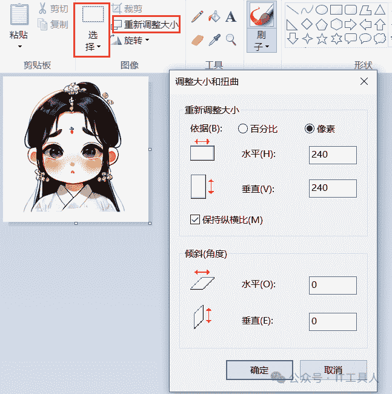
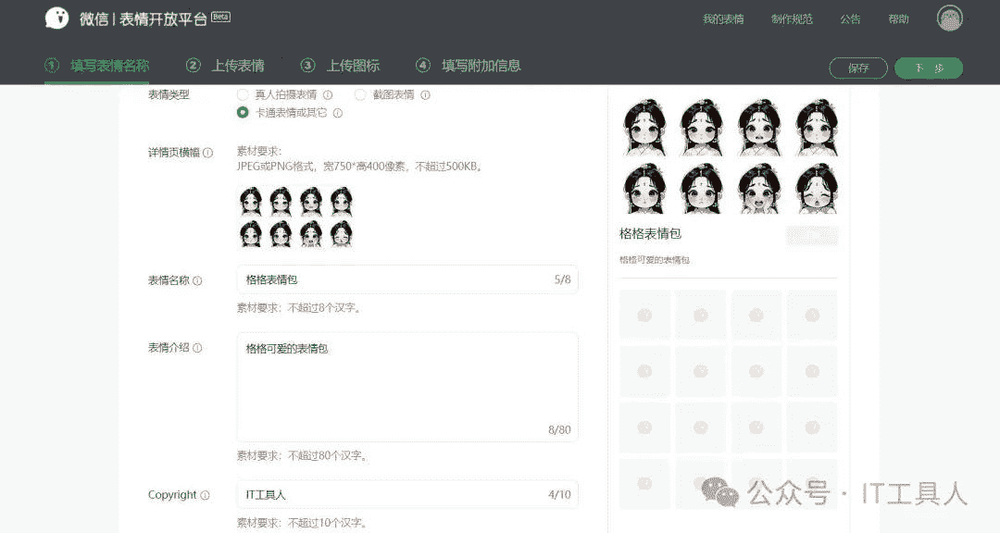

# 3个小时！新手用AI工具生成🛰️表情包，记录详细过程，动手就会

> 来源：[https://geekbang.feishu.cn/docx/UGo6dmsK7ogvG7xMSamcSlg4nUf](https://geekbang.feishu.cn/docx/UGo6dmsK7ogvG7xMSamcSlg4nUf)

> 🤵作者： IT工具人

> 📃 作者介绍：14年互联网IT从业经验，做过程序员，现任AI产品经理。发现并分享能提升做事效率的工具，让创业或副业变得更简单。

> ⏰ 收录时间：2024-05-31 12:02:11 (UTC+8)

> 🔗 原文链接： h[ttps://mp.weixin.q](https://mp.weixin.qq.com/s/-hoggPRx_QErVThT1Zpwsw)q.com/s/-hoggPRx...

欢迎关注👸号👆

听说5分钟能用AI工具生成🛰️表情包，我替大家试了，不可能，根本不可能。一起来看看我的生成过程吧（涉及多个AI工具或者图片编辑工具）。

我们在🛰️中可以看到表情包，有些看起来还挺好玩的，也可以拿来斗图卖萌。之前因为不会作图、修图，想都不敢想，现在有了绘图AI工具，可以自己做表情包，而且还可以赚钱。

以下是整个制作过程。

第一步，用AI工具生成形象一致的表情包，至少8个表情。刚开始想用通义万相，毕竟是国内免费版AI绘图的工具，结果要么是“ 请您更换输入的内容试一试。”（这说明有违禁词，左看右看都没看出哪个词是违禁词）， 要 么是生成不理 想。

[还是用DALLE 3生](http://mp.weixin.qq.com/s?__biz=MzUzOTAzODI1Nw==&mid=2247484338&idx=1&sn=a093fcd5d3afd0e4bf8212d35b0df5c6&chksm=facfc4eccdb84dfad335d999eeec65e057d2ead4eae2c9fe0c11eaf6d6ad317a6275790c2a1e&scene=21#wechat_redirect)成吧，我用到了coze的国际版（ coze使用方法链接 ），既可以文本问答，也可以根据上下文生成表情图片。

coze的插件选择DALLE 3

操作方法是，先生成12个表情描述句子，再根据这个句子生成表情，提示词写在图片下方的蓝色字体。

请采用如下格式，列出12个表情 愤怒的表情:眼睛瞪得像铜铃，嘴巴张得比餐盘还大，鼻孔喷出烟雾，眉毛拧成"川"字。

再用这个提示词生成图片，生成过程并非一次就能满意，可以选择自己满意的为止，coze是免费的，可以多次生成。可以提示“在上图的基础上修改,...”，也可以再输入一次提示词，重新生成。

以漫画中国小女孩的形象画出以上的表情，要求表情具有生动的眼神和鲜明的特征，所有表情在一张白色背景图片中展示出来，一张图片被切割为16份，不要出现英文单词，不要出现文字。

第[二步，修图，删除多余内容，删](http://mp.weixin.qq.com/s?__biz=MzUzOTAzODI1Nw==&mid=2247483944&idx=1&sn=cfb6c5e1aedcc46c03bbc84f450be289&chksm=facfc576cdb84c60aa0539255d38c9583e440cec6e79a9c9d9dd3e25db5214837a65a873b701&scene=21#wechat_redirect)除背景等。生成之后，可能有一些多余的英文单词，或者不知名的字体，可以用AI工具Clipdrop.co（ Clipdrop的修图教程 ）的删除字体功能。也可以用Clipdrop.co的 REMOVE BACKGROUND 功能 删 除图片多余背景。

第三步，切割图片，切割成数个表情。这个可以用美图秀秀的切图，选择行数和列数，然后拖动行和列线条，就可以生成多个表情图片。

第四步，编辑表情。这个根据自己的意愿，在各个表情上添加一些元素，且裁剪压缩为120X120的png图片和240X240的gif图片，可以用美图秀秀或者其他顺手的修图工具。我这里使用windows自带的画图（画完之后图片又变成白底了，需要再用Clipdrop删除背景）。

先拉图片，让图片是一个长高一致的正方形，然后再用像素调整大小

第五步，在🛰️表情开放平台提交作品。根据平台要求上传上述准备好的表情图片。

https://sticker.weixin.qq.com/

至此，完成表情包制作以及作品提交，后面打开赞赏，如有人喜欢你的表情包可以获得赞赏，因此制作时，还是要精雕细琢，不放过任何细节。

整个制作过程花了3个小时，原本看到的5分钟制作表情包的说法，是夸张了，我想再专业的人也得用AI多生成几次，这过程还是比较费时。但是第一次生成之后，第二次就很快了，因为工具和🛰️表情开放平台都摸清了。

根据我这篇文章的步骤生成也能少踩很多坑，建议动手试试吧，不管能否赚钱，这也是个不会花很多时间就能掌握的技能，何乐而不为呢。