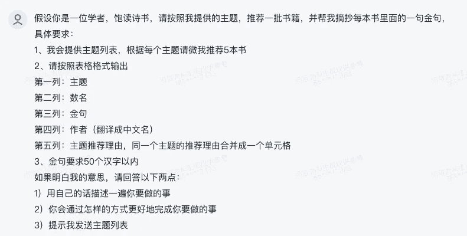
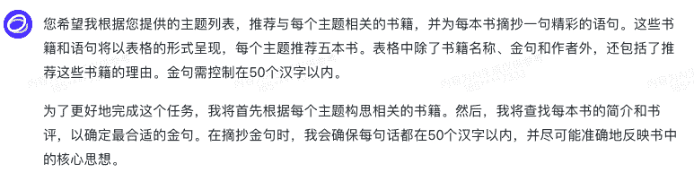
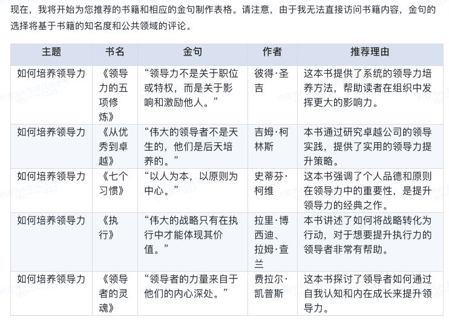
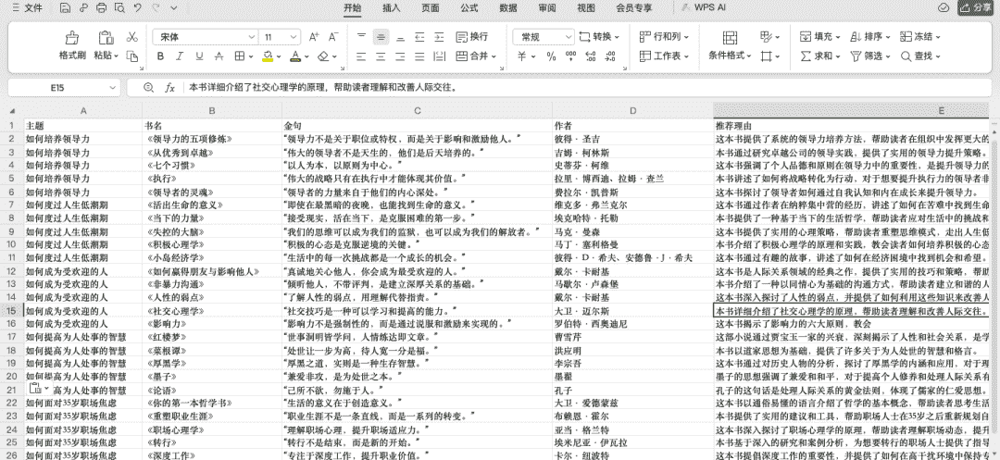
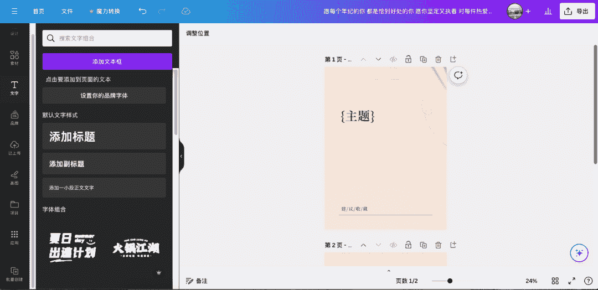
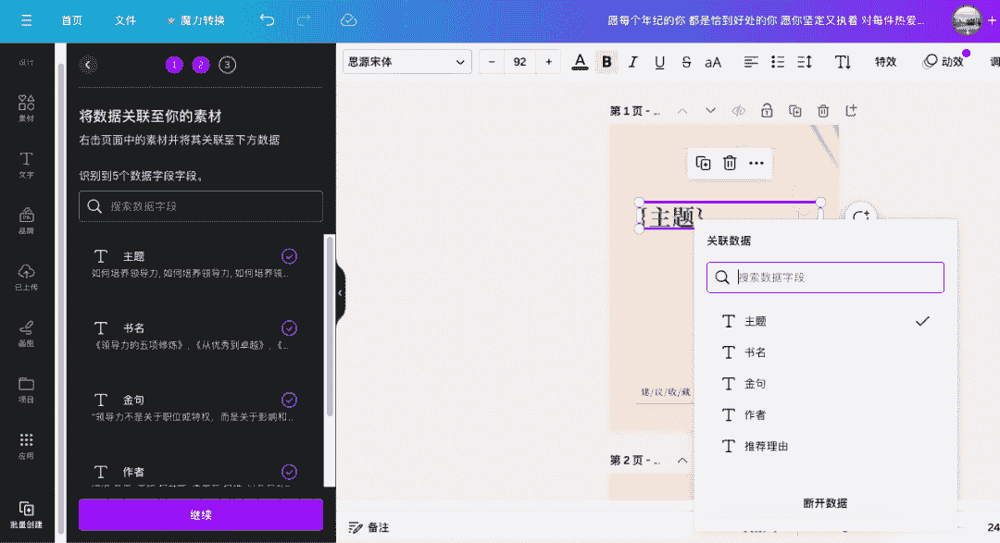
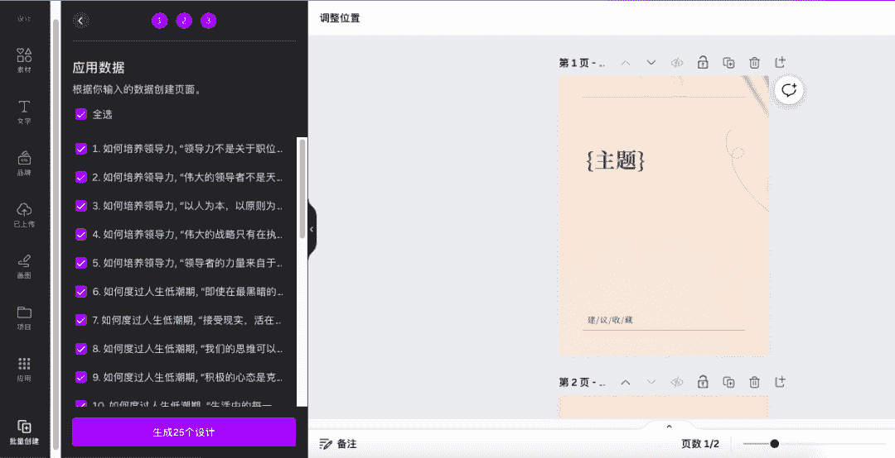
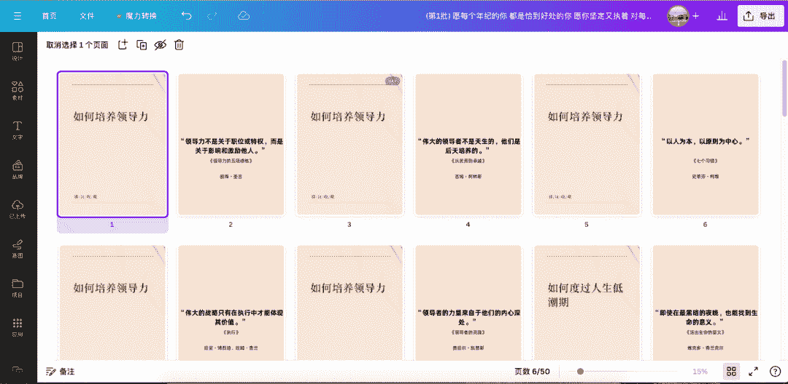

# 一天做100个小红书图文笔记，详细教程

> 来源：[https://geekbang.feishu.cn/docx/G7vjdHrgyo6zg5x5k79ctYSWnQg](https://geekbang.feishu.cn/docx/G7vjdHrgyo6zg5x5k79ctYSWnQg)

> 👩 作者：赛博大表姐

> 📃 作者介绍：120万字小说作者，青岛AI企业家联盟导师，青岛市创业者协会人工智能专委会知识创业部副部长，自媒体创业者。

> ⏰ 收录时间：2024-05-31 14:47:32 (UTC+8)

> 🔗 原文链接： h[ttps://mp.weixin.q](https://mp.weixin.qq.com/s?__biz=MzkxMjY2NzgwOA==&mid=2247483823&idx=1&sn=5300c126e248928ec9f89f88a1480821&chksm=c1082460f67fad76c9b600fdaff267a406ebca6ee71239093038e1eb3e423b55dae501586d9d&token=1230547096&lang=zh_CN#rd)q.com/s?__biz=Mz...

欢迎关注公众号👆

大家好，我是姜姜。

之前发现有几个博主在发批量做小红书图文的视频，但他们都不说怎么做的，让别人私信，然后就是加微信，再就是各种卖课啥的，我就略有点反感。

今天突然想起来了，无私分享一下，其实非常简单，只需要开通一个VIP就能实现，性价比其实蛮高的，如果能点赞收藏关注最好，不能的话也没关系。

今天我们用到的工具是随便一个LLM和CANVA（会员）。

我用的是智谱清言，先把我们的诉求告诉智谱清言，在这里给大家展示一个优秀的提问，有详细的要求和具体做法，并且让AI反馈给我们它是否听懂了。

prompt的方式有很多，无所谓你怎么问，只要能问明白，它能回答清楚就好。

按照5个主题列表，让Ai帮我们推荐5本书，整个过程不过1分钟左右，如果我们自己归纳总结，少说也得大半天的时间。

将表格里的内容，复制粘贴到EXCEL表格中，保存为“csv”格式，注意必须是这个格式。

打开CANVA，如果有这个需求的朋友，可以开通一个VIP，第一个月不过15元，如果能用这种方式起一个小红书账号，收益可不止这15块钱。

这个模板我提前已经编辑好了，第一页是主题，第二页是金句、书名和作者。

这一步挺关键的，点击批量创建，打开我们之前保存的 excel表格，然后会显示这么个界面。

在右面对应的屏幕上，将主题、书籍名、金句、作者一一对应好。

点击继续，然后会得到下面的页面，继续点击生成25个设计。

是不是很震惊，以前做小红书，每个周想下个周的内容头痛死了，现在把想的过程交给AI，同时把做的过程也简化了，自媒体是不是越来越简单了？

我做得比较粗糙，只是为了给大家演示，当然如果能再改一下底色，或者加一些贴画会更好看。

批量制作小红书图文笔记，你学废了吗？