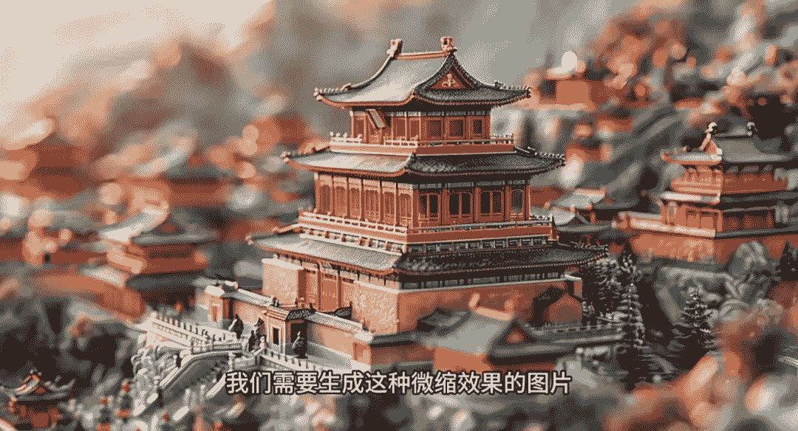
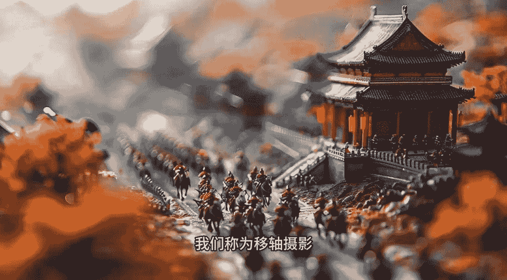
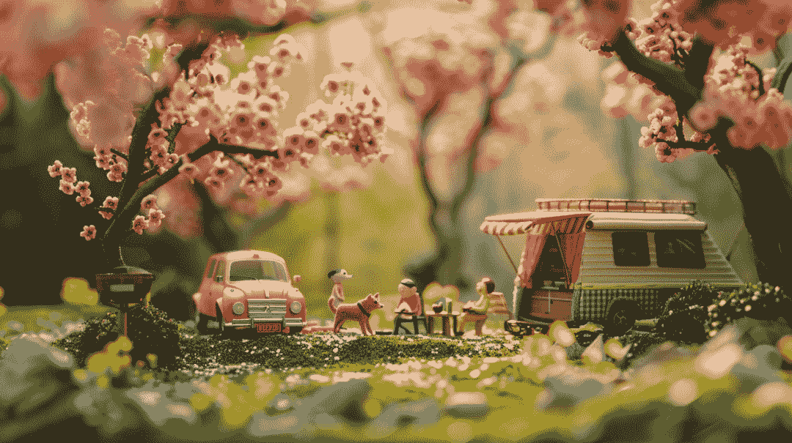
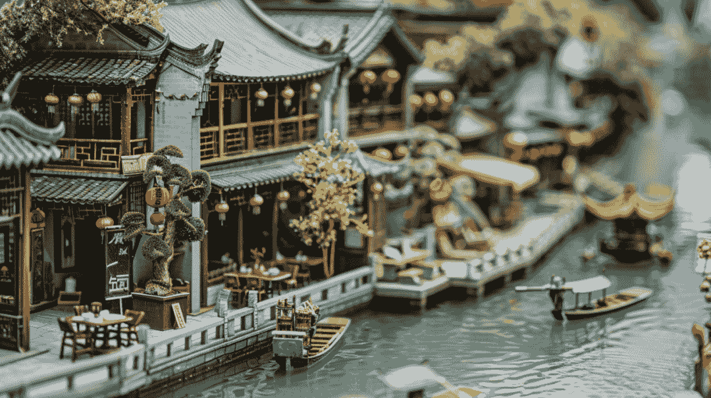
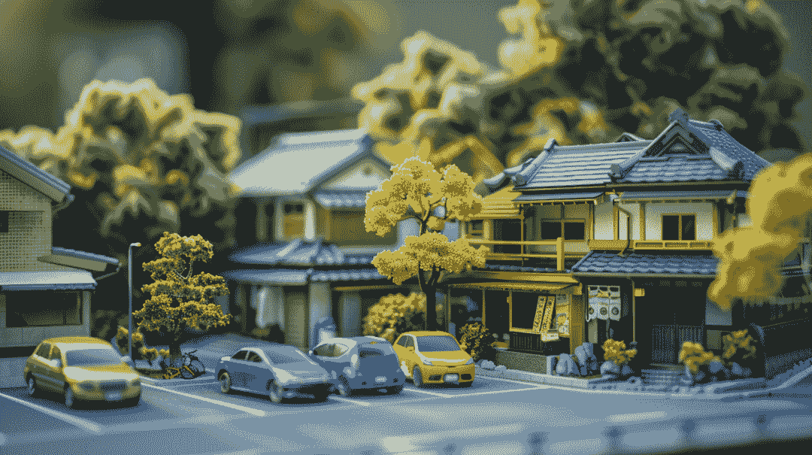
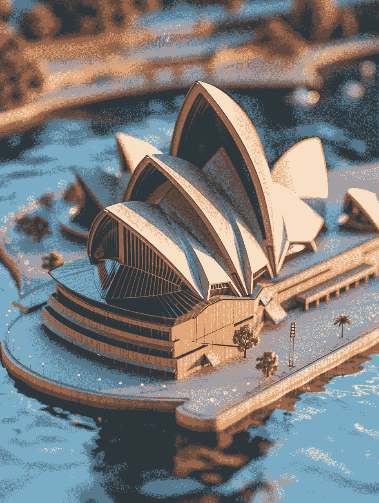
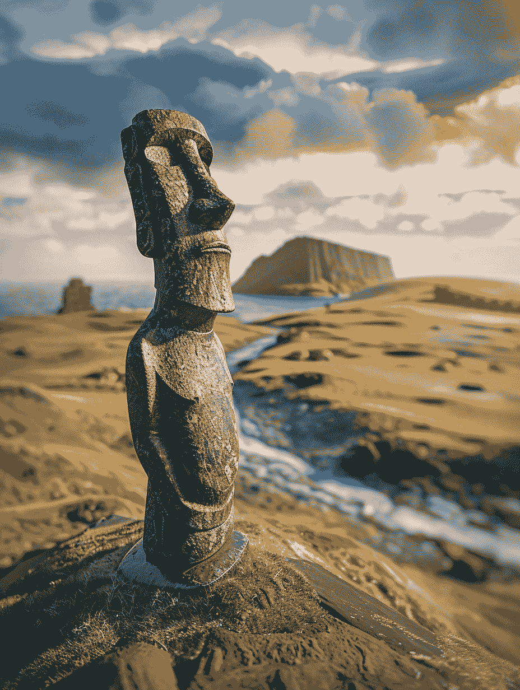
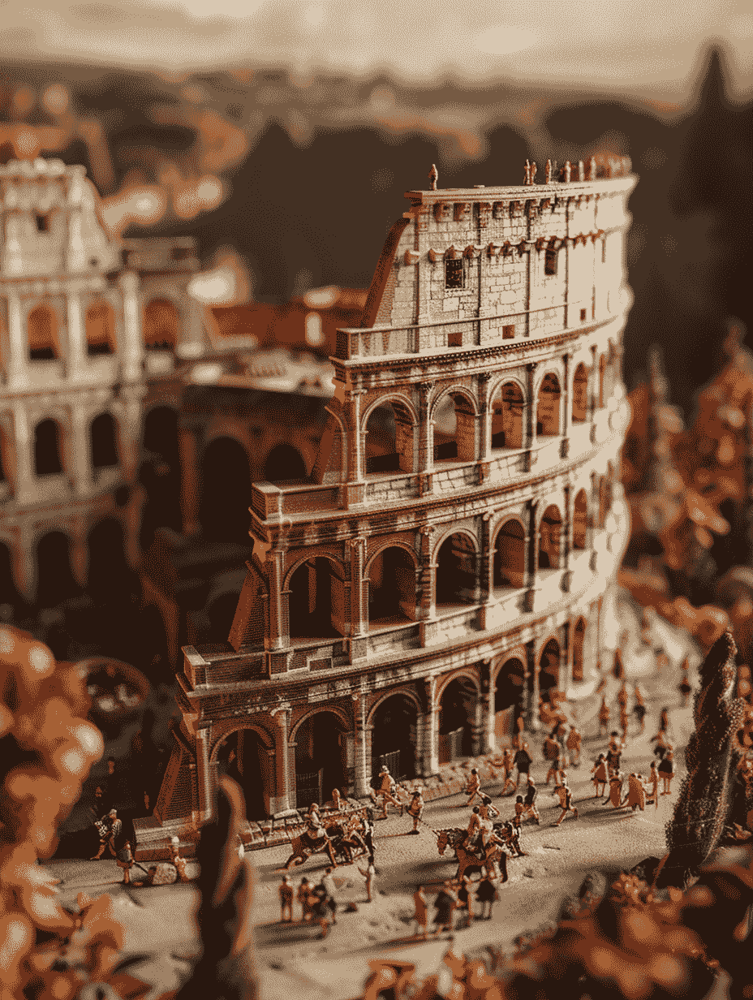
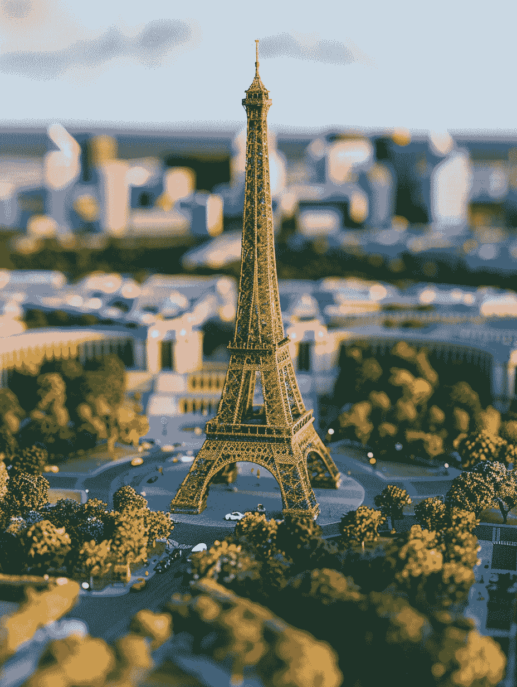
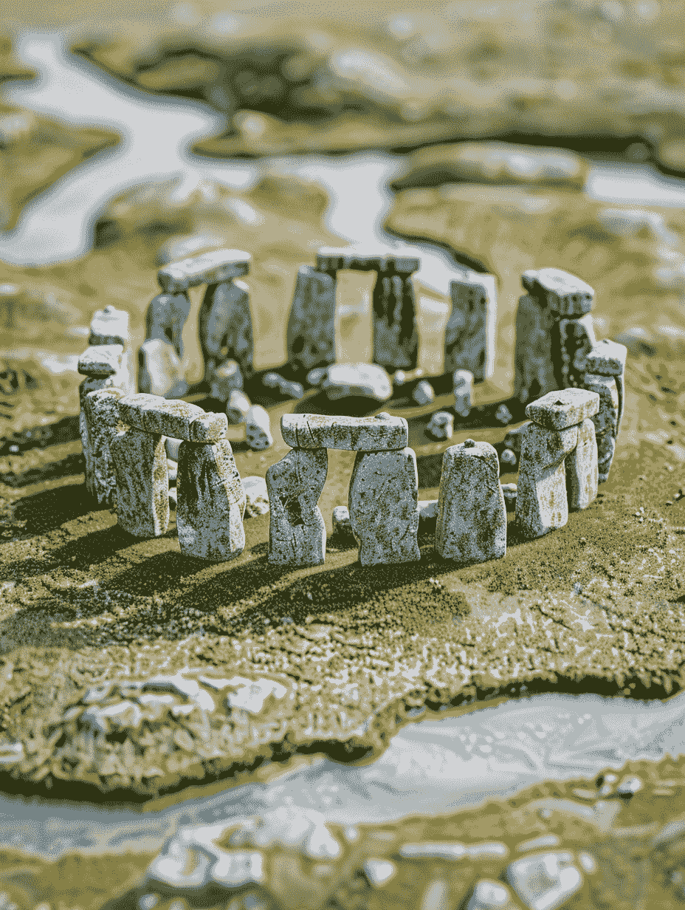

# 爆火的微缩景观是怎么拍出来的？

> 来源：[https://geekbang.feishu.cn/docx/Fjv3dEbrqoPxLMxSKCvcDHobny0](https://geekbang.feishu.cn/docx/Fjv3dEbrqoPxLMxSKCvcDHobny0)

> 👩 作者：赛博大表姐

> 📃 作者介绍：120万字小说作者，青岛AI企业家联盟导师，青岛市创业者协会人工智能专委会知识创业部副部长，自媒体创业者。

> ⏰ 收录时间：2024-05-31 14:51:11 (UTC+8)

> 🔗 原文链接： h[ttps://mp.weixin.q](https://mp.weixin.qq.com/s?__biz=MzkxMjY2NzgwOA==&mid=2247484221&idx=1&sn=35f4fd630822565a624033f9392a6b27&chksm=c10826f2f67fafe4177e07a683ccbcafff4311ac6d23357625f22b3257ebb0468ece439ed7f4&token=1230547096&lang=zh_CN#rd)q.com/s?__biz=Mz...

欢迎关注👸号👆

大家好，我是姜姜。

最近网络上有一种风格的AI图片火了，那就是微缩景观，咱们先来看看这个作者的作品：

这两张是我从他视频中截的图，他把这些图片全部生成视频，做成了一个短小精悍的故事，非常博人眼球，在各大平台上发布，平均获得几千赞。

像这种微缩的图片，还有这种：

这种：

这种：

不知道屏幕前的你是否喜欢，反正我个人非常喜欢这种风格。

其实在AI绘画火以前，这种微缩版的景观就已经受欢迎很多年了，有了AI绘画，很多事情仿佛一下子变得简单起来了。

再加上图生视频的工具，可以让这种可爱的图片动起来，效果跟《阿凡提》有点类似呢～

那像这种生动又可爱又好看的图片到底怎么画出来的，今天就给大家揭秘喽。

想要有这种微缩、立体的效果，有几个词起到关键的作用：

1、Miniature scene微缩景观；

2、tilt shift延时移轴摄影；

3、clay粘土；

4、felt毛毡；

除了这些以外，叠加这些效果会更赞：

5、excellent lighting出色的照明；

6、volume landscape体积景观；

7、brush rendering笔刷渲染；

8、super detail超级细节；

9、bird’s-eye view鸟瞰；

10、panoramic view俯视。

但也不是说把这所有的全放到一起效果一定会好，有些还需要加3D，C4D渲染等这种词，最终效果还是需要自己一遍一遍尝试。

耐心一些，你会看到最终想要的效果。下面给大家分享几个案例吧。

所有的微缩类图片当中，其实我还是更喜欢景点类，所以我多放了一些景点的图片和咒语：

「 咒语： A clay world miniature scene of the Sydney Opera House, panoramic view, bird's-eye view, excellent lighting, super detailed, 3D rendering, C4D rendering. --ar 3:4 」

「 咒语： A clay world miniature scene of Stonehenge in the UK, panoramic view, bird's-eye view, excellent lighting, super detailed, 3D rendering, C4D rendering. --ar 3:4 」

「咒语：miniature,Super cute clay world,isometric view of Roman,cute clay freeze frame animation,cute Roman Colosseum,people,tilt shift,excellent lighting,volume,landscape,brush rendering,3D,super detail --ar 3:4」

「 咒语：A clay world miniature scene of the Eiffel Tower in France, panoramic view, bird's-eye view, excellent lighting, super detailed, 3D rendering, C4D rendering. --ar 3:4 」

「 咒语： A clay world miniature scene of Stonehenge in the UK , panoramic view, bird's-eye view, excellent lighting, super detailed, 3D rendering, C4D rendering. --ar 3:4 」