# 用Chatgpt篇篇流量10万+？

> 来源：[https://geekbang.feishu.cn/docx/SUojdqtzOoi7jJxk9nTcC875nrc](https://geekbang.feishu.cn/docx/SUojdqtzOoi7jJxk9nTcC875nrc)

> 👩 作者：赛博大表姐

> 📃 作者介绍：120万字小说作者，青岛AI企业家联盟导师，青岛市创业者协会人工智能专委会知识创业部副部长，自媒体创业者。

> ⏰ 收录时间：2024-05-31 15:13:06 (UTC+8)

> 🔗 原文链接： h[ttps://mp.weixin.q](https://mp.weixin.qq.com/s?__biz=MzkxMjY2NzgwOA==&mid=2247484698&idx=1&sn=38822757a890d02322c13c9ec4c76977&chksm=c10820d5f67fa9c3175926b0a0cf2e277b8bb7aa642f20d23026f86824af8701aee2607eff4f&token=1230547096&lang=zh_CN#rd)q.com/s?__biz=Mz...

欢迎关注👸号👆

前两天看了一类👸号挺火，用搞笑一些的句子和好看的配图，篇篇好几万的流量，让人挺羡慕的。

静下心来看看，其实很简单……

里面是这种，一段或者一句话，配上一个好看或者搞笑的图片，真没想到，这种流量好到爆～

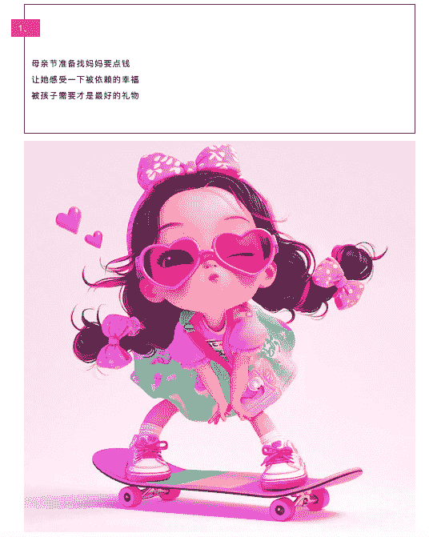

接下来拆解一下这种爆火的👸号制作步骤：

1.一个吸引人的标题；

2.几个走心的文案；

3.好看的配图。

现在先来看一下，如何让AI帮我们写一个吸引人的标题。

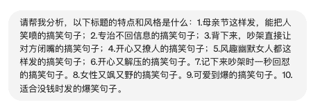

这回我们用Chatgpt，看看它给我们的反馈：

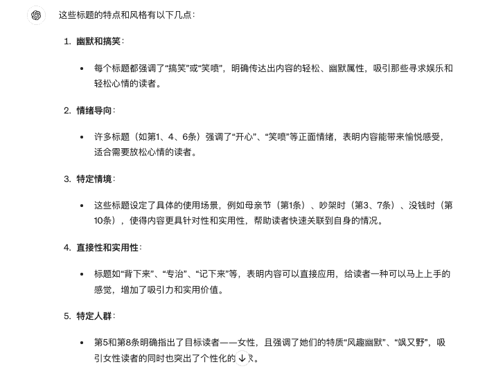

好啦，现在我们让它按照这些风格和特点，帮我们仿写10条：

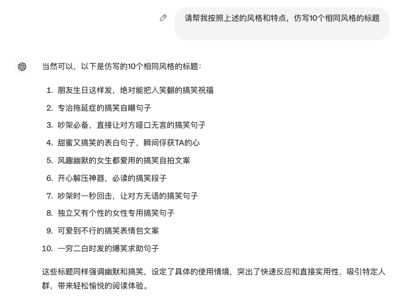

怎么样？是不是特别简单呀。现在咱们进行第二步，写文案！

在这儿需要额外提醒一下，可以把对标👸号文章扔给AI让它帮忙提取内容，也可以将你认为有代表性的文案直接复制到对话框中，让它帮你分析。

还是老规矩，先让GPT帮我们分析文案的特点和风格，这样做是让GPT形成一条完整的思维链条，如果上来就让它写文案，不会太精准。

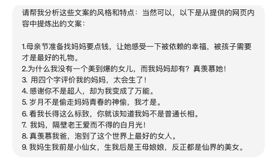

这是GPT给我的反馈：

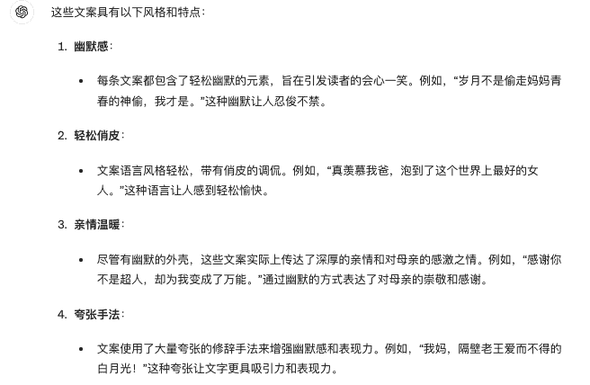

OK，接下来，让GPT帮我们按照主题，仿写上述文案：

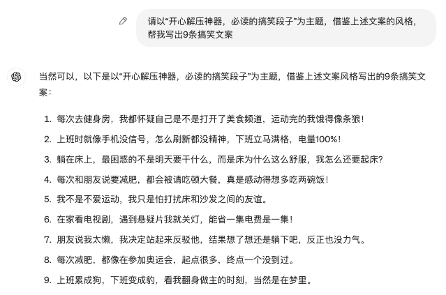

到这一步，内容都有了，接下来我们要配图。

我习惯用Midjourney，所以咱们先打开工具，选择describe，让MJ帮我们生成4张目标图片相同风格的图片。

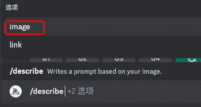

我们在此基础上进行修改提示词，生成自己想要的图片风格即可。

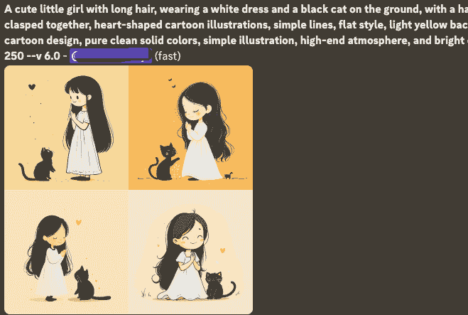

按上述步骤生成你想要的张数，我这儿生成了9张，因为目标👸号文章就是9个文案+9张图片，接下来我们看看完整效果：

1、

每次去健身房，

我都怀疑自己是不是打开了美食频道，

运动完的我饿得像条狼！

2、

上班时就像手机没信号，

怎么刷新都没精神，

下班立马满格，电量100%！

3、

躺在床上，

最困惑的不是明天要干什么，

而是床为什么这么舒服，

我怎么还要起床？

4、

每次和朋友说要减肥，

都会被请吃顿大餐，

真是感动得想多吃两碗饭！

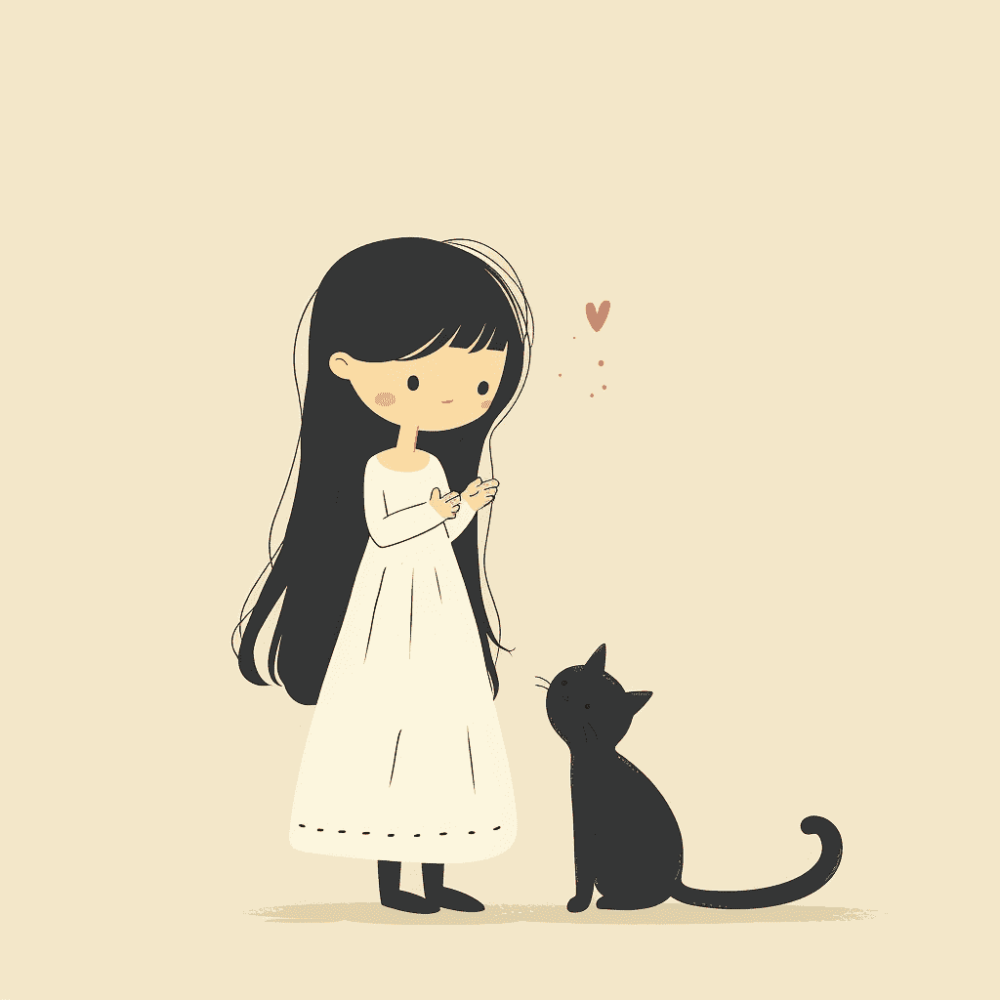

5、

我不是不爱运动，

我只是怕打扰床和沙发之间的友谊。

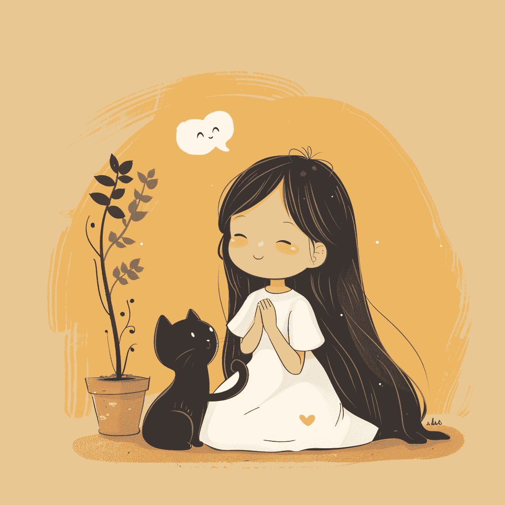

6、

在家看电视剧，

遇到悬疑片我就关灯，

能省一集电费是一集！

7、

朋友说我太懒，

我决定站起来反驳他，

结果想了想还是躺下吧，

反正也没力气。

8、

每次减肥，

都像在参加奥运会，

起点很多，

终点一个没到过。

9、

上班累成狗，

下班变成豹，

看我翻身做主的时刻，

当然是在梦里。

今天就到这儿了，拿去挣钱吧，散会。