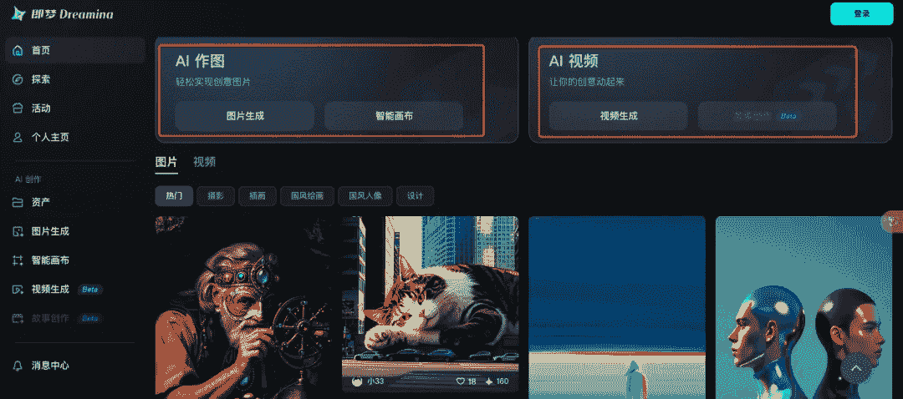
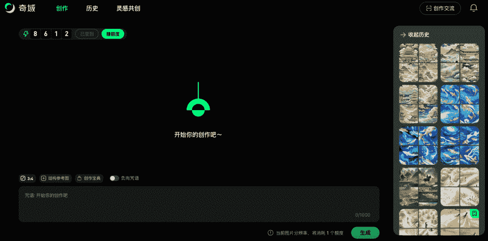
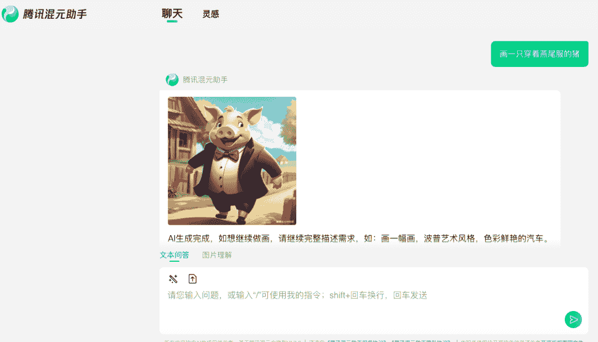
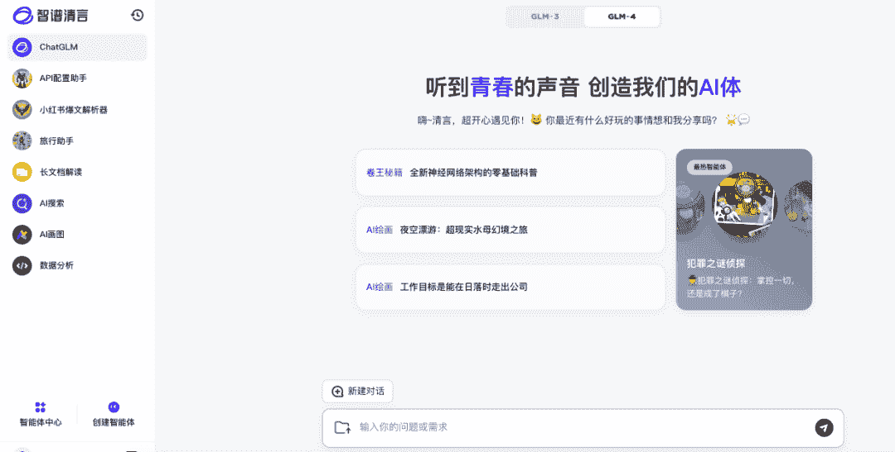
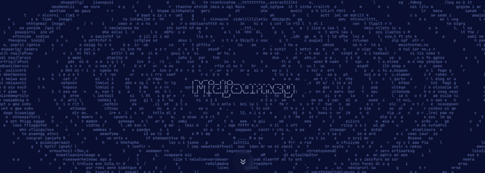

# 常用的6个AI绘图工具，国内国外都有！

> 来源：[https://geekbang.feishu.cn/docx/GW21dV5vto9pfHx08nYc7yP8nUf](https://geekbang.feishu.cn/docx/GW21dV5vto9pfHx08nYc7yP8nUf)

> 👩 作者：赛博大表姐

> 📃 作者介绍：120万字小说作者，青岛AI企业家联盟导师，青岛市创业者协会人工智能专委会知识创业部副部长，自媒体创业者。

> ⏰ 收录时间：2024-05-31 15:45:58 (UTC+8)

> 🔗 原文链接：  h[ttps://mp.weixin.q](https://mp.weixin.qq.com/s?__biz=MzkxMjY2NzgwOA==&mid=2247484568&idx=1&sn=fc6752a8c693ba0e9634434275ffa61a&chksm=c1082157f67fa841ff57f48e198b9911ba94e71f4c74fcb059005575af99a43ec6d28f9c6510&token=1230547096&lang=zh_CN#rd)q.com/s?__biz=Mz...

欢迎关注👸号👆

考虑到很多新人朋友刚接触AI，最难的就是在NNN多工具中挑一个“最”好用的开始，所以这篇文章非常有必要出现。

**需要注意的是： **

这篇文章提到的是「我常用」的，而不是盲目的推荐。

还**需要提前说一**点，AI本身就是个工具，文生图也好、文生视频也好，更是个工具中的工具，不要在乎哪个“最”好用，我个人觉得没有最好， 只有最适合 。

**而且工具太**多了，现在很多，以后会更多，千万 不要纠结 在要把所有工具都学会，那你就累死了……

**学会底层的绘图逻辑 **，然后找1、2个或者2、3个深耕下去才是正事。

排名不分先后，按我收藏夹里收藏的顺序

**一、国内篇**

1、即梦Dreamina

是否免费：免费

网址：https://dreamina.jianying.com/ai-tool/home?subTab=

字节旗下的一款文生图、文生视频工具，个人觉得还不错，比较有特色的是它的智能画布，据说啊，据说智能画布对标SD

不过整体上我愿意让大家尝试，智能画布的一件抠图功能挺好，而且对于要求不是那么高的商品图，用智能画布就能搞定。

再就是它的文生视频每天60点免费额度，相当于你可以生成4次，而且现在还有了对口型的功能，但必须是会员才行（昨天吐槽的就是他们家…… ）

2、奇域

是否免费： 免费

网址：https://www.qiyuai.net/

众所周知，我超爱的一款国风类AI绘图工具了，逢人就推，因为是真的很好用。

我曾经说过，奇域是MJ在国风这个赛道上的最强竞品，而并非平替，真心希望大家都去试试。

每天签到有100点额度，也就是说最多可以生成100张图，真的够用了……

3、通义万相

是否免费：免费

网址： https://tongyi.aliyun.com/wanxiang/

在我的眼里，目前阿里和字节在应用端是国内的两大巨头了，通义的全家桶也非常牛，通义千问、 通义 万相、 通义 听悟、 通义 法睿、 通义 灵码、 通义 点金、 通义 智文……这华丽丽的一家子啊，等我后面写一篇通义全家桶的文。

通义万相最大的特色就是艺术字，今年超级符号火了，但不是人人都有能力用SD画一个超级符号，通义万相的艺术字相当于简约版的超级符号，要求不那么高的话，真可以试试。

4、腾讯混元助手

是否免费：免费

网址：https://hunyuan.tencent.com/

有点类似于Chatgpt4.0的DELL-E，可以在对话中画图，而且质量不差，语义理解也挺好，混元是个宝藏啊，发现得晚了一些。

5、智谱清言

是否免费：免费

网址：https://chatglm.cn/

跟混元比较类似，也是直接在对话中输入你想要绘画的内容即可，不过我使用智谱的时间比较久了，比Kimi还要久，所以我对智谱其实更加偏爱一些。

大爱无言

对于智谱想说的太多，反而不知道该从何说起， 后面安排一篇文吧，给它 一点排面

**二、国外篇**

我只用一个：Midjourney

是否免费：收费

官网网址：https://www.midjourney.com/home

和其他的不一样，Midjourney无法在官网中直接绘图，它需要在一个叫Discord的论坛里打开。

具体的操作流程我就不说了，这个也值得单独开一篇讲，在这需要提一点，目前MJ最便宜也是10美金一个月，如果觉得太贵，可以在某宝上自行搜索套壳的，也一样用。

只不过单独买，就你一个人用，买套壳是和别人拼，一般6-8个人差不多30多人民币一个月，新手是比较合适的。

好了，今天就到这儿了。

除此以外，也有很多比较好用，但是我不太常用的工具，比如 国内的 哩布、无界、美图等，国外的DELL-E3、Stable Diffusion 等，还有一些小工具，花点钱就能很方便地使用。

其实如果你会用Midjourney，那么你会发现大部分的图其实都可以用它来解决……

如果你还是不知道该从哪下手，这篇文章中的每一个，挨个去用，用完了再来找我沟通。