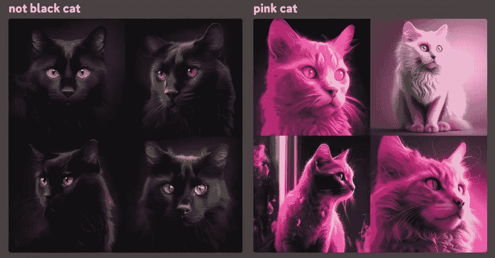
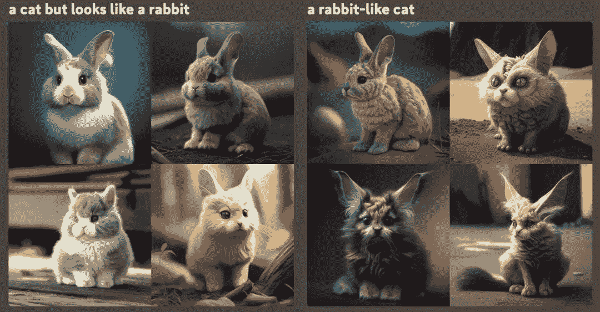
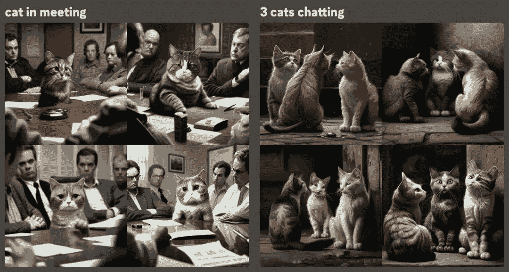
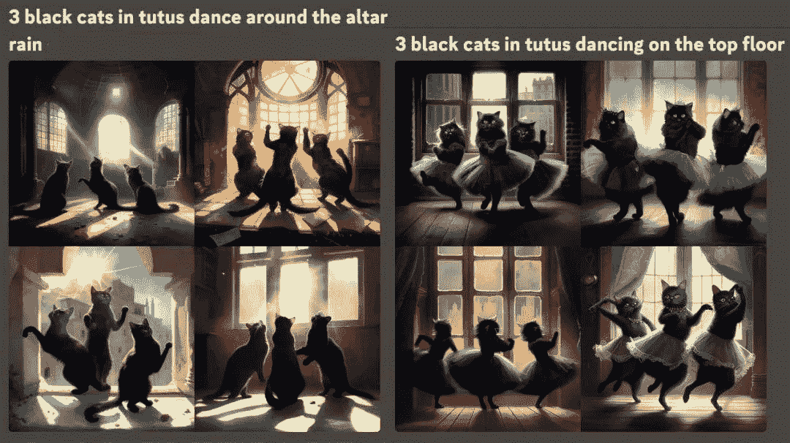
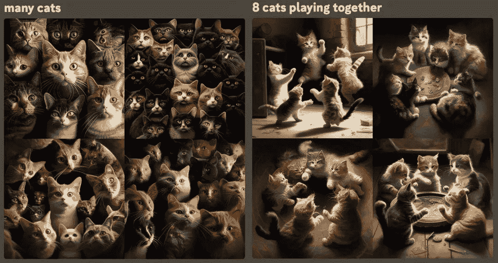
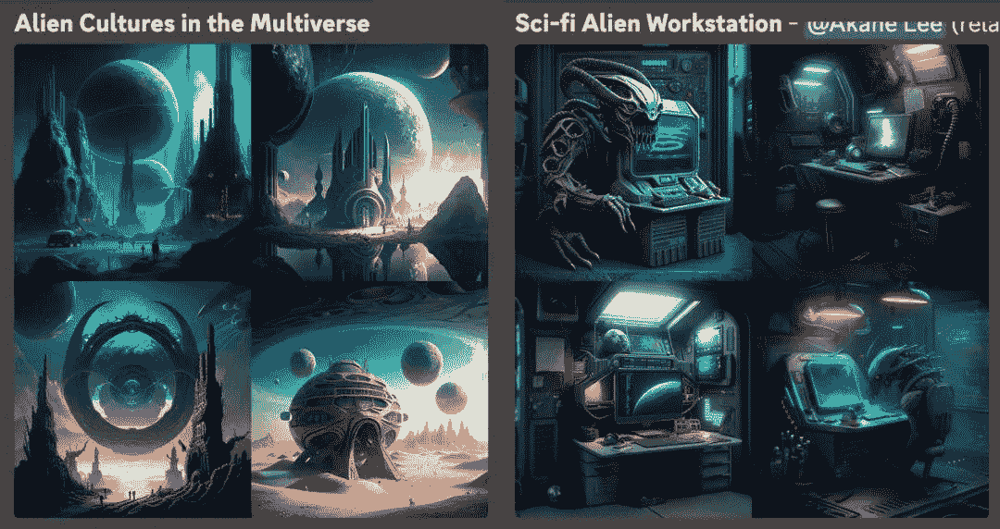
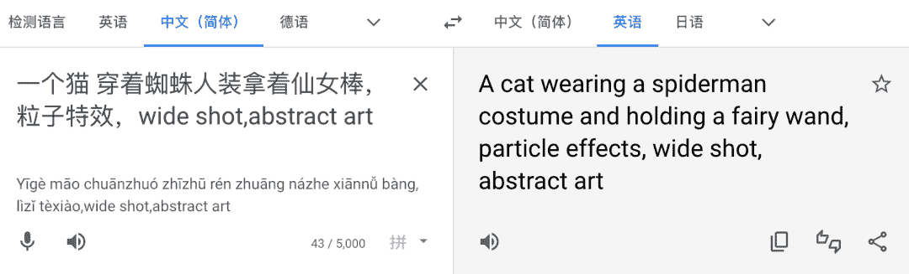
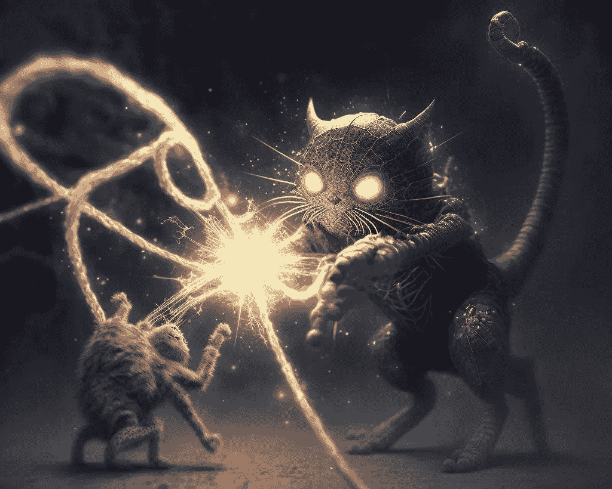

# 6个最有效的Midjourney AI精准出图技巧

> 来源：[https://geekbang.feishu.cn/docx/PHVidBFQioedWexzWvYcjumunie](https://geekbang.feishu.cn/docx/PHVidBFQioedWexzWvYcjumunie)

> 👨 作者： Clippp

> 📃 作者介绍：优设专栏作家｜UI中国推荐设计师｜woshipm年度创作者｜👸号「Clip设计夹」主理人，每周定期分享关于AIGC、B端设计、UI交互上的设计思考。

> ⏰ 收录时间：2024-06-21 15:50:03 (UTC+8)

> 🔗 原文链接： h[ttps://mp.weixin.q](https://mp.weixin.qq.com/s?__biz=MzI5Nzc3MzkyNw==&mid=2247491585&idx=1&sn=c3d8c2ae919ef20be329dad7fc62f16b&chksm=ecad5e09dbdad71fc356794f17c60daa33cf302a1cb45bf7f0ffb70e8a65e35a48459a25250a&scene=178&cur_album_id=2999481860428840964#rd)q.com/s?__biz=Mz...

关注作者👸号，获取更多AI知识

**Halo ，这里是设**计夹 ， 今天分享的是 「AI出图技巧 」 。

**AI生成的**作品虽视觉效果很棒，但容易出现每个人都会遇到的 痛点问题 ：脑海里预想的效果和AI生成出来的往往落差很大，而且反复重新生成好多次仍达不到想要的效果。

这是一套官方通用的描述模板，不一定每个类型都会设定，但 输入顺序 大概是这样： 「主体、情境、道具、气氛、风格、艺术家名字、色彩、光照、特效、精致度、镜头焦段、渲染引擎、参考网站、指令」

面对这么长的描述模板，很容易把用户劝退。

** 那怎**么才能用尽可能少的描述，让 A**I 知**道你想要什么呢？ 这里总结 6个 用在Midjourney AI出图上最有效的技巧！

##   **使用肯定描述**

Midjourney目前不是特别懂否定的描述词，尽量不要用 not、but、except、without 等否定词，失败率会变高。

因为描述词里有提到的某个关键词时，AI就很可能画出来，忽略否定的逻辑关系。

例如想生成猫的图片，避免用「not black cat」，改用 「pink cat」 。

例如想生成一个看起来像兔子的猫，避免用「a cat but looks like a rabbit」，改用 「a cat like a rabbit」 ，会更精准。

##   **清楚说明你想要什么**

对比抽象的描述词，尽量具体地描述图像。抽象的描述词会让画面超出预期 很难控制 ，越具象越精准。

比较抽象的词包括： 期待、梦、实用、概念、意义、想像、经验、记忆、论点、叙述、友情、使命、压力、人生、智慧…

例如想生成猫咪开会的图片，我们想要的场景肯定是一群在开会的猫，而不是人们在开会的时候会议室里有只猫，因此避免用「cat in meeting」，改用 「3 cats chatting」 。

##   **太细碎的细节可能无法精准表达**

AI不一定了解「事物之间的关系」，所以可以试着重复描述词、更改描述词的顺序、重复元素或添加更多细节。但细节太多AI会更容易混淆。

例如想生成一群猫跳舞的场景，避免用「3 black cats in tutus dance around the altar on the top floor of a sun-baked building to pray for rain」，改用 「3 black cats in tutus dancing on the top floor」 。

##   **尽量使用特定数量**

之前提到描述越具体越好，用具体的数字指明数量也比用「many」更好。

例如避免用「many cats」，改用 「8 cats playing together」 。

有兴趣的可以亲自试试输入「cat mountain cat sea」，看看是否是你想要的那种「猫山猫海」的效果hh。

##   **避免延伸联想的概念**

使用AI生成图片时，经常遇到的一个情况是不是图片生成不出来，而是生成的图总觉得少了点东西，没有达到预想的感觉。

这个时候需要检查自己写的描述词是否要 延伸联想 。因为不管输入什么关键词，Midjourney都能出图，但生成的图像是不是和自己想要一样是两回事。

例如避免用「Alien Cultures in the Multiverse」，改用 「Sci-fi Alien Workstation」 。

##   **活用翻译软件**

英文不好没关系，可以 用翻译软件 输入中文、复制英文贴到Midjourney里。

输入描述词时，不用过度考虑描述词的 语法问题 ，因为AI更关注描述词的内容，而非描述词的语法问题。

**最后**

**以上6个小技巧，肯定能**帮助你在描述 「主体、情境、道具」 等关键词时，让AI更精准Get到你的想法！