# Midjourney直接生成UI界面！AI设计体验指南

> 来源：[https://geekbang.feishu.cn/docx/NliddVgyXoIjNXxqH3ucIV7RnKy](https://geekbang.feishu.cn/docx/NliddVgyXoIjNXxqH3ucIV7RnKy)

> 👨 作者： Clippp

> 📃 作者介绍：优设专栏作家｜UI中国推荐设计师｜woshipm年度创作者｜👸号「Clip设计夹」主理人，每周定期分享关于AIGC、B端设计、UI交互上的设计思考。

> ⏰ 收录时间：2024-06-21 15:52:43 (UTC+8)

> 🔗 原文链接： h[ttps://mp.weixin.q](https://mp.weixin.qq.com/s?__biz=MzI5Nzc3MzkyNw==&mid=2247491419&idx=1&sn=02f2d4e90bd7a71246e60ae40b24e558&chksm=ecaea153dbd92845a2c8d8e25c6f030f66f50d95dda7d762a8deffbf5c71b733efda1a3c0d2f&scene=178&cur_album_id=2999481860428840964#rd)q.com/s?__biz=Mz...

关注作者👸号，获取更多AI知识

Halo ，这里是设计夹 ， 今天为大家分享的是 「AI工具Midjourney 」 。

目前国内外有很多热门的AI绘图工具，其中Midjourney是目前我觉得 最容易上手 的工具，对于完全不懂AI绘图、想试试看的新手来说，是很不错的入门选择。

而且 现阶段的 AI 已经能辅助进行设计，视觉效果相当吸睛。

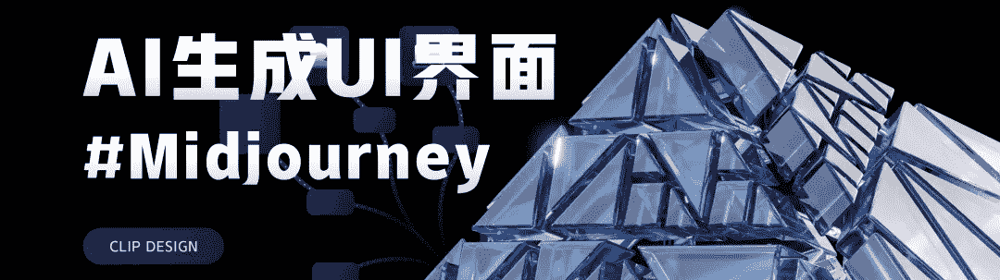

那么UI/UX设计师能用Midjourney加快哪些设计流程呢？我们一起来通过具体的实操，从 主体、配色、风格 等方向探索AI在设计中的应用！

##  AI **设计指令**

Midjourney中没有固定的Prompt(指令)来生成某种APP，具体想要什么样的效果要多多尝试。

如果没想好要输入哪些指令，可以先用这个指令模板：

「ui design for [类型] application, mobile app, iPhone, iOS, Apple Design Award, screenshot, single screen, high resolution, dribbble」

把里面的「类型」替换成你想设计的产品的关键词描述(英文)，就能生成想要的UI设计图。来看看几个示例~

**出行类**

关键词：「距离、车费、费用结算、优惠金额、地图」等。

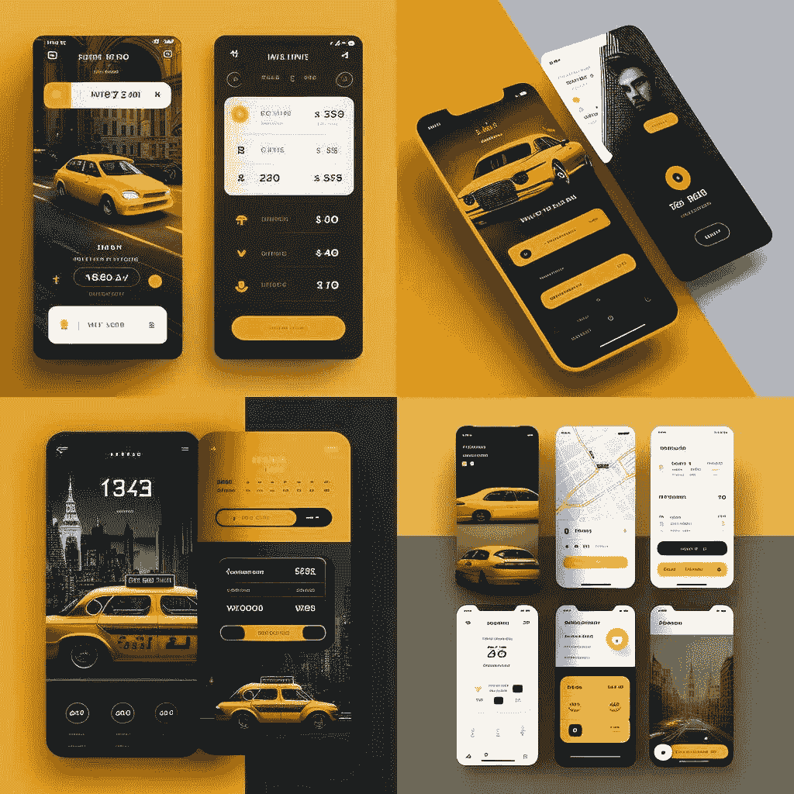

**餐饮类**

关键词：「介绍咖啡的特色、口味、咖啡豆产地、价格」等。

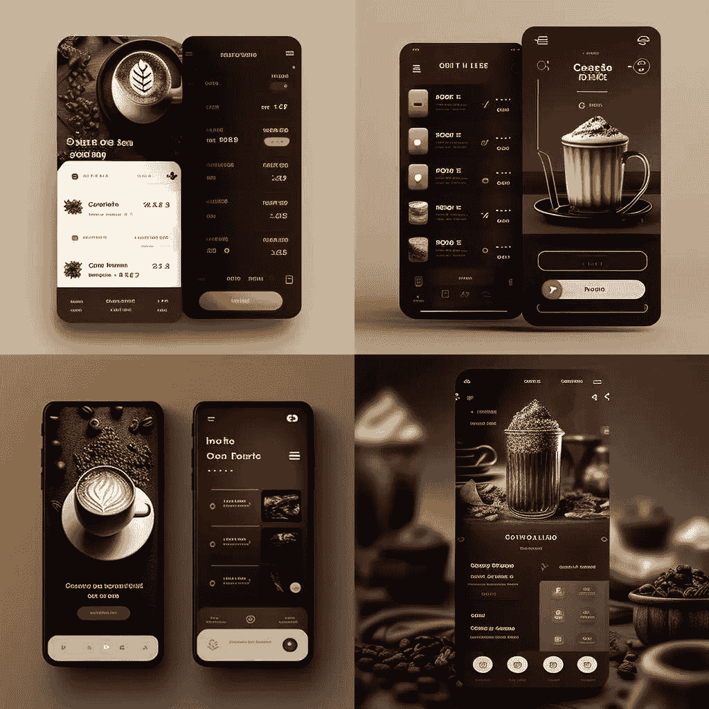

**运动类**

关键词：「卡路里、步数、距离、某种运动」等描述。

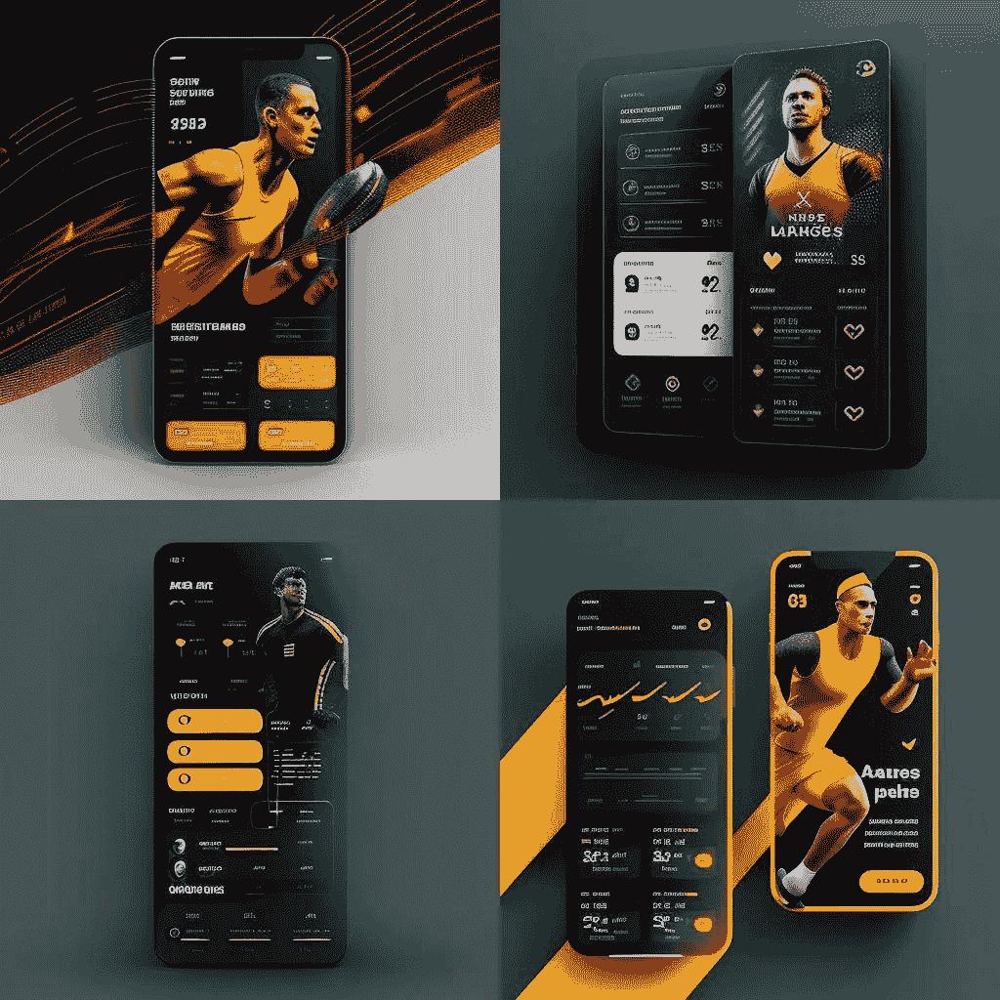

##   主体物指令

确定了产品类型后，如果还想更进一步突显产品的特色，可以在指令中加入 主体描述 来加强图片生成的效果。

例如一个 生鲜类 APP想突显蔬果很新鲜，可以加上更多相关的关键词描述，例如「水果、蔬菜、新鲜」等，生成的图片看起来就会特别新鲜。

电商类 产品加上「模特实拍、商品列表、尺寸」等描述，就能得到一个常见的商品详情页设计图。

##   配色指令

确定了APP类型和主体描述之后，还可以继续定制想要的主题色，配色方案可以试试这个指令： 「xxx color scheme」 。

**餐饮类**

关键词： 「beach style color」 ，就能生成一个沙滩风饮料订购页面，设计风格也很有意思。

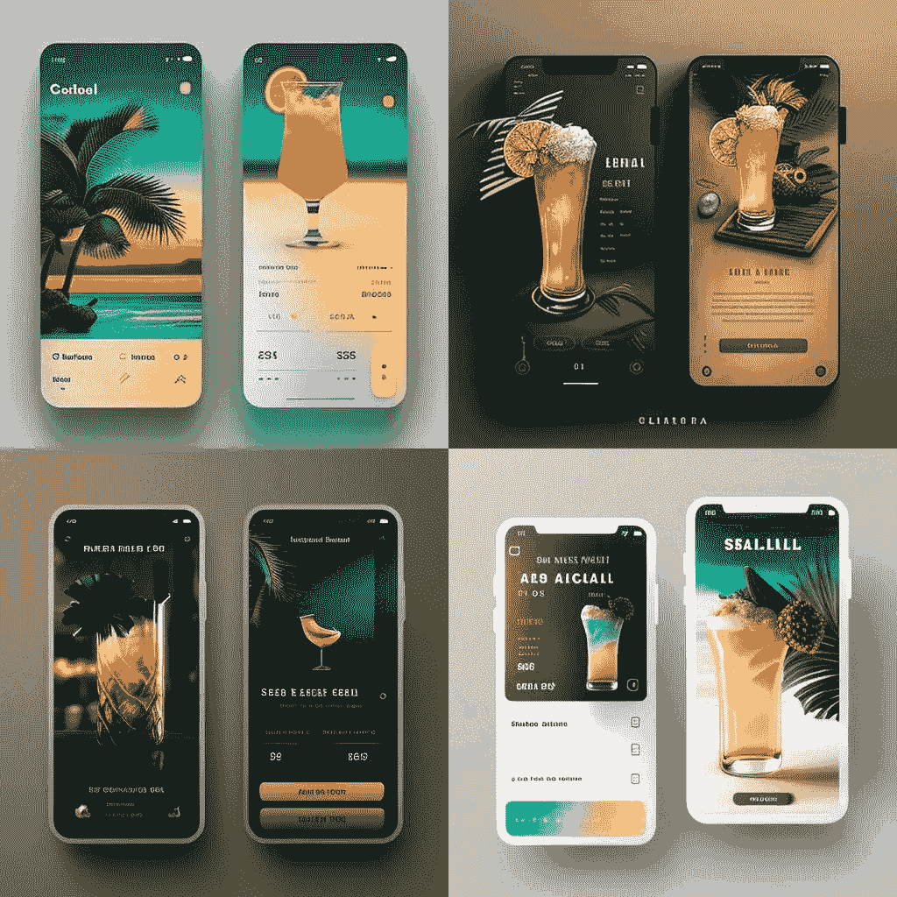

**快递类**

关键词：输入 「Forest」 指令，生成的图片会长很多树，有一种亲近自然的感觉。

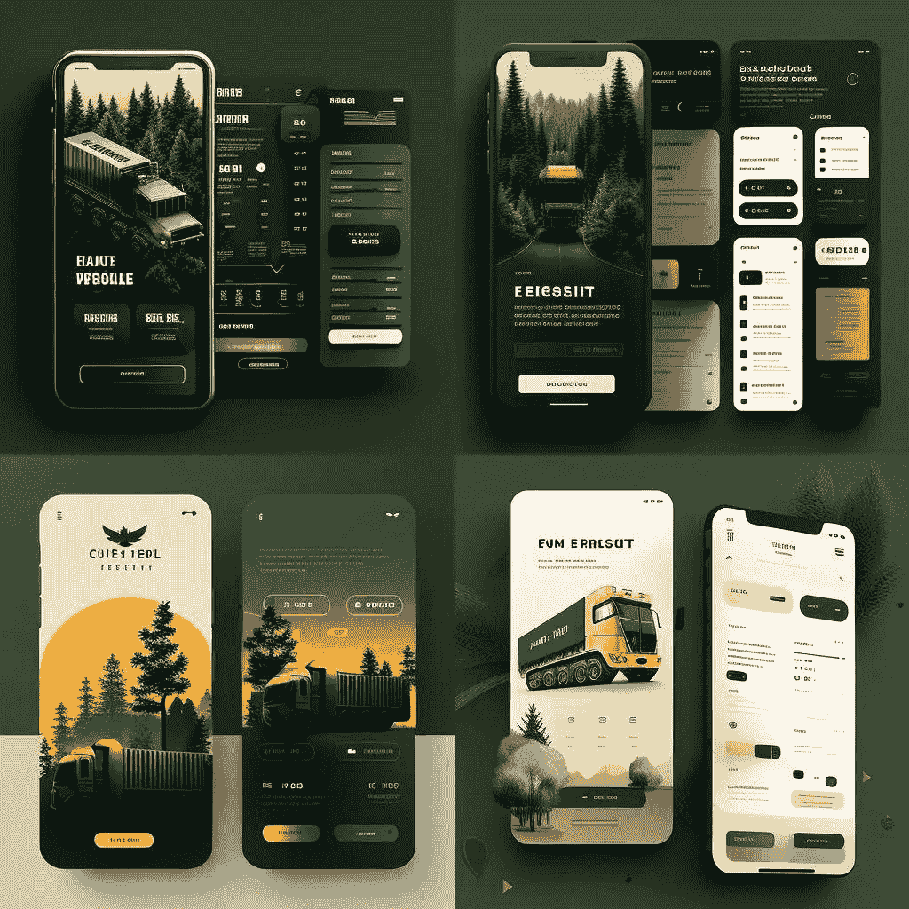

**生活服务类**

关键词： 「glacier color scheme」 ,可以得到一个很有氛围感的订房界面。

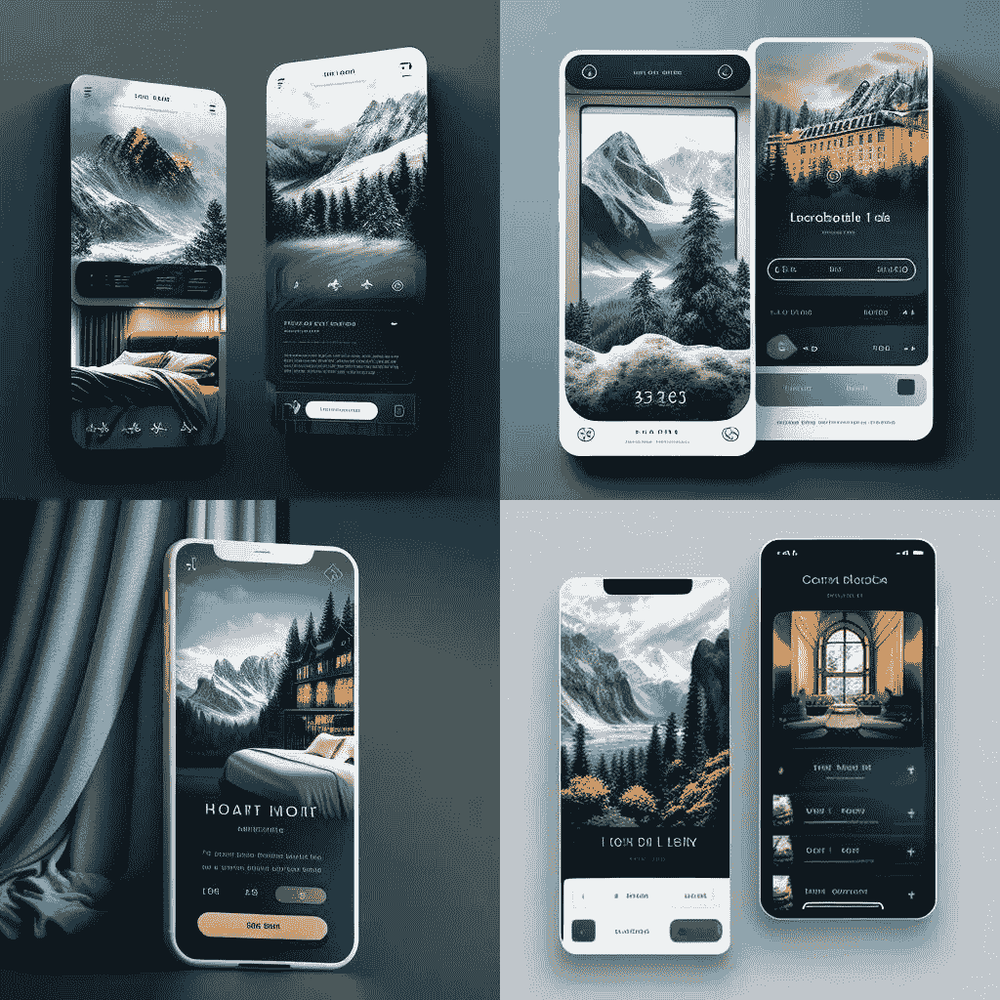

##   风格指令

如果只依靠输入配色指令无法满足你的要求，还可以指定某种艺术风格，甚至艺术家、设计师、插画家的名字。

**天气类**

关键词： 「Pop art」 ，一个色彩鲜艳配色大胆图案抢眼的波普艺术风格的天气APP就生成了。

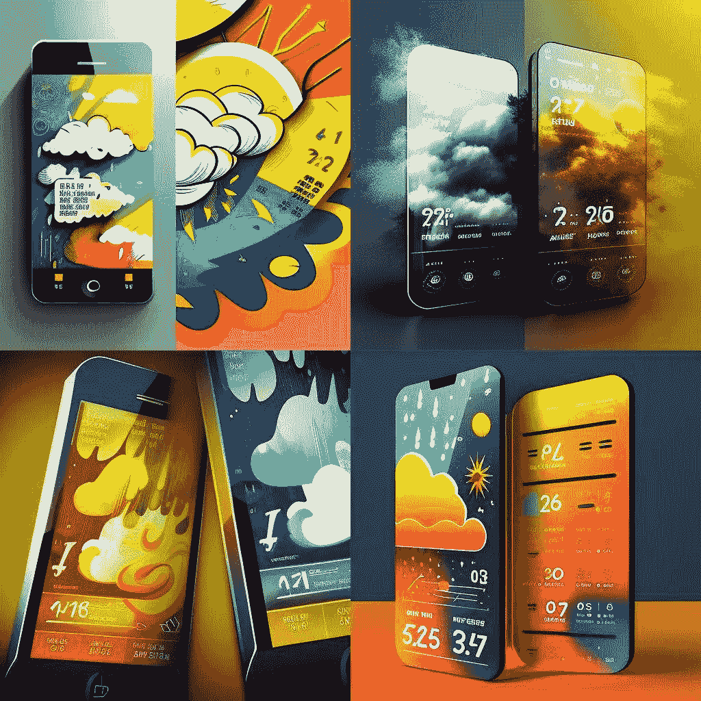

**社交类**

例如一个聊天类软件，输入关键词 「K-pop fashion」 ，生成一个时尚流行的页面效果。

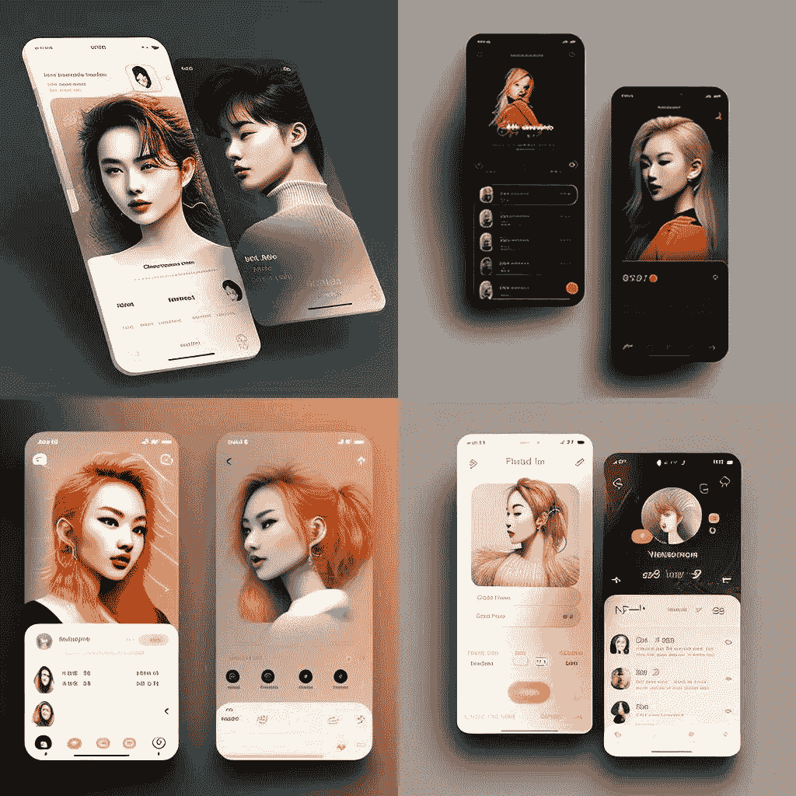

输入 「by Van Gogh」 ，就能得到一个带有梵高作品的UI页面。

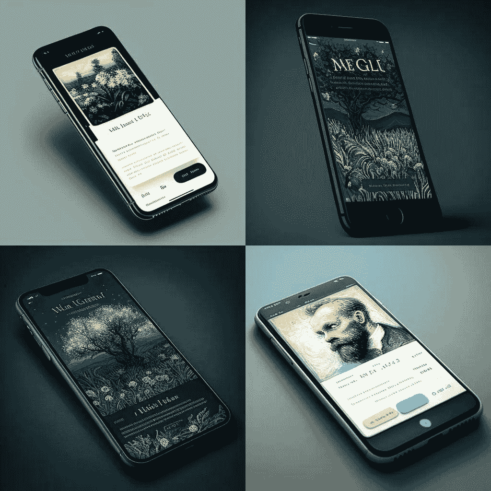

##   页面指令

如果想指定AI生成某个页面(首页、登录页等)，只需要再加一段页面指令描述就可以，例如「landing page、Profile Page」。

**社交平台**

关键词： 「landing page」 ，一个社交平台的登录页设计就出来了。

**信息类**

关键词： 「Profile Page」 ，生成人力资源类产品的个人资料页，里面包含照片、自我介绍、基本信息等内容。

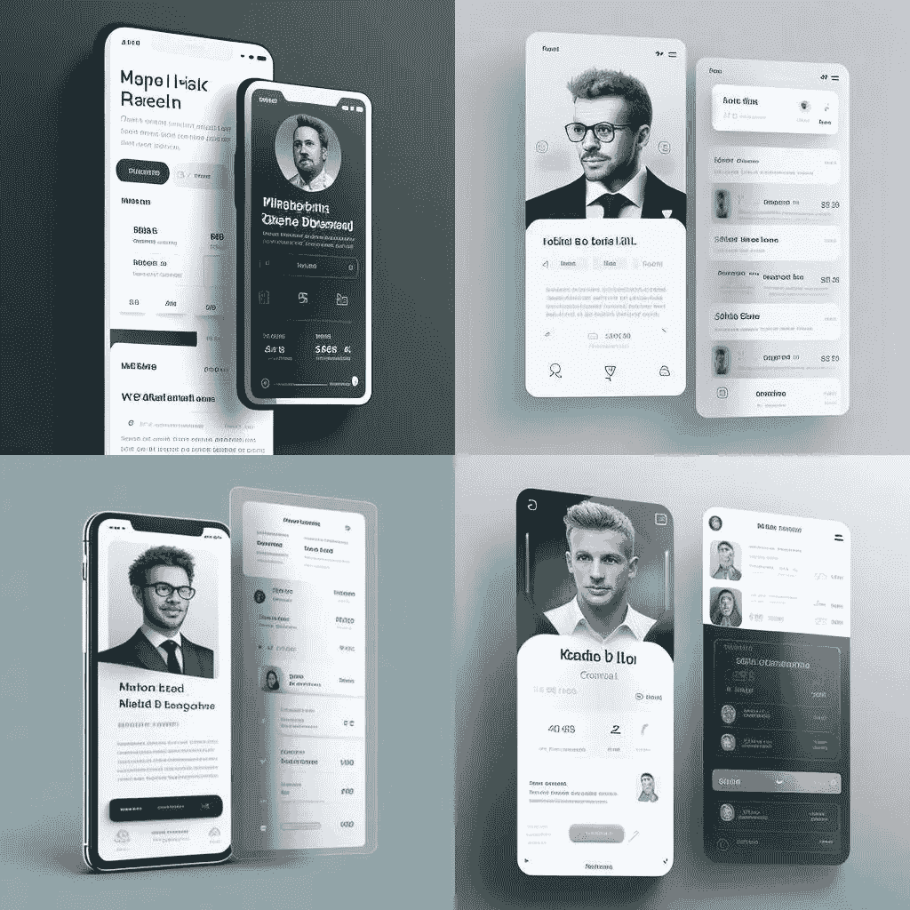

**最后**

通**过一系列的**AI出图操作能发现，Midjourney产出的设计图视觉效果都很不错，更适合在APP设计的 初始阶段 ，例如 头脑风暴和风格探索 等过程中，为设计师提供更多灵感和创意。

**如果想让Mid**journey产出的UI设计图直接落地开发，目前来看 仍有一段距离 ，但按照AI现在的技术迭代速度，这个距离应该也不会太远…