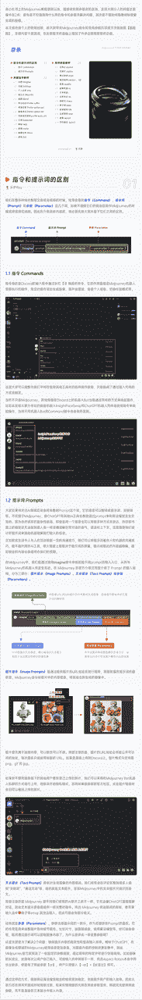
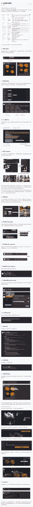
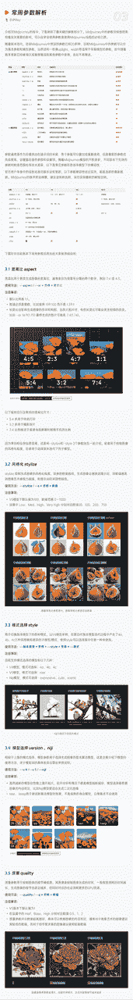
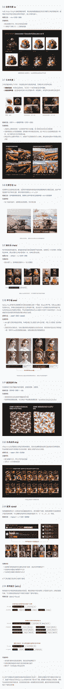

# Midjourney学习指南【基础篇】

> 来源：[https://geekbang.feishu.cn/docx/Thq8dT0AZoajWNx4nrtchO5Rnfe](https://geekbang.feishu.cn/docx/Thq8dT0AZoajWNx4nrtchO5Rnfe)

> 👨 作者： 乐伊ROY

> 📃 作者介绍：👋🏻 体验设计师｜数字艺术探索者

> ⏰ 收录时间：2024-06-21 16:02:52 (UTC+8)

> 🔗 原文链接： h[ttps://www.zcool.c](https://www.zcool.com.cn/work/ZNjUzNjgzOTY=.html)om.cn/work/ZNjUz...

> 备注：如有侵权，联系删除！！🫰

本篇教程给大家带来Midjourney指令和常用参数的详细文字版教程，本期【基础篇】内容干货满满，包括了大量最近刚更新的功能介绍

