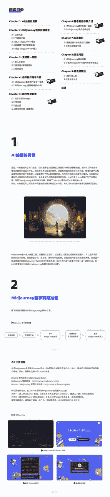
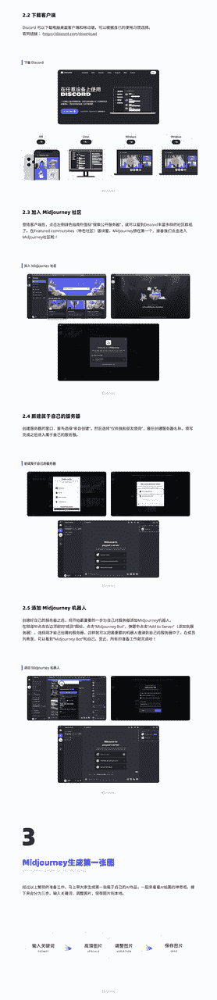
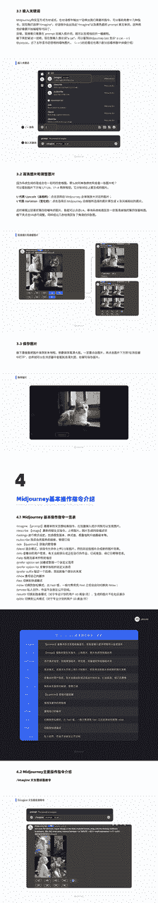
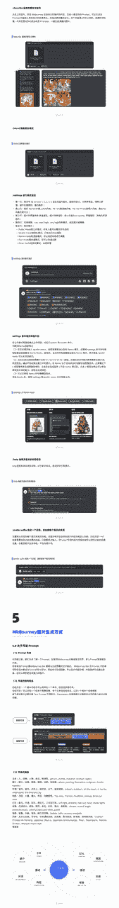
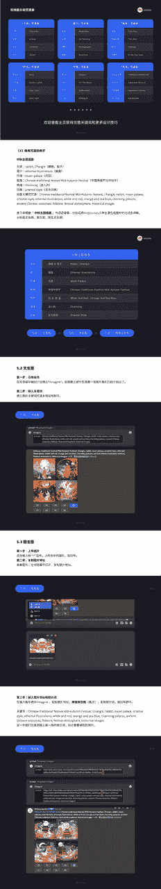
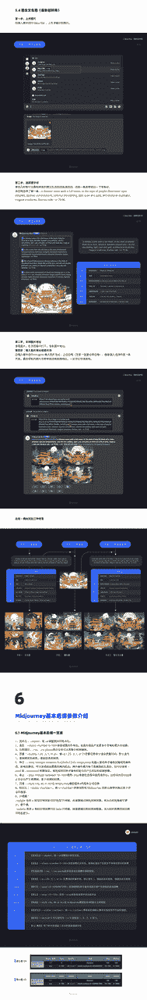
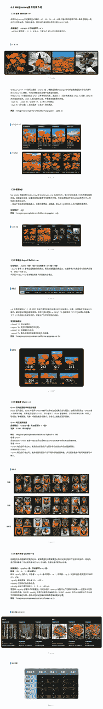
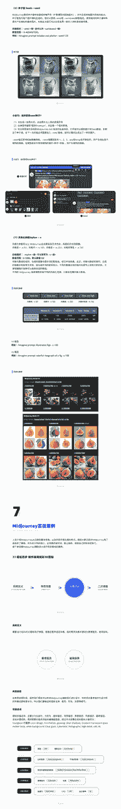
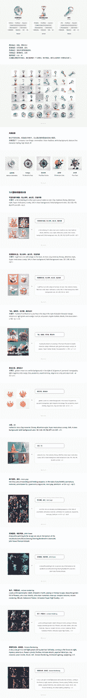
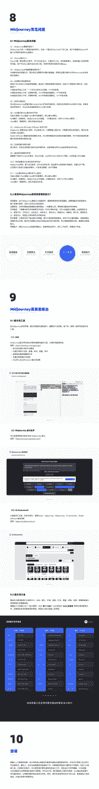

# Midjourney从零基础到落地实践

> 来源：[https://geekbang.feishu.cn/docx/XDfFd4YBGo4RfrxUicQcaLuAn9e](https://geekbang.feishu.cn/docx/XDfFd4YBGo4RfrxUicQcaLuAn9e)

> 👨 作者： yaoyao设计师

> 📃 作者介绍：UX设计师

> 🔗 原文链接： h[ttps://www.zcool.c](https://www.zcool.com.cn/work/ZNjUxNDUyMTY=.html)om.cn/work/ZNjUx...

> ⏰ 收录时间：2024-06-21 16:57:36 (UTC+8)

> 备注：如有侵权，联系删除！！🫰

从注册登录到基本的操作界面，提示词组成后缀介绍，到主流的生成图片的方式，以及最重要的提示词咒语分享，还有一些我的使用心得，希望对大家有帮助！

