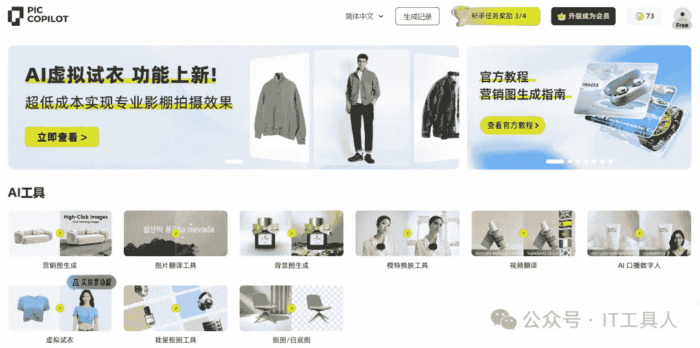
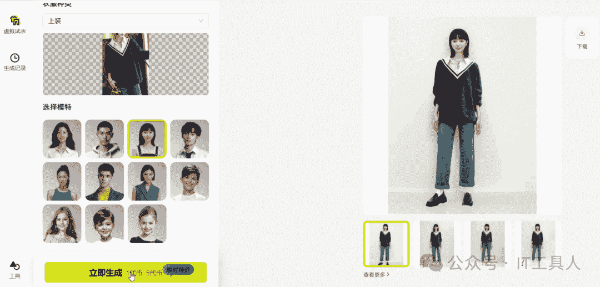
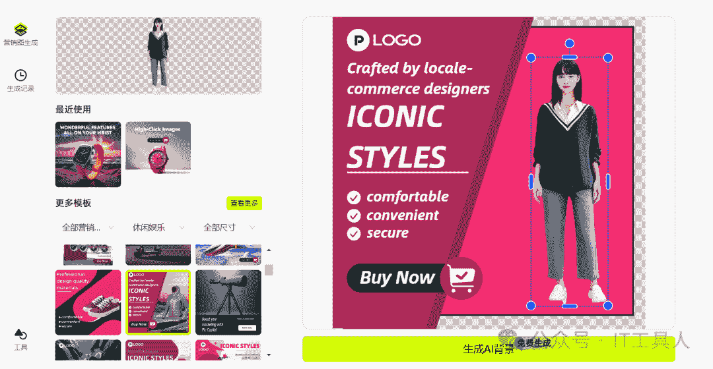
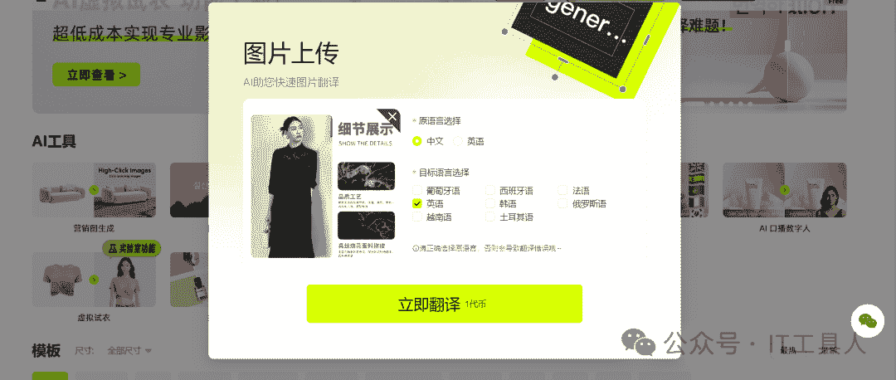
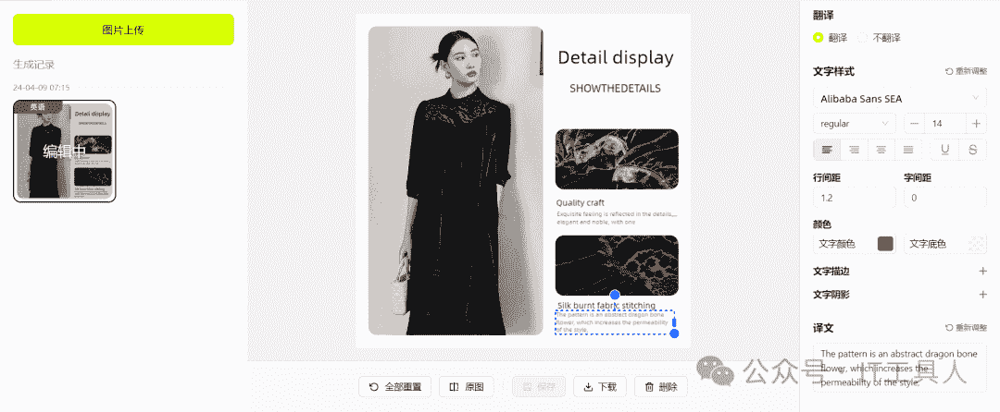
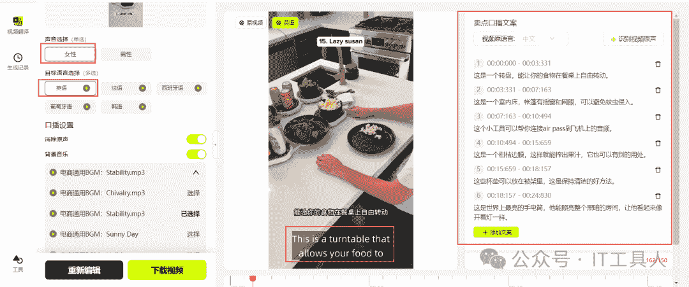
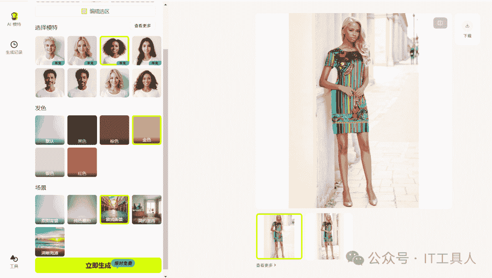
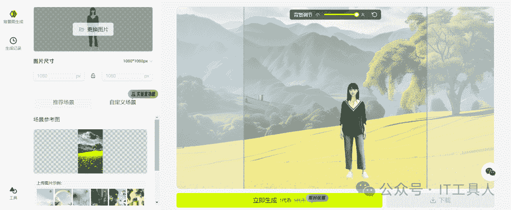
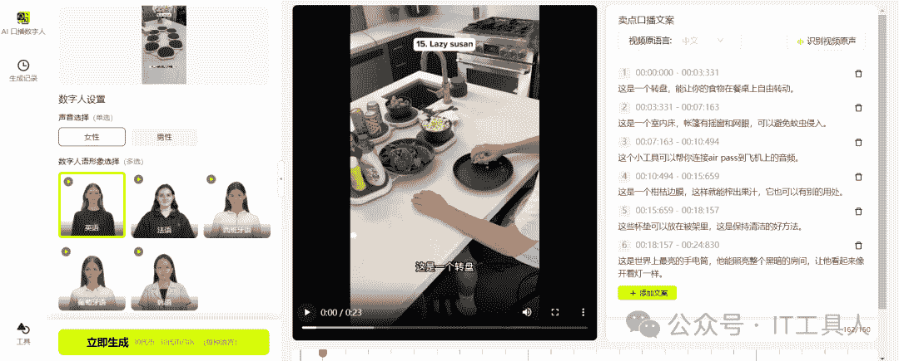
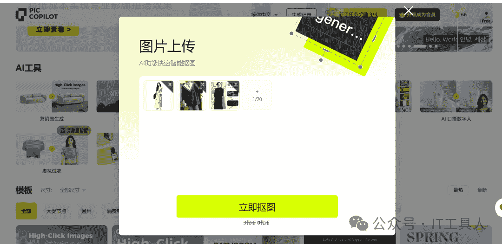

# 【Pic Copilot 】这个强大的AI作图神器有虚拟试衣功能了，学会了准备抢美工的饭碗

> 来源：[https://geekbang.feishu.cn/docx/Ku7Ad2o01ofDc1xMLbocaFjknof](https://geekbang.feishu.cn/docx/Ku7Ad2o01ofDc1xMLbocaFjknof)

> 🤵作者： IT工具人

> 📃 作者介绍：14年互联网IT从业经验，做过程序员，现任AI产品经理。发现并分享能提升做事效率的工具，让创业或副业变得更简单。

> ⏰ 收录时间：2024-05-31 14:19:51 (UTC+8)

> 🔗 原文链接：  h[ttps://mp.weixin.q](https://mp.weixin.qq.com/s/y5l3DOxs4Mx6QLlMs9qWFw)q.com/s/y5l3DOxs...

欢迎关注公众号👆

“AI不会取代人，但会淘汰不会AI的人”，越来越有道理了。

今天要介绍的这款神器 **Pic Copilot **是 **阿里 **打**造的，它是专门为电商而生的一款**AI作图工具，界面可以选择中文。虽然如此，但只要是日常的娱乐、做海报等涉及 修图、绘图等都可以用这个工具 ，非常好用。接下来以电商为主题体验该工具。

阿里可是电商界的大佬，对电商了如指掌，不止擅长电商营销视觉，还有超大的商品信息库，所以在电商这块，这款AI作图工具可是比其他作图工具强多了，不仅能做出高质量的营销图，用它做图还能提高商品点击率。

那么它有哪些功能呢？跟我一起去体验吧。

1、 **AI虚拟试衣 **。这是工具近期推出的功能，可以把商品图“穿“在模特图身上，用这个功能**卖家可以省**去找模特**的时间**，超低成**本实现专业**影棚拍摄效果。操作方式很简单， 上传 商品 图 ，选择 模特 ，点击 立即生成 就可以了 ，目前支持上装、下装、上下装、单件连体。这个功能目前可以免费试用50次。

2、 **生成营销图 **。生成电商产品的营销图（主图），当你有少量的电商店铺时，是不会招专业美工，而是在外面找兼职美工，一张20-50元。在这里你只要上传产品图片，然后选择模板（240多个模板），修改产品的详情以及商品logo ，点击生成AI背景，就可以搞定了。

用这个生成主图，没有侵权风险，价格也便宜，一张还不到0.8元，而且生成之后有预览图(有水印)，预览满意之后再下载原图，这时才会扣代币，如果不下载就不会扣。

3、 **图片翻译 **。这个工具是为跨境电商准备的，所以翻译是必不可少。翻译图片上的文字，这个功能我在前面的公众号文章有推荐过一款免费的翻译工具，感兴趣的朋友可以看看。

阿里的这个图片翻译比较厉害，翻译可以选择多种语言，包括葡萄牙语、西班牙语、法语、英语、韩语、俄罗斯语、越南语、土耳其语。翻译之后如果对翻译内容不满意，可以修改字体颜色、大小、内容，也可以移动翻译后的文字，而这些操作就像编辑文档一样简单。

翻译前：

翻译后：

4 、 **视频翻译 **。这个就厉害了，国内的视频用这个翻译之后就可以搬到tiktok、油管等平台。操作方式也是简单，上传待翻译视频（目前仅支持2分钟以内的视频），可以改变声音，消除原声，选择其他电商的背景音乐，也可以编辑口播文案内容，简直不要太方便了，又是一个跨境搬视频的神器啊。

5、 **模特换肤 **。模特是黄皮肤的商品主图直接传到跨境电商平台，可能会因为审美问题造成图片点击率效果较差，所以可以用这个功能。上传商品图之后，选择模特、发色和场景，点击立即生成就可以了，这个功能目前是免费的，也很好用。

改前改后对比：

6、 **背景图生成 **。这个功能可以更换商品的背景图，定制图片尺寸、采用推荐场景、自定义场景（选择自己的图片做背景）。这功能也不仅仅在电商可用，其他的P图需求也是可以满足。

7、 **AI 口播数字人 **。跨境短视频带货的时候，加一个AI口播数字人，这个短视频的效果是不是好了很多。那么这个功能刚好是你需要的，短视频做好之后，上传到平台，选择男性或女性声音、数字人语形象，消除原声，替换背景音乐，也可以修改口播内容，最后点击立即生成就可以看到视频中有数字人在口播。

8、 **抠图 **。AI抠图功能几乎是各AI绘图软件标配了，这工具的特点是可以批量抠图，一次可以处理20张，而且速度非常快，2秒就搞定了。

**写在最后 **，体验下来，发现这个工具是很不错，生成的结果很稳定，不像其他AI工具，可能需要多次生成，而且每次生成效果不稳定。专业美工用这个工具 ，可以提高生产效率， 原来1个小时作图，现在只要两三分钟就可以完成 ，而且有作图经验的人做起来会很顺手。