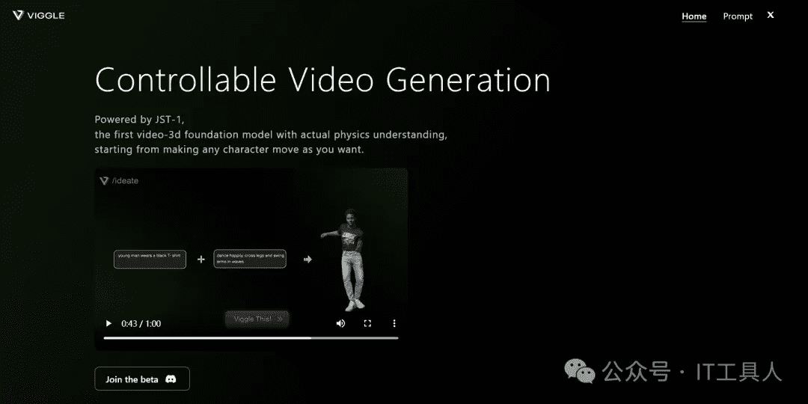
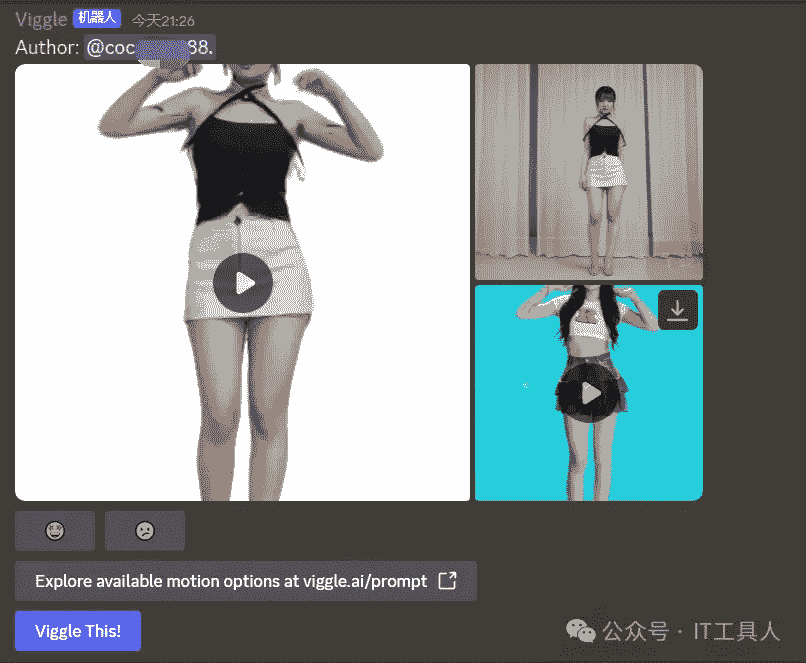
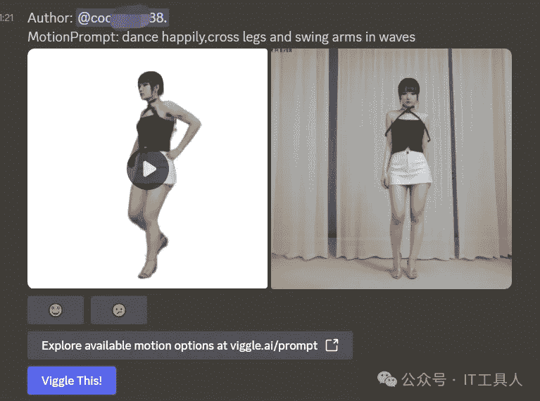
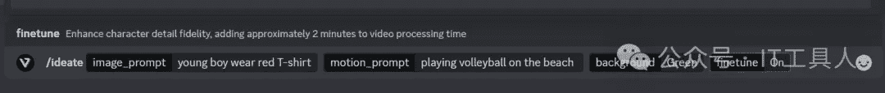
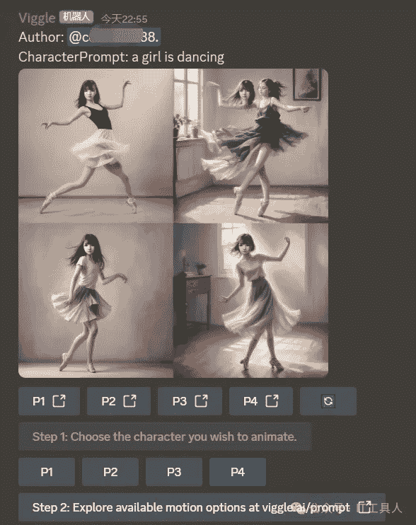

# 【Viggle】太震撼了，用这个免费的AI工具可以生成一条100%原创短视频

> 来源：[https://geekbang.feishu.cn/docx/I5BcdWR1IomVf2x6tQocin0Cnbb](https://geekbang.feishu.cn/docx/I5BcdWR1IomVf2x6tQocin0Cnbb)

> 🤵作者： IT工具人

> 📃 作者介绍：14年互联网IT从业经验，做过程序员，现任AI产品经理。发现并分享能提升做事效率的工具，让创业或副业变得更简单。

> ⏰ 收录时间：2024-05-30 18:04:59 (UTC+8)

> 🔗 原文链接：  h[ttps://mp.weixin.q](https://mp.weixin.qq.com/s/PQqdPFxCLRUbu8AA2Ji8Fg)q.com/s/PQqdPFxC...

欢迎关注公众号👆

今天介绍这款AI有点料，是可以生成可控视频，能够替换任何视频的角色 。这么描述可能不是很清晰，可以看下面这个视频。当我们想跟风拍某一条短视频，把里面的角色和背景替换一下就可以生成属于自己的短视频，根本不用动手拍摄就可以生成一条原创短视频。

[🎦 点击观看视频](https://mpvideo.qpic.cn/0bc3x4aakaaal4apdwpwvzsvbp6daw7qabia.f10002.mp4?dis_k=8acc0a71d4af00a3aa1d60470e20f7ef&dis_t=1717063489&play_scene=10120&auth_info=IuSQrYgISitl47S/wAonOTI/TjEeBH85E1tbI3VhEj8fDjpcMwQXRAc7OBY2KDADOA==&auth_key=38681733bb7b33eedfed0b82091a75fc&vid=wxv_3373748643765207054&format_id=10002&support_redirect=0&mmversion=false)

图片+视频生成视频

我们体验过通义千问的“全民舞王”，在前面文章也写过这个功能体验，这个功能很好玩，传一张人物照片以及选择一个模板（如蒙古舞、鬼步舞等）就可以生成该人物跳相应舞的视频。当时很多人意识到视频还可以这么玩，所以再出现视频中的角色替换已经不奇怪了，这项技术的应用只是时间的问题了。

[🎦 点击观看视频](https://mpvideo.qpic.cn/0bc3liab2aaaz4amvye3hzsvawwddvnaahia.f10002.mp4?dis_k=a3239d0780cf37f394112529b83f7d93&dis_t=1717063489&play_scene=10120&auth_info=cJDQycYKTHdh4bS8xw0nYWc/GzUbAnFrTloNciY9R2ZNX2pVNgMRGAM5OBUxLzBbbQ==&auth_key=8475814624c1666e2062de30dd7d40ea&vid=wxv_3273567272086847488&format_id=10002&support_redirect=0&mmversion=false)

这是用梅西的照片生成鬼舞步

接下来我们来看看Viggle的功能，以及功能体验。 Viggle是在线生成工具，需要在Discord中使用，采用命令行模式，如果还不会用的铁子们可以留言，这个在M i djourne y也要用到 ，所以建议学习一下 。

1、 **人物融合到视频 **。上传一张人物图片和一个视频，选择背景是白色或者绿色（ 建议使用绿色，可以用剪映生成背景 ），finetune（微调）参数是否开启，然后回车就可以了。这里的视频可以认为是模板，所生成的视频是人物图片将替换视频中的人物，视频中的人物动作是一致。如下图，左边是生成的视频，右边上面是人物图片，右边下面是参考视频。

生成视频与原视频对比如下：(建议人物图片采用全身照，不然效果会很差。)

[🎦 点击观看视频](https://mpvideo.qpic.cn/0b2eimabaaaah4aba5xxkrsvaq6dcbbqaeaa.f10002.mp4?dis_k=7ac5a8c5b0fcdb211f6603c8059cc3d0&dis_t=1717063489&play_scene=10120&auth_info=IqaMxNpeTi1h5LHrklklaTU4HDcdU3A5Q1AIJnFgRDAfDmwNalATQgM8PUJkezJTPw==&auth_key=177628720bae46af382f6673e5dc5e75&vid=wxv_3373798509191151622&format_id=10002&support_redirect=0&mmversion=false)

视频详情

2、 **让照片动起来 **。这是根据图片+提示词生成视频，与“4秒”时代的AI生成视频工具类似。这功能也挺好玩的，不过目前还不够完善，个别帧有重影的情况。

提示词： dance happily ,cross legs and swing arms in waves

3、 **文本生成视频 **。根据文本生成视频，与其他工具不同的是，Viggle是把人物描述和人物动作描述分开，即需要写人物特征的提示词和视频动作的提示词。

4、 **图片变换风格再生成视频 **。这与照片生成视频类似，不同的是可以给照片写提示词，让照片中的人物先生成另外一种风格，再以这种风格生成视频。（这个目前没看到视频动作的提示词，可能还没开放，因此只能体验图片人物风格变换功能）。

总结一下，这个 工具目前 生成速度很快，可能是因为体验的人还很少所以生成比较快，而且 完全免费，就像Midjourney刚出来一样，这也意味着它的部分功能还不成熟，因此生成时可以多生成几次，或者权当是娱乐了。我想这个工具更新速度也会比较快，建议持续关注，它的技术是一种趋势。

写在最后，抛一个问题大家一起思考， 这技术成熟之后，还怎么保护首次创作者，这也是未来会面临的问题，应该有技术或者相应的方案支持首次创作者，这样才能有好的内容不断出现。

Viggle体验地址： https://viggle.ai/。